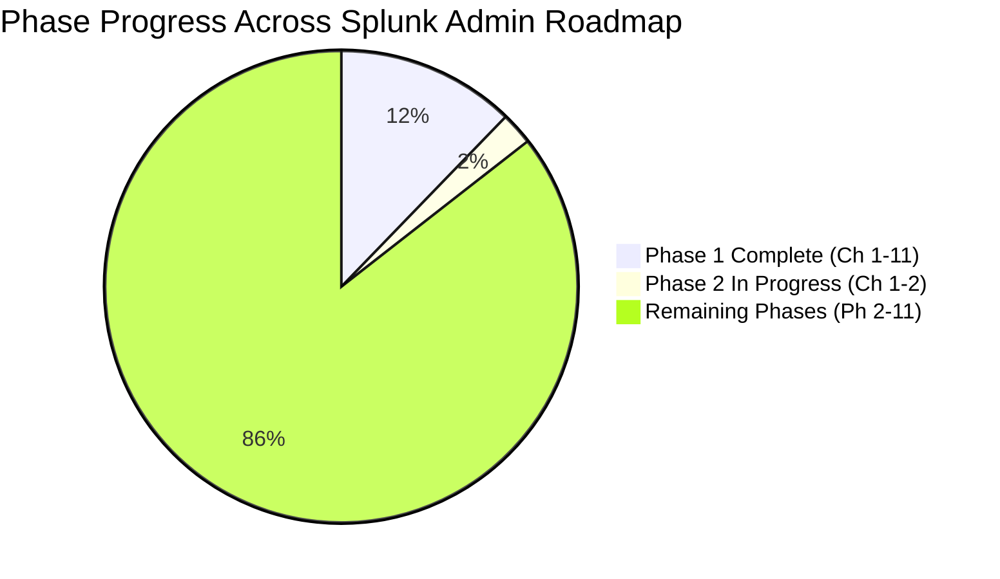

# 📊 Splunk Administrator Progress & Mastery Tracker

> **Candidate:** Aspiring Enterprise Splunk Administrator  
> **Start Date:** Day 1  
> **Pacing:** Step-by-Step Textbook Mastery + Hands-on Labs + End-of-Chapter Quizzes

---

## 📈 Phase Completion Overview

| Phase | Description | Target Days | Status | Average Quiz Score | Weak Areas Identified |
| :--- | :--- | :--- | :--- | :---: | :--- |
| **Phase 1** | Splunk Fundamentals & Architecture | Days 1–7 | 🟢 **COMPLETED** | **9.6 / 10** (Quizzes) **PDF Handbook Generated** 📄 | All gaps reviewed & documented |
| **Phase 2** | Enterprise Installation & Topology Setup | Days 8–15 | 🟡 **IN PROGRESS** | **9.8 / 10** (Ch 01–02) | None (Mastered Linux tuning & production installation) |
| **Phase 3** | Deep Data Onboarding & Parsing Pipeline | Days 16–28 | ⚪ Not Started | - | - |
| **Phase 4** | Advanced SPL & Search Optimization | Days 29–38 | ⚪ Not Started | - | - |
| **Phase 5** | Authentication, RBAC & Security Admin | Days 39–46 | ⚪ Not Started | - | - |
| **Phase 6** | Centralized Deployment Management | Days 47–53 | ⚪ Not Started | - | - |
| **Phase 7** | Distributed Splunk & High-Availability | Days 54–66 | ⚪ Not Started | - | - |
| **Phase 8** | Monitoring Console & Performance Tuning | Days 67–73 | ⚪ Not Started | - | - |
| **Phase 9** | Enterprise Troubleshooting Runbooks | Days 74–80 | ⚪ Not Started | - | - |
| **Phase 10** | Enterprise Operations & Runbooks | Days 81–85 | ⚪ Not Started | - | - |
| **Phase 11** | Mock Interviews & Scenario Drills | Days 86–90 | ⚪ Not Started | - | - |

---

## 📝 Daily Lesson & Chapter Quiz Evaluation Matrix

| Chapter / Day | Topic | Lab Status | Quiz Score (/10) | Evaluation & Feedback | Date Completed |
| :---: | :--- | :---: | :---: | :--- | :---: |
| **Ph1 Ch 01** | What is Splunk & Machine Data | 🟢 Completed | **10 / 10** | Perfect grasp of Schema-on-Read, 5 metadata keys, and unstructured data challenges. | 2026-08-25 |
| **Ph1 Ch 02** | Splunk Architecture & Components | 🟢 Completed | **8.8 / 10** | Great grasp of UF vs HF and Management components. Refined License metering and Map-Reduce. | 2026-08-29 |
| **Ph1 Ch 03** | End-to-End Ingestion Pipeline | 🟢 Completed | **10 / 10** | Flawless mastery of 4 pipeline stages, queue backpressure propagation, and useACK reliability. | 2026-08-29 |
| **Ph1 Ch 04** | Directory Layout & Config Precedence | 🟢 Completed | **9.7 / 10** | Excellent grasp of S-A-A-S precedence hierarchy, default vs local rules, and btool CLI syntax. | 2026-08-29 |
| **Ph1 Ch 05** | Index Architecture & Bucket Lifecycle | 🟢 Completed | **9.6 / 10** | Mastered Hot->Warm->Cold->Frozen transitions, tsidx/journal files, and thawing rebuild steps. | 2026-08-30 |
| **Ph1 Ch 06** | Splunk Licensing Mechanics | 🟢 Completed | **10 / 10** | Perfect grasp of uncompressed metering, RF=3 free exemption, 5-warning violation rules, and license pools. | 2026-08-30 |
| **Ph1 Ch 07** | Network Ports & Firewall Matrix | 🟢 Completed | **9.1 / 10** | Solid grasp of port 9997, 9887, 8089 vs 8191 differentiation, and netcat probing syntax. | 2026-08-30 |
| **Ph1 Ch 10** | **Phase 1 Master Assessment Exam** | 🟢 Completed | **4.2 / 10** *(50.5/120)* | Comprehensive 12-question evaluation across Beginner, Production, and Scenario levels. | 2026-08-30 |
| **Ph2 Ch 01** | Hardware Sizing & Linux OS Tuning | 🟢 Completed | **9.6 / 10** | Mastered 1200 IOPS spec, THP disablement, XFS dynamic inodes, ulimits, and noatime mount. | 2026-08-31 |
| **Ph2 Ch 02** | Splunk Enterprise Linux Installation | 🟢 Completed | **10 / 10** | Flawless hands-on verification: non-root splunk user, systemd service, user-seed.conf, bashrc PATH. | 2026-09-02 |
| **Ph2 Ch 03** | Universal Forwarder (UF) Rollout | 🟢 Completed | **9.8 / 10** | Mastered S2S protocol on port 9997, outputs.conf, useACK=true reliability, and UF CLI commands. | 2026-09-05 |
| **Ph2 Ch 04** | Heavy Forwarder (HF) Architecture | 🟢 Completed | **9.7 / 10** | Mastered in-memory parsing, PII regex masking, _TCP_ROUTING, and index=false safeguard. | 2026-09-12 |
| **Ph2 Ch 05** | License Manager & Slave Pairing | 🟢 Completed | **9.9 / 10** | Mastered central License Master/Slave setup, port 8089 pairing, server.conf, and 72-hour grace period.  🎮 *[Cyber Range Room 02: License Vault Heist](../Labs/Room_02_License_Vault_Heist_and_72Hr_Survival.md)* | 2026-09-12 |
| **Ph2 Ch 06** | Monitoring Console (MC) Setup | 🟢 Completed | **9.8 / 10** | Flawless grasp of DMC history, Standalone vs Distributed mode, port 8089 HTTPS pairing, dedicated MC sizing in high-volume tiers, and indexQueue IOPS bottlenecks.  🎮 *[Cyber Range Room 03: MC Queue Jam Triage](../Labs/Room_03_Monitoring_Console_Mission_Control.md)* | 2026-09-19 |
| **Ph2 Ch 07** | HTTP Event Collector (HEC) Setup | 🟡 Assigned | ⏳ Pending Study | Next topic: Token generation, JSON payloads, curl testing, SSL certificates, index routing, and HEC indexer acknowledgements. | - |

---

## 🎯 Continuous Improvement Log & Action Items

| Date | Topic Area | Identified Knowledge Gap | Action Item / Remediation Lab | Status |
| :---: | :--- | :--- | :--- | :---: |
| 2026-08-25 | Ch 01: Machine Data & Schema-on-Read | None. Strong conceptual foundation. | Ready to advance to Chapter 02. | ✅ Verified |
| 2026-08-29 | Ch 02: License Accounting & Map-Reduce | Clarified that UFs, SHs, and Cluster Replicated copies are 100% free from licensing. Reviewed Map vs Reduce search roles. | Reviewed in feedback. Ready for Chapter 03. | ✅ Resolved |
| 2026-08-29 | Ch 03: Ingestion Pipeline & Queues | None. Flawless grasp of pipeline sequence, queues, and ACK. | Ready to advance to Chapter 04. | ✅ Verified |
| 2026-08-29 | Ch 04: Directory Layout & Precedence | Note CLI precision: `inputs` (plural) & `--debug` (double dash). Fishbucket path: `/var/lib/splunk/fishbucket`. | Reviewed in feedback. Ready for Chapter 05. | ✅ Resolved |
| 2026-08-30 | Ch 05: Bucket Lifecycle & Archiving | Clarified that `journal.zst` is preserved in archive scripts for Frozen buckets, and restored into `thaweddb/` via `splunk rebuild`. | Reviewed in feedback. Ready for Chapter 06. | ✅ Resolved |
| 2026-08-30 | Ch 06: Licensing & Quota Management | None. Flawless grasp of licensing mechanics, warning rules, and pool containment. | Ready to advance to Chapter 07. | ✅ Verified |
| 2026-08-30 | Ch 07: Port Differentiation | Clarified Port 8089 (Search Head to Indexer map-reduce REST dispatch) vs Port 8191 (KV Store clustering). Forwarders initiate to DS. | Reviewed in feedback. Phase 1 Complete! | ✅ Resolved |
| 2026-08-30 | Phase 1 Capstone Gaps | Remediation Guide created in Ch 11. Complete Phase 1 PDF generated. | Ready for Phase 2 hands-on installations. | ✅ Resolved |
| 2026-08-31 | Ph2 Ch 01: Linux Kernel Tuning | Note difference between ulimits crash (errno 24 Too many open files) vs queue backpressure. | Reviewed in feedback. Ready for Chapter 02. | ✅ Resolved |
| 2026-09-02 | Ph2 Ch 02: Linux Installation | None. Live instance verified: ports 8000 & 8089 listening, running under systemd as splunk user. | Ready for Chapter 03 (UF Rollout). | ✅ Verified |
| 2026-09-12 | Ph2 Ch 04: HF & UF Setup & Routing | Solved Port 8089 collision (shifted UF to 8090), fixed 127.0.0.1 loopback vs LAN IP, aligned 9998/9997 ports, resolved file pre-creation. | Documented in Ch 04 Section 5 Troubleshooting Runbook. | ✅ Resolved |
