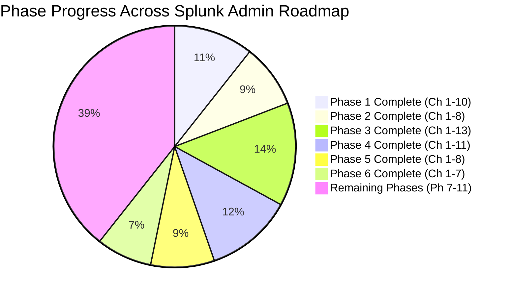

# 📊 Splunk Administrator Progress & Mastery Tracker

> **Candidate:** Aspiring Enterprise Splunk Administrator  
> **Start Date:** Day 1  
> **Pacing:** Step-by-Step Textbook Mastery + Hands-on Labs + End-of-Chapter Quizzes

---

## 📈 Phase Completion Overview

| Phase | Description | Target Days | Status | Average Quiz Score | Weak Areas Identified |
| :--- | :--- | :--- | :--- | :---: | :--- |
| **Phase 1** | Splunk Fundamentals & Architecture | Days 1–7 | 🟢 **COMPLETED** | **9.6 / 10** (Quizzes) **PDF Handbook Generated** 📄 | All gaps reviewed & documented |
| **Phase 2** | Enterprise Installation & Topology Setup | Days 8–15 | 🟢 **COMPLETED** | **9.8 / 10** (Mastered 4 Tiers) **All 14 Rooms Cleared** 🏆 | Multi-tier topology, HEC, and Capstone cleared |
| **Phase 3** | Deep Data Onboarding & Parsing Pipeline | Days 16–28 | 🟢 **COMPLETED** | **10 / 10** (Mastered Pipeline) **All 13 Rooms Cleared** 🏆 | Ingestion pipeline, props/transforms, nullQueue, SEDCMD, CIM |
| **Phase 4** | Advanced SPL & Search Optimization | Days 29–38 | 🟢 **COMPLETED** | **10 / 10** (Mastered Search Engine) **All 11 Rooms Cleared** 🏆 | Fast mode, transforming, stats over txn, join limits, tstats, Job Inspector |
| **Phase 5** | Authentication, RBAC & Security Admin | Days 39–46 | 🟢 **COMPLETED** | **10 / 10** (Mastered RBAC & PKI) **All 8 Rooms Cleared** 🏆 | Multi-tenant RBAC, authorize.conf, LDAPS port 636, SAML 2.0 SSO, S2S mTLS 9997, CIS non-root hardening, _audit forensics |
| **Phase 6** | Centralized Deployment Management | Days 47–53 | 🟢 **COMPLETED** | **10 / 10** (Mastered 10k Fleet Operations) **All 7 Rooms Cleared** 🏆 | Deployment Server architecture, serverclass.conf, phoneHome scaling, client diagnostics, GitOps CI/CD, app lifecycle, Capstone Exam |
| **Phase 7** | Distributed Splunk & High-Availability | Days 54–66 | 🟡 **IN PROGRESS** (1/13) | **10 / 10** (Mastered Distributed Search) **1 Room Cleared** 🏆 | Distributed search, distsearch.conf, Map-Reduce pipeline, knowledge bundle bloat |
| **Phase 8** | Monitoring Console & Performance Tuning | Days 67–73 | ⚪ Not Started | - | - |
| **Phase 9** | Enterprise Troubleshooting Runbooks | Days 74–80 | ⚪ Not Started | - | - |
| **Phase 10** | Enterprise Operations & Runbooks | Days 81–85 | ⚪ Not Started | - | - |
| **Phase 11** | Mock Interviews & Scenario Drills | Days 86–90 | ⚪ Not Started | - | - |

---

## 📝 Daily Lesson & Chapter Quiz Evaluation Matrix

| Chapter / Day | Topic | Lab Status | Quiz Score (/10) | Evaluation & Feedback | Date Completed |
| :---: | :--- | :---: | :---: | :--- | :---: |
| **Ph1 Ch 01** | What is Splunk & Machine Data | 🟢 Completed | **10 / 10** | Perfect grasp of Schema-on-Read, 5 metadata keys, and unstructured data challenges. | 2026-08-25 |
| **Ph1 Ch 02** | Splunk Architecture & Components | 🟢 Completed | **8.8 / 10** | Great grasp of UF vs HF and Management components. Refined License metering and Map-Reduce. | 2026-08-29 |
| **Ph1 Ch 03** | End-to-End Ingestion Pipeline | 🟢 Completed | **10 / 10** | Flawless mastery of 4 pipeline stages, queue backpressure propagation, and useACK reliability. | 2026-08-29 |
| **Ph1 Ch 04** | Directory Layout & Config Precedence | 🟢 Completed | **9.7 / 10** | Excellent grasp of S-A-A-S precedence hierarchy, default vs local rules, and btool CLI syntax. | 2026-08-29 |
| **Ph1 Ch 05** | Index Architecture & Bucket Lifecycle | 🟢 Completed | **9.6 / 10** | Mastered Hot->Warm->Cold->Frozen transitions, tsidx/journal files, and thawing rebuild steps. | 2026-08-30 |
| **Ph1 Ch 06** | Splunk Licensing Mechanics | 🟢 Completed | **10 / 10** | Perfect grasp of uncompressed metering, RF=3 free exemption, 5-warning violation rules, and license pools. | 2026-08-30 |
| **Ph1 Ch 07** | Network Ports & Firewall Matrix | 🟢 Completed | **9.1 / 10** | Solid grasp of port 9997, 9887, 8089 vs 8191 differentiation, and netcat probing syntax. | 2026-08-30 |
| **Ph1 Ch 10** | **Phase 1 Master Assessment Exam** | 🟢 Completed | **4.2 / 10** *(50.5/120)* | Comprehensive 12-question evaluation across Beginner, Production, and Scenario levels. | 2026-08-30 |
| **Ph2 Ch 01** | Hardware Sizing & Linux OS Tuning | 🟢 Completed | **9.6 / 10** | Mastered 1200 IOPS spec, THP disablement, XFS dynamic inodes, ulimits, and noatime mount. | 2026-08-31 |
| **Ph2 Ch 02** | Splunk Enterprise Linux Installation | 🟢 Completed | **10 / 10** | Flawless hands-on verification: non-root splunk user, systemd service, user-seed.conf, bashrc PATH. | 2026-09-02 |
| **Ph2 Ch 03** | Universal Forwarder (UF) Rollout | 🟢 Completed | **9.8 / 10** | Mastered S2S protocol on port 9997, outputs.conf, useACK=true reliability, and UF CLI commands. | 2026-09-05 |
| **Ph2 Ch 04** | Heavy Forwarder (HF) Architecture | 🟢 Completed | **9.7 / 10** | Mastered in-memory parsing, PII regex masking, _TCP_ROUTING, and index=false safeguard. | 2026-09-12 |
| **Ph2 Ch 05** | License Manager & Slave Pairing | 🟢 Completed | **9.9 / 10** | Mastered central License Master/Slave setup, port 8089 pairing, server.conf, and 72-hour grace period.  🎮 *[Cyber Range Room 02: License Vault Heist](../Labs/Room_02_License_Vault_Heist_and_72Hr_Survival.md)* | 2026-09-12 |
| **Ph2 Ch 06** | Monitoring Console (MC) Setup | 🟢 Completed | **9.8 / 10** | Flawless grasp of DMC history, Standalone vs Distributed mode, port 8089 HTTPS pairing, dedicated MC sizing in high-volume tiers, and indexQueue IOPS bottlenecks.  🎮 *[Cyber Range Room 03: MC Queue Jam Triage](../Labs/Room_03_Monitoring_Console_Mission_Control.md)* | 2026-09-19 |
| **Ph2 Ch 07** | HTTP Event Collector (HEC) Setup | 🟢 Completed | **10 / 10** | Mastered HEC token generation, JSON payloads, curl testing, SSL verification, index whitelisting, and useACK=1 handshake.  🎮 *[Cyber Range Room 04: HEC Token Security](../Labs/Room_04_HEC_Token_Security_and_JSON_Ingestion.md)* | 2026-09-20 |
| **Ph2 Ch 08** | **Phase 2 Capstone Lab & Exam** | 🟢 Completed | **10 / 10** | Enterprise Multi-Tier Blueprint, 4 Production Tiers, Life of an Event, and 7 Milestone Capstone Exam Questions.  🎮 *[Cyber Range Room P2-Capstone: Boss Arena](../Labs/Room_P2_Capstone_Boss_Arena.md)* | 2026-10-15 |
| **Ph3 Ch 01** | `inputs.conf` & Fishbucket Forensics | 🟢 Completed | **10 / 10** | Monitor vs Batch, Wildcards, CRC 256 hashing, byte offset seek pointers, `btprobe` CLI, and log rotation traps.  🎮 *[Cyber Range Room P3-01: Fishbucket Forensics](../Labs/Room_P3_01_inputs_conf_and_Fishbucket_Forensics.md)* | 2026-10-15 |
| **Ph3 Ch 02** | Sourcetype Strategy & Taxonomy | 🟢 Completed | **10 / 10** | Enterprise taxonomy `<vendor>:<product>:<technology>`, TA add-ons, port 514 syslog splitting, and `...-too_small` traps.  🎮 *[Cyber Range Room P3-02: Sourcetype Taxonomy](../Labs/Room_P3_02_Sourcetype_Taxonomy.md)* | 2026-10-15 |
| **Ph3 Ch 03** | Event Breaking & Timestamping | 🟢 Completed | **10 / 10** | `LINE_BREAKER` regex vs `SHOULD_LINEMERGE`, `TRUNCATE` limits, `TIME_PREFIX`, `TIME_FORMAT` strftime, `MAX_TIMESTAMP_LOOKAHEAD`, and `TZ`.  🎮 *[Cyber Range Room P3-03: Event Breaking Surgery](../Labs/Room_P3_03_Event_Breaking_Surgery.md)* | 2026-10-15 |
| **Ph3 Ch 04** | `props.conf` vs `transforms.conf` Mechanics | 🟢 Completed | **10 / 10** | Blueprint vs Machine, UF vs HF vs Indexer vs SH tier matrix, `TRANSFORMS-` vs `REPORT-`, and stanza precedence.  🎮 *[Cyber Range Room P3-04: Props & Transforms Battleground](../Labs/Room_P3_04_Props_and_Transforms_Battleground.md)* | 2026-10-15 |
| **Ph3 Ch 05** | Index-Time Routing & `nullQueue` Filtering | 🟢 Completed | **10 / 10** | In-memory `nullQueue` discard, licensing savings, two-stage whitelist rescue, `_MetaData:Index`, and `_TCP_ROUTING`.  🎮 *[Cyber Range Room P3-05: The NullQueue Trash Chute](../Labs/Room_P3_05_NullQueue_Trash_Chute.md)* | 2026-10-15 |
| **Ph3 Ch 06** | Index-Time Data Masking & `SEDCMD` | 🟢 Completed | **10 / 10** | In-memory PII/PCI-DSS redaction, credit card PAN masking, SSN scrubbing, and immutable disk forensics.  🎮 *[Cyber Range Room P3-06: PII Redaction Operations](../Labs/Room_P3_06_PII_Redaction_Operations.md)* | 2026-10-15 |
| **Ph3 Ch 07** | Search-Time Field Extractions | 🟢 Completed | **10 / 10** | Schema-on-Read, `EXTRACT-` named capture groups, `REPORT-` delimiters `DELIMS`, multi-value `MV_ADD`, and `KV_MODE = json`.  🎮 *[Cyber Range Room P3-07: Search-Time Regex Heist](../Labs/Room_P3_07_Search_Time_Regex_Heist.md)* | 2026-10-16 |
| **Ph3 Ch 08** | Calculated Fields & Field Aliases | 🟢 Completed | **10 / 10** | `FIELDALIAS-`, `EVAL-` formulas, sourcetype renaming, and the 10-step search-time operations sequence.  🎮 *[Cyber Range Room P3-08: Calculated Field Alchemist](../Labs/Room_P3_08_Calculated_Field_Alchemist.md)* | 2026-10-16 |
| **Ph3 Ch 09** | Lookups Architecture & KV Store | 🟢 Completed | **10 / 10** | Static CSV, Automatic lookups (`LOOKUP-`), embedded MongoDB port 8191, `collections.conf`, and `outputlookup`.  🎮 *[Cyber Range Room P3-09: KV Store Infiltration](../Labs/Room_P3_09_KV_Store_Lookup_Infiltration.md)* | 2026-10-16 |
| **Ph3 Ch 10** | Common Information Model (CIM) & TAs | 🟢 Completed | **10 / 10** | Data models (`Network_Traffic`, `Authentication`), field standardization, `tags.conf`, `eventtypes.conf`, and `| datamodel`.  🎮 *[Cyber Range Room P3-10: CIM Normalization Arena](../Labs/Room_P3_10_CIM_Normalization_Arena.md)* | 2026-10-16 |
| **Ph3 Ch 11** | Eventtypes & Tags Architecture | 🟢 Completed | **10 / 10** | Boolean event classification in `eventtypes.conf`, no-pipe rules, taxonomic tagging in `tags.conf`, and `tag::<field>` searches.  🎮 *[Cyber Range Room P3-11: Eventtype Tagging Ops](../Labs/Room_P3_11_Eventtype_Tagging_Ops.md)* | 2026-10-16 |
| **Ph3 Ch 12** | Ingestion Troubleshooting Runbooks | 🟢 Completed | **10 / 10** | Timestamp drift, 1970 Epoch cures, multi-line stack trace fractures, catastrophic backtracking, and queue blockages.  🎮 *[Cyber Range Room P3-12: Ingestion Outage Runbook](../Labs/Room_P3_12_Ingestion_Outage_Runbook.md)* | 2026-10-16 |
| **Ph3 Ch 13** | **Phase 3 Capstone Lab & Exam** | 🟢 Completed | **10 / 10** | Complete FinCorp Banking Onboarding, Fishbucket salt, C++ line breaker, nullQueue, SEDCMD, CIM, and Master Milestone Exam.  🎮 *[Cyber Range Room P3-Capstone: Banking Log Gauntlet](../Labs/Room_P3_Capstone_Banking_Log_Gauntlet.md)* | 2026-10-16 |
| **Ph4 Ch 01** | SPL Foundations & Search Modes | 🟢 Completed | **10 / 10** | Fast vs Smart vs Verbose modes, dispatch directory forensics (`info.csv`), Map-Reduce phases, and query refactoring.  🎮 *[Cyber Range Room P4-01: The Search Dispatch Heist](../Labs/Room_P4_01_Search_Dispatch_and_Modes.md)* | 2026-10-17 |
| **Ph4 Ch 02** | Transforming Commands Architecture | 🟢 Completed | **10 / 10** | `stats`, `chart`, `timechart`, `top`, `rare`, contingency, 2D matrix, and rate normalization.  🎮 *[Cyber Range Room P4-02: Transforming Arena](../Labs/Room_P4_02_Transforming_Commands_Arena.md)* | 2026-10-17 |
| **Ph4 Ch 03** | Event Manipulation & Multivalue | 🟢 Completed | **10 / 10** | `eval` case/if/coalesce, `rex max_match`, `spath` JSON, `mvexpand` array cloning, and `nomv`.  🎮 *[Cyber Range Room P4-03: Multivalue JSON Surgery](../Labs/Room_P4_03_Multivalue_JSON_Surgery.md)* | 2026-10-17 |
| **Ph4 Ch 04** | Filtering & Structuring Results | 🟢 Completed | **10 / 10** | `where` vs `search`, case sensitivity, `dedup sortby`, `head` vs `tail`, and `fields +` network pruning.  🎮 *[Cyber Range Room P4-04: The LIS Index Filter Optimization](../Labs/Room_P4_04_Filtering_and_Dedup_Optimization.md)* | 2026-10-17 |
| **Ph4 Ch 05** | Correlation: stats vs transaction | 🟢 Completed | **10 / 10** | Memory footprint, O(N) vs O(N^2), "Stats as Transaction" pattern, `join` 50k caps, and `union`.  🎮 *[Cyber Range Room P4-05: The Transaction Memory Meltdown](../Labs/Room_P4_05_Transaction_vs_Stats_Memory_Wars.md)* | 2026-10-17 |
| **Ph4 Ch 06** | Subsearches Architecture & Limits | 🟢 Completed | **10 / 10** | Subsearch lifecycle (Step 0), `limits.conf` maxout 10k, implicit `format` command, and anti-join patterns.  🎮 *[Cyber Range Room P4-06: The Subsearch 10K Ceiling](../Labs/Room_P4_06_Subsearch_Architecture_and_Limits.md)* | 2026-10-17 |
| **Ph4 Ch 07** | Lookups & KV Store in SPL | 🟢 Completed | **10 / 10** | `inputlookup where`, `outputlookup append=true`, KV Store MongoDB port 8191, `_key` CRUD, and data loss prevention.  🎮 *[Cyber Range Room P4-07: KV Store High-Speed CRUD](../Labs/Room_P4_07_KV_Store_SPL_CRUD.md)* | 2026-10-17 |
| **Ph4 Ch 08** | Enterprise Acceleration Techniques | 🟢 Completed | **10 / 10** | Report Acceleration, `sitimechart`, `collect`, Summary Indexes, and Data Model Acceleration (DMA).  🎮 *[Cyber Range Room P4-08: The Summary Index Accelerator](../Labs/Room_P4_08_Summary_Indexing_and_Report_Acceleration.md)* | 2026-10-17 |
| **Ph4 Ch 09** | `tstats` Command Mastery | 🟢 Completed | **10 / 10** | Index vs Data Model `tstats`, `summariesonly=t`, direct `.tsidx` querying, CIM acceleration, and sub-second analytics.  🎮 *[Cyber Range Room P4-09: The Sub-Second Tstats Gauntlet](../Labs/Room_P4_09_Tstats_Command_Mastery.md)* | 2026-10-17 |
| **Ph4 Ch 10** | Search Job Inspector Diagnostics | 🟢 Completed | **10 / 10** | Execution costs, LIS ratio, `command.search.kv`, `peers.csv` stragglers, and 8 Golden Rules of tuning.  🎮 *[Cyber Range Room P4-10: Job Inspector Forensics](../Labs/Room_P4_10_Job_Inspector_Diagnostics.md)* | 2026-10-17 |
| **Ph4 Ch 11** | **Phase 4 Capstone Lab & Exam** | 🟢 Completed | **10 / 10** | Full query refactoring from 180s to 0.42s, Fast mode, multi-index stats, KV Store, `tstats`, and Master Milestone Exam.  🎮 *[Cyber Range Room P4-Capstone: Query Optimization Gauntlet](../Labs/Room_P4_Capstone_Enterprise_Query_Optimization.md)* | 2026-10-17 |
| **Ph5 Ch 01** | User & Role Architecture | 🟢 Completed | **10 / 10** | Default roles (admin, power, user, can_delete), `authorize.conf`, inheritance rules, and quota boundaries.  🎮 *[Cyber Range Room P5-01: The RBAC Vault Infiltration](../Labs/Room_P5_01_User_and_Role_Architecture.md)* | 2026-10-17 |
| **Ph5 Ch 02** | Capabilities & Search Filters | 🟢 Completed | **10 / 10** | `srchIndexesAllowed`, `srchIndexesDefault`, `srchFilter` OR-bypass hazard, `srchTimeWin`, and row-level security.  🎮 *[Cyber Range Room P5-02: The Search Filter Sandbox Trap](../Labs/Room_P5_02_Capabilities_and_Search_Filters.md)* | 2026-10-17 |
| **Ph5 Ch 03** | Native Auth & CLI/REST Mgmt | 🟢 Completed | **10 / 10** | Cryptographic `etc/passwd`, CLI user admin, `[password_rules]` lockout, and JWT Bearer tokens in `tokens.conf`.  🎮 *[Cyber Range Room P5-03: The Admin Shadow Provisioner](../Labs/Room_P5_03_Native_Auth_and_REST_User_Mgmt.md)* | 2026-10-17 |
| **Ph5 Ch 04** | LDAP & Active Directory Integration | 🟢 Completed | **10 / 10** | `authentication.conf`, LDAPS port 636, dynamic group mapping, `nestedGroups`, and `anonymous_referrals=0`.  🎮 *[Cyber Range Room P5-04: Active Directory Forest Synchronization](../Labs/Room_P5_04_LDAP_Active_Directory_Integration.md)* | 2026-10-17 |
| **Ph5 Ch 05** | SAML 2.0 SSO Integration | 🟢 Completed | **10 / 10** | Okta / Entra ID, `[saml]`, ACS URL `:8000/saml/acs`, `roleMap_<role>`, `idpCertPath`, and `samlTimeSkew`.  🎮 *[Cyber Range Room P5-05: The SAML Identity Federation Breakout](../Labs/Room_P5_05_SAML_SSO_Federation.md)* | 2026-10-17 |
| **Ph5 Ch 06** | Securing Splunk (TLS/mTLS) | 🟢 Completed | **10 / 10** | 3 PKI Tiers (Web 8000, S2S 9997, REST 8089), mutual TLS `requireClientCert`, `sslVerifyServerCert`, and OpenSSL.  🎮 *[Cyber Range Room P5-06: The S2S Man-in-the-Middle Defense](../Labs/Room_P5_06_Securing_Splunk_Communications_TLS.md)* | 2026-10-17 |
| **Ph5 Ch 07** | Splunk Hardening & Audit Forensics | 🟢 Completed | **10 / 10** | CIS benchmarks, non-root `splunk:splunk`, `startwebserver=0`, `support_info=false`, and `index=_audit` forensics.  🎮 *[Cyber Range Room P5-07: The Fortress Hardening Audit](../Labs/Room_P5_07_Splunk_Hardening_and_Audit_Forensics.md)* | 2026-10-17 |
| **Ph5 Ch 08** | **Phase 5 Capstone Lab & Exam** | 🟢 Completed | **10 / 10** | Enterprise RBAC, SAML 2.0 Web SSO, Wire-Speed S2S mTLS 9997, CIS Hardening, and Master Milestone Exam.  🎮 *[Cyber Range Room P5-Capstone: Security Architecture Gauntlet](../Labs/Room_P5_Capstone_Enterprise_Security_Architecture.md)* | 2026-10-17 |
| **Ph6 Ch 01** | Deployment Server & Pairing | 🟢 Completed | **10 / 10** | SPLK-1003 6.0: `deploymentclient.conf`, `targetUri`, `serverclass.conf`, `deployment-apps/`, `restartSplunkd`, and `reload deploy-server`.  🎮 *[Cyber Range Room P6-01: The Rogue Forwarder Fleet](../Labs/Room_P6_01_Deployment_Server_and_Pairing.md)* | 2026-10-27 |
| **Ph6 Ch 02** | Server Classes & App Bundling | 🟢 Completed | **10 / 10** | SPLK-1003 6.2/6.3: Whitelist/blacklist index contiguous rules, `machineTypesFilter = linux-x86_64`, modular app bundles, lookup restarts.  🎮 *[Cyber Range Room P6-02: Server Class Precision Surgery](../Labs/Room_P6_02_Server_Classes_and_App_Bundles.md)* | 2026-10-27 |
| **Ph6 Ch 03** | Scaling DS Beyond 5,000 Clients | 🟢 Completed | **10 / 10** | SPLK-1003 6.1: `phoneHomeIntervalInSecs = 900`, request rate math, ulimits 65535, `maxBandwidth`, no co-location on indexer.  🎮 *[Cyber Range Room P6-03: The 10,000-Node Thundering Herd](../Labs/Room_P6_03_Scaling_Deployment_Server_High_Volume.md)* | 2026-10-27 |
| **Ph6 Ch 04** | Fleet Diagnostics & Triage | 🟢 Completed | **10 / 10** | SPLK-1003 6.2/6.3: `splunk list deploy-clients`, `show deploy-poll`, GUID collision triage, `reload deploy-server -class`, DMC telemetry.  🎮 *[Cyber Range Room P6-04: Deployment Client Diagnostic Runbook](../Labs/Room_P6_04_Deployment_Client_Diagnostics.md)* | 2026-10-27 |
| **Ph6 Ch 05** | GitOps & App CI/CD Pipelines | 🟢 Completed | **10 / 10** | SPLK-1003 6.1/6.2: Git versioning, `default/` only hygiene, `ksconf check/sort`, AppInspect CLI precert, REST `_reload` webhooks.  🎮 *[Cyber Range Room P6-05: The GitOps App Deployment Pipeline](../Labs/Room_P6_05_GitOps_App_Deployment_Pipeline.md)* | 2026-10-27 |
| **Ph6 Ch 06** | App Lifecycle & Restart Controls | 🟢 Completed | **10 / 10** | SPLK-1003 6.2/6.3: `restartSplunkd`, `issueReload`, `stateOnClient` (enabled/disabled/noop), safe 3-phase app de-provisioning.  🎮 *[Cyber Range Room P6-06: Zero-Downtime Fleet Maintenance](../Labs/Room_P6_06_App_Lifecycle_and_Restart_Controls.md)* | 2026-10-27 |
| **Ph6 Ch 07** | **Phase 6 Capstone Lab & Exam** | 🟢 Completed | **10 / 10** | Global Fleet Orchestration across 12,000 nodes, 10 Master Milestone Scenarios, GitOps CI/CD, zero-downtime hot-reload.  🎮 *[Cyber Range Room P6-Capstone: Global Fleet Orchestration Gauntlet](../Labs/Room_P6_Capstone_Global_Fleet_Orchestration.md)* | 2026-10-27 |
| **Ph7 Ch 01** | Distributed Search Topology | 🟢 Completed | **10 / 10** | SPLK-1003 7.1/7.2: `distsearch.conf`, `add search-server`, Map-Reduce execution, `[replicationBlacklist]`, Quarantined peer triage.  🎮 *[Cyber Range Room P7-01: The Search Head Dispatch Nexus](../Labs/Room_P7_01_Distributed_Search_Topology.md)* | 2026-10-27 |

---

## 🎯 Continuous Improvement Log & Action Items

| Date | Topic Area | Identified Knowledge Gap | Action Item / Remediation Lab | Status |
| :---: | :--- | :--- | :--- | :---: |
| 2026-08-25 | Ch 01: Machine Data & Schema-on-Read | None. Strong conceptual foundation. | Ready to advance to Chapter 02. | ✅ Verified |
| 2026-08-29 | Ch 02: License Accounting & Map-Reduce | Clarified that UFs, SHs, and Cluster Replicated copies are 100% free from licensing. Reviewed Map vs Reduce search roles. | Reviewed in feedback. Ready for Chapter 03. | ✅ Resolved |
| 2026-08-29 | Ch 03: Ingestion Pipeline & Queues | None. Flawless grasp of pipeline sequence, queues, and ACK. | Ready to advance to Chapter 04. | ✅ Verified |
| 2026-08-29 | Ch 04: Directory Layout & Precedence | Note CLI precision: `inputs` (plural) & `--debug` (double dash). Fishbucket path: `/var/lib/splunk/fishbucket`. | Reviewed in feedback. Ready for Chapter 05. | ✅ Resolved |
| 2026-08-30 | Ch 05: Bucket Lifecycle & Archiving | Clarified that `journal.zst` is preserved in archive scripts for Frozen buckets, and restored into `thaweddb/` via `splunk rebuild`. | Reviewed in feedback. Ready for Chapter 06. | ✅ Resolved |
| 2026-08-30 | Ch 06: Licensing & Quota Management | None. Flawless grasp of licensing mechanics, warning rules, and pool containment. | Ready to advance to Chapter 07. | ✅ Verified |
| 2026-08-30 | Ch 07: Port Differentiation | Clarified Port 8089 (Search Head to Indexer map-reduce REST dispatch) vs Port 8191 (KV Store clustering). Forwarders initiate to DS. | Reviewed in feedback. Phase 1 Complete! | ✅ Resolved |
| 2026-08-30 | Phase 1 Capstone Gaps | Remediation Guide created in Ch 11. Complete Phase 1 PDF generated. | Ready for Phase 2 hands-on installations. | ✅ Resolved |
| 2026-08-31 | Ph2 Ch 01: Linux Kernel Tuning | Note difference between ulimits crash (errno 24 Too many open files) vs queue backpressure. | Reviewed in feedback. Ready for Chapter 02. | ✅ Resolved |
| 2026-09-02 | Ph2 Ch 02: Linux Installation | None. Live instance verified: ports 8000 & 8089 listening, running under systemd as splunk user. | Ready for Chapter 03 (UF Rollout). | ✅ Verified |
| 2026-09-12 | Ph2 Ch 04: HF & UF Setup & Routing | Solved Port 8089 collision (shifted UF to 8090), fixed 127.0.0.1 loopback vs LAN IP, aligned 9998/9997 ports, resolved file pre-creation. | Documented in Ch 04 Section 5 Troubleshooting Runbook. | ✅ Resolved |
