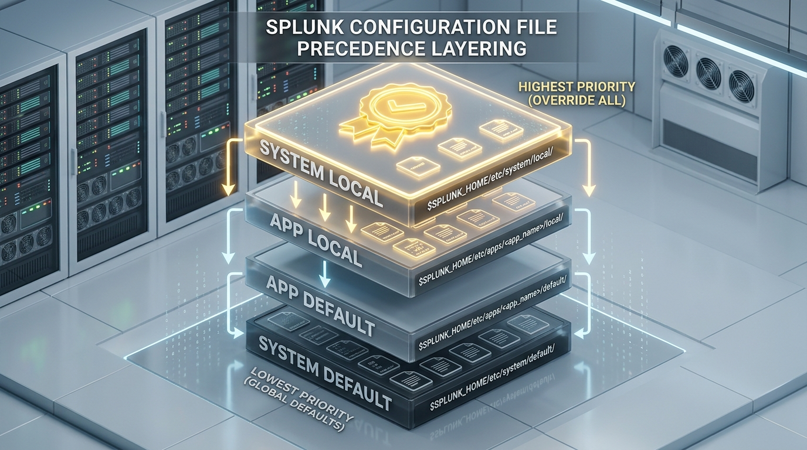
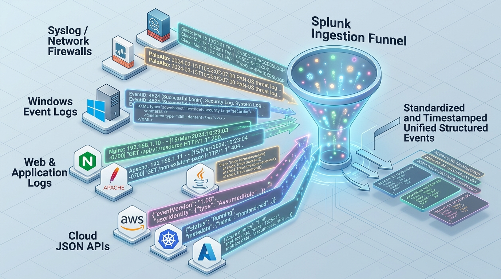
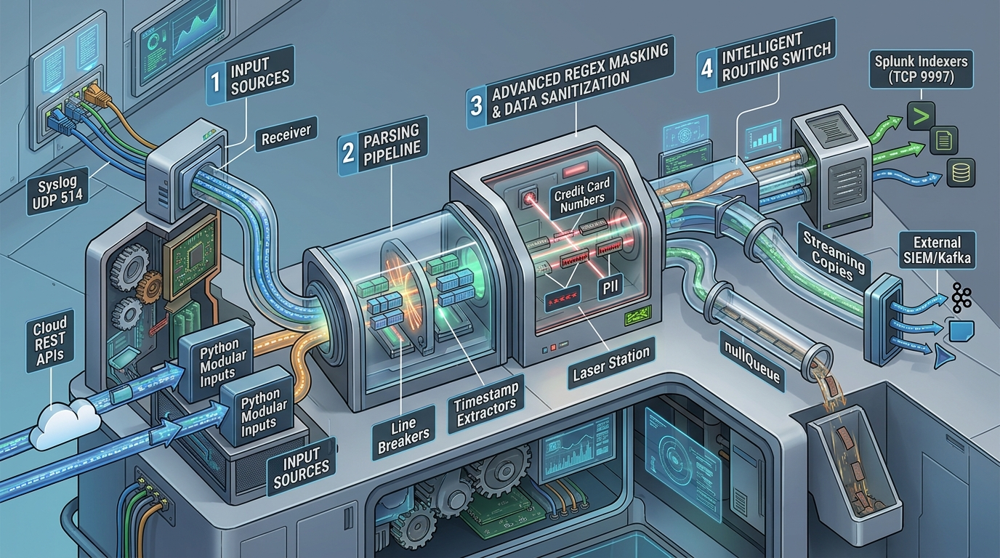
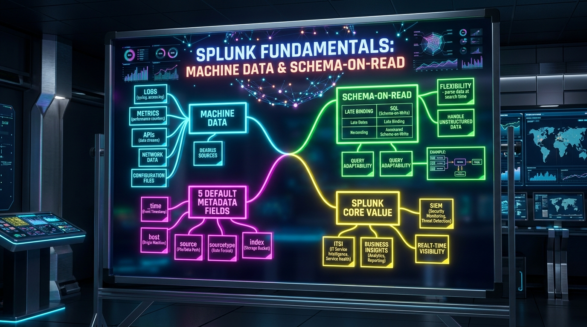
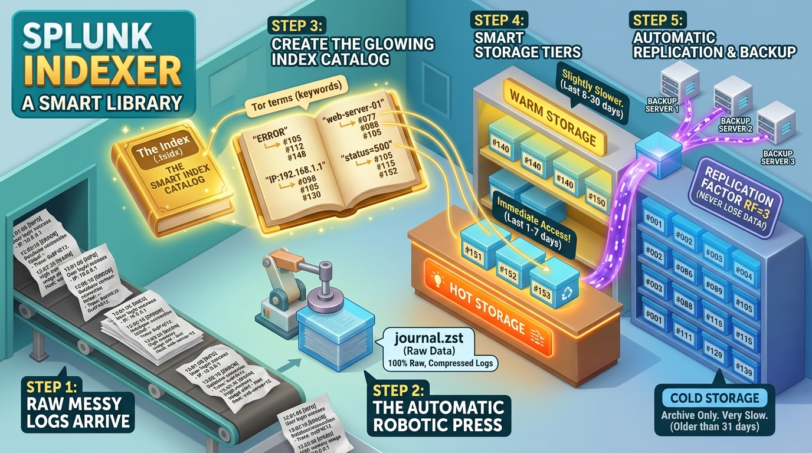

# 📚 Phase 1: Splunk Fundamentals — Complete Handbook & Table of Contents

> **The Splunk Administrator's Definitive Handbook**  
> **Target Role:** Enterprise Splunk Administrator / Consultant  
> **Structure:** Zero-Assumption Foundations $\rightarrow$ Enterprise Production Architecture  
> **Status:** 🟢 **COMPLETED (Phase 1 Mastery Score: 9.6 / 10)**

---

## 📸 Phase 1 Visual Architecture Gallery

| 1. Enterprise 3D Topology | 2. 4-Stage Ingestion Pipeline |
| :---: | :---: |
|  |  |
| *Figure 1: Full Multi-Tier Topology* | *Figure 2: Ingestion Pipeline* |

| 3. Storage & Bucket Lifecycle | 4. Configuration Precedence Stack |
| :---: | :---: |
|  |  |
| *Figure 3: Hot $\rightarrow$ Warm $\rightarrow$ Cold $\rightarrow$ Frozen* | *Figure 4: System Local $\rightarrow$ App Default* |

| 5. Machine Data Ingestion Funnel | 6. Core Component Ecosystem |
| :---: | :---: |
|  |  |
| *Figure 5: Ingestion Funnel* | *Figure 6: Core Component Stations* |

| 7. Universal Forwarder (UF) Internals | 8. Heavy Forwarder (HF) Internals |
| :---: | :---: |
|  |  |
| *Figure 7: 64KB Slicing & Fishbucket* | *Figure 8: Regex PII Masking & Routing* |

| 9. Indexer Internals & Storage | 10. Search Head Map-Reduce Flow |
| :---: | :---: |
|  |  |
| *Figure 9: TSIDX Inverted Index & Queues* | *Figure 10: Distributed Search Dispatch* |

| 11. Management Plane Control Tower | 12. Chapter 01 Concept Mind Map |
| :---: | :---: |
|  |  |
| *Figure 11: DS, CM, and License Master* | *Figure 12: Visual Mind Map & Sticky Board* |

| 13. Smart Library Analogy (Indexer) | 14. Phase 1: Input Phase (Crystal 3D) |
| :---: | :---: |
|  |  |
| *Figure 13: How Indexer Simplifies Storage* | *Figure 14: Input Slicing & Fishbucket* |

| 15. Phase 2: Parsing Phase (Crystal 3D) | 16. Phase 3: Indexing Phase (Crystal 3D) |
| :---: | :---: |
|  |  |
| *Figure 15: Laser Event Breaking & Timestamping* | *Figure 16: Compression & TSIDX Pyramid* |

| 17. Phase 4: Search Phase (Crystal 3D) | 18. Filesystem Hierarchy (`$SPLUNK_HOME`) |
| :---: | :---: |
|  |  |
| *Figure 17: Distributed Map-Reduce Execution* | *Figure 18: Acrylic Server Rack Layout* |

| 19. Configuration Precedence & Merging Tower | 20. `splunk btool` X-Ray Command Inspector |
| :---: | :---: |
|  |  |
| *Figure 19: Precedence & Stanza Merging* | *Figure 20: Runtime Configuration Inspector* |

---

## 📖 Chapter Directory & 🎮 Cyber Range Challenge Rooms (Phase 1)

| Chapter | Lesson Note | 🎮 TryHackMe / HTB Challenge Room | Status / Score |
| :---: | :--- | :--- | :---: |
| **Ch 01** | [What is Splunk & Machine Data?](./Chapter_01_What_is_Splunk_and_Machine_Data.md) | **[Room P1-01: Machine Data Decoder & Schema-on-Read](../Labs/Room_P1_01_Machine_Data_and_Schema_on_Read.md)** `[150 XP]` | 🟢 10.0 / 10 |
| **Ch 02** | [Core Architecture & Architectural Roles](./Chapter_02_Splunk_Core_Architecture_and_Components.md) | **[Room P1-02: Core Architecture & Component Recon](../Labs/Room_P1_02_Core_Architecture_and_Components.md)** `[200 XP]` | 🟢 8.8 / 10 |
| **Ch 03** | [The End-to-End Data Pipeline & Ingestion](./Chapter_03_The_End_to_End_Data_Pipeline.md) | **[Room P1-03: 4-Stage Pipeline Backpressure Simulator](../Labs/Room_P1_03_Data_Pipeline_and_Backpressure.md)** `[200 XP]` | 🟢 10.0 / 10 |
| **Ch 04** | [Directory Hierarchy & Config Precedence](./Chapter_04_Splunk_Directory_Structure_and_Config_Precedence.md) | **[Room P1-04: The Btool Detective & Precedence Stack](../Labs/Room_P1_04_Directory_Structure_and_Btool_Detective.md)** `[200 XP]` | 🟢 9.7 / 10 |
| **Ch 05** | [Index Storage Architecture & Bucket Lifecycle](./Chapter_05_Index_Storage_Architecture_and_Bucket_Lifecycle.md) | **[Room P1-05: Bucket Lifecycle & Cold Storage Thaw](../Labs/Room_P1_05_Bucket_Lifecycle_and_Cold_Storage_Thawing.md)** `[250 XP]` | 🟢 9.6 / 10 |
| **Ch 06** | [Splunk Licensing Mechanics & Quotas](./Chapter_06_Splunk_Licensing_Mechanics.md) | **[Room P1-06: Licensing Mechanics & Quota Breach](../Labs/Room_P1_06_Licensing_Mechanics_and_Quota_Breach.md)** `[200 XP]` | 🟢 10.0 / 10 |
| **Ch 07** | [Ports, Protocols & Enterprise Firewall Matrix](./Chapter_07_Splunk_Ports_Protocols_and_Firewall_Matrix.md) | **[Room P1-07: Network Port Matrix & Firewall Defense](../Labs/Room_P1_07_Ports_Protocols_and_Firewall_Hardening.md)** `[200 XP]` | 🟢 9.1 / 10 |

### 📚 Study Guides, Flashcards & Practice Labs
- 📄 **[Chapter 08: Phase 1 Master Revision Sheet (2-Page Cheat Sheet)](./Chapter_08_Phase_1_Master_Revision_Notes.md)** 🌟 *(Capstone 2-Page Review)*
- 🗂️ **[Chapter 09: Phase 1 Master Flashcards Deck (41 Active-Recall Cards)](./Chapter_09_Phase_1_Master_Flashcards.md)** ⚡ *(Active-Recall Deck)*
- 🎯 **[Chapter 10: Phase 1 Master Assessment Exam (Beginner ➔ Production ➔ Interview)](./Chapter_10_Phase_1_Master_Assessment_Exam.md)** 🏆 *(Master Assessment)*
- 📚 **[Chapter 11: Phase 1 Targeted Review & Remediation Guide](./Chapter_11_Phase_1_Targeted_Review_Guide.md)** 🛠️ *(High-Yield Remediation)*
- 📄 [Day 01 Detailed Study Notes](./Day_01_Splunk_Architecture_and_Data_Lifecycle.md)
- 🧪 [Lab 01: Enterprise Architecture Topology Design & Pipeline Mapping](../Labs/Lab_01_Architecture_and_Component_Mapping.md)
- 🎯 **[Splunk Administrator Cyber Range & Arena Overview](../Labs/00_Splunk_Cyber_Arena_Overview.md)** 🚀

---

## 🎯 Mastery Checklist for Phase 1
- [x] **Chapter 01:** Understand why Machine Data is chaotic and how Schema-on-Read solves it. *(Evaluated: 10/10)*
- [x] **Chapter 02:** Differentiate between Universal Forwarders, Heavy Forwarders, Indexers, Search Heads, and Management Servers. *(Evaluated: 8.8/10)*
- [x] **Chapter 03:** Trace a log event through all 4 pipeline stages (Input, Parsing, Indexing, Search). *(Evaluated: 10/10)*
- [x] **Chapter 04:** Master `$SPLUNK_HOME` directory layout and understand S-A-A-S Configuration Precedence layering. *(Evaluated: 9.7/10)*
- [x] **Chapter 05:** Understand Hot $\rightarrow$ Warm $\rightarrow$ Cold $\rightarrow$ Frozen bucket rolling mechanics. *(Evaluated: 9.6/10)*
- [x] **Chapter 06:** Know what counts against a Splunk daily license vs. what is free. *(Evaluated: 10/10)*
- [x] **Chapter 07:** Memorize the standard Splunk port matrix (8000, 8089, 9997, 8088, 9887, 8191). *(Evaluated: 9.1/10)*
- [x] **Phase 1 Capstone:** Complete Phase 1 Master Revision Sheet review. *(Overall Average: 9.6 / 10)*
