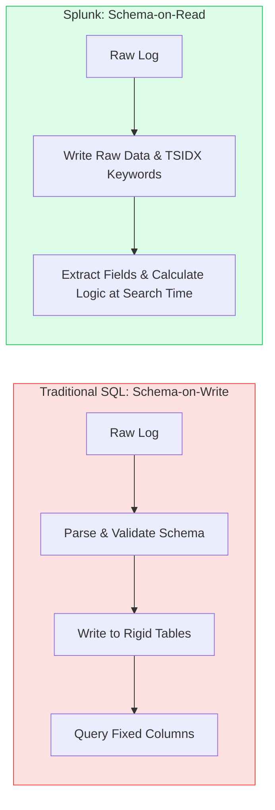
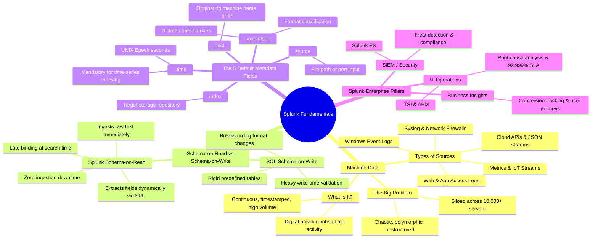

# 📖 Chapter 01: What is Splunk & What is Machine Data?

> **The Splunk Administrator's Handbook** | Phase 1: Splunk Fundamentals  
> **Target Audience:** Complete Beginners to Enterprise Administrators  
> **Prerequisites:** None (Zero background knowledge assumed)

---

## 📸 1. Visual Overview: The Machine Data Ingestion Funnel


*Figure 1.1: Diverse, chaotic machine data streams ingested, parsed, and unified by Splunk (`![[05_machine_data_types_3d.jpg]]`)*

---

## 2. What is Machine Data?

Every computer system, server, cloud resource, mobile app, network router, and security firewall generates an unending stream of digital breadcrumbs called **machine data** (or "logs").

### 🔍 Real-World Machine Data Examples

```text
1. Linux Authentication Log (/var/log/secure):
Mar 15 10:23:01 auth-srv sshd[24512]: Failed password for invalid user admin from 192.168.1.105 port 42812 ssh2

2. Nginx Web Server Access Log (/var/log/nginx/access.log):
192.168.1.50 - - [15/Mar/2026:10:23:02 +0000] "GET /api/v1/checkout HTTP/1.1" 500 1423 "https://shop.company.com" "Mozilla/5.0"

3. AWS CloudTrail Security Audit Event (JSON Format):
{"eventVersion": "1.08", "userIdentity": {"type": "IAMUser", "userName": "jdoe"}, "eventTime": "2026-03-15T10:23:03Z", "eventName": "TerminateInstances", "sourceIPAddress": "54.239.28.1"}

4. Windows Security Event Log (XML / Event ID 4625 - Failed Logon):
<Event xmlns="http://schemas.microsoft.com/win/2004/08/events/event">
  <System><EventID>4625</EventID><TimeCreated SystemTime="2026-03-15T10:23:04.128Z"/></System>
  <EventData><Data Name="TargetUserName">Administrator</Data><Data Name="IpAddress">10.0.4.12</Data></EventData>
</Event>
```

### 🌪️ Why is Machine Data So Hard to Manage Without Splunk?
1. **Unstructured & Inconsistent:** Every vendor (Cisco, Microsoft, Linux, AWS, Oracle) writes logs in completely different formats.
2. **Massive Volume:** A mid-sized company generates **billions** of log events every day ($1\text{ to }50+\text{ TB/day}$).
3. **Siloed Across Thousands of Machines:** When an outage happens, the relevant clues are scattered across web servers, database clusters, firewalls, and microservices.

---

## 3. What is Splunk? (The Big Picture)

**Splunk Enterprise** is a distributed, high-performance big data platform designed specifically to **collect, index, search, analyze, and visualize machine data in real time**.

```text
┌─────────────────────────────────────────────────────────────────────────┐
│                           THE SPLUNK ENGINE                             │
│                                                                         │
│   [ Raw Logs / Metrics / APIs ] ──► [ Collect & Ingest ]               │
│                                            │                            │
│                                            ▼                            │
│                               [ Break Events & Timestamp ]              │
│                                            │                            │
│                                            ▼                            │
│                             [ Build Inverted Index (.tsidx) ]           │
│                                            │                            │
│                                            ▼                            │
│                         [ Search-Time Schema & Analytics (SPL) ]        │
└─────────────────────────────────────────────────────────────────────────┘
```

---

## 4. Traditional SQL Databases vs. Splunk (Schema-on-Write vs. Schema-on-Read)

This is one of the most critical foundational concepts in Splunk.

| Feature | Traditional SQL Database (MySQL, PostgreSQL, Oracle) | Splunk Enterprise |
| :--- | :--- | :--- |
| **Schema Model** | **Schema on Write** (Rigid) | **Schema on Read** (Late Binding / Flexible) |
| **Data Preparation** | You MUST define tables, column names, and data types *before* you can insert any data. | You dump raw unstructured text directly into Splunk with zero upfront schema design. |
| **Handling Format Changes** | If an application adds a new field to its logs, SQL queries break or the table schema must be altered via migration scripts. | If log formats change, Splunk still ingests everything without errors. You extract the new field instantly at search time. |
| **Storage Mechanism** | Relational tables, rows, B-trees, primary/foreign keys. | Time-series partitioned buckets containing compressed raw data (`journal.zst`) + inverted index keyword maps (`.tsidx`). |
| **Query Language** | SQL (`SELECT * FROM logs WHERE ...`) | SPL (Search Processing Language) (`index=web status=500 | stats count by clientip`) |



---

## 5. The Three Core Splunk Use Cases in the Enterprise

```text
┌────────────────────────────────────────────────────────────────────────┐
│                      SPLUNK ENTERPRISE USE CASES                       │
├──────────────────────────┬───────────────────────┬─────────────────────┤
│  1. SECURITY & SIEM      │ 2. IT OPERATIONS      │ 3. BUSINESS INSIGHTS│
│  - Splunk Enterprise     │ - Root cause analysis │ - User conversions  │
│    Security (ES)         │ - Outage prevention   │ - Revenue tracking  │
│  - Threat detection      │ - Infrastructure health│ - Cart abandonment │
│  - Compliance (PCI/HIPAA)│ - SLA monitoring      │ - Usage telemetry   │
└──────────────────────────┴───────────────────────┴─────────────────────┘
```

1. **Security Information and Event Management (SIEM):**
   - SOC (Security Operations Center) analysts use Splunk Enterprise Security to detect cyberattacks, brute-force logins, malware outbreaks, and data exfiltration in real-time.
2. **IT Operations & Troubleshooting (ITSI):**
   - DevOps and Site Reliability Engineers (SREs) track application health, database latency, server crashes, and container errors to maintain 99.999% uptime.
3. **Business Analytics:**
   - Product managers track how many users clicked "Checkout", where checkout errors occurred, and how marketing campaigns drive revenue directly from web server logs.

---

## 6. How Splunk Ingests & Stores Data (First Principles)

When Splunk receives a line of text, it immediately stamps it with **4 Mandatory Default Metadata Fields**:

1. **`_time`**: The exact timestamp when the event occurred (converted into UNIX epoch time, e.g., `1773570183`).
2. **`host`**: The physical machine, VM hostname, or IP address where the event originated (e.g., `web-srv-01.prod.company.com`).
3. **`source`**: The exact file path, port, or script that produced the data (e.g., `/var/log/nginx/access.log` or `UDP:514`).
4. **`sourcetype`**: The classification format of the log that tells Splunk how to parse and interpret it (e.g., `nginx:access`, `cisco:asa`, `WinEventLog:Security`).
5. **`index`**: The specific logical and physical storage database where this event will reside (e.g., `web_prod`, `os_linux`, `firewall_sec`).

```text
┌────────────────────────────────────────────────────────────────────────┐
│                        A SINGLE SPLUNK EVENT                           │
├────────────────────────────────────────────────────────────────────────┤
│ _time      = 2026-03-15 10:23:02 UTC                                   │
│ host       = web-prod-01.company.com                                   │
│ source     = /var/log/nginx/access.log                                 │
│ sourcetype = nginx:access                                              │
│ index      = web_prod                                                  │
├────────────────────────────────────────────────────────────────────────┤
│ _raw       = 192.168.1.50 - - [15/Mar/2026:10:23:02 +0000] "GET /api/v1│
│              /checkout HTTP/1.1" 500 1423                              │
└────────────────────────────────────────────────────────────────────────┘
```

---

## 7. Key Administrator Takeaways & Chapter Summary

1. **Machine data is chaotic and high-volume**, but it contains the complete truth about your IT and security infrastructure.
2. **Splunk uses Schema-on-Read**: You ingest first, and interpret/extract fields at search time.
3. **Every event in Splunk has 5 key metadata attributes**: `_time`, `host`, `source`, `sourcetype`, and `index`.
4. **Splunk scales from 1 machine (Standalone) to thousands of servers (Distributed Cluster)** processing tens of terabytes per day.

---

## 🧠 Chapter 01 Self-Check Quiz

1. What is the fundamental difference between **Schema-on-Write** (SQL) and **Schema-on-Read** (Splunk)?
2. What are the 5 mandatory metadata fields attached to every Splunk event?
3. If an application developer changes their log format from plain text to JSON, will Splunk stop indexing the data? Explain why.
4. Why is machine data difficult to analyze using traditional relational databases?

---

## 📌 8. Visual Mind Map & Sticky Notes (Chapter 01 Quick-Review)

### 📸 Visual 3D Concept Board

*Figure 1.2: 3D Visual Concept & Sticky Note Board (`![[06_chapter_01_mindmap_sticky_notes_3d.jpg]]`)*

### 🧠 Hierarchical Mind Map


### 🗂️ Color-Coded Digital Sticky Notes

#### 🟨 Sticky Note 1: What is Machine Data?
```text
┌─────────────────────────────────────────────────────────────┐
│ 📌 CONCEPT: MACHINE DATA (THE DIGITAL FOOTPRINT)           │
│                                                             │
│ • Definition: Raw, timestamped output generated by every    │
│   software, server, firewall, cloud API, and container.     │
│ • Key Trait: Unstructured or semi-structured text streams.  │
│ • Real Example:                                             │
│   "192.168.1.10 - [15/Mar/2026:10:23:01] GET /checkout 500"│
│ • Rule of Thumb: If a machine wrote it, Splunk can index it.│
└─────────────────────────────────────────────────────────────┘
```

#### 🟩 Sticky Note 2: Schema-on-Read (The Golden Principle)
```text
┌─────────────────────────────────────────────────────────────┐
│ 📌 GOLDEN RULE: SCHEMA-ON-READ (LATE BINDING)               │
│                                                             │
│ • SQL = "Schema on Write" (Rigid table layout required).    │
│ • Splunk = "Schema on Read" (Flexible field extraction).    │
│ • How it works:                                             │
│   1. Ingest raw text immediately (No table creation!).      │
│   2. Store raw text in compressed journal.zst files.        │
│   3. Extract fields (status=500, ip=...) at SEARCH TIME.    │
│ • Benefit: If log formats mutate, INGESTION NEVER BREAKS.   │
└─────────────────────────────────────────────────────────────┘
```

#### 🟪 Sticky Note 3: The 5 Mandatory Metadata Keys
```text
┌─────────────────────────────────────────────────────────────┐
│ 📌 THE 5 DEFAULT METADATA KEYS (ATTACHED TO EVERY EVENT)     │
│                                                             │
│ 1. _time       ──► Exact event timestamp (in UNIX Epoch)    │
│ 2. host        ──► Originating server name / IP             │
│ 3. source      ──► Specific file path, port, or API name    │
│ 4. sourcetype  ──► Data classification format               │
│ 5. index       ──► Database bucket where event is stored    │
│                                                             │
│ ⚠️ ADMIN NOTE: Set sourcetype & index explicitly in         │
│    inputs.conf. NEVER rely on the default 'main' index!     │
└─────────────────────────────────────────────────────────────┘
```

#### 🟦 Sticky Note 4: The 3 Core Enterprise Use Cases
```text
┌─────────────────────────────────────────────────────────────┐
│ 📌 ENTERPRISE VALUE: WHY COMPANIES PAY FOR SPLUNK          │
│                                                             │
│ 1. SIEM & Cybersecurity (Splunk Enterprise Security):       │
│    - Detect brute-force logins, malware, and data leaks.    │
│ 2. IT Operations & Monitoring (Splunk ITSI):                │
│    - Pinpoint server outages & database query latency.      │
│ 3. Business Analytics & Product Insights:                   │
│    - Track shopping cart abandonment & customer journeys.   │
└─────────────────────────────────────────────────────────────┘
```

#### 🟧 Sticky Note 5: Interview Cheat Code (SQL vs. Splunk)
```text
┌─────────────────────────────────────────────────────────────┐
│ 📌 INTERVIEW CHEAT CODE: "WHY NOT USE POSTGRESQL/SQL?"     │
│                                                             │
│ "Traditional RDBMS engines require upfront schemas and      │
│ table locking, making them fail under the high write        │
│ throughput and polymorphic format changes of machine data.  │
│ Splunk decouples ingestion from schema definition by using  │
│ an inverted time-series index (.tsidx) and Schema-on-Read." │
└─────────────────────────────────────────────────────────────┘
```

#### 🟥 Sticky Note 6: Common Administrator Pitfall
```text
┌─────────────────────────────────────────────────────────────┐
│ ⚠️ CRITICAL PITFALL: ACCIDENTAL SOURCETYPE SKEW             │
│                                                             │
│ • Never let Splunk auto-assign generic sourcetypes like     │
│   'syslog' or 'log4j' for specialized application logs.     │
│ • Always create explicit, descriptive sourcetypes:          │
│   e.g., 'nginx:access', 'cisco:asa', 'app:payment:json'.    │
│ • Reason: Changing a sourcetype later breaks existing       │
│   saved searches, field extractions, and dashboards!        │
└─────────────────────────────────────────────────────────────┘
```

---

### ⚡ Rapid-Recall Flashcards

| # | Question (Front) | Answer (Back) |
| :-: | :--- | :--- |
| **01** | What does **Late Binding** mean in Splunk? | Fields are extracted and assigned meaning dynamically at **search time**, not during ingestion write. |
| **02** | Which metadata field contains the UNIX epoch timestamp? | **`_time`** |
| **03** | What is the file extension of Splunk's inverted keyword index? | **`.tsidx`** |
| **04** | What is the file extension of Splunk's compressed raw data journal? | **`journal.zst`** (or `journal.gz`) |
| **05** | If an index is not specified in `inputs.conf`, where does the data go by default? | The **`main`** index (also known as `defaultdb`). |
| **06** | What are the three core business pillars of Splunk? | **1. Security (SIEM)**, **2. IT Operations (ITSI)**, **3. Business Analytics**. |

---

## 🎮 Hands-On Cyber Range Challenge: Room P1-01 (TryHackMe / HTB Style)

```text
┌────────────────────────────────────────────────────────────────────────┐
│ 🕹️ ARENA MISSION: Room P1-01 — The Machine Data Decoder                │
│ ⭐ DIFFICULTY: Easy | 💎 REWARD: 150 XP | ⏱️ TIME: 25 Mins              │
└────────────────────────────────────────────────────────────────────────┘
```

> **🚨 Incident Scenario:**  
> At 08:14 AM, the finance department reported that customers are being charged twice on the payment gateway.  
> The web servers are dumping thousands of unstructured JSON and syslog lines every minute:  
> `2026-09-12 08:14:22.412 UTC host="web-gw-09" status="FAIL" action="DOUBLE_CHARGE" amount="499.00" uid="USR-8821"`  
> Traditional SQL rejected the logs because of unknown fields. You must triage the stream using Splunk's **Schema-on-Read**!

### 🎯 Mission Checkpoint Questions

#### 1. What core principle allows Splunk to ingest unknown log fields without altering database schemas?
*(Answer Format: `******-**-****`)*
<details><summary>💡 Need a Hint?</summary>Fields are bound dynamically at search time, not during write time.</details>
<details><summary>🔓 Reveal Answer</summary><b>Answer:</b> <code>Schema-on-Read</code> (Late Binding)</details>

#### 2. Which of the 5 Default Metadata Keys instructs Splunk how to break lines and extract timestamps?
*(Answer Format: `**********`)*
<details><summary>💡 Need a Hint?</summary>Combines "source" and "type".</details>
<details><summary>🔓 Reveal Answer</summary><b>Answer:</b> <code>sourcetype</code></details>

#### 3. What internal field preserves the exact, unaltered original text string for forensics?
*(Answer Format: `_***`)*
<details><summary>💡 Need a Hint?</summary>Starts with an underscore and has 3 letters.</details>
<details><summary>🔓 Reveal Answer</summary><b>Answer:</b> <code>_raw</code></details>

👉 **[Launch Full Interactive Lab: Room P1-01 & Capture All 4 Flags (150 XP)](../Labs/Room_P1_01_Machine_Data_and_Schema_on_Read.md)**
