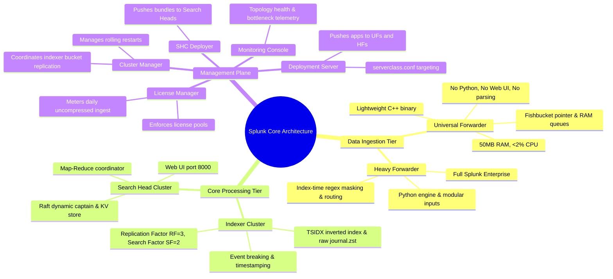

# 📖 Chapter 02: Splunk Core Architecture & The Inner Workings of Every Component

> **The Splunk Administrator's Handbook** | Phase 1: Splunk Fundamentals  
> **Target Audience:** Complete Beginners to Enterprise Administrators  
> **Prerequisites:** Chapter 01 (What is Splunk & Machine Data)

---

## 📸 1. Visual 3D Core Components Ecosystem Overview


*Figure 2.1: 3D Isometric View of the Core Component Ecosystem (`![[07_core_components_3d_breakdown.jpg]]`)*

---

## 🍕 2. The Real-World Analogy: "The Mega Restaurant Network"

To understand how Splunk's components work together, imagine a **nationwide mega-restaurant chain** serving 100,000 customers per hour:

```text
┌────────────────────────────────────────────────────────────────────────┐
│               THE SPLUNK MEGA-RESTAURANT ANALOGY                       │
├────────────────────────────┬───────────────────────────────────────────┤
│ Splunk Component           │ Restaurant Role                           │
├────────────────────────────┼───────────────────────────────────────────┤
│ Universal Forwarder (UF)   │ Fast Delivery Scooter (Picks up raw       │
│                            │ ingredients from farms, delivers to kitchen│
│ Heavy Forwarder (HF)       │ Quality Control Checkpoint (Inspects, washes│
│                            │ peels, removes bad food before kitchen)   │
│ Indexer (IDX)              │ The Main Kitchen & Walk-in Storage Vaults │
│                            │ (Cooks raw items, boxes, labels & stores)  │
│ Search Head (SH)           │ Waiters & Customer Front Desk (Takes orders│
│                            │ from customers, asks kitchen, serves food) │
│ Cluster Manager (CM)       │ Head Kitchen Coordinator (Manages chefs,   │
│                            │ ensures backup copies of recipes & dishes) │
│ Deployment Server (DS)     │ Central Training & Recipe Updater for      │
│                            │ all Delivery Scooters across the country  │
│ SHC Deployer               │ Menu & Dashboard Designer for the Waiters │
│ License Manager (LM)       │ The Finance Auditor (Meters total raw     │
│                            │ ingredients brought into the kitchen daily)│
│ Monitoring Console (MC)    │ CCTV Health & Thermometer Hub (Monitors   │
│                            │ smoke, oven temps, and chef workloads)    │
└────────────────────────────┴───────────────────────────────────────────┘
```

---

## 🏗️ 3. Exhaustive Deep-Dive: How Each Core Component Works Internally

---

### 3.1 Universal Forwarder (UF) — The Lightweight Edge Shipper

#### 🛵 The Simple Explanation: "The High-Speed Express Courier"

Imagine you have 10,000 physical and virtual servers across the globe. Each server continuously writes logs to local files (`/var/log/...`).
- You cannot install heavy software on those servers because they need 100% of their CPU/RAM to run your web applications and databases.
- **The Universal Forwarder (UF) is designed specifically for this.** It is an ultra-lightweight, stripped-down courier whose only job is to pick up log files and ship them over the network as fast as possible.


*Figure 2.2: 3D Isometric Cutaway of Universal Forwarder Inner Mechanics (`![[08_uf_internal_workings_3d.jpg]]`)*

---

#### 🔍 Step-by-Step: The 4-Stage Journey of Data Inside a UF

```text
┌────────────────────────────────────────────────────────────────────────┐
│             THE 4-STAGE JOURNEY OF DATA INSIDE A UF                    │
├────────────────────────────────────────────────────────────────────────┤
│ Stage 1: Input Monitoring & The Fishbucket Bookmark                    │
│          - The UF watches log files on disk (monitor:///var/log/...).  │
│          - It records an exact bookmark in its 'fishbucket' database   │
│            storing the file's MD5 header and exact byte offset read.   │
│                                                                        │
│ Stage 2: Raw Slicing & Chunking (No Heavy Parsing!)                    │
│          - The UF does NOT break lines or parse timestamps.            │
│          - It chops continuous byte streams into neat 64KB blocks and  │
│            tags them with 4 keys: host, source, sourcetype, index.     │
│                                                                        │
│ Stage 3: In-Memory RAM Queue (Shock Absorber)                          │
│          - Chunks enter an in-memory buffer (maxQueueSize = 50MB).     │
│          - If the network hiccups, data stays safely in RAM.           │
│                                                                        │
│ Stage 4: Auto-Load Balancing TCP Output Engine                         │
│          - Sends blocks over TCP Port 9997 to your Indexers.           │
│          - Switches indexers every 30s (autoLBFrequency = 30).         │
│          - Waits for Indexer ACK (useACK = true) before dropping from RAM!│
└────────────────────────────────────────────────────────────────────────┘
```

---

#### 🛡️ Production Resiliency: What if Something Fails?
1. **What if the Server Reboots?**
   - The UF checks its **fishbucket** database (`$SPLUNK_HOME/var/lib/splunk/fishbucket`), sees it previously read up to byte `4,215,800`, and immediately resumes reading from byte `4,215,801`. **Zero logs are lost, and zero logs are duplicated.**
2. **What if the Network Goes Down?**
   - The UF's RAM queue holds up to 50 MB of data. If the network remains down, the UF pauses reading from the file on disk. The logs sit safely on the server's disk until connectivity is restored.

#### 📊 Administrator Summary Table:
| Metric / Feature | Specification |
| :--- | :--- |
| **Resource Footprint** | $< 2\%\text{ CPU}$, $\approx 50\text{--}100\text{ MB RAM}$ |
| **Python Engine / Web UI** | ❌ None (Stripped C/C++ binary) |
| **Licensing Cost** | ❌ 100% Free |
| **Default Ingestion Port** | Sends to Port `9997` (S2S Protocol) |
| **Primary Config Files** | `inputs.conf` (what to monitor), `outputs.conf` (where to send) |

---

### 3.2 Heavy Forwarder (HF) — The Smart Ingestion & Sanitization Proxy

#### 🔍 The Simple Explanation: "The High-Tech Customs Checkpoint"

A **Heavy Forwarder (HF)** is a full Splunk Enterprise installation used as a dedicated security and routing gateway. It intercepts data before it reaches your Indexers to inspect it, redact sensitive secrets (passwords, credit cards), or pull logs from external cloud APIs.


*Figure 2.3: 3D Isometric Cutaway of Heavy Forwarder Inner Mechanics (`![[09_hf_internal_workings_3d.jpg]]`)*

---

#### 🔍 Step-by-Step: The 4-Stage Journey of Data Inside an HF

```text
┌────────────────────────────────────────────────────────────────────────┐
│             THE 4-STAGE JOURNEY OF DATA INSIDE AN HF                   │
├────────────────────────────────────────────────────────────────────────┤
│ Stage 1: Input Receivers & Python Modular Inputs                       │
│          - Listens for high-volume Syslog over UDP/TCP Port 514.       │
│          - Runs Python scripts to pull logs from AWS S3, Azure Event   │
│            Hubs, and third-party REST APIs.                            │
│                                                                        │
│ Stage 2: The Full In-Memory Parsing Pipeline                           │
│          - Runs the event-breaking engine (LINE_BREAKER).              │
│          - Finds timestamp strings (TIME_PREFIX/TIME_FORMAT) and       │
│            converts them into standard UNIX epoch seconds (_time).     │
│                                                                        │
│ Stage 3: Advanced Regex Masking & Data Sanitization Laser              │
│          - Evaluates transforms.conf regular expressions to mask credit│
│            cards (PII/PCI compliance) before data leaves a secure DMZ. │
│                                                                        │
│ Stage 4: Intelligent Routing Switch                                    │
│          - Routes Security logs to Indexer Cluster A.                  │
│          - Streams a real-time copy to an external Kafka/SIEM topic.   │
│          - Drops useless debug spam directly to 'nullQueue'!           │
└────────────────────────────────────────────────────────────────────────┘
```

---

#### ❓ Why Not Install Heavy Forwarders Everywhere?
- A Heavy Forwarder runs a full Python environment and parsing engine, requiring **$\ge 4$ CPU cores and $8\text{--}16\text{ GB RAM}$**.
- Installing an HF on 5,000 application servers would consume massive server compute and introduce immense maintenance overhead. We use UFs on 95% of endpoints and reserve HFs for dedicated DMZ/API relays.

#### 📊 Administrator Summary Table:
| Metric / Feature | Specification |
| :--- | :--- |
| **Resource Footprint** | $\ge 4\text{ CPU Cores}$, $\ge 8\text{--}16\text{ GB RAM}$ |
| **Python Engine / Web UI** | ✅ Full Python runtime / Web UI optional (disabled by default) |
| **Licensing Cost** | ❌ 100% Free (Data is metered only when written to disk on Indexers) |
| **When to Use** | API polling, PII regex masking, Syslog aggregation relay. |
| **Primary Config Files** | `inputs.conf`, `props.conf`, `transforms.conf`, `outputs.conf` |

---

### 3.3 Indexer (IDX) & Indexer Cluster — The Core Processing & Storage Engine

#### 📚 The Simple Explanation: "The Smart Library & Robotic Press"

Imagine you receive **1,000,000 pages of messy log text** from servers every single day.
- If you simply dump those pages into one huge file, finding the word `"ERROR_404"` requires scanning all 1,000,000 lines from start to finish. That takes minutes or hours!
- **This is why the Indexer exists.** It acts like an intelligent, automated library system:


*Figure 2.4A: The Smart Library Analogy — How an Indexer processes, indexes, stores, and replicates data (`![[13_indexer_simple_analogy_3d.jpg]]`)*

---

#### 🔍 Step-by-Step: What the Indexer Does to Your Data

```text
┌────────────────────────────────────────────────────────────────────────┐
│             THE 5-STEP JOURNEY OF DATA INSIDE AN INDEXER               │
├────────────────────────────────────────────────────────────────────────┤
│ Step 1: Raw Messy Logs Arrive                                          │
│         - Continuous stream of text arrives from Forwarders on port 9997│
│                                                                        │
│ Step 2: The Automatic Robotic Press (Compressing Raw Logs)             │
│         - Indexer cuts text into individual events and compresses them │
│           into small, blue storage boxes called 'journal.zst'.         │
│         - Result: A 100 GB log file shrinks down to just ~15-20 GB!    │
│                                                                        │
│ Step 3: Create the Glowing Index Catalog (The '.tsidx' Secret)         │
│         - The Indexer writes an alphabetical index book (like the index│
│           at the back of a textbook).                                  │
│         - It maps every single word to its exact box number:           │
│             "ERROR"          ──► Box #105, Box #112, Box #148          │
│             "web-server-01"  ──► Box #077, Box #088, Box #105          │
│             "IP:192.168.1.1" ──► Box #098, Box #105, Box #130          │
│             "status=500"     ──► Box #105, Box #115, Box #152          │
│                                                                        │
│ Step 4: Organize into Smart Storage Shelves (Buckets)                  │
│         - HOT Storage:  On the desk (Fast NVMe SSD) for newest logs.   │
│         - WARM Storage: On the shelf (Fast SSD) for recent searches.   │
│         - COLD Storage: In the basement archive (Cheaper HDD storage). │
│                                                                        │
│ Step 5: Automatic Replication & Backup (Indexer Cluster)               │
│         - Makes 3 duplicate copies across different servers (RF=3)    │
│           so if any server catches fire, ZERO data is lost!            │
└────────────────────────────────────────────────────────────────────────┘
```

---

#### ⚡ Why is Searching in Splunk So Fast?

When you search: `status=500 AND "ERROR"`

1. **Without Splunk (Slow):** The computer opens every log file on disk and reads billions of lines one by one. *(Takes 10 minutes)*.
2. **With Splunk Indexer (Lightning Fast):**
   - Splunk opens the **`.tsidx` Index Catalog Book**.
   - It looks at `"status=500"` (Boxes: #105, #115, #152).
   - It looks at `"ERROR"` (Boxes: #105, #112, #148).
   - It instantly finds the match: **Box #105**!
   - Splunk opens **ONLY Box #105** from `journal.zst` and returns your results in **0.005 seconds**!

---

#### 🗄️ What is a "Bucket"? (Filing Folders by Date)

A **Bucket** is simply a directory (folder) on the Indexer's hard drive that holds log events for a specific period of time:

```text
  [ Fresh Logs Arrive ]
           │
           ▼
┌───────────────────────┐
│      HOT BUCKET       │  • Where: Super-fast NVMe SSD.
│  (Active Right Now)   │  • Status: Actively written to; immediately searchable.
└──────────┬────────────┘
           │ When full (~10 GB) or after a few days:
           ▼
┌───────────────────────┐
│     WARM BUCKET       │  • Where: Fast SSD.
│  (Recent Searchable)  │  • Status: Closed for writing; 100% read-only searchable.
└──────────┬────────────┘
           │ When warm shelf gets crowded:
           ▼
┌───────────────────────┐
│     COLD BUCKET       │  • Where: High-capacity, cheaper mechanical hard drives.
│  (Older Historical)   │  • Status: Still searchable, but takes a few seconds longer.
└──────────┬────────────┘
           │ When retention limit reached (e.g. 90 days or 1 year):
           ▼
┌───────────────────────┐
│    FROZEN BUCKET      │  • Where: Archived to Cloud Storage (AWS S3) or DELETED.
│  (Archived / Expired) │  • Status: The '.tsidx' index is destroyed to save disk space.
└───────────────────────┘
```

---

#### 🛡️ What is an "Indexer Cluster"? (The Photocopy Backup Team)

If you only have **1 Indexer** and its motherboard or hard drive fails, your company loses all its logs and nobody can search.

In production, we group multiple Indexers into an **Indexer Cluster**:

```text
┌────────────────────────────────────────────────────────────────────────┐
│                     INDEXER CLUSTER ARCHITECTURE                       │
├───────────────────────────────────┬────────────────────────────────────┤
│ 1. Replication Factor (RF = 3)    │ Splunk creates 3 identical copies  │
│    (Zero Data Loss Guarantee)     │ of every raw data box (journal.zst)│
│                                   │ across 3 separate physical servers.│
├───────────────────────────────────┼────────────────────────────────────┤
│ 2. Search Factor (SF = 2)         │ Splunk creates 2 copies of the     │
│    (High-Speed Search Guarantee)  │ index catalog (.tsidx). If one     │
│                                   │ indexer dies, another immediately  │
│                                   │ answers queries without delay.     │
├───────────────────────────────────┼────────────────────────────────────┤
│ 3. Cluster Manager (CM)           │ The master brain that constantly   │
│    (The Coordinator)              │ checks if all indexers are alive.  │
│                                   │ If an indexer goes down, it orders │
│                                   │ remaining indexers to make copies. │
└───────────────────────────────────┴────────────────────────────────────┘
```

---

#### ⚙️ The Deep Technical Cutaway: Step-by-Step Breakdown of Every Part


*Figure 2.4B: 3D Engineering Cutaway of Indexer Internal Memory Queues & Storage Engine (`![[10_indexer_internal_workings_3d.jpg]]`)*

Let's walk through every single station shown in the 3D cutaway diagram above, from left to right:

---

### 🧩 Part 1: Data Ingestion & The 4 Memory Queues (The Pipeline Shock Absorbers)

When data streams into an Indexer from Universal Forwarders over **Port 9997 (TCP)**, it doesn't write to disk immediately. It passes through **4 sequential memory queues (RAM buffers)** that act like an assembly line:

```text
[ Port 9997 TCP Stream ] ──► [ utf8_queue ] ──► [ agg_queue ] ──► [ typing_queue ] ──► [ index_queue ] ──► [ Disk ]
```

1. **`utf8_queue` (The Character Cleaner & Validator):**
   - **What it does:** Reads raw bytes from the network card and ensures every character is valid UTF-8 text.
   - **Simple Analogy:** Like a spell-checker that cleans corrupted or garbled binary characters before passing text along.
2. **`agg_queue` / Aggregator Queue (The Scissors & Event Breaker):**
   - **What it does:** Raw data arrives as a continuous, unbroken river of text. The `agg_queue` applies the `LINE_BREAKER` regular expression to cut the river into **discrete, individual log events**.
   - **Simple Analogy:** Like an automated pair of scissors cutting a continuous roll of paper into individual receipts.
3. **`typing_queue` (The Timestamp Detective & Security Inspector):**
   - **What it does:** 
     - **Timestamp Extraction:** Finds the date/time string in each event, interprets the timezone, and converts it into UNIX epoch seconds (`_time`).
     - **Data Masking & Filtering:** Evaluates `transforms.conf` rules to redact sensitive credit card numbers/PII or drop junk events to `nullQueue`.
   - **Simple Analogy:** A customs officer stamping the official date on every document and blacking out secret passwords with a marker.
4. **`index_queue` (The Pre-Disk Staging Buffer):**
   - **What it does:** Holds fully parsed, clean events in RAM right before they are handed over to the disk writer.
   - **Why Queues Matter in Production:** If the hard drive is temporarily busy or slow, these memory queues expand safely to hold incoming data in RAM without dropping a single log line!

---

### 🧩 Part 2: The Indexing Engine (The Compressor & Catalog Builder)

Once data leaves the `index_queue`, the Indexing Engine creates **two critical files**:

1. **The Compression Block (`journal.zst` — Raw Compressed Text):**
   - **What it does:** Takes the clean, parsed log lines and compresses them into immutable archive blocks using the ultra-fast Zstandard algorithm (`zstd`).
   - **Simple Analogy:** Like a hydraulic garbage compactor that takes 100 boxes of loose paper and squashes them into 15 compact, numbered storage bricks.
2. **The Golden Inverted Index Pyramid (`.tsidx` — The Keyword Map):**
   - **What it does:** Breaks every log line into individual words (tokens) like `"ERROR"`, `"192.168.1.50"`, `"admin"` and records their exact position (posting offsets) inside `journal.zst`.
   - **Simple Analogy:** The alphabetical index in the back of an encyclopedia. Instead of reading all 5,000 pages, you look up the word "Splunk" $\rightarrow$ found on Page 42, Line 15.
3. **Bloom Filters (`.bloom` — The Instant Rejector):**
   - **What it does:** A mathematical bit-array that answers: *"Does the word 'HACKER' exist in this bucket?"*
   - If the Bloom Filter says **"NO"**, Splunk skips opening the `.tsidx` file completely! This saves 90%+ of disk reading during searches.

---

### 🧩 Part 3: Multi-Tiered Storage Buckets (The Lifecycle Shelves)

Data on disk is organized into structured folders called **Buckets** that age over time:

1. **HOT BUCKET (Active Writing — Fast NVMe SSD):**
   - The only bucket open for active writing right now. Holds both live `journal.zst` and open `.tsidx` files.
   - Located on the fastest storage tier (`homePath`).
2. **WARM BUCKET (Read-Only Search — Fast SSD):**
   - When a Hot bucket reaches its size limit (e.g., 10 GB via `maxDataSize`), it **rolls over** into a Warm bucket.
   - Closed for writing; renamed with its exact oldest and newest timestamps (e.g., `db_1773570000_1773483600_12`). 100% searchable.
3. **COLD BUCKET (Archived Storage — High-Capacity HDD):**
   - When the fast SSD gets crowded (exceeding `maxWarmDBCount`), older warm buckets automatically move to cheaper, larger mechanical hard drives (`coldPath`).
   - Still completely searchable by users!

---

### 🧩 Part 4: Cluster Replication (The Zero-Data-Loss Backup Beam)

At the bottom right of the 3D cutaway, the **Replication Manager** handles cluster high availability:

1. **Replication Beam (Port 9887):**
   - As soon as a Hot bucket slice is written, the indexer fires a stream across **Port 9887** to peer indexer nodes.
2. **Replication Factor ($\text{RF}=3$):**
   - Creates **3 copies of raw compressed data (`journal.zst`)** on 3 separate physical servers. If 2 servers suffer a sudden hardware failure, your raw data is 100% intact.
3. **Search Factor ($\text{SF}=2$):**
   - Creates **2 searchable copies of the index catalog (`.tsidx`)**. If the primary search indexer goes offline, another node immediately answers queries with zero downtime.

---

#### 📊 Administrator Summary Table:
| Metric / Feature | Specification |
| :--- | :--- |
| **Hardware Requirements** | 16–32+ CPU Cores, 64–128 GB RAM, NVMe SSD ($\ge 1200\text{ IOPS}$) |
| **Licensing Cost** | ⚠️ **This is where licensing is metered!** Measured on raw uncompressed ingest volume. |
| **Default Ports** | `9997` (Ingest from forwarders), `8089` (Management/Search), `9887` (Inter-indexer cluster replication) |
| **Failure Mode** | In a cluster ($\text{RF}=3$), up to 2 indexers can fail simultaneously with **zero data loss**. |

---

### 3.4 Search Head (SH) & Search Head Cluster — The Distributed Analytics Engine

#### 🤵 The Simple Explanation: "The Head Waiter & Command Center"

Imagine you are in a restaurant with 10 different kitchens. You don't walk into all 10 kitchens yourself to look for food.
- You sit at a table and tell the **Head Waiter (Search Head)**: *"I want a report on all failed logins."*
- The Waiter translates your order, asks all 10 kitchens simultaneously to check their vaults, gathers their partial answers, merges them into a beautiful plate, and hands it to you.
- **This is the Search Head.** It provides the Web UI (Port 8000) and coordinates distributed searches across all your Indexers.


*Figure 2.5: 3D Isometric View of Search Head Distributed Map-Reduce Execution (`![[11_search_head_internal_workings_3d.jpg]]`)*

---

#### 🔍 Step-by-Step: The 4-Step Map-Reduce Distributed Search Journey

When a user runs: `index=web status=500 | stats count by clientip`

```text
┌────────────────────────────────────────────────────────────────────────┐
│             THE 4-STEP MAP-REDUCE DISTRIBUTED SEARCH FLOW              │
├────────────────────────────────────────────────────────────────────────┤
│ Step 1: User Input & SPL Query Parsing                                 │
│         - User types query in Splunk Web UI (Port 8000).               │
│         - Search Head validates user permissions (RBAC).               │
│         - Optimizes query and splits it into Streaming vs Transforming.│
│                                                                        │
│ Step 2: The MAP Phase (Search Job Dispatch)                            │
│         - Search Head dispatches the search request to all 6 Indexers  │
│           simultaneously over HTTPS Port 8089.                         │
│                                                                        │
│ Step 3: Local Execution on Indexers (Streaming Search)                 │
│         - Each indexer opens its local .tsidx files and raw logs.      │
│         - Computes its own local sub-count of status=500 per IP.       │
│         - Streams partial summary blocks back to the Search Head.      │
│                                                                        │
│ Step 4: The REDUCE Phase & Knowledge Object Evaluation                 │
│         - Results Merger combines partial counts from all indexers.    │
│         - Evaluates search-time lookups (e.g. mapping IP to country).  │
│         - Renders final charts, tables, and dashboards to the user!    │
└────────────────────────────────────────────────────────────────────────┘
```

---

#### 🛡️ What is a "Search Head Cluster (SHC)"?
In an enterprise with 500 security analysts and automated alerts running 24/7:
- A single Search Head would run out of CPU and search concurrency slots.
- We group 3 or more Search Heads into a **Search Head Cluster (SHC)**.
- **Raft Consensus Protocol:** The cluster elects a dynamic **Captain**. The Captain balances scheduled search jobs evenly across all members so no single Search Head gets overloaded.
- **KV Store Replication (Port 8191):** Automatically synchronizes lookup tables and user dashboard changes across all Search Head members.

#### 📊 Administrator Summary Table:
| Metric / Feature | Specification |
| :--- | :--- |
| **Hardware Requirements** | 16–32 CPU Cores, 32–64 GB RAM |
| **Licensing Cost** | ❌ 100% Free |
| **Clustering Protocol** | Raft consensus algorithm with dynamic **Captain** election (min. 3 members). |
| **Default Ports** | `8000` (Web UI), `8089` (REST/Mgmt to Indexers), `8191` (KV Store Replication) |
| **Failure Mode** | If a Search Head crashes, the cluster elects a new Captain in $< 1\text{ second}$. Users access surviving nodes via a load balancer. |

---

### 3.5 The Management Plane — Control, Orchestration & Compliance

#### 🗼 The Simple Explanation: "The Airport Air Traffic Control Tower"

An enterprise Splunk deployment can have thousands of servers. You cannot log into 5,000 servers one by one to update passwords, monitor health, or check software versions.
- The **Management Plane** acts like an **Air Traffic Control Tower**. It does not process user searches or store raw customer data; it supervises, updates, and audits the entire fleet.


*Figure 2.6: 3D Isometric Cutaway of the Management Control Plane (`![[12_management_plane_internal_workings_3d.jpg]]`)*

---

#### 🔍 Step-by-Step Breakdown of the 5 Management Specialists

```text
┌────────────────────────────────────────────────────────────────────────┐
│                   THE 5 MANAGEMENT PLANE ROLES                         │
├────────────────────────────────────────────────────────────────────────┤
│ 1. Deployment Server (DS) — The Forwarder Fleet Manager                │
│    - 1,000s of Universal Forwarders "phone home" to the DS on Port 8089│
│      every 60 seconds.                                                 │
│    - The DS checks 'serverclass.conf' (e.g. Linux Web vs Windows DC)   │
│      and automatically downloads new app packages and inputs.conf.     │
├────────────────────────────────────────────────────────────────────────┤
│ 2. Cluster Manager (CM) — The Indexer Cluster Boss                     │
│    - Constantly receives health heartbeats from Indexers on Port 8089. │
│    - Ensures Replication Factor (RF=3) and Search Factor (SF=2) hold.  │
│    - If an Indexer dies, CM tells surviving indexers to create copies! │
│    - Orchestrates zero-downtime rolling upgrades across indexers.      │
├────────────────────────────────────────────────────────────────────────┤
│ 3. License Manager (LM) — The Financial Meter & Auditor                │
│    - Receives daily uncompressed byte counts from all Indexers.        │
│    - Partitions license quota into License Pools (e.g. 2 TB Security,  │
│      1 TB IT Ops) to prevent runaway debug logs from breaking quota.   │
├────────────────────────────────────────────────────────────────────────┤
│ 4. SHC Deployer — The Search Head App Pusher                           │
│    - A dedicated server that pushes app bundles ($SPLUNK_HOME/etc/     │
│      shcluster/apps) to Search Head Cluster members.                   │
│    - Distinct from the Deployment Server!                              │
├────────────────────────────────────────────────────────────────────────┤
│ 5. Monitoring Console (MC) — The Hospital Health Hub                   │
│    - Aggregates internal metrics (_internal and _introspection).       │
│    - Real-time dashboards for CPU, RAM, Disk IOPS bottlenecks, search  │
│      concurrency limits, and pipeline queue blockages.                 │
└────────────────────────────────────────────────────────────────────────┘
```

#### 📊 Administrator Summary Table:
| Management Role | Who Does It Manage? | What Configuration / Path Does It Control? |
| :--- | :--- | :--- |
| **Deployment Server (DS)** | Universal & Heavy Forwarders | `$SPLUNK_HOME/etc/deployment-apps/` & `serverclass.conf` |
| **Cluster Manager (CM)** | Indexer Cluster Peers | `$SPLUNK_HOME/etc/master-apps/` & `server.conf` |
| **SHC Deployer** | Search Head Cluster Members | `$SPLUNK_HOME/etc/shcluster/apps/` |
| **License Manager (LM)** | All Indexers (License Slaves) | `server.conf` (License Master stanzas) |
| **Monitoring Console (MC)** | Entire Topology | Out-of-the-box telemetry dashboards & alerts |

---

## ⚖️ 4. The 3 Crucial Component Comparisons

### Comparison 1: Universal Forwarder vs. Heavy Forwarder

```text
┌──────────────────────────────────────┬──────────────────────────────────────┐
│       UNIVERSAL FORWARDER (UF)       │        HEAVY FORWARDER (HF)          │
├──────────────────────────────────────┼──────────────────────────────────────┤
│ • Binary: Stripped-down C/C++        │ • Binary: Full Splunk Enterprise     │
│ • RAM Usage: ~50 - 100 MB            │ • RAM Usage: 4 - 16+ GB              │
│ • CPU Usage: < 2%                    │ • CPU Usage: Multi-core required     │
│ • Python Interpreter: NO             │ • Python Interpreter: YES            │
│ • Web UI: NO                         │ • Web UI: Optional (disabled by def) │
│ • Event Line Breaking: NO            │ • Event Line Breaking: YES           │
│ • PII / Regex Masking: NO            │ • PII / Regex Masking: YES           │
│ • Primary Location: On 10,000+ hosts │ • Primary Location: DMZ / API Relay  │
└──────────────────────────────────────┴──────────────────────────────────────┘
```

---

### Comparison 2: The 3 Management Masters (Never Confuse These!)

| Feature | Deployment Server (DS) | SHC Deployer | Cluster Manager (CM) |
| :--- | :--- | :--- | :--- |
| **Who does it manage?** | Universal & Heavy Forwarders | Search Head Cluster (SHC) | Indexer Cluster (IDXC) |
| **What does it push?** | Forwarder apps (`etc/deployment-apps/`) | SHC app bundles (`etc/shcluster/apps/`) | Indexer cluster apps (`etc/master-apps/`) |
| **How is config applied?** | Polled by forwarders (Phone home) | Pushed via CLI: `splunk apply shcluster-bundle` | Pushed via CLI: `splunk apply cluster-bundle` |
| **Does it handle replication?**| ❌ No | ❌ No | ✅ Yes (Coordinates RF/SF bucket fixups) |

---

## 🧠 5. Chapter 02 Self-Check Quiz

1. Why should you **never** install a Heavy Forwarder on 500 general application servers?
2. Which component coordinates bucket replication across an Indexer Cluster?
3. Which component pushes app bundles to Search Head Cluster members?
4. Do Universal Forwarders, Search Heads, or replicated indexer bucket copies count against your Splunk license?
5. In a distributed search, what is the exact difference between the work done by the **Indexer (Map)** and the **Search Head (Reduce)**?

---

## 📌 6. Visual Mind Map & Sticky Notes (Chapter 02 Quick-Review)

### 📸 Visual 3D Concept Board

*Figure 2.7: 3D Visual Concept & Component Breakdown Board (`![[07_core_components_3d_breakdown.jpg]]`)*

### 🧠 Hierarchical Mind Map


### 🗂️ Color-Coded Digital Sticky Notes

#### 🟨 Sticky Note 1: Universal Forwarder Golden Rule
```text
┌─────────────────────────────────────────────────────────────┐
│ 📌 UNIVERSAL FORWARDER (UF): THE 95% DEFAULT                │
│                                                             │
│ • Always use UFs on edge servers (Linux, Windows, K8s).     │
│ • Extremely light: ~50MB RAM, <2% CPU.                      │
│ • Does NOT parse regex, break events, or extract timestamps.│
│ • Sends raw 64KB chunks to indexers over TCP port 9997.     │
│ • Fishbucket remembers byte offsets across reboots!         │
└─────────────────────────────────────────────────────────────┘
```

#### 🟩 Sticky Note 2: When to Use a Heavy Forwarder
```text
┌─────────────────────────────────────────────────────────────┐
│ 📌 HEAVY FORWARDER (HF): THE SPECIALIZED GATEWAY            │
│                                                             │
│ Use ONLY when you need:                                     │
│ 1. Python modular inputs (AWS S3, REST APIs).               │
│ 2. Index-time regex PII masking before leaving a secure DMZ.│
│ 3. Syslog ingestion (UDP 514) aggregated to TCP 9997.       │
│ ⚠️ Never deploy on general application endpoints!           │
└─────────────────────────────────────────────────────────────┘
```

#### 🟪 Sticky Note 3: Indexer Cluster Resiliency
```text
┌─────────────────────────────────────────────────────────────┐
│ 📌 INDEXER CLUSTER: RF=3 & SF=2                             │
│                                                             │
│ • Replication Factor (RF=3): 3 raw copies of every bucket.  │
│ • Search Factor (SF=2): 2 searchable (TSIDX) copies.        │
│ • Benefit: If 1 or 2 indexers crash, ZERO data is lost and  │
│   searches continue without downtime.                       │
│ • Managed entirely by the Cluster Manager (CM).             │
└─────────────────────────────────────────────────────────────┘
```

#### 🟦 Sticky Note 4: The 3 Management Masters
```text
┌─────────────────────────────────────────────────────────────┐
│ 📌 MANAGEMENT TIERS (DO NOT CONFUSE!):                      │
│                                                             │
│ 1. Deployment Server (DS) ──► Pushes apps to FORWARDERS.    │
│ 2. SHC Deployer          ──► Pushes apps to SEARCH HEADS.   │
│ 3. Cluster Manager (CM)  ──► Coordinates INDEXER CLUSTERS.  │
└─────────────────────────────────────────────────────────────┘
```

#### 🟧 Sticky Note 5: License Accounting Rule
```text
┌─────────────────────────────────────────────────────────────┐
│ 📌 LICENSING: ONLY INDEXER WRITES COUNT                     │
│                                                             │
│ • Universal Forwarders = 100% FREE                          │
│ • Heavy Forwarders = 100% FREE                              │
│ • Search Heads = 100% FREE                                  │
│ • Replicated bucket copies (RF) = 100% FREE                 │
│ • Data is metered ONCE when the indexer writes to disk.     │
└─────────────────────────────────────────────────────────────┘
```

---

### ⚡ Rapid-Recall Flashcards

| # | Question (Front) | Answer (Back) |
| :-: | :--- | :--- |
| **01** | Which forwarder contains a Python runtime and full parsing engine? | **Heavy Forwarder (HF)** |
| **02** | Which forwarder should be deployed on 5,000 application servers? | **Universal Forwarder (UF)** |
| **03** | What are the two core files created by Indexers inside every bucket? | **`journal.zst`** (raw compressed text) and **`.tsidx`** (inverted index). |
| **04** | Which component coordinates Search Head Cluster bundle deployments? | The **Deployer** (`etc/shcluster/apps/`). |
| **05** | Which component monitors cluster-wide CPU, RAM, and queue health? | The **Monitoring Console (MC)**. |
| **06** | What is the purpose of the **fishbucket** on a Universal Forwarder? | Stores file read pointers (MD5 hash & byte offsets) so files are never re-read after restarts. |
| **07** | What consensus algorithm is used by Search Head Clusters to elect a Captain? | **Raft Consensus Protocol**. |

---

## 🎮 Hands-On Cyber Range Challenge: Room P1-02 (TryHackMe / HTB Style)

```text
┌────────────────────────────────────────────────────────────────────────┐
│ 🕹️ ARENA MISSION: Room P1-02 — Core Architecture & Component Recon     │
│ ⭐ DIFFICULTY: Easy-Medium | 💎 REWARD: 200 XP | ⏱️ TIME: 30 Mins       │
└────────────────────────────────────────────────────────────────────────┘
```

> **🚨 Incident Scenario:**  
> A misconfigured enterprise cluster crashed after an engineer tried to configure regex masking on Universal Forwarders and deployed cluster bundles using the wrong tool.  
> Your mission is to audit the components, separate the collection and indexing layers, and verify the Map-Reduce dispatch flow!

### 🎯 Mission Checkpoint Questions

#### 1. Why will in-memory regex data masking fail if deployed on a Universal Forwarder?
*(Answer Format: Universal Forwarders lack the ****** ******* and parsing pipeline)*
<details><summary>💡 Need a Hint?</summary>Look at the stripped-down binary footprint of a UF compared to an HF.</details>
<details><summary>🔓 Reveal Answer</summary><b>Answer:</b> Universal Forwarders lack the <code>Python runtime</code> and parsing pipeline binaries.</details>

#### 2. What file extension does Splunk use for its time-series inverted index lexicon?
*(Answer Format: `.*****`)*
<details><summary>💡 Need a Hint?</summary>Time Series Index.</details>
<details><summary>🔓 Reveal Answer</summary><b>Answer:</b> <code>.tsidx</code></details>

#### 3. What computing paradigm allows Search Heads to delegate heavy data filtering down to Indexers?
*(Answer Format: `***-******`)*
<details><summary>💡 Need a Hint?</summary>First transforming locally (Map), then aggregating results (Reduce).</details>
<details><summary>🔓 Reveal Answer</summary><b>Answer:</b> <code>Map-Reduce</code></details>

#### 4. Which management server component distributes apps and configuration bundles to Search Head Clusters?
*(Answer Format: `********`)*
<details><summary>💡 Need a Hint?</summary>Do not confuse with the Deployment Server!</details>
<details><summary>🔓 Reveal Answer</summary><b>Answer:</b> <code>Deployer</code></details>

👉 **[Launch Full Interactive Lab: Room P1-02 & Capture All 4 Flags (200 XP)](../Labs/Room_P1_02_Core_Architecture_and_Components.md)**
