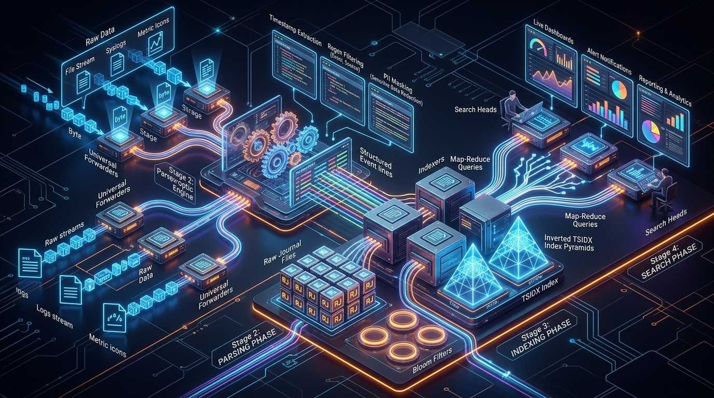
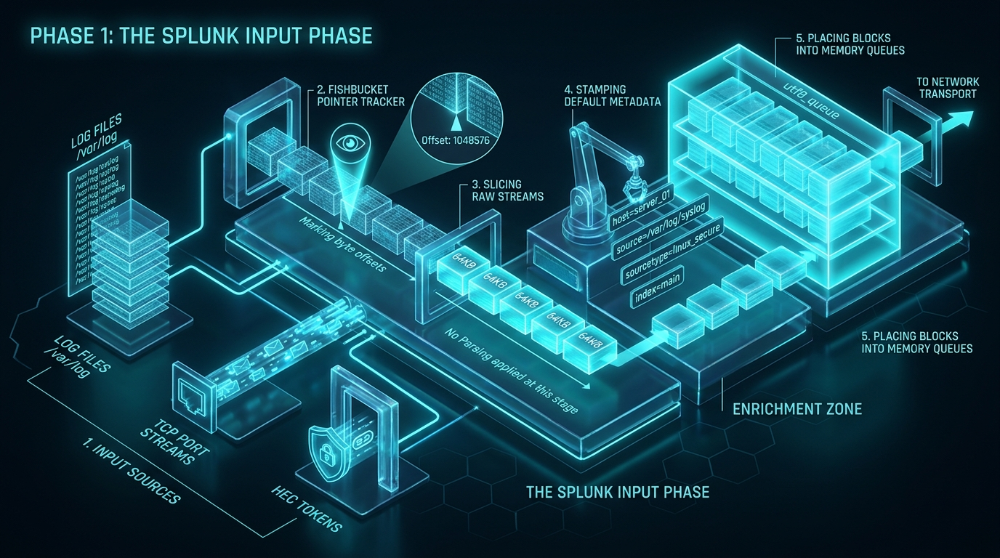
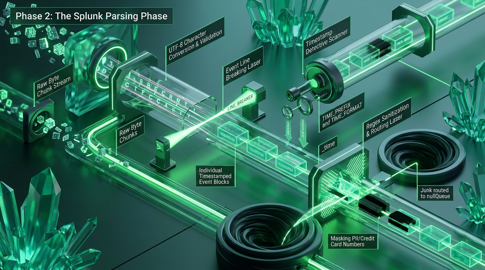
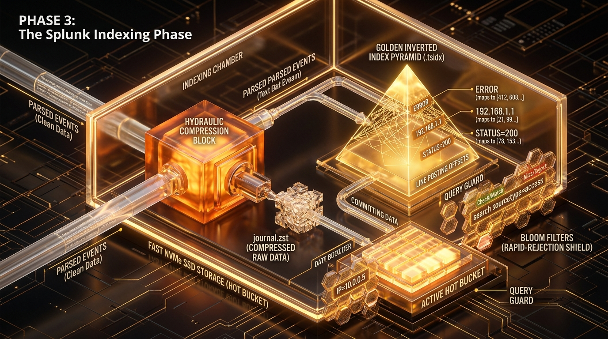
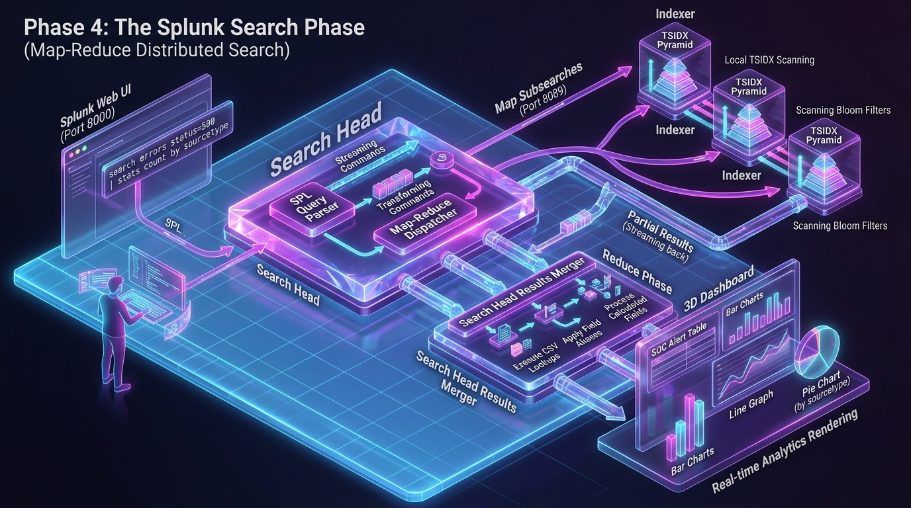
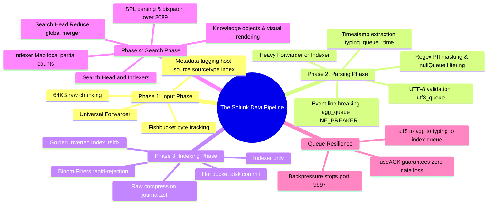

# 📖 Chapter 03: The End-to-End Data Pipeline & Ingestion Lifecycle

> **The Splunk Administrator's Handbook** | Phase 1: Splunk Fundamentals  
> **Target Audience:** Complete Beginners to Enterprise Administrators  
> **Prerequisites:** Chapter 01 (Machine Data) & Chapter 02 (Core Architecture)

---

## 📸 1. Visual Overview: The 4-Stage Splunk Data Pipeline


*Figure 3.1: 3D Master Overview of the 4-Stage Ingestion Pipeline (`![[02_data_pipeline_4phases_3d.jpg]]`)*

Every single byte of machine data that enters Splunk travels through **four sequential, immutable phases**:

```text
┌─────────────────┐      ┌──────────────────┐      ┌─────────────────┐      ┌────────────────┐
│ 1. INPUT PHASE  │ ───► │ 2. PARSING PHASE │ ───► │3. INDEXING PHASE│ ───► │4. SEARCH PHASE │
│ (UF / HF / IDX) │      │ (HF / Indexer)   │      │ (Indexer Only)  │      │ (SH & Indexers)│
└─────────────────┘      └──────────────────┘      └─────────────────┘      └────────────────┘
```

---

## 🏗️ 2. Step-by-Step Deep Dive: The 4 Ingestion Phases (With Crystal 3D Cutaways)

---

### 🔹 Phase 1: The Input Phase (Acquisition & Chunking)

#### 🛵 Simple Concept: "The Loading Dock & Package Labeler"
The Input Phase is where Splunk first opens files, listens to network ports, or receives API tokens. Its only responsibility is to read raw bytes, package them into 64KB boxes, stamp default labels, and put them on a conveyor belt.


*Figure 3.2: 3D Crystal Cutaway of Phase 1 (The Input Phase) (`![[14_pipeline_phase1_input_3d.jpg]]`)*

#### 🔍 Step-by-Step Internal Mechanics:
1. **Input Sources (Left):**
   - Monitors log files on disk (`monitor:///var/log/syslog`), listens on network ports (`tcp://514`, `udp://514`), or receives HTTP Event Collector tokens (`http://:8088/services/collector`).
2. **Fishbucket Pointer Tracker:**
   - For file inputs, Splunk computes an **MD5 checksum** of the first 256 bytes of the file and maintains a continuous byte-read offset inside `$SPLUNK_HOME/var/lib/splunk/fishbucket`.
   - If the server restarts, Splunk checks the fishbucket and immediately resumes reading from the exact next byte.
3. **64KB Raw Slicing (No Parsing!):**
   - The stream is sliced into **64KB raw byte chunks**.
   - ⚠️ **CRITICAL RULE:** **Universal Forwarders DO NOT break lines or parse timestamps.** They only package raw chunks.
4. **Stamping the 4 Mandatory Metadata Keys:**
   - Splunk attaches the 4 core metadata labels to each chunk:
     - `host`: Hostname or IP of the origin system.
     - `source`: Exact file path or network port name.
     - `sourcetype`: Format definition key (e.g. `cisco:asa`, `nginx:access`).
     - `index`: Target storage repository (e.g. `main`, `security`, `web`).
5. **Placement into In-Memory Queues:**
   - Raw chunks enter memory buffers (`maxQueueSize = 50MB`) ready for transport across TCP port `9997` (S2S protocol).

---

### 🔹 Phase 2: The Parsing Phase (Index-Time Processing & Sanitization)

#### ✂️ Simple Concept: "The Laser Slicer, Clock Detective & Security Guard"
Data arrives as an unbroken river of raw bytes. The Parsing Phase cuts the river into distinct event blocks, stamps the official timestamp, masks confidential data, and discards unwanted junk.


*Figure 3.3: 3D Crystal Cutaway of Phase 2 (The Parsing Phase) (`![[15_pipeline_phase2_parsing_3d.jpg]]`)*

#### 🔍 Step-by-Step Internal Mechanics:
- **Where it runs:** On the **Heavy Forwarder** or **Indexer** (**Never** on a Universal Forwarder).

1. **UTF-8 Character Conversion & Validation:**
   - Converts character streams (ASCII, Latin-1, UTF-16) into standardized UTF-8 text inside `utf8_queue`.
2. **Event Line Breaking Laser (`LINE_BREAKER`):**
   - The `agg_queue` applies the `LINE_BREAKER` regex (default: `([\r\n]+)`) to slice the raw byte river into **individual, timestamped event records**.
   - Applies the `TRUNCATE` safety threshold (default: 10,000 characters) to prevent runaway single-line log crashes.
3. **Timestamp Detective Scanner (`TIME_PREFIX` & `TIME_FORMAT`):**
   - In `typing_queue`, the timestamp parser searches for date/time strings using `TIME_PREFIX`.
   - Reads up to `MAX_TIMESTAMP_LOOKAHEAD` characters and interprets the pattern via `TIME_FORMAT` (e.g., `%Y-%m-%d %H:%M:%S`).
   - Translates the local time into standardized **UNIX Epoch seconds** (e.g., `1773570000`) and stamps it as the permanent field **`_time`**.
4. **Regex Sanitization & Data Routing Laser:**
   - **PII / PCI Masking:** Replaces credit card numbers, SSNs, and passwords with `XXXX-XXXX` using `transforms.conf` before data is saved.
   - **Junk Filtering to `nullQueue`:** Evaluates regex to discard spammy debug messages to `queue = nullQueue`, saving massive licensing and disk costs!

---

### 🔹 Phase 3: The Indexing Phase (Compression & Inverted Indexing)

#### 📚 Simple Concept: "The Hydraulic Compactor & Golden Index Builder"
In the Indexing Phase, parsed events are transformed into immutable storage. Splunk squashes the raw text into small bricks and builds an alphabetical search catalog.


*Figure 3.4: 3D Crystal Cutaway of Phase 3 (The Indexing Phase) (`![[16_pipeline_phase3_indexing_3d.jpg]]`)*

#### 🔍 Step-by-Step Internal Mechanics:
- **Where it runs:** **Indexer Only**.

1. **Hydraulic Compression Block (`journal.zst`):**
   - Squeezes the raw parsed event text using the ultra-fast Zstandard (`zstd`) algorithm ($5\times\text{ to }10\times$ compression).
   - Writes compressed blocks sequentially to the active **Hot Bucket** on NVMe SSD storage (`homePath`).
2. **The Golden Inverted Index Pyramid (`.tsidx`):**
   - Tokenizes every alphanumeric word in the event (e.g., `"FAIL"`, `"192.168.1.50"`, `"status=500"`).
   - Maps each word to its exact line posting offset inside `journal.zst` (like the index at the back of an encyclopedia).
3. **Hexagonal Bloom Filters (`.bloom` — The Rapid-Rejection Shield):**
   - Creates a probabilistic bit-array for each bucket.
   - When a search runs, the Bloom Filter instantly answers if a keyword **definitely does NOT exist** in the bucket, skipping costly disk reads entirely!
4. **Committing to Active Hot Buckets:**
   - Flushes indexed blocks to disk, releases memory buffers, and sends an **Acknowledgement Signal (ACK)** back to the forwarder.

---

### 🔹 Phase 4: The Search Phase (Distributed Map-Reduce)

#### 🤵 Simple Concept: "The Master Waiter & Analytical Kitchen"
When an analyst searches across 50 Terabytes of logs, Splunk distributes the search query to all indexers in parallel, merges the results, and renders the visual dashboard.


*Figure 3.5: 3D Crystal Cutaway of Phase 4 (The Search Phase) (`![[17_pipeline_phase4_search_3d.jpg]]`)*

#### 🔍 Step-by-Step Internal Mechanics:
- **Where it runs:** On the **Search Head** and **Indexers** simultaneously.

1. **User Input & SPL Query Parser:**
   - Analyst enters a query in Splunk Web (Port 8000), e.g.:
     `search index=web status=500 | stats count by sourcetype`
   - The Search Head checks Role-Based Access Control (RBAC) and parses the SPL query into an execution tree.
2. **The MAP Phase (Search Dispatch over Port 8089):**
   - The Search Head dispatches subsearches simultaneously to all Indexers across HTTPS port `8089`.
3. **Local Execution on Indexers (Streaming Search):**
   - Each Indexer checks its local Bloom Filters and scans its local `.tsidx` pyramids.
   - Indexers extract raw text lines from `journal.zst` and calculate **local partial counts** per sourcetype.
   - Indexers stream intermediate summary blocks back to the Search Head.
4. **The REDUCE Phase & Knowledge Object Evaluation:**
   - The Search Head's **Results Merger** receives partial counts from all indexers and calculates the **global total**.
   - Evaluates search-time knowledge objects: CSV lookups, field aliases, and calculated fields.
5. **Real-time Analytics Rendering:**
   - Formats the aggregated numbers into interactive bar charts, line graphs, pie charts, and SOC security alert tables.

---

## 🚦 3. Internal Pipeline Queues & Backpressure Mechanics

Inside the `splunkd` process on Indexers and Heavy Forwarders, data flows sequentially through 4 dedicated RAM queues:

```text
[ Incoming TCP Stream ]
          │
          ▼
┌──────────────────┐
│    utf8_queue    │ ── Validates & normalizes UTF-8 character encoding
└────────┬─────────┘
         ▼
┌──────────────────┐
│    agg_queue     │ ── Aggregates lines & breaks events (LINE_BREAKER)
└────────┬─────────┘
         ▼
┌──────────────────┐
│   typing_queue   │ ── Extracts timestamps (_time) & applies regex transforms
└────────┬─────────┘
         ▼
┌──────────────────┐
│   index_queue    │ ── Builds TSIDX index & writes raw data to Hot Bucket
└────────┬─────────┘
         ▼
[ Disk Storage (Hot Bucket) ]
```

### 🚨 What is Pipeline Backpressure?

```text
┌────────────────────────────────────────────────────────────────────────┐
│                   HOW PIPELINE BACKPRESSURE PROPAGATES                 │
├────────────────────────────────────────────────────────────────────────┤
│ 1. Disk IOPS Bottleneck: Hard drive is slow writing Hot Buckets.       │
│                               │                                        │
│                               ▼                                        │
│ 2. 'index_queue' fills to 100% capacity in RAM.                        │
│                               │                                        │
│                               ▼                                        │
│ 3. 'typing_queue' backs up to 100% (cannot push to index_queue).       │
│                               │                                        │
│                               ▼                                        │
│ 4. 'agg_queue' backs up to 100% (cannot push to typing_queue).         │
│                               │                                        │
│                               ▼                                        │
│ 5. 'utf8_queue' backs up to 100% (cannot push to agg_queue).           │
│                               │                                        │
│                               ▼                                        │
│ 6. Indexer stops accepting incoming network packets on Port 9997.      │
│                               │                                        │
│                               ▼                                        │
│ 7. Forwarders detect blocked TCP socket, buffer data in RAM (50MB),    │
│    and pause reading local log files until indexer disk recovers.      │
│                                                                        │
│ 🛡️ RESULT: ZERO DATA LOSS, but ingestion latency increases enterprise-wide│
└────────────────────────────────────────────────────────────────────────┘
```

---

## 🔒 4. Indexer Acknowledgement (`useACK = true`)

In enterprise production environments, forwarder `outputs.conf` should always configure `useACK = true`.

```text
WITHOUT Indexer ACK (Risk of Data Loss):
[ Forwarder ] ──── Sends 64KB Block over TCP ────► [ Indexer ]
(Forwarder immediately deletes block from RAM)        (If indexer crashes right now, DATA IS LOST!)

WITH Indexer ACK (Zero Data Loss Guaranteed):
[ Forwarder ] ──── Sends 64KB Block over TCP ────► [ Indexer ]
(Forwarder KEEPS block in RAM buffer)                 │ Writes block to Hot Bucket
                                                      ▼
[ Forwarder ] ◄─── Sends ACK Signal (Port 9997) ── [ Indexer ]
(Forwarder safely drops block from RAM only AFTER ACK received)
```

---

## 🧠 5. Chapter 03 Self-Check Quiz

1. What are the 4 sequential phases of the Splunk data pipeline?
2. Does event line breaking (`LINE_BREAKER`) occur on a Universal Forwarder? Explain why or why not.
3. What is the specific difference between `journal.zst` and `.tsidx` files inside an index bucket?
4. What happens to the internal memory queues on an Indexer when its storage disk is saturated with slow IOPS?
5. How does configuring `useACK = true` in `outputs.conf` guarantee zero data loss during network disruptions?

---

## 📌 6. Visual Mind Map & Sticky Notes (Chapter 03 Quick-Review)

### 📸 Visual 3D Concept Board

*Figure 3.6: 3D Visual Concept & End-to-End Pipeline Board (`![[02_data_pipeline_4phases_3d.jpg]]`)*

### 🧠 Hierarchical Mind Map


### 🗂️ Color-Coded Digital Sticky Notes

#### 🟨 Sticky Note 1: Universal Forwarder Ingestion Rule
```text
┌─────────────────────────────────────────────────────────────┐
│ 📌 PHASE 1: NO PARSING ON UNIVERSAL FORWARDERS!             │
│                                                             │
│ • UFs only slice raw streams into 64KB chunks.              │
│ • UFs tag: host, source, sourcetype, index.                 │
│ • UFs DO NOT break lines or parse timestamps.               │
│ • Fishbucket saves exact file byte offsets.                 │
└─────────────────────────────────────────────────────────────┘
```

#### 🟩 Sticky Note 2: Parsing Phase Responsibilities
```text
┌─────────────────────────────────────────────────────────────┐
│ 📌 PHASE 2: WHERE DATA BECOMES EVENTS                       │
│                                                             │
│ • Runs on: Heavy Forwarder or Indexer.                      │
│ • LINE_BREAKER slices continuous text into events.          │
│ • TIME_PREFIX & TIME_FORMAT create UNIX epoch _time.        │
│ • transforms.conf masks PII or discards to nullQueue.       │
└─────────────────────────────────────────────────────────────┘
```

#### 🟪 Sticky Note 3: The Bucket File Pair
```text
┌─────────────────────────────────────────────────────────────┐
│ 📌 PHASE 3: THE TWO PILLARS OF INDEX STORAGE                │
│                                                             │
│ 1. journal.zst ──► Raw, compressed text (5x-10x ratio).     │
│ 2. .tsidx     ──► Inverted keyword index (Word -> Offset).  │
│ 3. .bloom     ──► Instant rejection filter (skips disk I/O).│
└─────────────────────────────────────────────────────────────┘
```

#### 🟦 Sticky Note 4: Distributed Search (Map vs. Reduce)
```text
┌─────────────────────────────────────────────────────────────┐
│ 📌 PHASE 4: MAP-REDUCE SEARCH FLOW                          │
│                                                             │
│ • MAP (Indexers): Scan local .tsidx, stream partial counts. │
│ • REDUCE (Search Head): Merge partial sums, apply CSV       │
│   lookups/field aliases, and render dashboards.             │
└─────────────────────────────────────────────────────────────┘
```

#### 🟧 Sticky Note 5: Indexer Acknowledgement
```text
┌─────────────────────────────────────────────────────────────┐
│ 📌 QUEUE BACKPRESSURE & ACK (outputs.conf)                  │
│                                                             │
│ • Backpressure: index_queue -> typing -> agg -> utf8 -> TCP.│
│ • useACK = true: Forwarder keeps 64KB block in RAM until    │
│   Indexer confirms data is written to disk.                 │
│ • Result: 100% zero data loss during network hiccups!       │
└─────────────────────────────────────────────────────────────┘
```

---

### ⚡ Rapid-Recall Flashcards

| # | Question (Front) | Answer (Back) |
| :-: | :--- | :--- |
| **01** | What are the 4 phases of the Splunk data pipeline in order? | **Input $\rightarrow$ Parsing $\rightarrow$ Indexing $\rightarrow$ Search** |
| **02** | Where does the Parsing Phase execute in an architecture with UFs and Indexers? | On the **Indexers**. |
| **03** | Which queue performs event line breaking? | The **`agg_queue`** (Aggregator Queue via `LINE_BREAKER`). |
| **04** | Which queue extracts timestamps and converts them to `_time`? | The **`typing_queue`**. |
| **05** | What file stores raw compressed log events inside an index bucket? | **`journal.zst`** (or `journal.gz`). |
| **06** | What is the purpose of Bloom Filters in Splunk? | Fast probabilistic check to skip reading buckets on disk that definitely don't contain search terms. |
| **07** | What setting in `outputs.conf` ensures zero data loss if an Indexer crashes mid-stream? | **`useACK = true`** (Indexer Acknowledgement). |

---

## 🎮 Hands-On Cyber Range Challenge: Room P1-03 (TryHackMe / HTB Style)

```text
┌────────────────────────────────────────────────────────────────────────┐
│ 🕹️ ARENA MISSION: Room P1-03 — 4-Stage Pipeline Backpressure Simulator  │
│ ⭐ DIFFICULTY: Medium | 💎 REWARD: 200 XP | ⏱️ TIME: 30 Mins           │
└────────────────────────────────────────────────────────────────────────┘
```

> **🚨 Incident Scenario:**  
> Ingestion gridlock! Downstream disks are slow, causing the `indexQueue` to saturate.  
> Memory buffers on upstream forwarders are filling up. You must trace the pipeline stages, locate the tracking seek pointer, and enable `useACK` to prevent data loss!

### 🎯 Mission Checkpoint Questions

#### 1. What internal database tracks monitored file hashes and seek pointers to prevent re-indexing?
*(Answer Format: `**********`)*
<details><summary>💡 Need a Hint?</summary>Starts with "fish".</details>
<details><summary>🔓 Reveal Answer</summary><b>Answer:</b> <code>Fishbucket</code> (<code>$SPLUNK_HOME/var/lib/splunk/fishbucket</code>)</details>

#### 2. On which component does the Parsing Phase occur when Universal Forwarders send logs directly to Indexers?
*(Answer Format: `*******`)*
<details><summary>💡 Need a Hint?</summary>UFs cannot parse. Who receives the unparsed stream next?</details>
<details><summary>🔓 Reveal Answer</summary><b>Answer:</b> <code>Indexer</code></details>

#### 3. What outputs.conf setting ensures forwarders retain in-memory events until the Indexer commits them to disk?
*(Answer Format: `****** = ****`)*
<details><summary>💡 Need a Hint?</summary>Indexer Acknowledgement.</details>
<details><summary>🔓 Reveal Answer</summary><b>Answer:</b> <code>useACK = true</code></details>

👉 **[Launch Full Interactive Lab: Room P1-03 & Capture All 4 Flags (200 XP)](../Labs/Room_P1_03_Data_Pipeline_and_Backpressure.md)**
