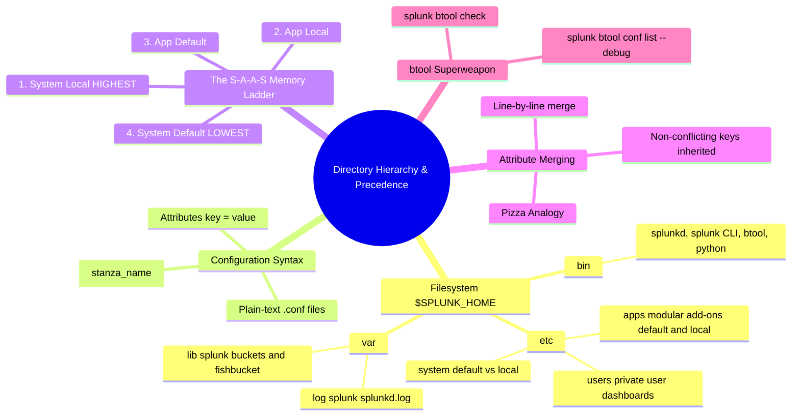

# 📖 Chapter 04: Splunk Directory Hierarchy & Configuration File Precedence

> **The Splunk Administrator's Handbook** | Phase 1: Splunk Fundamentals  
> **Target Audience:** Complete Beginners to Enterprise Administrators  
> **Prerequisites:** Chapters 01, 02, & 03

---

## 📸 1. Visual 3D Concept & Hierarchy Gallery

|                   1. Splunk Filesystem Hierarchy (`$SPLUNK_HOME`)                    |                     2. Configuration Precedence & Merging Tower                      |
| :----------------------------------------------------------------------------------: | :----------------------------------------------------------------------------------: |
|                    |                    |
| *Figure 4.1: `$SPLUNK_HOME` Directory Layout (`![[18_directory_structure_3d.jpg]]`)* | *Figure 4.2: Precedence & Stanza Merging (`![[19_config_layering_merging_3d.jpg]]`)* |

| 3. The `splunk btool` X-Ray Command Inspector | 4. Global Layering Overview Stack |
| :---: | :---: |
|  |  |
| *Figure 4.3: `splunk btool` Merged Runtime Inspector (`![[20_btool_mechanics_3d.jpg]]`)* | *Figure 4.4: 3D Layered Hierarchy (`![[04_config_precedence_3d.jpg]]`)* |

---

## 🏢 2. The 3-Minute Analogy: "The Smart Office Building"

To easily understand and memorize the directory layout of Splunk, think of `$SPLUNK_HOME` (default: `/opt/splunk`) as a **Smart Office Building**:

```text
┌────────────────────────────────────────────────────────────────────────┐
│               THE SPLUNK SMART OFFICE BUILDING ANALOGY                 │
├──────────────┬─────────────────────────────┬───────────────────────────┤
│ Directory    │ Office Building Real-World  │ What It Contains in Splunk│
├──────────────┼─────────────────────────────┼───────────────────────────┤
│ bin/         │ 🛠️ The Engine & Tool Room   │ The executable software:  │
│              │                             │ splunkd, splunk, python   │
├──────────────┼─────────────────────────────┼───────────────────────────┤
│ etc/         │ 📋 The Rulebook & Blueprint │ ALL plain-text .conf files│
│              │    Cabinets                 │ system, apps, and users   │
├──────────────┼─────────────────────────────┼───────────────────────────┤
│ var/         │ 📦 The Storage Vault & Log  │ Live index buckets, fish- │
│              │    Warehouse                │ bucket, splunkd.log logs  │
├──────────────┼─────────────────────────────┼───────────────────────────┤
│ share/       │ 🖼️ The Receptionist Display │ Icons, UI graphics, web   │
│              │                             │ templates, documentation  │
└──────────────┴─────────────────────────────┴───────────────────────────┘
```

---

## 🗂️ 3. The Big 3 Directories in Plain English


*Figure 4.1: 3D Isometric View of the `$SPLUNK_HOME` Directory Layout (`![[18_directory_structure_3d.jpg]]`)*

### 1️⃣ `bin/` (The Engine)
- Contains the compiled C/C++ engine **`splunkd`**, the **`splunk` CLI**, the **`btool`** inspector, and Splunk's internal Python interpreter.

### 2️⃣ `etc/` (The Brain & Configuration Hub)
- Contains **100% of Splunk's configuration files**:
  - `etc/system/`: Machine-wide settings for this whole server.
  - `etc/apps/`: Modular Technology Add-ons (TAs) like `Splunk_TA_nix` or `Splunk_TA_windows`.
  - `etc/users/`: Private user dashboards, searches, and alerts.
  - `etc/deployment-apps/`: App repository pushed to Forwarders by the Deployment Server.
  - `etc/master-apps/`: Indexer Cluster bundles pushed by the Cluster Manager.
  - `etc/shcluster/apps/`: Search Head bundles pushed by the Deployer.

### 3️⃣ `var/` (The Dynamic Data Warehouse)
- Where changing data is stored on disk:
  - `var/lib/splunk/`: Index folders containing raw Hot/Warm/Cold buckets and the **`fishbucket`** database.
  - `var/log/splunk/`: Internal diagnostic logs (**`splunkd.log`**) for troubleshooting.

---

## ⚖️ 4. The Golden Rule of `default/` vs. `local/`

In every configuration folder, you will see two subdirectories:

```text
┌──────────────────────────────────────┬──────────────────────────────────────┐
│          📁 default/ FOLDER          │           📁 local/ FOLDER           │
├──────────────────────────────────────┼──────────────────────────────────────┤
│ 🔒 The Factory Default (Read-Only)   │ ✏️ Your Custom Overrides (Writable)  │
│                                      │                                      │
│ • Shipped by Splunk or App Developer │ • Created by YOU (The Administrator) │
│ • ⚠️ NEVER TOUCH OR EDIT THIS!       │ • ALWAYS PUT YOUR CONFIGURATIONS HERE│
│ • Reason: When you upgrade Splunk or │ • Reason: Upgrades NEVER overwrite   │
│   an App, default/ is WIPED OUT and  │   the local/ folder! Your custom     │
│   re-installed from scratch!         │   settings remain 100% safe.         │
└──────────────────────────────────────┴──────────────────────────────────────┘
```

---

## 👑 5. How to Memorize Configuration Precedence (The S-A-A-S Rule)

When Splunk reads `.conf` files, it checks multiple folders. Which one wins?

### 🧠 The Easy Memory Trick: **"S - A - A - S"**
*(Read from Top / Highest Priority $\rightarrow$ Bottom / Lowest Priority)*


*Figure 4.2: 3D Vertical Tower of Splunk Configuration Precedence and Stanza Merging (`![[19_config_layering_merging_3d.jpg]]`)*

```text
┌────────────────────────────────────────────────────────────────────────┐
│            THE S-A-A-S INGESTION PRECEDENCE MEMORY LADDER              │
├───────────────┬────────────────────────────────────────────────────────┤
│ 👑 1. S (Top) │ System Local  ($SPLUNK_HOME/etc/system/local/)         │
│               │ ──► HIGHEST: The Server Master Override                │
├───────────────┼────────────────────────────────────────────────────────┤
│ 🥈 2. A       │ App Local     ($SPLUNK_HOME/etc/apps/<app>/local/)     │
│               │ ──► Custom Administrator overrides for this app        │
├───────────────┼────────────────────────────────────────────────────────┤
│ 🥉 3. A       │ App Default   ($SPLUNK_HOME/etc/apps/<app>/default/)   │
│               │ ──► Original settings shipped with the app             │
├───────────────┼────────────────────────────────────────────────────────┤
│ 🧱 4. S (Base)│ System Default ($SPLUNK_HOME/etc/system/default/)       │
│               │ ──► LOWEST: Splunk factory default baseline            │
└───────────────┴────────────────────────────────────────────────────────┘
```

> 💡 **Tie-Breaker Rule:** If two apps are at the same level (e.g. `App A` vs `App Z`), Splunk evaluates them **alphabetically (lexicographically)**: `00_app` wins over `Splunk_app` wins over `zz_app`.

---

## 🍕 6. Stanza Merging Explained Simply: "The Pizza Customizer"

A common beginner mistake is thinking Splunk replaces an entire file or entire stanza. **It does not!** Splunk merges settings **line-by-line (attribute-by-attribute)**:

```text
Imagine ordering a Pizza:
- Factory Default Recipe:   [Crust = Thin], [Sauce = Tomato], [Cheese = Mozzarella]
- Your Custom Local Order:  [Cheese = Cheddar]

🍕 The Final Baked Pizza in Memory:
- Crust = Thin          (Inherited from Factory Default!)
- Sauce = Tomato        (Inherited from Factory Default!)
- Cheese = Cheddar      (Overridden by your Local Order!)
```

### In Splunk `.conf` Code:

#### 1. Shipped App Default (`etc/apps/Splunk_TA_nix/default/inputs.conf`):
```ini
[monitor:///var/log/messages]
disabled = 0
sourcetype = syslog
index = default
```

#### 2. Your Local Override (`etc/system/local/inputs.conf`):
```ini
[monitor:///var/log/messages]
index = os_linux
```

#### 🏆 The Merged Result Active in Memory:
```ini
[monitor:///var/log/messages]
disabled = 0          <-- Kept from App Default (No conflict)
sourcetype = syslog    <-- Kept from App Default (No conflict)
index = os_linux      <-- OVERRIDDEN by System Local!
```

---

## 🔬 7. The Administrator's Superweapon: `splunk btool`

Because Splunk merges dozens of `.conf` files across multiple apps, **never guess which setting won**. Use the **`splunk btool`** X-ray scanner!


*Figure 4.3: 3D Holographic View of `splunk btool` Resolving Conflicting Settings with `--debug` (`![[20_btool_mechanics_3d.jpg]]`)*

### 🛠️ The 4 Commands You Must Know:

```bash
# 1. THE SPELL-CHECKER: Find typos & invalid stanzas across ALL conf files:
/opt/splunk/bin/splunk btool check

# 2. THE X-RAY: View active merged settings AND see the exact file that set each line:
/opt/splunk/bin/splunk btool inputs list --debug

# 3. THE TARGETED SEARCH: Check props settings for a specific log type:
/opt/splunk/bin/splunk btool props list nginx:access --debug

# 4. THE APP FILTER: Check configuration inside one specific app:
/opt/splunk/bin/splunk btool inputs list --app=org_all_linux_inputs --debug
```

## 🧠 8. Chapter 04 Self-Check Quiz

1. **What is the highest priority configuration directory in the System / Ingestion context?**
2. **What happens to files inside `/opt/splunk/etc/system/default/` when you upgrade Splunk Enterprise?**
3. **If `index = main` is set in `app/default/inputs.conf` and `index = security` is set in `app/local/inputs.conf`, which index receives the data?**
4. **What exact CLI command shows the effective merged configuration alongside the exact file path responsible for each line?**
5. **Where does Splunk store its internal file tracking state database (fishbucket)?**

---

## 📌 9. Visual Mind Map & Sticky Notes (Chapter 04 Quick-Review)

### 📸 Visual 3D Concept Board

*Figure 4.5: 3D Visual Concept & Configuration Precedence Board (`![[04_config_precedence_3d.jpg]]`)*

### 🧠 Hierarchical Mind Map


### 🗂️ Color-Coded Digital Sticky Notes

#### 🟨 Sticky Note 1: The Golden Rule of `default/`
```text
┌─────────────────────────────────────────────────────────────┐
│ 📌 RULE #1: NEVER TOUCH DEFAULT/ DIRECTORIES!               │
│                                                             │
│ • Any file inside 'default/' is owned by Splunk/Vendor.    │
│ • Splunk upgrades WILL OVERWRITE 'default/' completely!     │
│ • Always place overrides in 'local/' or a custom App.      │
└─────────────────────────────────────────────────────────────┘
```

#### 🟩 Sticky Note 2: The S-A-A-S Precedence Ladder
```text
┌─────────────────────────────────────────────────────────────┐
│ 📌 INGESTION PRECEDENCE ORDER (S-A-A-S):                    │
│                                                             │
│ 1. System Local       ($SPLUNK_HOME/etc/system/local/)      │
│ 2. App Local          ($SPLUNK_HOME/etc/apps/<app>/local/)  │
│ 3. App Default        ($SPLUNK_HOME/etc/apps/<app>/default/)│
│ 4. System Default     ($SPLUNK_HOME/etc/system/default/)    │
└─────────────────────────────────────────────────────────────┘
```

#### 🟪 Sticky Note 3: Attribute-Level Merging
```text
┌─────────────────────────────────────────────────────────────┐
│ 📌 STANZA MERGING (THE PIZZA ANALOGY)                       │
│                                                             │
│ • Splunk DOES NOT overwrite entire stanzas.                 │
│ • Splunk merges settings key-by-key (attribute-by-attribute)│
│ • Non-conflicting keys are inherited from lower layers.     │
│ • Only conflicting keys are overridden by higher layers.    │
└─────────────────────────────────────────────────────────────┘
```

#### 🟦 Sticky Note 4: The `splunk btool` Superweapon
```text
┌─────────────────────────────────────────────────────────────┐
│ 📌 BTOOL COMMAND CHEAT SHEET                                │
│                                                             │
│ • Syntax Check: splunk btool check                          │
│ • Active Config: splunk btool <conf_name> list              │
│ • Find Origin:  splunk btool <conf_name> list --debug       │
│ • App Filter:   splunk btool <conf_name> list --app=<name>  │
└─────────────────────────────────────────────────────────────┘
```

#### 🟧 Sticky Note 5: Fishbucket Location
```text
┌─────────────────────────────────────────────────────────────┐
│ 📌 FISHBUCKET STORAGE LOCATION                              │
│                                                             │
│ • Path: $SPLUNK_HOME/var/lib/splunk/fishbucket              │
│ • Contains: MD5 header hashes and byte read offsets.        │
│ • Prevents: Re-indexing data after server restarts.         │
└─────────────────────────────────────────────────────────────┘
```

---

### ⚡ Rapid-Recall Flashcards

| # | Question (Front) | Answer (Back) |
| :-: | :--- | :--- |
| **01** | What is the default installation path of Splunk Enterprise on Linux? | **`/opt/splunk`** (`$SPLUNK_HOME`). |
| **02** | What directory has the highest precedence in the System/Ingestion context? | **`$SPLUNK_HOME/etc/system/local/`** |
| **03** | What directory has the lowest precedence in all contexts? | **`$SPLUNK_HOME/etc/system/default/`** |
| **04** | How does Splunk evaluate two apps at the same directory tier? | **Lexicographically** (Alphabetical order: `00_app` wins over `zz_app`). |
| **05** | What flag in `splunk btool` prints the file path where each attribute originated? | **`--debug`** (e.g. `splunk btool inputs list --debug`). |
| **06** | What command validates configuration files for syntax errors without restarting Splunk? | **`splunk btool check`** |
| **07** | Where are user private dashboards stored? | **`$SPLUNK_HOME/etc/users/<username>/<app_name>/local/`** |

---

## 🎮 Hands-On Cyber Range Challenge: Room P1-04 (TryHackMe / HTB Style)

```text
┌────────────────────────────────────────────────────────────────────────┐
│ 🕹️ ARENA MISSION: Room P1-04 — The Btool Detective                     │
│ ⭐ DIFFICULTY: Medium | 💎 REWARD: 200 XP | ⏱️ TIME: 30 Mins           │
└────────────────────────────────────────────────────────────────────────┘
```

> **🚨 Incident Scenario:**  
> A newly deployed app broke custom sourcetype extractions and timestamps.  
> The administrator doesn't know which configuration file is taking precedence.  
> You must leverage `splunk btool` to inspect runtime settings and enforce the S-A-A-S hierarchy!

### 🎯 Mission Checkpoint Questions

#### 1. Which directory sits at the very peak of the S-A-A-S precedence stack in Global Context?
*(Answer Format: `****** *****`)*
<details><summary>💡 Need a Hint?</summary>Located at <code>$SPLUNK_HOME/etc/system/local/</code>.</details>
<details><summary>🔓 Reveal Answer</summary><b>Answer:</b> <code>System Local</code></details>

#### 2. Which btool flag outputs the exact configuration file path where each setting originated?
*(Answer Format: `--*****`)*
<details><summary>💡 Need a Hint?</summary>Starts with "--d".</details>
<details><summary>🔓 Reveal Answer</summary><b>Answer:</b> <code>--debug</code> (e.g. <code>splunk btool props list --debug</code>)</details>

#### 3. What command scans all active .conf files for syntax errors and unrecognized parameters?
*(Answer Format: `splunk btool *****`)*
<details><summary>💡 Need a Hint?</summary>5-letter verb.</details>
<details><summary>🔓 Reveal Answer</summary><b>Answer:</b> <code>splunk btool check</code></details>

👉 **[Launch Full Interactive Lab: Room P1-04 & Capture All 4 Flags (200 XP)](../Labs/Room_P1_04_Directory_Structure_and_Btool_Detective.md)**
