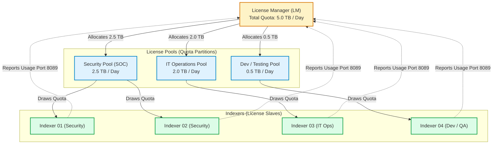
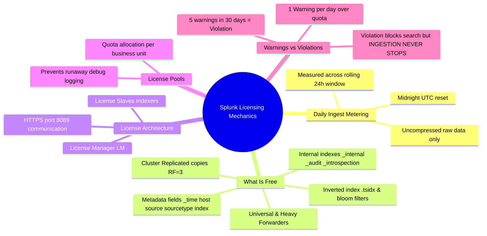

# 📖 Chapter 06: Splunk Licensing Mechanics & Quota Management

> **The Splunk Administrator's Handbook** | Phase 1: Splunk Fundamentals  
> **Target Audience:** Complete Beginners to Enterprise Administrators  
> **Prerequisites:** Chapters 01 through 05

---

## 🏦 1. How Splunk Ingestion Licensing Works

Splunk Enterprise is traditionally licensed based on the **daily volume of uncompressed raw data ingested** across a rolling 24-hour window (measured at midnight UTC).

$$\text{Daily License Capacity} = \sum \text{Gigabytes (GB) or Terabytes (TB) per 24 hours}$$

---

## ⚖️ 2. What Counts Against Your License vs. What is 100% Free

As a Splunk Administrator, you must understand exactly which bytes cost money and which are exempt:

```text
┌────────────────────────────────────────────────────────────────────────┐
│                        SPLUNK LICENSE ACCOUNTING                       │
├───────────────────────────────────┬────────────────────────────────────┤
│   ✅ COUNTS AGAINST LICENSE       │     ❌ 100% EXEMPT (FREE)          │
├───────────────────────────────────┼────────────────────────────────────┤
│ • Uncompressed raw event text     │ • Metadata fields (_time, host,    │
│   written to an index             │   source, sourcetype, index)       │
│ • Custom application logs         │ • Inverted index files (.tsidx)    │
│ • Firewall syslogs                │ • Bloom filters & bucket info      │
│ • Windows Event Log contents      │ • Summary Indexes (sistats/collect)│
│ • JSON/XML payloads               │ • Splunk Internal Indexes:         │
│                                   │   - _internal                      │
│                                   │   - _audit                         │
│                                   │   - _introspection                 │
│                                   │   - _telemetry                     │
│                                   │ • Replicated bucket copies (RF)    │
│                                   │ • Universal Forwarders (UFs)       │
│                                   │ • Heavy Forwarders (HFs)           │
│                                   │ • Search Head searches & results   │
└───────────────────────────────────┴────────────────────────────────────┘
```

> [!IMPORTANT]
> **Replication is Free!** If your Indexer Cluster has a Replication Factor of 3 ($\text{RF}=3$), and you ingest 100 GB of logs, you store 300 GB of raw data on disk, but **you are billed for only 100 GB**. Splunk meters data once at the point of initial indexing on the primary indexer.

---

## 🏗️ 3. License Manager Architecture & License Pools

### 💳 The Analogy: "The Corporate Bank Account & Department Debit Cards"
- **The Enterprise License (5 TB/day):** The master corporate bank account holding \$5,000/day.
- **License Pools:** Department debit cards with specific spending limits (e.g. Security gets \$2,500/day, Dev gets \$500/day).
- **Indexers (License Slaves):** The workers spending from their department debit cards and reporting every 1 minute to the central accountant (**License Manager**).

---

### 📊 Master Visual Diagram: License Manager, Pools & Slaves



---

### 🔍 Clear ASCII Architecture Blueprint

```text
┌────────────────────────────────────────────────────────────────────────┐
│                 ENTERPRISE LICENSE STACK (5.0 TB/DAY)                  │
│                                                                        │
│                      ┌───────────────────────────┐                     │
│                      │ 👑 LICENSE MANAGER (LM)   │                     │
│                      │ Total Enterprise: 5.0 TB  │                     │
│                      └─────────────┬─────────────┘                     │
│                                    │ Allocates Quotas                  │
│            ┌───────────────────────┼───────────────────────┐           │
│            ▼                       ▼                       ▼           │
│ ┌─────────────────────┐ ┌─────────────────────┐ ┌─────────────────────┐│
│ │ 🛡️ Security Pool   │ │ ⚙️ IT Ops Pool      │ │ 🧪 Dev / QA Pool    ││
│ │ Quota: 2.5 TB / Day │ │ Quota: 2.0 TB / Day │ │ Quota: 0.5 TB / Day ││
│ └──────────┬──────────┘ └──────────┬──────────┘ └──────────┬──────────┘│
│            │                       │                       │           │
│      ┌─────┴─────┐                 │                       │           │
│      ▼           ▼                 ▼                       ▼           │
│ ┌─────────┐ ┌─────────┐       ┌─────────┐             ┌─────────┐      │
│ │ Indexer │ │ Indexer │       │ Indexer │             │ Indexer │      │
│ │   01    │ │   02    │       │   03    │             │   04    │      │
│ └────┬────┘ └────┬────┘       └────┬────┘             └────┬────┘      │
│      │           │                 │                       │           │
│      └───────────┴─────────────────┴───────────────────────┘           │
│            ▲ Every 1 Minute Usage Report via HTTPS Port 8089            │
│            └───────────────────────────────────────────────────────────┘
```

---

### 🛡️ Why Use License Pools? (The 2 Big Reasons)

1. **Runaway Log Containment (Firewalling Disasters):**
   - If a developer turns on verbose `DEBUG` logging on 100 test servers, it could generate **2 TB of unexpected spam in 4 hours**.
   - With a dedicated **Dev Pool (0.5 TB limit)**, only the Dev pool gets flagged—the **Security (2.5 TB)** and **IT Ops (2.0 TB)** pools are completely protected and continue operating normally!
2. **Cost Allocation & Showback:**
   - Enables financial accounting to bill the Cybersecurity department for their exact 2.5 TB consumption and IT Ops for their 2.0 TB.

---

## 🚨 4. License Warnings vs. License Violations

```text
┌────────────────────────────────────────────────────────────────────────┐
│               WARNINGS VS. VIOLATIONS (THE 30-DAY WINDOW)              │
├────────────────────────────────────────────────────────────────────────┤
│ Daily Ingest Exceeds Quota at Midnight (UTC)                           │
│                               │                                        │
│                               ▼                                        │
│ ┌────────────────────────────────────────────────────────────────────┐ │
│ │ ⚠️ 1 LICENSE WARNING RECORDED                                      │ │
│ │ • Recorded on the License Manager.                                 │ │
│ │ • No search restrictions yet. System works 100% normally.          │ │
│ └─────────────────────────────┬──────────────────────────────────────┘ │
│                               │                                        │
│                               │ ── If 5 Warnings occur within 30 days  │
│                               ▼                                        │
│ ┌────────────────────────────────────────────────────────────────────┐ │
│ │ 🚫 HARD LICENSE VIOLATION                                          │ │
│ │ • Search capabilities blocked for non-admin users in classic mode. │ │
│ │ • 🛡️ INGESTION NEVER STOPS: Splunk CONTINUES to index data!         │ │
│ └────────────────────────────────────────────────────────────────────┘ │
└────────────────────────────────────────────────────────────────────────┘
```

### 🚨 What Actually Happens During a License Violation?

| What DOES Happen | What DOES NOT Happen (Myth Busted!) |
| :--- | :--- |
| ❌ Search capability is disabled for regular users in classic licensing. | 🛡️ **DATA INGESTION NEVER STOPS!** Splunk continues indexing all incoming logs without dropping a single byte. |
| ⚠️ Prominent red alert banner displayed in Splunk Web UI. | 🛡️ Data is **not** deleted or corrupted. |
| ⚠️ Scheduled alerts and reports stop firing. | 🛡️ Forwarders continue to ship logs normally. |

---

## 🔬 5. How to Investigate License Usage in Production (SPL)

### 📊 Query 1: Top Ingesting Sourcetypes Today
```spl
index=_internal source=*license_usage.log type="RolloverSummary"
| eval ingest_gb = round(b/1024/1024/1024, 2)
| timechart span=1d sum(ingest_gb) by s
```

### 💻 Query 2: Top 10 Talker Hosts Consuming License
```spl
index=_internal source=*license_usage.log type="Usage"
| stats sum(b) as bytes by h
| eval Ingest_GB = round(bytes/1024/1024/1024, 2)
| sort 10 - Ingest_GB
```

---

---

## 🛠️ 6. How to Increase License Capacity When Quota is Exhausted

When your enterprise is approaching or has exceeded its daily license quota, you have two paths: **adding new license capacity** or **performing immediate data hygiene**.

---

### 🧱 1. The Core Rule: Splunk Licenses Stack Additively!

Splunk Enterprise licenses are **stackable**:
$$\text{Existing License (1 TB)} + \text{New Add-on License (500 GB)} = \mathbf{1.5\text{ TB / Day Total Quota}}$$

You do not need to replace your existing license file; you simply install the new `.lic` key onto the **License Manager (LM)**.

---

### 💻 2. Method 1: Add License via Splunk Web UI (GUI)

```text
┌────────────────────────────────────────────────────────────────────────┐
│             STEP-BY-STEP: ADDING A LICENSE IN SPLUNK WEB               │
├────────────────────────────────────────────────────────────────────────┤
│ Step 1: Log in to the License Manager (LM) as an Administrator.        │
│                                                                        │
│ Step 2: In the top navigation bar, click Settings ──► Licensing.       │
│                                                                        │
│ Step 3: Click the [ Add License ] button in the top right.             │
│                                                                        │
│ Step 4: Choose your installation method:                               │
│         • Option A: Upload a license file (Browse to your .lic file).  │
│         • Option B: Copy & paste the raw XML license key text.         │
│                                                                        │
│ Step 5: Click [ Install ]. The new capacity takes effect immediately!  │
│                                                                        │
│ Step 6: Expand License Pools:                                          │
│         • Navigate to Settings ──► Licensing ──► License Pools.        │
│         • Click 'Edit' next to your target pool (e.g. Security Pool)   │
│           and allocate the newly added capacity (e.g. from 2.5TB to 3TB│
│         • Click [ Save ].                                              │
└────────────────────────────────────────────────────────────────────────┘
```

---

### ⌨️ 3. Method 2: Add License via Linux Command Line (CLI)

On the License Manager server terminal, run:

```bash
# 1. Install the new license file (.lic):
/opt/splunk/bin/splunk add licenses /opt/splunk/etc/licenses/enterprise_500gb.lic -auth admin:YourAdminPassword

# 2. Verify that the new total license quota is active:
/opt/splunk/bin/splunk list licenser-pools -auth admin:YourAdminPassword

# 3. Check effective stack status:
/opt/splunk/bin/splunk list licenser-stacks -auth admin:YourAdminPassword
```

---

### 🚨 4. Emergency Action: How to Clear Search Lockouts (Reset License)

If your environment has accumulated **5 warnings within 30 days** and entered a **License Violation** (blocking user searches):

1. **Contact your Splunk Account Manager or Splunk Support:**
   - Request an **Emergency License Reset Key (No-Enforcement License)**. Splunk Support provides these temporary reset keys within hours.
2. **Install the Reset Key on the License Manager:**
   - Once installed, the reset key instantly clears all 5 historical warnings, resets the warning counter to **`0`**, and immediately unlocks search functionality for all analysts.

---

### 🧹 5. Free Administrative Ways to Recover Ingest Capacity (Stop License Bleed)

Before spending additional money on larger licenses, run these optimizations:

1. **Route Useless Debug Spam to `nullQueue`:**
   - In `transforms.conf` on your Heavy Forwarders or Indexers, filter out repetitive healthcheck logs:
     ```ini
     # transforms.conf
     [drop_noisy_debug_logs]
     REGEX = (?i)level=(DEBUG|TRACE)|GET /healthcheck
     DEST_KEY = queue
     FORMAT = nullQueue
     ```
2. **Exclude Backup/Compressed Files in `inputs.conf`:**
   - Prevent forwarders from re-indexing compressed archives:
     ```ini
     # inputs.conf
     [monitor:///var/log/...]
     blacklist = \.(gz|tar|zip|bak|old)$
     ```
3. **Find the Top Offending Hosts / Sourcetypes:**
   - Run the SPL license usage search to pinpoint which application or server is generating unexpected spikes:
     ```spl
     index=_internal source=*license_usage.log type="Usage"
     | stats sum(b) as bytes by h, s
     | eval Ingest_GB = round(bytes/1024/1024/1024, 2)
     | sort 10 - Ingest_GB
     ```

---

## 🧠 7. Chapter 06 Self-Check Quiz

1. Does Splunk count `.tsidx` inverted index files against your daily license quota?
2. If you ingest 50 GB of data into an Indexer Cluster with $\text{Replication Factor}=3$, how many GB count against your license?
3. What is the difference between a **License Warning** and a **License Violation**?
4. When a Splunk cluster enters a License Violation state, does it stop indexing incoming logs?
5. How does configuring **License Pools** protect an enterprise against runaway logging loops?

---

## 📌 7. Visual Mind Map & Sticky Notes (Chapter 06 Quick-Review)

### 🧠 Hierarchical Mind Map


### 🗂️ Color-Coded Digital Sticky Notes

#### 🟨 Sticky Note 1: License Accounting Golden Rule
```text
┌─────────────────────────────────────────────────────────────┐
│ 📌 ONLY RAW UNCOMPRESSED DATA COUNTS                        │
│                                                             │
│ • Metered ONCE when Indexer writes event to disk.          │
│ • Free: .tsidx, bloom filters, metadata, internal indexes.  │
│ • Free: Replicated copies (RF=3 stores 3x, billed 1x).     │
│ • Free: Universal & Heavy Forwarders, Search Heads.         │
└─────────────────────────────────────────────────────────────┘
```

#### 🟩 Sticky Note 2: License Pools Purpose
```text
┌─────────────────────────────────────────────────────────────┐
│ 📌 WHY USE LICENSE POOLS?                                   │
│                                                             │
│ 1. Containment: A misconfigured dev app cannot eat the      │
│    entire enterprise quota.                                 │
│ 2. Showback: Bill individual departments for their share.   │
└─────────────────────────────────────────────────────────────┘
```

#### 🟪 Sticky Note 3: The 5-Warning Violation Rule
```text
┌─────────────────────────────────────────────────────────────┐
│ 📌 WARNINGS & VIOLATIONS                                    │
│                                                             │
│ • Over quota at midnight UTC = 1 Warning.                   │
│ • 5 Warnings in a rolling 30-day window = Violation.        │
│ • Warning resets after 30 days from occurrence.             │
└─────────────────────────────────────────────────────────────┘
```

#### 🟦 Sticky Note 4: The Golden Violation Truth
```text
┌─────────────────────────────────────────────────────────────┐
│ 📌 MYTH BUSTED: INGESTION NEVER STOPS!                      │
│                                                             │
│ • In a License Violation, SEARCH is restricted.             │
│ • DATA INGESTION CONTINUES 100% UNINTERRUPTED.              │
│ • Zero data loss occurs during a license violation!         │
└─────────────────────────────────────────────────────────────┘
```

---

### ⚡ Rapid-Recall Flashcards

| # | Question (Front) | Answer (Back) |
| :-: | :--- | :--- |
| **01** | What metric is Splunk Enterprise classic licensing based on? | **Daily uncompressed raw data volume (GB/TB)**. |
| **02** | At what time does the rolling daily license quota reset? | **Midnight UTC**. |
| **03** | Do replicated bucket copies ($\text{RF}=3$) multiply license costs? | **No. Replicated copies are 100% free.** |
| **04** | How many license warnings trigger a hard License Violation? | **5 warnings in a rolling 30-day window.** |
| **05** | Does Splunk stop indexing data during a License Violation? | **No! Ingestion continues normally without data loss.** |
| **06** | What port do Indexer License Slaves use to report to the License Manager? | **HTTPS Port `8089`**. |

---

## 🎮 Hands-On Cyber Range Challenge: Room P1-06 (TryHackMe / HTB Style)

```text
┌────────────────────────────────────────────────────────────────────────┐
│ 🕹️ ARENA MISSION: Room P1-06 — Licensing & Quota Breach Simulation     │
│ ⭐ DIFFICULTY: Medium | 💎 REWARD: 200 XP | ⏱️ TIME: 30 Mins           │
└────────────────────────────────────────────────────────────────────────┘
```

> **🚨 Incident Scenario:**  
> A debug script flooded the dev index with a 100 GB burst, blowing your 50 GB daily quota by 200%.  
> Management is terrified that Splunk dropped incoming production security logs.  
> You must verify the metering model, explain the 5-warning rule, and prove that data indexing never stops!

### 🎯 Mission Checkpoint Questions

#### 1. In what format does Splunk meter incoming data volume against the daily license?
*(Answer Format: ************ *** bytes)*
<details><summary>💡 Need a Hint?</summary>Is it measured before or after gzip compression?</details>
<details><summary>🔓 Reveal Answer</summary><b>Answer:</b> <code>Uncompressed raw bytes</code></details>

#### 2. Do cluster replica bucket copies (RF=3) consume enterprise license quota?
*(Answer Format: `***` or `**`)*
<details><summary>💡 Need a Hint?</summary>Splunk licenses data indexed once.</details>
<details><summary>🔓 Reveal Answer</summary><b>Answer:</b> <code>No</code> (Cluster replicas and internal indexes are 100% free)</details>

#### 3. Does Splunk ever stop indexing incoming logs due to a license quota overage?
*(Answer Format: `***` or `**`)*
<details><summary>💡 Need a Hint?</summary>The core architectural invariant.</details>
<details><summary>🔓 Reveal Answer</summary><b>Answer:</b> <code>No</code> (Indexing NEVER stops; only search queries are locked after 5 warnings)</details>

👉 **[Launch Full Interactive Lab: Room P1-06 & Capture All 4 Flags (200 XP)](../Labs/Room_P1_06_Licensing_Mechanics_and_Quota_Breach.md)**
