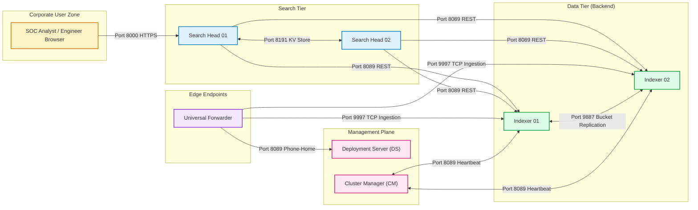
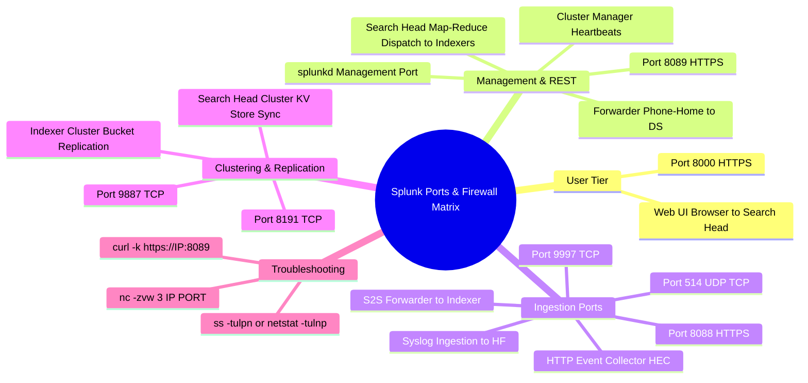

# 📖 Chapter 07: Splunk Network Ports, Protocols & Enterprise Firewall Matrix

> **The Splunk Administrator's Handbook** | Phase 1: Splunk Fundamentals  
> **Target Audience:** Complete Beginners to Enterprise Administrators  
> **Prerequisites:** Chapters 01 through 06

---

## 1. The Standard Splunk Port Matrix

In an enterprise environment with network segmentation and hardware firewalls, every Splunk component requires specific inbound and outbound firewall rules.

```text
┌─────────────────────────────────────────────────────────────────────────────────────────┐
│                              THE SPLUNK ENTERPRISE PORT MATRIX                          │
├───────┬──────────┬──────────┬─────────────────────────────┬─────────────────────────────┤
│ Port  │ Protocol │ Traffic  │ Source ──► Destination       │ Purpose / Internal Function │
├───────┼──────────┼──────────┼─────────────────────────────┼─────────────────────────────┤
│ 8000  │ HTTPS/TCP│ Inbound  │ Web Browsers ──► Search Head│ Splunk Web User Interface   │
│ 8089  │ HTTPS/TCP│ Inbound  │ Management Clients ──► Any  │ splunkd REST API & Mgmt     │
│ 9997  │ TCP (S2S)│ Inbound  │ Forwarders ──► Indexers     │ Splunk-to-Splunk Raw Ingest │
│ 8088  │ HTTPS/TCP│ Inbound  │ Applications ──► HEC / IDX  │ HTTP Event Collector (HEC)  │
│ 9887  │ TCP      │ Peer     │ Indexer ◄──► Indexer        │ Bucket Replication (RF/SF)  │
│ 8191  │ TCP      │ Peer     │ Search Head ◄──► Search Head│ KV Store Clustering Engine  │
│ 514   │ UDP/TCP  │ Inbound  │ Network Devices ──► HF      │ Syslog Ingestion Port       │
└───────┴──────────┴──────────┴─────────────────────────────┴─────────────────────────────┘
```

---

## 2. Firewall Flow Architecture Diagram



---

## 3. Directionality Rules (Who Initiates Connections?)

A common pitfall for new administrators is misunderstanding which server initiates network connections:

1. **Forwarder to Deployment Server:**
   - **Forwarder INITIATES** the outbound connection to the Deployment Server on port `8089`.
   - The Deployment Server **never reaches out to the forwarder**.
2. **Forwarder to Indexer:**
   - **Forwarder INITIATES** the outbound TCP connection to the Indexer on port `9997`.
3. **Search Head to Indexer:**
   - **Search Head INITIATES** the outbound REST query to the Indexers on port `8089`.
4. **Cluster Manager to Indexers:**
   - **Indexers INITIATE** the heartbeat to the Cluster Manager on port `8089`.

---

## 4. Administrator Network Troubleshooting Commands

When data is not arriving or components cannot communicate, test connectivity from the command line:

```bash
# 1. Test TCP port reachability using netcat:
nc -zvw 3 10.100.1.10 9997

# 2. Test HTTPS REST API port reachability:
curl -k https://10.100.1.10:8089/services/server/info

# 3. Check if local Splunk is listening on port 9997:
ss -tulpn | grep 9997
# OR:
netstat -tulnp | grep 9997

# 4. Check real-time network drops using tcpdump:
sudo tcpdump -i eth0 port 9997 -nn
```

---

## 🧠 5. Chapter 07 Self-Check Quiz

1. Which port is used by Universal Forwarders to send log streams to Indexers?
2. Does the Deployment Server initiate connections to Forwarders, or do Forwarders initiate connections to the Deployment Server?
3. Which port must be open between Indexers in an Indexer Cluster for bucket replication?
4. What port does a Search Head use to dispatch distributed searches to Indexers?
5. What CLI command can you run on a forwarder to test if an indexer is reachable on port 9997?

---

## 📌 6. Visual Mind Map & Sticky Notes (Chapter 07 Quick-Review)

### 🧠 Hierarchical Mind Map


### 🗂️ Color-Coded Digital Sticky Notes

#### 🟨 Sticky Note 1: The Core 3 Ports to Memorize
```text
┌─────────────────────────────────────────────────────────────┐
│ 📌 THE CORE 3 PORTS                                         │
│                                                             │
│ • 8000 : Splunk Web UI (User ──► Search Head)               │
│ • 8089 : Management / REST API (All components)             │
│ • 9997 : Data Ingestion (Forwarder ──► Indexer)             │
└─────────────────────────────────────────────────────────────┘
```

#### 🟩 Sticky Note 2: Directionality Golden Rule
```text
┌─────────────────────────────────────────────────────────────┐
│ 📌 DIRECTIONALITY GOLDEN RULE                               │
│                                                             │
│ • Forwarders ALWAYS initiate OUTBOUND to Indexers (9997).   │
│ • Forwarders ALWAYS initiate OUTBOUND to DS (8089).         │
│ • Firewalls must allow OUTBOUND from endpoint agents.       │
│ • Deployment Server NEVER reaches into forwarders!          │
└─────────────────────────────────────────────────────────────┘
```

#### 🟪 Sticky Note 3: Clustering Inter-Node Ports
```text
┌─────────────────────────────────────────────────────────────┐
│ 📌 CLUSTER REPLICATION PORTS                                │
│                                                             │
│ • 9887 : Indexer ◄──► Indexer (Raw Bucket Replication).     │
│ • 8191 : Search Head ◄──► Search Head (KV Store Sync).      │
│ • Both are peer-to-peer within their respective clusters.   │
└─────────────────────────────────────────────────────────────┘
```

#### 🟦 Sticky Note 4: Essential CLI Network Probes
```text
┌─────────────────────────────────────────────────────────────┐
│ 📌 NETWORK PROBE COMMANDS                                   │
│                                                             │
│ • nc -zvw 3 <indexer_ip> 9997    (Test TCP port 9997)       │
│ • curl -k https://<sh_ip>:8089/  (Test REST API 8089)       │
│ • ss -tulpn | grep 9997          (Check if listening)       │
└─────────────────────────────────────────────────────────────┘
```

---

### ⚡ Rapid-Recall Flashcards

| # | Port & Protocol | Source ──► Destination | Primary Role |
| :-: | :--- | :--- | :--- |
| **01** | **`8000` (HTTPS)** | User Web Browser ──► Search Head | Splunk Web GUI access. |
| **02** | **`8089` (HTTPS)** | Mgmt Clients / Forwarders / SH ──► Splunk | `splunkd` REST API, app deployment & search dispatch. |
| **03** | **`9997` (TCP)** | Universal/Heavy Forwarder ──► Indexer | High-performance Splunk-to-Splunk (S2S) log stream. |
| **04** | **`8088` (HTTPS)** | App Servers / Cloud Services ──► HEC / IDX | HTTP Event Collector token-authenticated JSON ingest. |
| **05** | **`9887` (TCP)** | Indexer Peer ◄──► Indexer Peer | Clustered raw bucket replication ($\text{RF}=3$). |
| **06** | **`8191` (TCP)** | Search Head ◄──► Search Head | Raft-based KV Store database synchronization. |
| **07** | **`514` (UDP/TCP)**| Switches / Routers / Firewalls ──► HF / SC4S | Syslog network traffic capture. |


---

## 🎮 Hands-On Cyber Range Challenge: Room P1-07 (TryHackMe / HTB Style)

```text
┌────────────────────────────────────────────────────────────────────────┐
│ 🕹️ ARENA MISSION: Room P1-07 — Network Port Matrix & Firewall Defense  │
│ ⭐ DIFFICULTY: Easy-Medium | 💎 REWARD: 200 XP | ⏱️ TIME: 30 Mins       │
└────────────────────────────────────────────────────────────────────────┘
```

> **🚨 Incident Scenario:**  
> A zero-trust firewall policy blocked all traffic between subnets. Forwarders dropped, the Web UI crashed, and the REST API failed.  
> You must provide the exact port matrix and use Netcat to verify listening sockets!

### 🎯 Mission Checkpoint Questions

#### 1. What standard TCP port is used on Indexers for Splunk-to-Splunk (S2S) ingestion?
*(Answer Format: `****`)*
<details><summary>💡 Need a Hint?</summary>Four nines and a seven.</details>
<details><summary>🔓 Reveal Answer</summary><b>Answer:</b> <code>9997</code></details>

#### 2. What port and protocol serve as the encrypted REST API backbone (splunkd)?
*(Answer Format: `*****:****`)*
<details><summary>💡 Need a Hint?</summary>License Master and Search Peer port.</details>
<details><summary>🔓 Reveal Answer</summary><b>Answer:</b> <code>HTTPS:8089</code></details>

#### 3. What Netcat command tests if remote port 9997 is listening without sending data?
*(Answer Format: `nc -zvw3 ***.***.***.*** ****`)*
<details><summary>💡 Need a Hint?</summary>Uses -z for zero-I/O.</details>
<details><summary>🔓 Reveal Answer</summary><b>Answer:</b> <code>nc -zvw3 &lt;IP&gt; 9997</code></details>

👉 **[Launch Full Interactive Lab: Room P1-07 & Capture All 4 Flags (200 XP)](../Labs/Room_P1_07_Ports_Protocols_and_Firewall_Hardening.md)**
