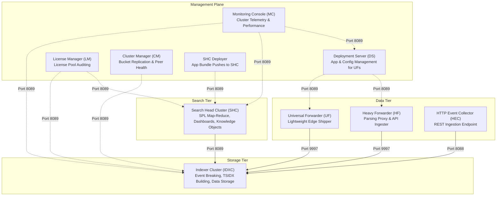
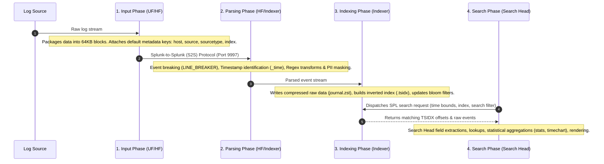

	# 📘 Day 01: Splunk Core Anatomy, Enterprise Distributed Topology & The 4 Ingestion Pipeline Phases

> **Phase 1:** Splunk Fundamentals & Architecture  
> **Topic:** Machine Data, Component Roles (SHC, IDXC, UF, HF, DS, LM, CM, MC), 3D Architecture, Storage Lifecycles & Ingestion Pipeline Mechanics  
> **Estimated Study Time:** 60 mins + Lab  
> **Status:** 🟡 Active Study Note

---

## 📸 1. Visual 3D Enterprise Architecture Overview


*Figure 1: 3D Isometric Enterprise Multi-Tier Topology (`![[01_enterprise_architecture_3d.jpg]]`)*

### 📐 Layer-by-Layer Architectural Breakdown

```text
┌────────────────────────────────────────────────────────────────────────┐
│  LAYER 4: PRESENTATION & SEARCH TIER (Search Head Cluster - SHC)      │
│  - SH01 (Captain), SH02 (Member), SH03 (Member)                        │
│  - Functions: SPL Parsing, Map-Reduce Coordinator, Knowledge Objects   │
└──────────────────────────────────┬─────────────────────────────────────┘
                                   │ Dispatches Search Jobs (Port 8089)
                                   ▼
┌────────────────────────────────────────────────────────────────────────┐
│  LAYER 3: STORAGE & PARSING CORE TIER (Indexer Cluster - IDXC)        │
│  - IDX01, IDX02, IDX03, IDX04 ... IDX12 (Peers)                        │
│  - Functions: Event Breaking, Timestamping, TSIDX Inverted Indexing    │
│  - High Availability: Replication Factor (RF=3), Search Factor (SF=2)  │
└──────────────────────────────────▲─────────────────────────────────────┘
                                   │ Raw S2S Data Stream (Port 9997)
                                   │
┌──────────────────────────────────┴─────────────────────────────────────┐
│  LAYER 2: INGESTION ROUTING & SECURE DMZ (Heavy Forwarders / HEC LB)   │
│  - Heavy Forwarders: Syslog receiver, API pollers, PII regex masking    │
│  - HTTP Event Collector (HEC): Token-based JSON/metric REST ingestion  │
└──────────────────────────────────▲─────────────────────────────────────┘
                                   │ Port 9997 / Syslog 514 / HTTPS 8088
┌──────────────────────────────────┴─────────────────────────────────────┐
│  LAYER 1: EDGE COLLECTION TIER (Universal Forwarders - UF)             │
│  - Installed on 10,000+ Linux / Windows / Kubernetes nodes             │
│  - Functions: File monitoring, RAM queuing, Auto-load balancing        │
└────────────────────────────────────────────────────────────────────────┘
```

---

## 2. Multi-Level Perspective Explanations

### 👶 Level 1: Explain Like I'm a Beginner
Imagine your company operates thousands of web servers, mobile backends, databases, and network firewalls. Every microsecond, these systems generate millions of log entries (*"User logged in"*, *"Database connection timeout"*, *"Payment transaction approved"*).
- Without Splunk, when a critical outage happens, engineers must manually log into dozens of servers, run shell scripts, and guess where the failure originated.
- **Splunk acts as the enterprise Google for machine data.** It continuously ingests logs from everywhere, timestamps and indexes them in real-time, and allows anyone to search billions of events in seconds.

### 🛠️ Level 2: Explain Like I'm a Splunk Administrator
Splunk Enterprise is an event-driven, horizontally scalable time-series database.
- Traditional databases require **Schema on Write** (you must predefine tables, columns, and datatypes before inserting data). Splunk uses **Schema on Read** (late binding).
- Splunk accepts raw, unstructured text. It indexes words into an inverted index (`.tsidx`) alongside compressed raw data (`journal.zst`). When you execute a query, Splunk applies regex patterns, lookups, and calculated fields on the fly.
- As an Administrator, you manage the data ingestion pipeline, tune parsing parameters (`props.conf`, `transforms.conf`), maintain cluster high availability, and balance storage and compute resources.

### 🏭 Level 3: Explain Like I'm Working in Production
In an enterprise processing **10 TB to 50 TB of logs per day**:
- Splunk is mission-critical for **SIEM (Splunk Enterprise Security)** and **ITSI (IT Service Intelligence)**.
- Data originates across thousands of **Universal Forwarders (UF)** on endpoints and **Heavy Forwarder (HF) clusters** or **HEC Load Balancers** for cloud/syslog streams.
- The logs are distributed across an **Indexer Cluster** managed by a **Cluster Manager (CM)** with $\text{Replication Factor (RF)}=3$ and $\text{Search Factor (SF)}=2$ to guarantee zero data loss even if two indexers fail simultaneously.
- A **Search Head Cluster (SHC)** coordinated by dynamic Raft consensus distributes analytical workloads.
- Every byte of data is governed by license pools, and storage tiers are tuned to deliver $\ge 1200\text{ IOPS}$ on NVMe storage.

---

## 3. Deep Dive: Component Roles & Responsibilities



### Detailed Component Specifications:

1. **Universal Forwarder (UF):**
   - Stripped-down binary: no Python interpreter, no web GUI, no search/parsing engine.
   - Resource footprint: $<2\%\text{ CPU}$, $\approx 50\text{--}100\text{ MB RAM}$.
   - Reads files, queues raw 64KB chunks into RAM (`maxQueueSize`), and sends them over TCP 9997.
   - **Never attempts regex line breaking or timestamp parsing.**

2. **Heavy Forwarder (HF):**
   - Full Splunk Enterprise installation with the web server disabled (`startwebserver = false`).
   - Contains the full parsing pipeline and Python environment.
   - **Use Cases:** Ingesting from APIs (AWS, Azure, REST), performing index-time regex masking of sensitive data (PII/PCI compliance), routing specific events to external syslog or third-party systems (`transforms.conf`).

3. **Indexer (IDX):**
   - The core workhorse. Receives raw data streams, performs event breaking, extracts `_time`, builds inverted indexes (`.tsidx`), and writes compressed raw slices to disk (`journal.zst`).
   - Executes the "Map" phase of distributed search queries.

4. **Search Head (SH):**
   - Web GUI and search orchestration engine.
   - Receives SPL queries from users or scheduled alerts, translates them into distributed search jobs, sends requests to Indexers via port `8089`, merges incoming results ("Reduce" phase), executes search-time knowledge objects (lookups, regex extractions, field aliases), and formats output.

5. **Cluster Manager (CM) / Master:**
   - Controls indexer cluster bucket replication.
   - Maintains the cluster's Replication Factor (RF) and Search Factor (SF).
   - Directs Search Heads to available searchable bucket copies.

6. **Deployment Server (DS):**
   - Centralized management tool to distribute configuration apps and files to Universal Forwarders and Heavy Forwarders.
   - Uses `serverclass.conf` to target forwarders by hostname, IP, or OS type.

7. **Deployer:**
   - Dedicated management instance that pushes configuration bundles to Search Head Cluster members (`shcluster/apps`). Distinct from the Deployment Server!

8. **License Manager (LM):**
   - Aggregates daily indexing volume across all indexers and monitors compliance against the organization's purchased license quota.

9. **Monitoring Console (MC):**
   - Single-pane-of-glass dashboard providing topology-wide metrics: CPU/RAM/Disk IOPS bottlenecks, pipeline queue blockages, search concurrency, and license usage.

---

## 📸 4. The 4 Data Pipeline Phases Visualized


*Figure 2: 3D Visual of the 4-Stage Ingestion Pipeline (`![[02_data_pipeline_4phases_3d.jpg]]`)*

### ⚙️ Deep Dive into the 4 Pipeline Phases



### Phase 1: Input Phase
- **Executed on:** Universal Forwarder, Heavy Forwarder, or Indexer.
- **Internal Mechanics:**
  - Reads raw input streams (`monitor://`, `tcp://`, `udp://`, `http://`).
  - Packages raw bytes into **64KB chunks**.
  - Assigns default metadata keys: `host`, `source`, `sourcetype`, and `index`.
  - Places chunks into the memory queue (`utf8_queue` $\rightarrow$ `tcp_output_queue`).

### Phase 2: Parsing Phase (Index-Time Processing)
- **Executed on:** Heavy Forwarder or Indexer (**Never Universal Forwarder**).
- **Internal Mechanics:**
  - **Line Breaking:** Converts continuous byte streams into discrete log events using `LINE_BREAKER` regex.
  - **Timestamp Identification:** Scans for timestamp patterns using `TIME_PREFIX`, parses characters via `TIME_FORMAT`, and converts to standard UNIX epoch stored in `_time`.
  - **Transformations:** Evaluates `transforms.conf` rules for regex-based data masking, custom routing, or dropping junk events to `nullQueue`.

### Phase 3: Indexing Phase
- **Executed on:** Indexer Only.
- **Internal Mechanics:**
  - Writes the raw event slice into the compressed archive file (`journal.zst`).
  - Analyzes event words/tokens and builds the inverted index file (`.tsidx`).
  - Generates Bloom filters (`.bloom`) to eliminate disk scans for non-existent keywords.
  - Flushes data into **Hot Buckets** on disk.

### Phase 4: Search Phase (Search-Time Processing)
- **Executed on:** Search Head and Indexers (Map-Reduce model).
- **Internal Mechanics:**
  - The Search Head parses SPL syntax, checks user permissions, optimizes the search tree, and broadcasts subsearches to all Indexers via port `8089`.
  - Indexers scan their local `.tsidx` files and bloom filters, retrieve matching raw events from `journal.zst`, process streaming commands (`search`, `eval`, `fields`), and stream intermediate results back.
  - The Search Head receives result streams from all indexers, merges them, executes transforming commands (`stats`, `chart`, `timechart`), applies search-time regex extractions, evaluates lookups, and presents the final visualization to the user.

---

## 📸 5. Indexer Storage Architecture & Bucket Lifecycle


*Figure 3: 3D Visual of Indexer Storage & Bucket Lifecycle (`![[03_indexer_storage_buckets_3d.jpg]]`)*

### 🗄️ Bucket State Transitions & Storage Mechanics

```text
  [ Incoming Data ]
          │
          ▼
┌───────────────────┐
│    HOT BUCKET     │  • Location: Local Ultra-Fast NVMe/SSD (homePath)
│   (Active Write)  │  • Status: Actively written by splunkd; fully searchable.
└─────────┬─────────┘  • Contains: raw data (journal.zst) + inverted index (.tsidx)
          │ When full (maxDataSize) or time expires (maxHotSpanSecs)
          ▼
┌───────────────────┐
│   WARM BUCKET     │  • Location: Local Fast SSD (homePath)
│ (Read-Only Search)│  • Status: Closed to writes; read-only searchable.
└─────────┬─────────┘  • Renamed to: db_<youngest_time>_<oldest_time>_<bucket_id>
          │ When warm count exceeds limit (maxWarmDBCount)
          ▼
┌───────────────────┐
│   COLD BUCKET     │  • Location: High-capacity Storage / HDD / NAS (coldPath)
│(Archived Search)  │  • Status: Still searchable, but on slower storage tier.
└─────────┬─────────┘
          │ When retention size (maxTotalDataSizeMB) or age (frozenTimePeriodInSecs) is reached
          ▼
┌───────────────────┐
│   FROZEN BUCKET   │  • Location: Remote Cloud Archive (AWS S3, GCP GCS, Glacier) or DELETED
│  (Non-Searchable) │  • Status: TSIDX files destroyed; raw data archived or purged.
└───────────────────┘
```

---

## 6. Enterprise Configuration Files & Production Code

### 1. `inputs.conf` (Universal Forwarder Ingestion)
Path: `/opt/splunkforwarder/etc/apps/org_all_linux_inputs/local/inputs.conf`
```ini
[monitor:///var/log/secure]
disabled = 0
index = os_linux
sourcetype = linux_secure

[monitor:///var/log/nginx/access.log]
disabled = 0
index = web_prod
sourcetype = nginx:access
```

### 2. `outputs.conf` (Universal Forwarder Auto-Load Balancing & Indexer ACK)
Path: `/opt/splunkforwarder/etc/apps/org_all_forwarder_outputs/local/outputs.conf`
```ini
[tcpout]
defaultGroup = enterprise_indexers
maxQueueSize = 50MB

[tcpout:enterprise_indexers]
server = 10.100.1.10:9997, 10.100.1.11:9997, 10.100.1.12:9997, 10.100.1.13:9997
autoLB = true
autoLBFrequency = 30
useACK = true
```

### 3. `props.conf` (Indexer/Heavy Forwarder Parsing Tier)
Path: `/opt/splunk/etc/apps/org_custom_props/local/props.conf`
```ini
[nginx:access]
SHOULD_LINEMERGE = false
LINE_BREAKER = ([\r\n]+)
TIME_PREFIX = ^\[
TIME_FORMAT = %d/%b/%Y:%H:%M:%S %z
MAX_TIMESTAMP_LOOKAHEAD = 30
TRUNCATE = 10000
```

---

## 7. Administrator CLI Toolkit & Verification Commands

```bash
# Check Splunk service status
/opt/splunk/bin/splunk status

# Restart Splunk Enterprise and auto-accept license agreement
/opt/splunk/bin/splunk restart --accept-license

# CRITICAL ADMIN TOOL: Verify configuration syntax and detect conflicts
/opt/splunk/bin/splunk btool check

# Trace exactly which app and file is setting a configuration stanza
/opt/splunk/bin/splunk btool inputs list --debug
/opt/splunk/bin/splunk btool props list nginx:access --debug

# Tail real-time internal engine daemon logs
tail -f /opt/splunk/var/log/splunk/splunkd.log

# Check active forwarder connections on Indexer
/opt/splunk/bin/splunk list forward-server
```

---

## 8. Real Production Incident Runbook

### Incident: "Forwarders are sending data, but Search Head returns 0 events for 'Last 15 minutes'. Events only appear when searching 'All Time'."

```text
[Data Source] ---> [Universal Forwarder] ---> [Indexer Tier] ---> [Search Head]
                                                     │
                                         [Timestamp Parsing Fails]
                                                     │
                                  [Event _time defaults to Epoch 0 (1970)
                                   or current server indexing time]
```

- **Problem Statement:** Events are ingested, but search queries for recent time windows return empty results.
- **Root Cause Analysis (RCA):** The parsing tier (Indexer or Heavy Forwarder) failed to extract the timestamp string from the raw log due to missing or incorrect `TIME_PREFIX` / `TIME_FORMAT` settings in `props.conf`. Splunk exhausted `MAX_TIMESTAMP_LOOKAHEAD` and defaulted to the file's modification time or Epoch 0 (`1970-01-01`).
- **Resolution Steps:**
  1. Inspect `splunkd.log` on the indexer for parsing warnings:
     ```bash
     grep -i "DateParserVerbose" /opt/splunk/var/log/splunk/splunkd.log
     ```
  2. Query `_internal` on the Search Head:
     ```spl
     index=_internal sourcetype=splunkd log_level=WARN component=DateParserVerbose
     ```
  3. Validate active `props.conf` configuration with `btool`:
     ```bash
     /opt/splunk/bin/splunk btool props list <sourcetype> --debug
     ```
  4. Fix `props.conf` on the **Indexer / Heavy Forwarder tier** with explicit `TIME_PREFIX` and `TIME_FORMAT`.

---

# 🧠 Day 01 Benchmark Quiz

Answer these 5 technical questions to test your comprehension:

---

### ❓ Question 1 (Architecture & Sizing)
A development team requests to install a **Heavy Forwarder** on 500 production eCommerce web servers to collect `/var/log/httpd/access.log`. As the Senior Splunk Administrator, what is your technical decision, what do you recommend instead, and why?

---

### ❓ Question 2 (Pipeline & Responsibility)
A junior engineer configures `LINE_BREAKER` and `TIME_FORMAT` in `props.conf` on a **Universal Forwarder** and complains that multi-line Java stack traces are still getting split into single lines on the Search Head. What is the root cause, and where must this configuration be placed?

---

### ❓ Question 3 (High Availability & Loss Prevention)
What is the purpose of setting `useACK = true` inside `outputs.conf` on forwarders? What exact production risk does it eliminate?

---

### ❓ Question 4 (Ports & Topologies)
Match the following Splunk communications with their default TCP/HTTPS network ports:
1. Universal Forwarder $\rightarrow$ Indexer (Log stream)
2. Search Head $\rightarrow$ Indexer (Distributed search queries)
3. Browser $\rightarrow$ Search Head (Splunk Web UI)
4. Cluster Peer $\rightarrow$ Cluster Peer (Bucket replication)
5. Forwarder $\rightarrow$ Deployment Server (Management heartbeat)

---

### ❓ Question 5 (Production Incident Triage)
You modify `inputs.conf` to monitor a new application log file, but after restarting, no data arrives in the index. What CLI command and internal log file do you immediately inspect on the server to diagnose the issue?

---

**👉 Please provide your answers to Questions 1 through 5.** I will evaluate your answers, score each out of 10, explain any nuances, log your performance in the [Progress Tracker](file:///home/venom/Documents/Study/Study/Splunk%20Admin/00%20-%20Master%20Dashboard%20&%20Roadmap/01_Progress_Tracker.md), and seamlessly transition into **Day 02 (Splunk Directory Layout & Configuration Precedence)**.
