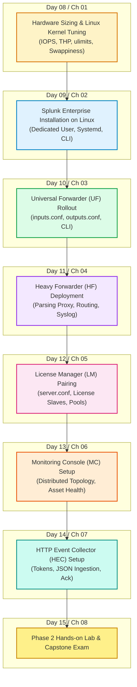

# 📚 Phase 2: Enterprise Installation & Topology Setup — Handbook & TOC

> **The Splunk Administrator's Definitive Handbook** | Phase 2  
> **Target Audience:** Complete Beginners to Enterprise Administrators  
> **Goal:** Transition from architectural theory into **hands-on Linux enterprise deployment, kernel tuning, forwarder rollouts, and multi-tier instance configuration**.

---

## 🎯 Phase 2 Roadmap & Curriculum (Days 8–15)

---

## 📖 Chapter Directory & 🎮 Cyber Range Challenge Rooms (Phase 2)

| Chapter | Lesson Note | 🎮 TryHackMe / HTB Challenge Room | Status / Score |
| :---: | :--- | :--- | :---: |
| **Ch 01** | [Hardware Sizing & Linux Kernel Tuning](./Chapter_01_Hardware_Sizing_and_Linux_Kernel_Tuning.md) | **[Room P2-01: Linux Kernel Hardening & 1200 IOPS](../Labs/Room_P2_01_Linux_Kernel_Tuning_and_1200_IOPS.md)** `[200 XP]` | 🟢 9.6 / 10 |
| **Ch 02** | [Splunk Enterprise Linux Installation](./Chapter_02_Step_by_Step_Splunk_Enterprise_Installation.md) | **[Room P2-02: Production Linux Deployment & Systemd](../Labs/Room_P2_02_Splunk_Enterprise_Linux_Deployment_and_Systemd.md)** `[200 XP]` | 🟢 10.0 / 10 |
| **Ch 03** | [Universal Forwarder (UF) Rollout](./Chapter_03_Universal_Forwarder_Installation_and_Config.md) | **[Room P2-03: UF Fleet Rollout & outputs useACK](../Labs/Room_P2_03_Universal_Forwarder_Fleet_Deployment_and_ACK.md)** `[200 XP]` | 🟢 9.8 / 10 |
| **Ch 04** | [Heavy Forwarder (HF) Architecture](./Chapter_04_Heavy_Forwarder_Deployment_and_Routing.md) | **[Room 01: Heavy Forwarder Port Clash & Triage](../Labs/Room_01_Heavy_Forwarder_Infiltration_and_Port_Clash.md)** `[200 XP]` | 🟢 9.7 / 10 |
| **Ch 05** | [License Manager Pairing & Pools](./Chapter_05_License_Manager_Pairing_and_Pools.md) | **[Room 02: Central License Vault Heist & 72h Grace](../Labs/Room_02_License_Vault_Heist_and_72Hr_Survival.md)** `[250 XP]` | 🟢 9.9 / 10 |
| **Ch 06** | [Monitoring Console (MC) Setup](./Chapter_06_Monitoring_Console_Setup_and_Telemetry.md) | **[Room 03: Monitoring Console: Queue Jam Triage](../Labs/Room_03_Monitoring_Console_Mission_Control.md)** `[300 XP]` | 🟡 In Progress |
| **Ch 07** | [HTTP Event Collector (HEC) Setup](./Chapter_07_HTTP_Event_Collector_Setup_and_Security.md) | *[Room 04: HEC Token Security & JSON Ingestion]* *(Upcoming)* | ⚪ Next Up |

👉 **[Enter the Master Cyber Range Arena](../Labs/00_Splunk_Cyber_Arena_Overview.md)** 🚀

---

## 🎯 Mastery Checklist for Phase 2
- [x] **Chapter 01:** Understand CPU/RAM reference specs, $\ge 1200\text{ IOPS}$ requirements, and disable Transparent Huge Pages (`THP`). *(Evaluated: 9.6/10)*
- [x] **Chapter 02:** Install Splunk Enterprise under a non-root `splunk` user and enable Systemd startup. *(Evaluated: 10/10)*
- [x] **Chapter 03:** Deploy a Universal Forwarder, configure `inputs.conf` / `outputs.conf`, and verify TCP 9997 connectivity. *(Evaluated: 9.8/10)*
- [x] **Chapter 04:** Build a Heavy Forwarder to mask PII data and route events. *(Evaluated: 9.7/10)*
- [x] **Chapter 05:** Pair an Indexer to a central License Manager via Port 8089. *(Evaluated: 9.9/10)*
- [ ] **Chapter 06:** Configure the Monitoring Console in Distributed Mode to monitor cluster topology.
- [ ] **Chapter 07:** Create HEC tokens and test JSON ingestion via `curl`.
