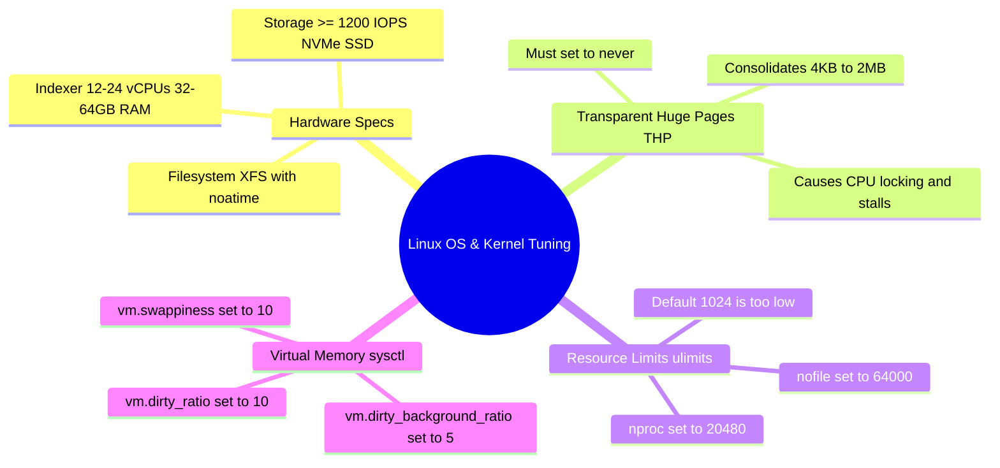

# 📖 Chapter 01 (Phase 2): Hardware Sizing, Storage Benchmarks & Linux Kernel Tuning

> **The Splunk Administrator's Handbook** | Phase 2: Enterprise Installation & Topology Setup  
> **Target Audience:** Complete Beginners to Enterprise Administrators  
> **Prerequisites:** Phase 1 (Chapters 01–07)

---

## 🏎️ 1. The Master Analogy: "The Formula 1 Race Car on a Highway"

Imagine buying a **Formula 1 racing engine** capable of 250 MPH (Splunk Enterprise indexing thousands of events per second), but dropping it into a standard family sedan with skinny tires and speed-governed software (default, untuned Linux OS):

1. **Default Linux `ulimits` (1024 open files):** The engine tries to open 5,000 log files, but the OS slams on the emergency brake and crashes.
2. **Transparent Huge Pages (`THP = always`):** The OS aggressively tries to group memory into giant 2MB chunks, causing massive CPU stuttering (locking) during real-time indexing.
3. **Slow Disk IOPS (< 800 IOPS):** The engine writes data faster than the tires can roll, causing the entire car to skid and stall (queue backpressure).

> [!IMPORTANT]
> **The Golden Production Rule:** Before installing a single byte of Splunk, an enterprise administrator **MUST tune the underlying Linux kernel and verify hardware specs**.

---

## 🖥️ 2. Splunk Reference Hardware Specifications

Splunk publishes strict **Reference Hardware Specifications** for production instances:

```text
┌────────────────────────────────────────────────────────────────────────────────────────┐
│                        SPLUNK ENTERPRISE REFERENCE HARDWARE                            │
├───────────────────┬────────────────────┬─────────────────────┬─────────────────────────┤
│ COMPONENT ROLE    │ CPU (VIRTUAL/PHYS) │ RAM (MEMORY)        │ DISK STORAGE & IOPS     │
├───────────────────┼────────────────────┼─────────────────────┼─────────────────────────┤
│ Universal Fwd (UF)│ 1 - 2 vCPUs        │ 512 MB - 1 GB       │ Standard Disk (~100 IOPS│
│ Heavy Fwd (HF)    │ 4 - 8 vCPUs        │ 8 GB - 16 GB        │ Fast SSD (300+ IOPS)    │
│ Indexer (IDX)     │ 12 - 24 vCPUs      │ 32 GB - 64 GB       │ NVMe SSD (≥ 1,200 IOPS) │
│ Search Head (SH)  │ 16 - 32 vCPUs      │ 32 GB - 64 GB       │ Fast SSD (800+ IOPS)    │
│ Deployment Server │ 4 - 8 vCPUs        │ 8 GB - 16 GB        │ Standard SSD (300+ IOPS)│
│ Cluster Manager   │ 4 - 8 vCPUs        │ 8 GB - 16 GB        │ Standard SSD (300+ IOPS)│
└───────────────────┴────────────────────┴─────────────────────┴─────────────────────────┘
```

### ⚡ Why Indexers Demand $\ge 1,200\text{ IOPS}$:
During peak ingestion, an Indexer is simultaneously:
1. Writing raw compressed data to `journal.zst`.
2. Building and updating inverted indexes in `.tsidx`.
3. Reading historical buckets to serve active Search Head queries.
4. Streaming replicated bucket copies to peer indexers over port `9887`.

If your storage delivers less than $1,200\text{ IOPS}$, your `index_queue` will fill to 100%, causing data ingestion to pause!

---

## 📂 3. Filesystem Selection: `xfs` vs. `ext4`

| Feature | `XFS` (Recommended by Splunk) | `EXT4` (Acceptable Alternative) | `NFS` (Prohibited for Hot/Warm) |
| :--- | :--- | :--- | :--- |
| **Parallel I/O Handling** | 🌟 Exceptional multi-threaded write performance across large directories. | Good, but experiences lock contention with 10,000+ open buckets. | ❌ High network latency causes bucket corruption. |
| **Inode Allocation** | Dynamic (Grows automatically as you add millions of `.tsidx` files). | Fixed at formatting time (Can run out of Inodes even with disk space left!). | Variable. |
| **Mount Options** | `noatime,nodiratime` | `noatime,nodiratime` | Not recommended for active indexing. |

> [!TIP]
> **Always mount Splunk partitions with `noatime`:** By default, Linux updates the "access timestamp" every time Splunk reads a file. Adding `noatime` in `/etc/fstab` disables this useless metadata write, boosting disk performance by 15–20%!

---

## 🛠️ 4. The 4 Mandatory Linux Kernel Optimizations

```text
┌────────────────────────────────────────────────────────────────────────┐
│                   THE 4 MANDATORY LINUX KERNEL TUNINGS                 │
├────────────────────────────────┬───────────────────────────────────────┤
│ 1. 🚫 Disable THP              │ Prevents CPU stalls & memory locking  │
│ 2. 📂 Increase ulimits         │ Allows 64,000 open file descriptors   │
│ 3. 🧠 Set vm.swappiness = 10   │ Prevents premature swapping to disk   │
│ 4. ⚡ Tune Dirty Memory Ratio  │ Smooths out aggressive disk flushing  │
└────────────────────────────────┴───────────────────────────────────────┘
```

---

### 🚫 Tuning 1: Disable Transparent Huge Pages (THP)

#### What is THP?
By default, Linux allocates memory in small **4 KB pages**. THP attempts to automatically consolidate these into **2 MB huge pages**. 

#### Why Splunk Hates THP:
Splunk accesses thousands of small, discrete memory chunks simultaneously. When THP attempts to allocate or defragment 2 MB blocks, the Linux kernel locks CPU threads, causing **massive latency spikes (stuttering) and severe search degradation**.

#### 💻 Step-by-Step: How to Disable THP Permanently via Systemd

1. Check current THP status (if `[always]` is bracketed, THP is active and causing issues):
   ```bash
   cat /sys/kernel/mm/transparent_hugepage/enabled
   # Output: [always] madvise never   <-- BAD!
   ```

2. Create a custom systemd service to disable THP at boot:
   ```bash
   sudo nano /etc/systemd/system/disable-thp.service
   ```

3. Paste the following configuration:
   ```ini
   [Unit]
   Description=Disable Transparent Huge Pages (THP) for Splunk Enterprise
   DefaultDependencies=no
   After=sysinit.target local-fs.target
   Before=mongod.service splunk.service

   [Service]
   Type=oneshot
   ExecStart=/bin/sh -c 'echo never > /sys/kernel/mm/transparent_hugepage/enabled && echo never > /sys/kernel/mm/transparent_hugepage/defrag'

   [Install]
   WantedBy=basic.target
   ```

4. Enable and start the service:
   ```bash
   sudo systemctl daemon-reload
   sudo systemctl enable --now disable-thp.service
   ```

5. Verify that `[never]` is now selected:
   ```bash
   cat /sys/kernel/mm/transparent_hugepage/enabled
   # Output: always madvise [never]   <-- PERFECT!
   ```

---

### 📂 Tuning 2: Increase Resource Limits (`ulimits`)

#### Why Default Limits Crash Splunk:
By default, standard Linux users are restricted to **1,024 open files** and **1,024 processes**. In an enterprise environment, a single Indexer easily opens 15,000+ bucket files (`journal.zst`, `.tsidx`, `bloomfilter`) and spawns hundreds of search threads!

#### 💻 Step-by-Step: Setting Enterprise `ulimits`

Create a dedicated limits file for the `splunk` user:

```bash
sudo nano /etc/security/limits.d/99-splunk.conf
```

Add these standard production values:

```text
splunk          soft    nofile          64000
splunk          hard    nofile          64000
splunk          soft    nproc           20480
splunk          hard    nproc           20480
splunk          soft    fsize           unlimited
splunk          hard    fsize           unlimited
```

---

### 🧠 Tuning 3 & 4: Virtual Memory & Dirty Ratios (`sysctl.conf`)

Edit the system kernel parameters file:

```bash
sudo nano /etc/sysctl.d/99-splunk.conf
```

Add the following optimized kernel directives:

```ini
# 1. Reduce swappiness (Prevents OS from paging Splunk RAM into slow swap disk)
vm.swappiness = 10

# 2. Smooth disk write flushes (Starts background flushing at 5% dirty pages)
vm.dirty_background_ratio = 5
vm.dirty_ratio = 10

# 3. Increase max socket connections (Prevents dropped TCP connections from forwarders)
net.core.somaxconn = 1024
```

Apply the changes immediately without restarting:

```bash
sudo sysctl --system
```

---

## 🔍 5. Administrator Kernel Verification Script

Run this quick command chain to verify that your Linux OS is 100% tuned and ready for Splunk:

```bash
echo "=== 1. Checking THP Status ==="
cat /sys/kernel/mm/transparent_hugepage/enabled

echo "=== 2. Checking Swappiness ==="
sysctl vm.swappiness

echo "=== 3. Checking Splunk User Limits ==="
su - splunk -c "ulimit -a"
```

---

## 🧠 6. Chapter 01 (Phase 2) Self-Check Quiz

1. What is the minimum recommended disk **IOPS** for a production Splunk Indexer?
2. Why does enabling **Transparent Huge Pages (THP)** degrade Splunk performance?
3. Which Linux filesystem is officially recommended by Splunk for hot and warm storage tiers: `XFS` or `EXT4`?
4. What happens to Splunk if the Linux `nofile` (open file descriptors) limit remains at its default value of `1024`?
5. Why should you add the **`noatime`** mount option to Splunk disk partitions in `/etc/fstab`?

---

## 📌 7. Visual Mind Map & Sticky Notes (Chapter 01 Quick-Review)

### 🧠 Hierarchical Mind Map


### 🗂️ Color-Coded Digital Sticky Notes

#### 🟨 Sticky Note 1: The THP Golden Rule
```text
┌─────────────────────────────────────────────────────────────┐
│ 📌 THP MUST BE NEVER                                        │
│                                                             │
│ • Check: cat /sys/kernel/mm/transparent_hugepage/enabled    │
│ • Target: always madvise [never]                            │
│ • Why: Prevents kernel CPU locking during index operations. │
└─────────────────────────────────────────────────────────────┘
```

#### 🟩 Sticky Note 2: Enterprise ulimits
```text
┌─────────────────────────────────────────────────────────────┐
│ 📌 ULIMITS FOR SPLUNK USER                                  │
│                                                             │
│ • File: /etc/security/limits.d/99-splunk.conf               │
│ • nofile = 64000 (Open file descriptors)                    │
│ • nproc  = 20480 (Max user processes)                       │
└─────────────────────────────────────────────────────────────┘
```

#### 🟪 Sticky Note 3: Storage & Filesystem
```text
┌─────────────────────────────────────────────────────────────┐
│ 📌 STORAGE SPECIFICATIONS                                   │
│                                                             │
│ • IOPS: >= 1,200 IOPS on Indexers (NVMe/SSD).               │
│ • Filesystem: XFS (Dynamic Inodes + Multi-threaded I/O).    │
│ • Mount Option: noatime (Eliminates read timestamp writes). │
└─────────────────────────────────────────────────────────────┘
```

---

### ⚡ Rapid-Recall Flashcards

| # | Parameter / Tuning | Production Target Value | Reason / Architectural Impact |
| :-: | :--- | :--- | :--- |
| **01** | **THP (Transparent Huge Pages)** | `never` | Prevents kernel CPU lockups and latency spikes during indexing. |
| **02** | **`nofile` (Open Files Limit)** | `64000` | Allows Indexers to keep thousands of bucket files open simultaneously. |
| **03** | **`nproc` (Process Limit)** | `20480` | Accommodates concurrent search threads and background processes. |
| **04** | **`vm.swappiness`** | `10` | Keeps active Splunk processes in fast physical RAM instead of swap. |
| **05** | **Filesystem Type** | `XFS` | Handles parallel multi-threaded writes without inode exhaustion. |
| **06** | **Mount Option** | `noatime` | Disables disk write updates whenever a file is read, boosting I/O speed. |

---

## 🎮 Hands-On Cyber Range Challenge: Room P2-01 (TryHackMe / HTB Style)

```text
┌────────────────────────────────────────────────────────────────────────┐
│ 🕹️ ARENA MISSION: Room P2-01 — Linux Hardening & 1,200 IOPS Benchmark  │
│ ⭐ DIFFICULTY: Medium | 💎 REWARD: 200 XP | ⏱️ TIME: 30 Mins           │
└────────────────────────────────────────────────────────────────────────┘
```

> **🚨 Incident Scenario:**  
> A newly provisioned Indexer Cluster is suffering from memory lockups and 60% throughput drop.  
> The Monitoring Console flags: Transparent Huge Pages (`THP`) is enabled, and `ulimits` is at 1024!  
> You must permanently disable THP via Systemd and benchmark storage to 1,200 IOPS!

### 🎯 Mission Checkpoint Questions

#### 1. What value must be set in `/sys/kernel/mm/transparent_hugepage/enabled`?
*(Answer Format: `*****`)*
<details><summary>💡 Need a Hint?</summary>A 5-letter word meaning at no time.</details>
<details><summary>🔓 Reveal Answer</summary><b>Answer:</b> <code>never</code></details>

#### 2. What is the recommended production minimum limit for `nofile` (open files) in `/etc/security/limits.conf`?
*(Answer Format: `**,***`)*
<details><summary>💡 Need a Hint?</summary>Sixty-four thousand.</details>
<details><summary>🔓 Reveal Answer</summary><b>Answer:</b> <code>64,000</code></details>

#### 3. What is the minimum sustained random write IOPS benchmark required by Splunk?
*(Answer Format: `*,*** IOPS`)*
<details><summary>💡 Need a Hint?</summary>Twelve hundred.</details>
<details><summary>🔓 Reveal Answer</summary><b>Answer:</b> <code>1,200 IOPS</code></details>

👉 **[Launch Full Interactive Lab: Room P2-01 & Capture All 4 Flags (200 XP)](../Labs/Room_P2_01_Linux_Kernel_Tuning_and_1200_IOPS.md)**
