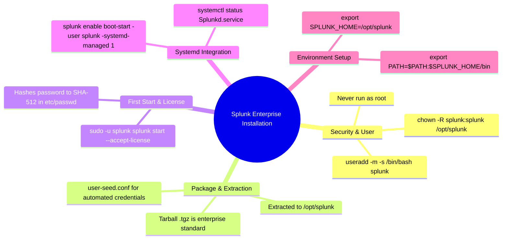

# 📖 Chapter 02 (Phase 2): Step-by-Step Installation of Splunk Enterprise on Linux

> **The Splunk Administrator's Handbook** | Phase 2: Enterprise Installation & Topology Setup  
> **Target Audience:** Complete Beginners to Enterprise Administrators  
> **Prerequisites:** Phase 1 (Chapters 01–07) & Phase 2, Chapter 01 (Linux OS Tuning)

---

## 🛡️ 1. The Golden Security Rule: "Never Run Splunk as `root`!"

In Linux enterprise administration, **Rule #1** of Splunk deployment is:
> **Splunk MUST always run under a dedicated, non-privileged service user (typically `splunk`).**

```text
┌────────────────────────────────────────────────────────────────────────┐
│                   WHY RUNNING SPLUNK AS ROOT IS PROHIBITED             │
├───────────────────────────────────┬────────────────────────────────────┤
│ ❌ RISKS OF RUNNING AS ROOT       │ ✅ BENEFITS OF DEDICATED USER       │
├───────────────────────────────────┼────────────────────────────────────┤
│ • Security Vulnerability: If a    │ • Principle of Least Privilege: If │
│   web exploit hits Splunk Web, the│   compromised, the attacker is     │
│   attacker gains full root access.│   trapped in non-privileged space. │
│ • File Permission Mess: Files     │ • Clean Ownership: All configs and │
│   created by root cannot be edited│   buckets belong strictly to the   │
│   later by service accounts.      │   'splunk' user and group.         │
│ • Accidental OS File Overwrites.  │ • Easy Integration with Systemd.   │
└───────────────────────────────────┴────────────────────────────────────┘
```

---

## 📦 2. Package Formats: `.tgz` (Tarball) vs. `.rpm` vs. `.deb`

```text
┌────────────────────────────────────────────────────────────────────────┐
│                        SPLUNK PACKAGE COMPARISON                       │
├─────────────┬───────────────────────────┬──────────────────────────────┤
│ PACKAGE     │ HOW IT WORKS              │ PRODUCTION USE CASE          │
├─────────────┼───────────────────────────┼──────────────────────────────┤
│ 🏆 .tgz     │ Compressed archive.       │ 🌟 Preferred by 90%+ of      │
│ (Tarball)   │ Extracted directly into   │ Enterprise Architects.       │
│             │ /opt/splunk as any user.  │ Complete control over paths. │
├─────────────┼───────────────────────────┼──────────────────────────────┤
│ 📦 .rpm     │ RedHat/CentOS/Rocky Linux │ Standard package installer;  │
│             │ system package manager.   │ creates user automatically.  │
├─────────────┼───────────────────────────┼──────────────────────────────┤
│ 📦 .deb     │ Debian/Ubuntu package.    │ Standard Debian installer.   │
└─────────────┴───────────────────────────┴──────────────────────────────┘
```

> [!TIP]
> **Why Architects Prefer the `.tgz` Tarball:**
> The tarball package does not make assumptions about your system users, does not require root privileges during download/extraction, and allows automated scripted installs (Ansible, Terraform, Puppet) with zero package manager conflicts!

---

## 🚀 3. Step-by-Step Installation Walkthrough (The Production Standard)

```text
  Step 1: Create 'splunk' User & Group
               │
               ▼
  Step 2: Download & Extract Tarball to /opt/splunk
               │
               ▼
  Step 3: Pre-seed Admin Password (user-seed.conf)
               │
               ▼
  Step 4: Fix Permissions (chown -R splunk:splunk)
               │
               ▼
  Step 5: First-Time Start (--accept-license)
               │
               ▼
  Step 6: Enable Systemd Boot-Start (-systemd-managed 1)
```

---

### 💻 Step 1: Create the Dedicated `splunk` User & Group

On your clean Linux server, create the `splunk` system user with a home directory and a standard Bash shell:

```bash
# 1. Create the splunk user and group:
sudo useradd -m -s /bin/bash splunk

# 2. (Optional) Set a password for the splunk user:
sudo passwd splunk
```

---

### 💻 Step 2: Download and Extract the Splunk Tarball to `/opt`

Navigate to the `/opt` directory (the enterprise industry standard location for Splunk) and extract the archive:

```bash
# 1. Move to /opt:
cd /opt

# 2. Extract the Splunk Enterprise tarball:
# (Replace with your downloaded version, e.g., splunk-9.2.x-linux-2.6-x86_64.tgz)
sudo tar -zxvf /tmp/splunk-9.2.1-linux-2.6-x86_64.tgz -C /opt

# 3. Verify the directory structure exists:
ls -ld /opt/splunk
```

---

### 💻 Step 3: Automate Admin Credentials via `user-seed.conf`

To avoid interactive terminal prompts and enable zero-touch automation, pre-configure the initial admin credentials:

```bash
# 1. Create the system local directory if it doesn't exist:
sudo mkdir -p /opt/splunk/etc/system/local

# 2. Create the user-seed.conf file:
sudo nano /opt/splunk/etc/system/local/user-seed.conf
```

Add the initial administrator username and desired password:

```ini
[user_info]
USERNAME = admin
PASSWORD = ComplexAdminPassword123!
```

> [!NOTE]
> Upon first startup, Splunk automatically hashes this plain-text password into an irreversible `SHA-512` hash inside `$SPLUNK_HOME/etc/passwd` and safely deletes `user-seed.conf`!

---

### 💻 Step 4: Fix Directory Ownership Permissions

Ensure the `splunk` user owns every file and directory under `/opt/splunk`:

```bash
sudo chown -R splunk:splunk /opt/splunk
```

---

### 💻 Step 5: First-Time Start & Accept License Agreement

Execute the first-time startup command strictly as the `splunk` user:

```bash
# Run startup with non-interactive license acceptance:
sudo -u splunk /opt/splunk/bin/splunk start --accept-license --answer-yes
```

**Expected Terminal Output:**
```text
Checking prerequisites...
  Checking http port [8000]: open
  Checking mgmt port [8089]: open
  Checking appserver port [8065]: open
  Checking kvstore port [8191]: open
All preliminary checks passed.

Starting splunk server daemon (splunkd)...
Done.
The Splunk web interface is available at: http://your-server-ip:8000
```

---

### 💻 Step 6: Enable Systemd Service Management (`boot-start`)

To ensure Splunk starts automatically when the Linux server reboots, configure Systemd service management:

```bash
# 1. Configure Systemd unit generation:
sudo /opt/splunk/bin/splunk enable boot-start -user splunk -systemd-managed 1

# 2. Reload the Systemd daemon:
sudo systemctl daemon-reload

# 3. Verify Splunk is running under Systemd:
sudo systemctl status Splunkd.service
```

---

## 🛠️ 5. Setting Up Environment Variables (`.bashrc`)

To run the `splunk` CLI command directly without typing `/opt/splunk/bin/splunk` every time:

```bash
# 1. Open the splunk user's bash profile:
sudo nano /home/splunk/.bashrc
```

Add these two lines at the bottom:

```bash
# Splunk Enterprise Environment Paths
export SPLUNK_HOME=/opt/splunk
export PATH=$PATH:$SPLUNK_HOME/bin
```

Apply immediately:
```bash
source /home/splunk/.bashrc
```

Now you can simply run `splunk status`, `splunk restart`, or `splunk btool` from any directory!

---

## 🔍 6. Verification: Ports, Service & Web UI Check

Run these 3 validation checks from the Linux terminal:

```bash
# 1. Check if splunkd process is running as the 'splunk' user:
ps -ef | grep splunkd

# 2. Check listening network ports (8000 Web, 8089 REST):
ss -tulpn | grep -E '8000|8089'

# 3. Check CLI server info:
/opt/splunk/bin/splunk show server-info -auth admin:ComplexAdminPassword123!
```

Open your browser and navigate to:  
👉 **`http://<YOUR_SERVER_IP>:8000`**  
Log in with username **`admin`** and your password!

---

## 🧠 7. Chapter 02 (Phase 2) Self-Check Quiz

1. Why is running Splunk Enterprise as the `root` user strictly prohibited in enterprise production environments?
2. Which configuration file can you pre-create in `$SPLUNK_HOME/etc/system/local/` to automate the initial admin username and password?
3. What happens to the plain-text password in `user-seed.conf` once Splunk completes its first startup?
4. What exact CLI command configures Splunk to start automatically at Linux boot under Systemd as the `splunk` user?
5. Which two Linux environment variables should be exported in `/home/splunk/.bashrc` for easy terminal administration?

---

## 📌 8. Visual Mind Map & Sticky Notes (Chapter 02 Quick-Review)

### 🧠 Hierarchical Mind Map


### 🗂️ Color-Coded Digital Sticky Notes

#### 🟨 Sticky Note 1: Dedicated User Rule
```text
┌─────────────────────────────────────────────────────────────┐
│ 📌 NEVER RUN AS ROOT                                        │
│                                                             │
│ • User: useradd -m -s /bin/bash splunk                      │
│ • Ownership: chown -R splunk:splunk /opt/splunk             │
│ • Security: Enforces Principle of Least Privilege.          │
└─────────────────────────────────────────────────────────────┘
```

#### 🟩 Sticky Note 2: user-seed.conf Automation
```text
┌─────────────────────────────────────────────────────────────┐
│ 📌 PRE-SEEDING CREDENTIALS                                  │
│                                                             │
│ • Path: $SPLUNK_HOME/etc/system/local/user-seed.conf        │
│ • Content: [user_info] \n USERNAME=admin \n PASSWORD=...    │
│ • Behavior: Converted to SHA-512 and auto-deleted at boot.  │
└─────────────────────────────────────────────────────────────┘
```

#### 🟪 Sticky Note 3: Systemd Boot Command
```text
┌─────────────────────────────────────────────────────────────┐
│ 📌 SYSTEMD ENABLEMENT                                       │
│                                                             │
│ • Command:                                                  │
│   splunk enable boot-start -user splunk -systemd-managed 1  │
│ • Service Name: Splunkd.service                             │
└─────────────────────────────────────────────────────────────┘
```

---

### ⚡ Rapid-Recall Flashcards

| # | Question (Front) | Answer & Key Production Detail (Back) |
| :-: | :--- | :--- |
| **01** | Where is the enterprise industry-standard installation path for Splunk? | **`/opt/splunk`** (owned by `splunk:splunk`). |
| **02** | Which file allows automated, headless admin password creation? | **`$SPLUNK_HOME/etc/system/local/user-seed.conf`**. |
| **03** | What command starts Splunk while accepting the license non-interactively? | **`sudo -u splunk /opt/splunk/bin/splunk start --accept-license --answer-yes`**. |
| **04** | What command sets up Systemd boot management for the `splunk` user? | **`sudo /opt/splunk/bin/splunk enable boot-start -user splunk -systemd-managed 1`**. |
| **05** | How do you check if Splunk Web (8000) and REST API (8089) are listening? | **`ss -tulpn \| grep -E '8000\|8089'`**. |

---

## 🎮 Hands-On Cyber Range Challenge: Room P2-02 (TryHackMe / HTB Style)

```text
┌────────────────────────────────────────────────────────────────────────┐
│ 🕹️ ARENA MISSION: Room P2-02 — Production Linux Deployment & Systemd   │
│ ⭐ DIFFICULTY: Medium | 💎 REWARD: 200 XP | ⏱️ TIME: 30 Mins           │
└────────────────────────────────────────────────────────────────────────┘
```

> **🚨 Incident Scenario:**  
> A security audit flagged Splunk running as `root`!  
> If the host reboots, Splunk fails to start.  
> You must migrate Splunk to a dedicated `splunk` service account, seed credentials via `user-seed.conf`, and enable native Systemd management!

### 🎯 Mission Checkpoint Questions

#### 1. Why must Splunk never run as the `root` superuser in production?
*(Answer Format: Third-party apps could execute ********* code with root privileges)*
<details><summary>💡 Need a Hint?</summary>Least privilege security.</details>
<details><summary>🔓 Reveal Answer</summary><b>Answer:</b> Third-party apps could execute <code>arbitrary</code> code with root privileges.</details>

#### 2. What configuration file silently seeds the initial admin password during automated deployment?
*(Answer Format: `*********.conf`)*
<details><summary>💡 Need a Hint?</summary>user-seed...</details>
<details><summary>🔓 Reveal Answer</summary><b>Answer:</b> <code>user-seed.conf</code></details>

#### 3. Which flag passed to `splunk enable boot-start` creates a native Systemd unit?
*(Answer Format: `-**************** *`)*
<details><summary>💡 Need a Hint?</summary>-systemd-managed 1</details>
<details><summary>🔓 Reveal Answer</summary><b>Answer:</b> <code>-systemd-managed 1</code></details>

👉 **[Launch Full Interactive Lab: Room P2-02 & Capture All 4 Flags (200 XP)](../Labs/Room_P2_02_Splunk_Enterprise_Linux_Deployment_and_Systemd.md)**
