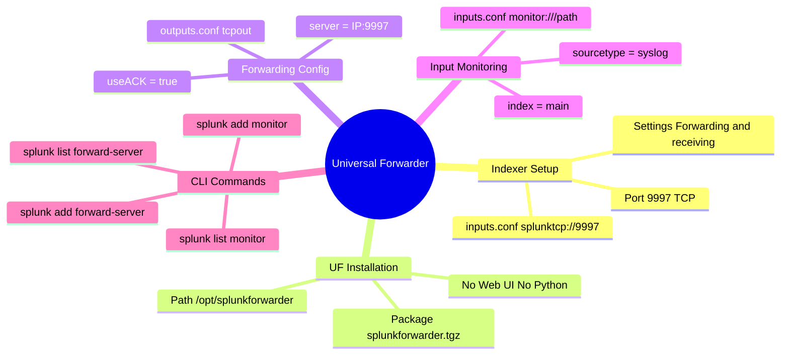

# 📖 Chapter 03 (Phase 2): Universal Forwarder (UF) Installation & Configuration

> **The Splunk Administrator's Handbook** | Phase 2: Enterprise Installation & Topology Setup  
> **Target Audience:** Complete Beginners to Enterprise Administrators  
> **Prerequisites:** Phase 2, Chapters 01 & 02 (Splunk Enterprise installed and running on port 8000/8089)

---

## 🚚 1. The Master Analogy: "The Dedicated Mail Courier"

Think of your **Indexer** as the **Central Post Office Sorting Center**, and the **Universal Forwarder (UF)** as the **Dedicated Mail Courier**:

```text
┌────────────────────────────────────────────────────────────────────────┐
│                   UNIVERSAL FORWARDER VS. FULL ENTERPRISE              │
├───────────────────────────────────┬────────────────────────────────────┤
│ 🏢 SPLUNK ENTERPRISE (INDEXER)    │ 🚚 UNIVERSAL FORWARDER (UF)        │
├───────────────────────────────────┼────────────────────────────────────┤
│ • Full processing engine          │ • Stripped-down binary             │
│ • Web UI on Port 8000             │ • NO Web UI (Headless CLI only)    │
│ • Python interpreter included     │ • NO Python engine                 │
│ • Parses, indexes, and searches   │ • NO parsing/indexing engine       │
│ • Heavy footprint (~1-2 GB RAM)   │ • Ultra-lightweight (~50MB RAM)    │
│ • Destination: Listens on TCP 9997│ • Source: Streams OUTBOUND to 9997 │
└───────────────────────────────────┴────────────────────────────────────┘
```

The Universal Forwarder does one job and does it at blazing speed: **monitors files, wraps logs into 64KB network blocks, and ships them over TCP 9997**.

---

## 🏗️ 2. The Two-Sided Handshake: Indexer Receiver + Forwarder Shipper

To get logs flowing from an application server to an indexer, you must configure **both sides of the connection**:

```text
┌───────────────────────────┐                    ┌───────────────────────────┐
│ 🚚 UNIVERSAL FORWARDER    │                    │ 📥 SPLUNK INDEXER         │
│                           │                    │                           │
│ outputs.conf:             │  TCP Port 9997     │ inputs.conf:              │
│ [tcpout]                  │ ─────────────────► │ [splunktcp://9997]        │
│ server = 10.0.0.10:9997   │  (S2S Protocol)    │ (Listens for incoming S2S)│
└───────────────────────────┘                    └───────────────────────────┘
```

---

## 📥 3. Step 1: Enable Receiving on Your Indexer (Port 9997)

Before a forwarder can send data, the Indexer must be told to listen on **TCP Port 9997**.

### Option A: Via Splunk Web GUI (Fastest & Easiest)
1. Log in to Splunk Web (`http://<indexer-ip>:8000`) as `admin`.
2. In the top right menu, click **Settings ──► Forwarding and receiving**.
3. Under **Receive data**, click **Configure receiving**.
4. Click **New Receiving Port**.
5. Enter **`9997`** and click **Save**.

### Option B: Via Configuration File (`inputs.conf`)
On the Indexer terminal, edit `$SPLUNK_HOME/etc/system/local/inputs.conf`:
```ini
[splunktcp://9997]
disabled = 0
```
Restart or reload Splunk:
```bash
/opt/splunk/bin/splunk restart
```

### 🔍 Verify Indexer is Listening on Port 9997:
```bash
ss -tulpn | grep 9997
# Expected output:
# tcp LISTEN 0 128 0.0.0.0:9997 ... users:(("splunkd",...))
```

---

## 💻 4. Step 2: Install Universal Forwarder on the Client Machine

### Step 2.1: Download & Extract into `/opt/splunkforwarder`
On the client application server (or a separate directory/machine):

```bash
# 1. Create the dedicated splunk user if not already present:
sudo useradd -m -s /bin/bash splunk

# 2. Extract the Universal Forwarder package into /opt:
sudo tar -zxvf /tmp/splunkforwarder-9.2.1-linux-2.6-x86_64.tgz -C /opt

# 3. Ensure ownership belongs to the splunk user:
sudo chown -R splunk:splunk /opt/splunkforwarder
```

### Step 2.2: Pre-seed Forwarder Admin Credentials
Create `/opt/splunkforwarder/etc/system/local/user-seed.conf`:
```ini
[user_info]
USERNAME = admin
PASSWORD = ForwarderPass123!
```

### Step 2.3: Start the Forwarder
```bash
sudo -u splunk /opt/splunkforwarder/bin/splunk start --accept-license --answer-yes
```

---

## 📡 5. Step 3: Configure Forwarding to Indexer (`outputs.conf`)

Now tell the forwarder where to send its logs.

### Method A: Using the Forwarder CLI (Recommended for Beginners)
Run this command on the Forwarder:
```bash
sudo -u splunk /opt/splunkforwarder/bin/splunk add forward-server <INDEXER_IP>:9997 -auth admin:ForwarderPass123!
```

Verify the active forwarding destination:
```bash
sudo -u splunk /opt/splunkforwarder/bin/splunk list forward-server -auth admin:ForwarderPass123!
```
**Expected Output:**
```text
Active forwards:
    <INDEXER_IP>:9997
Configured but inactive forwards:
    None
```

### Method B: Manual Configuration (`outputs.conf`)
Create or edit `/opt/splunkforwarder/etc/system/local/outputs.conf`:
```ini
[tcpout]
defaultGroup = default-autolb-group

[tcpout:default-autolb-group]
server = <INDEXER_IP>:9997
useACK = true
```

> [!IMPORTANT]
> **Always set `useACK = true`:** This enables Indexer Acknowledgment. If the network drops or the indexer disk saturates, the forwarder holds events in RAM and will not drop data!

---

## 📝 6. Step 4: Monitor a Log File on the Forwarder (`inputs.conf`)

Now let's tell the forwarder to monitor a real log file (e.g., `/var/log/syslog` or `/var/log/messages`).

### Method A: Using Forwarder CLI
```bash
sudo -u splunk /opt/splunkforwarder/bin/splunk add monitor /var/log/syslog -index main -sourcetype syslog -auth admin:ForwarderPass123!
```

Check all actively monitored paths:
```bash
sudo -u splunk /opt/splunkforwarder/bin/splunk list monitor -auth admin:ForwarderPass123!
```

### Method B: Manual Configuration in `inputs.conf`
Edit `/opt/splunkforwarder/etc/system/local/inputs.conf`:
```ini
[monitor:///var/log/syslog]
disabled = 0
index = main
sourcetype = syslog
```

> [!NOTE]
> **File Read Permissions:** Make sure the `splunk` user has read permission for the monitored file!
> `sudo chmod o+r /var/log/syslog` or add `splunk` to the `adm` group: `sudo usermod -aG adm splunk`.

---

## 🧪 7. Step 5: End-to-End Verification Test!

Let's prove logs are travelling across the network and being indexed:

1. On the client machine, inject a test log line:
   ```bash
   logger "SPLUNK TEST: Hello from Universal Forwarder on $(hostname)!"
   ```
2. Open **Splunk Web** on your Indexer: `http://<indexer-ip>:8000`
3. Click on **Search & Reporting** app.
4. Run this search query:
   ```spl
   index=main "SPLUNK TEST"
   ```
5. 🎯 You will see your test log event rendered live with its timestamp, host, source, and sourcetype!

---

## 🧠 8. Chapter 03 (Phase 2) Self-Check Quiz

1. What port does a Splunk Indexer listen on by default for incoming forwarder traffic?
2. In which configuration file on the **Universal Forwarder** do you specify the Indexer's IP address and port?
3. What is the difference between `/opt/splunk` and `/opt/splunkforwarder`?
4. What critical setting in `outputs.conf` ensures that a forwarder does not lose data if an Indexer restarts mid-stream?
5. If a forwarder shows `Configured but inactive forwards: <INDEXER_IP>:9997`, what is the most likely network or configuration cause?

---

## 📌 9. Visual Mind Map & Sticky Notes

### 🧠 Hierarchical Mind Map


### 🗂️ Color-Coded Digital Sticky Notes

#### 🟨 Sticky Note 1: The Port 9997 Rule
```text
┌─────────────────────────────────────────────────────────────┐
│ 📌 INGESTION PORT 9997                                      │
│                                                             │
│ • Indexer: inputs.conf [splunktcp://9997]                   │
│ • Forwarder: outputs.conf server = <IP>:9997                │
│ • Check listening: ss -tulpn | grep 9997                   │
└─────────────────────────────────────────────────────────────┘
```

#### 🟩 Sticky Note 2: Forwarder CLI Shortcuts
```text
┌─────────────────────────────────────────────────────────────┐
│ 📌 ESSENTIAL UF CLI COMMANDS                                │
│                                                             │
│ • Add Destination: splunk add forward-server <IP>:9997      │
│ • Check Destination: splunk list forward-server             │
│ • Add File to Ingest: splunk add monitor /path/to/file      │
│ • Check Monitored Files: splunk list monitor                │
└─────────────────────────────────────────────────────────────┘
```

#### 🟪 Sticky Note 3: Reliability with useACK
```text
┌─────────────────────────────────────────────────────────────┐
│ 📌 ALWAYS ENABLE useACK                                     │
│                                                             │
│ • Setting: useACK = true inside [tcpout] in outputs.conf    │
│ • Why: Forwarder keeps events in RAM until Indexer writes   │
│   them to disk and sends back an ACK token. Zero data loss! │
└─────────────────────────────────────────────────────────────┘
```

---

### ⚡ Rapid-Recall Flashcards

| # | Question (Front) | Answer & Key Detail (Back) |
| :-: | :--- | :--- |
| **01** | What protocol is used over port `9997`? | **Splunk-to-Splunk (S2S)** binary protocol. |
| **02** | Where are forwarding targets defined on a UF? | **`$SPLUNK_HOME/etc/system/local/outputs.conf`**. |
| **03** | How do you check if a forwarder is connected to the indexer? | **`splunk list forward-server`** (look for "Active forwards"). |
| **04** | What stanza in `inputs.conf` opens the listening port on an indexer? | **`[splunktcp://9997]`**. |
| **05** | Does a Universal Forwarder have a web browser interface? | **No.** The UF is headless and managed strictly via CLI or Deployment Server. |

---

## 🎮 Hands-On Cyber Range Challenge: Room P2-03 (TryHackMe / HTB Style)

```text
┌────────────────────────────────────────────────────────────────────────┐
│ 🕹️ ARENA MISSION: Room P2-03 — UF Fleet Rollout & ACK Hardening        │
│ ⭐ DIFFICULTY: Medium | 💎 REWARD: 200 XP | ⏱️ TIME: 30 Mins           │
└────────────────────────────────────────────────────────────────────────┘
```

> **🚨 Incident Scenario:**  
> 20 Nginx edge servers are under credential stuffing attack.  
> You must silently install the Universal Forwarder, monitor `/var/log/nginx/access.log`, configure auto-load balancing across indexers, and enable `useACK = true`!

### 🎯 Mission Checkpoint Questions

#### 1. What flag silently accepts the Splunk license agreement on first boot?
*(Answer Format: `--**************`)*
<details><summary>💡 Need a Hint?</summary>--accept-license</details>
<details><summary>🔓 Reveal Answer</summary><b>Answer:</b> <code>--accept-license</code></details>

#### 2. What stanza prefix in `inputs.conf` tells Splunk to monitor a log file on disk?
*(Answer Format: `[monitor://********]`)*
<details><summary>💡 Need a Hint?</summary>[monitor:///path/to/file.log]</details>
<details><summary>🔓 Reveal Answer</summary><b>Answer:</b> <code>[monitor:///path/to/file.log]</code></details>

#### 3. What is the default auto-load-balancing frequency in seconds (`autoLBFrequency`)?
*(Answer Format: `**` seconds)*
<details><summary>💡 Need a Hint?</summary>Half a minute.</details>
<details><summary>🔓 Reveal Answer</summary><b>Answer:</b> <code>30 seconds</code></details>

👉 **[Launch Full Interactive Lab: Room P2-03 & Capture All 4 Flags (200 XP)](../Labs/Room_P2_03_Universal_Forwarder_Fleet_Deployment_and_ACK.md)**
