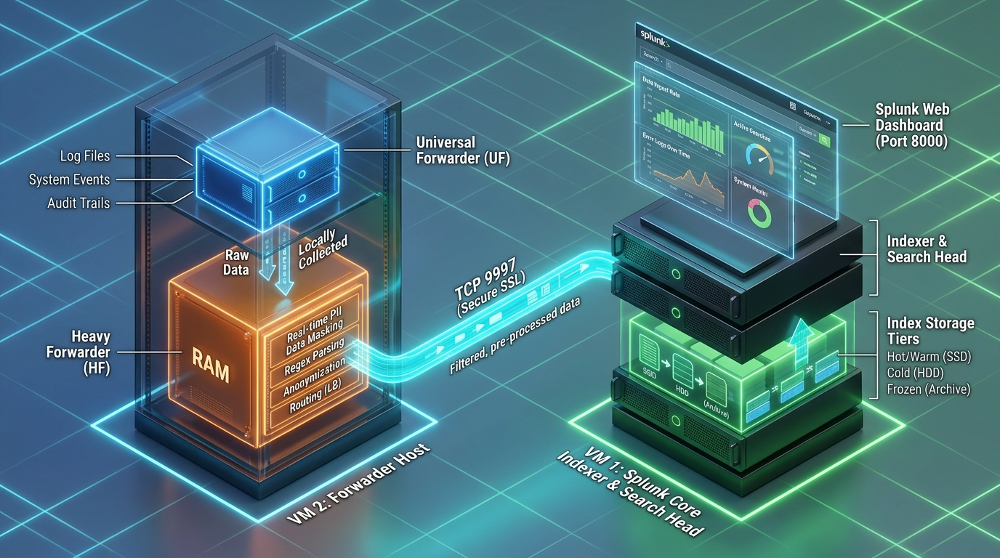
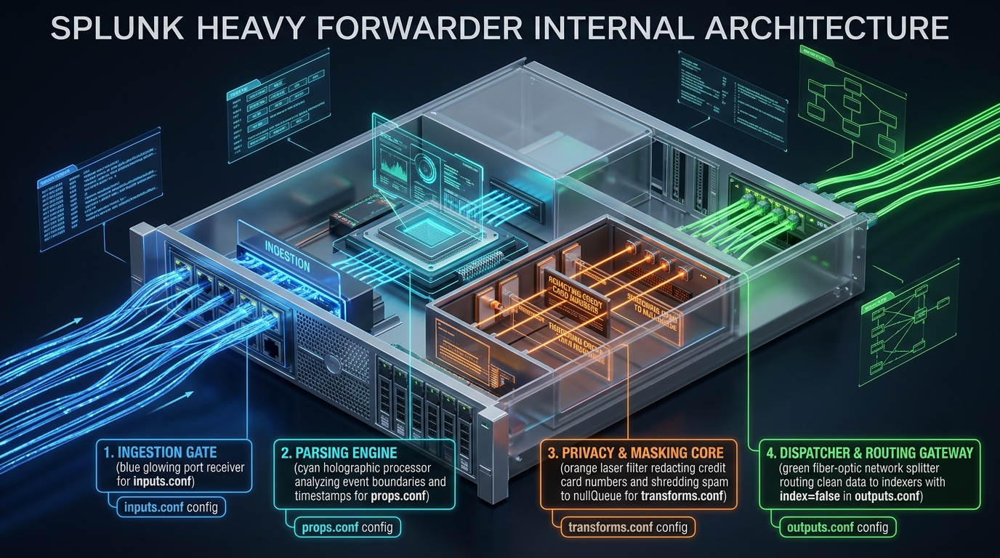
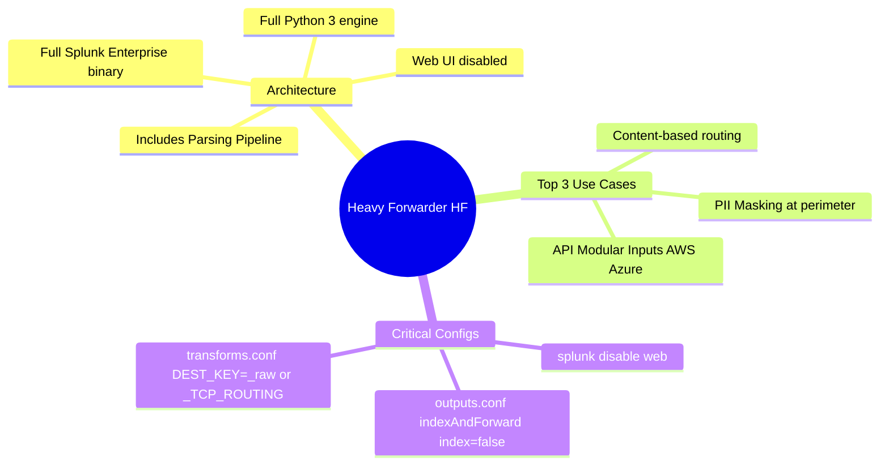

# 📖 Chapter 04 (Phase 2): Heavy Forwarder (HF) Architecture & Routing Scenarios

> **The Splunk Administrator's Handbook** | Phase 2: Enterprise Installation & Topology Setup  
> **Target Audience:** Complete Beginners to Enterprise Administrators  
> **Prerequisites:** Phase 2, Chapter 03 (Universal Forwarder Rollout)

---

## 🏭 1. The Master Analogy: "The Customs Inspection & Packaging Warehouse"

If a **Universal Forwarder (UF)** is a fast **bicycle courier** who picks up sealed envelopes and rushes them straight to the central post office without looking inside:

Then a **Heavy Forwarder (HF)** is a **High-Security Customs Inspection & Packaging Warehouse**:
- It opens the boxes (parses events).
- It blacks out sensitive personal details with a black marker (masks PII credit cards & SSNs).
- It shreds junk mail and throws it in the trash (`nullQueue` filtering).
- It routes high-priority packages to the VIP Vault (Splunk Core Indexers) and sends archiving packages to cheap bulk shipping (AWS S3 / Syslog).

```text
┌───────────────────────────┐      ┌───────────────────────────┐      ┌───────────────────────────┐
│ 🚚 UNIVERSAL FORWARDER    │      │ 🏭 HEAVY FORWARDER (HF)   │      │ 📥 SPLUNK CORE INDEXERS   │
│                           │      │                           │      │                           │
│ • Reads raw file bytes    │ S2S  │ • Parses events in memory │ S2S  │ • Writes .tsidx & journal │
│ • Attaches basic metadata │ ───► │ • Anonymizes PII/Masking  │ ───► │ • Serves user searches    │
│ • Ultra-low CPU/RAM       │ 9997 │ • Discards spam (nullQueue│ 9997 │ • Replicates buckets      │
│                           │      │ • Routes to Splunk or S3  │      │                           │
└───────────────────────────┘      └───────────────────────────┘      └───────────────────────────┘
```


*Figure 4.1: High-Tech 3D Isometric View of the 2-VM Pipeline (UF ➔ HF In-Memory Masking ➔ Core Indexer & Web Dashboard)*

---

## 🔬 1.1 The 4 Core Internal Components of a Heavy Forwarder

A Heavy Forwarder is an **Airport Customs & Security Inspection Terminal**: while a Universal Forwarder is "blind" and merely moves raw bytes, the Heavy Forwarder opens the payload, analyzes timestamps, redacts sensitive PII, drops useless junk, and dynamically directs traffic.


*Figure 4.2: 3D Isometric Cutaway of a Splunk Heavy Forwarder Internal Server Architecture*

### 🧩 Breakdown of the 4 Internal Stages:

```text
               ┌────────────────────────────────────────────────────────┐
               │              HEAVY FORWARDER INTERNAL CORE             │
               │                                                        │
Raw Data ─────►│ 1. INGESTION GATE ──► 2. PARSING ENGINE ──► 3. SHREDDER│
(TCP 9998/API) │    (inputs.conf)         (props.conf)          / MASKER│
               │                                             (transforms│
               │                                                  │     │
               │                                                  ▼     │
Clean Data ◄───│ 4. DISPATCHER & TRAFFIC COP ◄─────────────────────────┘
(TCP 9997 to   │    (outputs.conf / index=false)
Core Indexer)  └────────────────────────────────────────────────────────┘
```

1. 📥 **1. Ingestion Gate (`inputs.conf`):**  
   The entry portal. It listens on network ports (like Port `9998` receiving streams from Universal Forwarders) or executes Python modular input scripts (pulling data from AWS S3, Azure Event Hubs, or ServiceNow APIs).
2. 🧠 **2. Parsing Engine (`props.conf`):**  
   The "eyes and brain". Unlike the UF which cannot inspect log content, the HF breaks log streams into distinct events (`LINE_BREAKER`), extracts timestamps (`TIME_FORMAT`), and sets event boundaries in RAM.
3. 🛡️ **3. Privacy & Masking Core (`transforms.conf`):**  
   The "privacy shield and shredder". It performs two essential enterprise tasks:
   - **PII Redaction:** Uses regex to replace credit cards or Social Security numbers with `XXXX-XXXX-XXXX-1234` before data ever leaves your secure boundary.
   - **`nullQueue` Shredder:** Discards useless debug spam and keepalive noise before it reaches indexers, cutting your license bill to **$0** for that volume.
4. 🚦 **4. Dispatcher & Routing Gateway (`outputs.conf`):**  
   The "traffic cop". It packages the clean, masked events into the Splunk-to-Splunk (S2S) protocol and routes them across TCP port `9997` to the Core Indexer cluster.  
   *(Crucial Mandate: Must declare `[indexAndForward] \n index = false` so the HF does not store data on its own disk!)*

---

## ⚖️ 2. UF vs. HF: The Enterprise Decision Matrix

In interview and architectural design questions, you will often be asked: *"Why not just put Heavy Forwarders everywhere?"*

Here is the exact comparison every Splunk Administrator must know:

| Architectural Metric | 🚚 Universal Forwarder (UF) | 🏭 Heavy Forwarder (HF) |
| :--- | :--- | :--- |
| **Underlying Software** | Lightweight dedicated forwarder binary (`splunkforwarder-*.tgz`). | Full Splunk Enterprise binary (`splunk-*.tgz`) with Web & indexing disabled. |
| **Memory Footprint** | ~50 MB – 100 MB RAM | ~1 GB – 4 GB RAM |
| **Python Engine** | ❌ None (Stripped out). | ✅ Full Python 3 runtime included. |
| **Parsing Pipeline** | ❌ None (Cannot line-break, mask, or regex). | ✅ Full Parsing Pipeline (`props.conf` & `transforms.conf`). |
| **Web UI** | ❌ None (Headless). | 🟡 Available, but **disabled in production** (`splunk disable web`). |
| **License Impact** | 🆓 100% Free. | 🆓 100% Free (does not consume license if forwarding). |
| **Primary Production Role**| Edge log collection on thousands of servers. | Intermediate DMZ proxy, API data collection, PII masking, and data routing. |

> [!IMPORTANT]
> **Architectural Rule:** Always default to **Universal Forwarders** on edge endpoints. Only deploy **Heavy Forwarders** when an explicit technical requirement (PII masking, routing, or Python API modular inputs) demands it!

---

## 🎯 3. The Top 3 Enterprise Production Use Cases for Heavy Forwarders

---

### 🛡️ Use Case 1: PII Data Masking & Anonymization at the Perimeter
**The Scenario:** Financial and healthcare regulations (PCI-DSS, HIPAA, GDPR) forbid raw credit card numbers or Social Security Numbers (SSNs) from entering the central cloud indexer cluster in plain text.

**The Solution:** The HF intercepts the events in memory, applies a regex substitution, and replaces the sensitive digits with `XXXX-XXXX-XXXX-` before forwarding!

#### How to configure on the Heavy Forwarder:
In `$SPLUNK_HOME/etc/system/local/props.conf`:
```ini
[payment_transactions]
TRANSFORMS-mask_cc = mask_credit_cards
```

In `$SPLUNK_HOME/etc/system/local/transforms.conf`:
```ini
[mask_credit_cards]
REGEX = (?i)(card|cc_num)=([0-9]{4})-([0-9]{4})-([0-9]{4})-([0-9]{4})
FORMAT = $1=XXXX-XXXX-XXXX-$5
DEST_KEY = _raw
```
*(When events arrive at the Indexer, the `_raw` text already has the credit card masked!)*

---

### 🔀 Use Case 2: Content-Based Routing (Data Splitting)
**The Scenario:** An enterprise has a massive network firewall log feed.
- High-priority security threat logs must go to **Splunk Indexer Cluster**.
- Low-priority informational noise must be diverted to an external **Syslog archive / AWS S3 data lake** to save Splunk license costs.

#### How to configure routing in `transforms.conf`:
```ini
[route_security_logs]
REGEX = (?i)event_type=(attack|malware|breach)
DEST_KEY = _TCP_ROUTING
FORMAT = splunk_core_cluster

[route_compliance_archive]
REGEX = (?i)event_type=informational_traffic
DEST_KEY = _TCP_ROUTING
FORMAT = third_party_syslog
```

In `outputs.conf`:
```ini
[tcpout:splunk_core_cluster]
server = 10.0.1.10:9997, 10.0.1.11:9997
useACK = true

[tcpout:third_party_syslog]
server = 192.168.50.25:514
sendCookedData = false
```

---

### 🔌 Use Case 3: Complex Modular & API Inputs (Cloud & SaaS)
**The Scenario:** You need to ingest logs from:
- **Amazon AWS CloudWatch / S3** via the Splunk Add-on for AWS.
- **Microsoft Azure Event Hubs / Office 365**.
- **Salesforce, ServiceNow, or Kafka REST APIs**.

These technological add-ons rely heavily on **Python REST SDKs and modular inputs**. Because Universal Forwarders have no Python engine, these integrations **must run on a Heavy Forwarder**!

---

## 🛠️ 4. Step-by-Step: How to Configure a Heavy Forwarder

To turn a standard Splunk Enterprise installation into a high-performance Heavy Forwarder, follow these 3 steps:

### Step 4.1: Disable the Web Interface
A forwarder does not need a browser GUI. Disabling it saves ~500MB of RAM and eliminates an unnecessary attack surface:
```bash
sudo -u splunk /opt/splunk/bin/splunk disable web
```

---

### Step 4.2: Disable Local Indexing (`indexAndForward`)
By default, Splunk Enterprise indexes data into local buckets. On a Heavy Forwarder, you **MUST disable local indexing** so data is parsed in memory and immediately shipped outbound without saving to local disk:

Create or edit `$SPLUNK_HOME/etc/system/local/outputs.conf`:
```ini
[indexAndForward]
index = false

[tcpout]
defaultGroup = core_indexers
forwardedindex.filter.disable = true

[tcpout:core_indexers]
server = 10.0.0.10:9997, 10.0.0.11:9997
useACK = true
```

> [!CAUTION]
> If you forget to set `index = false` inside `[indexAndForward]`, the Heavy Forwarder will store a duplicate copy of every single event in its own local disk under `/opt/splunk/var/lib/splunk`, eventually filling the hard drive to 100%!

---

### Step 4.3: Restart the Heavy Forwarder
```bash
sudo -u splunk /opt/splunk/bin/splunk restart
```

Verify that port 8000 is closed, but `splunkd` is active:
```bash
ss -tulpn | grep -E '8000|8089'
# Port 8000 should be GONE; port 8089 remains active for management!
```

---

## 🚨 5. Real-World Lab Post-Mortem: 5 Enterprise Issues Faced & Professional Solutions

During multi-tier deployment across Virtual Machines (UF ➔ HF ➔ Indexer), administrators frequently encounter tricky network, configuration, and port conflicts. Below is the **official production post-mortem and troubleshooting runbook** documenting the 5 real-world issues solved in our lab:

```text
┌────────────────────────────────────────────────────────────────────────────────────────┐
│                        ENTERPRISE SETUP TROUBLESHOOTING MATRIX                         │
├────┬─────────────────────────────┬──────────────────────────┬──────────────────────────┤
│ #  │ ERROR / SYMPTOM             │ ROOT CAUSE (RCA)         │ PROFESSIONAL RESOLUTION  │
├────┼─────────────────────────────┼──────────────────────────┼──────────────────────────┤
│ 01 │ mgmt port [8089] bound      │ UF & HF on same host     │ Shift UF to port 8090 via│
│    │                             │ both claim port 8089     │ server.conf or CLI       │
│ 02 │ Logs trapped on local VM    │ outputs.conf set to      │ Replace 127.0.0.1 with   │
│    │                             │ 127.0.0.1 loopback       │ real routable VM LAN IP  │
│ 03 │ Port Mismatch (9997 vs 9998)│ Receiver on 9998 while   │ Align inputs.conf &      │
│    │                             │ shipper sends to 9997    │ outputs.conf port stanzas│
│ 04 │ Path must be a file/dir     │ Target log file does     │ Create file via touch    │
│    │                             │ not exist on disk yet    │ before splunk add monitor│
│ 05 │ 0 Events in index=main      │ Forwarder connected but  │ Run 'splunk list monitor'│
│    │ (Active forwards: None)     │ has 0 monitored files    │ & add file to index=main │
└────┴─────────────────────────────┴──────────────────────────┴──────────────────────────┘
```

---

### 🔴 Issue 1: Port 8089 Collision (`mgmt port [8089] - port is already bound`)
- **The Symptom:** Starting the Universal Forwarder (`/opt/splunkforwarder`) on the same VM as Splunk Enterprise crashed with:
  ```text
  ERROR: mgmt port [8089] - port is already bound. Splunk needs to use this port.
  Would you like to change ports? [y/n]:
  ```
- **Root Cause Analysis (RCA):** Both Splunk Enterprise and the Universal Forwarder bind to TCP Port `8089` by default for the `splunkd` REST/Management API. In Linux networking, two distinct processes cannot bind to the same IP:Port tuple.
- **Professional Resolution:**
  - When prompted interactively, enter **`8090`** (or `8091`).
  - Or permanently declare it in `/opt/splunkforwarder/etc/system/local/server.conf`:
    ```ini
    [splunkd]
    mgmtHostPort = 127.0.0.1:8090
    ```
- **Senior Architect Rule:** In production, UFs live on app servers and HFs live on gateway VMs so they never collide. In multi-instance test labs, always increment the secondary management port to `8090`.

---

### 🔴 Issue 2: Localhost Loopback Trap (`127.0.0.1` vs Network Ingestion)
- **The Symptom:** Forwarder reported active connection, but events never arrived at the Splunk Web UI on the Indexer VM.
- **Root Cause Analysis (RCA):** The forwarder's `outputs.conf` was configured with `server = 127.0.0.1:9998`. The IP `127.0.0.1` is the **localhost loopback interface**—data was circling back into the same VM rather than traveling across the virtual network!
- **Professional Resolution:**
  - Identify the target Indexer's routable network IP using `ip a | grep inet`.
  - Update `outputs.conf` with the real IP address:
    ```ini
    [tcpout:core_indexer]
    server = 192.168.1.50:9997
    useACK = true
    ```

---

### 🔴 Issue 3: Ingestion Port Mismatch (`9997` vs `9998`)
- **The Symptom:** Forwarder showed `Configured but inactive forwards`, or logs failed to pass through the intermediate proxy.
- **Root Cause Analysis (RCA):** The receiving instance had `[splunktcp://9998]` in `inputs.conf`, but the shipping forwarder was attempting to connect to `9997`.
- **Professional Resolution:**
  - Standardize ports:
    - Port `9997` = Primary Core Indexer receiving port.
    - Port `9998` = Local intermediate Heavy Forwarder proxy receiving port.
  - Always verify active listeners on the receiver:
    ```bash
    sudo ss -tulpn | grep splunkd
    ```

---

### 🔴 Issue 4: Pre-Validation Check Failure (`Path must be a file or directory`)
- **The Symptom:** Running `splunk add monitor /tmp/test.log -index main` returned:
  ```text
  Parameter name: Path must be a file or directory.
  ```
- **Root Cause Analysis (RCA):** The Splunk CLI validates the existence of the file or directory on the Linux filesystem **before** adding the monitor stanza. Because `/tmp/test.log` had not been created yet, the CLI rejected the parameter.
- **Professional Resolution:**
  - Create the file on disk first, then register the monitor:
    ```bash
    touch /tmp/test.log
    sudo -u splunk /opt/splunkforwarder/bin/splunk add monitor /tmp/test.log -index main
    ```

---

### 🔴 Issue 5: Zero Event Search Result Despite Active Connection
- **The Symptom:** Searching `index=main "SPLUNK TEST"` returned `0 events found`, despite `splunk list forward-server` showing `Active forwards: 127.0.0.1:9998`.
- **Root Cause Analysis (RCA):** The forwarder was actively connected, but checking `splunk list monitor` revealed:
  ```text
  Monitored Files:
  (EMPTY!)
  ```
  The forwarder was shipping internal operational telemetry to `index=_internal`, but had zero custom log files configured for `index=main`!
- **Professional Resolution:**
  - Never assume a connected forwarder is sending application logs.
  - Inspect active monitors with `splunk list monitor`.
  - Inject test data directly into the monitored file:
    ```bash
    echo "SPLUNK TEST: Event at $(date)" >> /tmp/test.log
    ```

---

## 🧠 6. Chapter 04 (Phase 2) Self-Check Quiz

1. What is the fundamental software difference between a Universal Forwarder and a Heavy Forwarder?
2. Why can't a Universal Forwarder mask Credit Card numbers or execute the Splunk Add-on for AWS?
3. What critical setting must be declared inside `[indexAndForward]` in `outputs.conf` on a Heavy Forwarder, and what happens if you forget it?
4. What CLI command is used to disable the Splunk Web graphical interface on a dedicated Heavy Forwarder?
5. In a data-routing scenario, which internal Splunk metadata key is modified in `transforms.conf` (`DEST_KEY = ...`) to dynamically switch target indexer groups?

---

## 📌 7. Visual Mind Map & Sticky Notes

### 🧠 Hierarchical Mind Map


### 🗂️ Color-Coded Digital Sticky Notes

#### 🟨 Sticky Note 1: The index = false Mandate
```text
┌─────────────────────────────────────────────────────────────┐
│ 📌 DISABLE LOCAL INDEXING                                   │
│                                                             │
│ • File: outputs.conf                                        │
│ • Stanza: [indexAndForward] \n index = false                │
│ • Danger: If missing, HF stores duplicate copies on local   │
│   disk until drive hits 100% full!                          │
└─────────────────────────────────────────────────────────────┘
```

#### 🟩 Sticky Note 2: When to Choose HF over UF
```text
┌─────────────────────────────────────────────────────────────┐
│ 📌 HF SELECTION CHECKLIST                                   │
│                                                             │
│ Deploy a Heavy Forwarder ONLY IF you need:                  │
│ 1. Regex PII masking before shipping to cloud.              │
│ 2. Splitting/routing logs to multiple destinations.         │
│ 3. Ingesting from Python modular APIs (AWS, Azure, Kafka).  │
└─────────────────────────────────────────────────────────────┘
```

#### 🟪 Sticky Note 3: CLI Web Disablement
```text
┌─────────────────────────────────────────────────────────────┐
│ 📌 HEADLESS HARDENING                                       │
│                                                             │
│ • Command: splunk disable web                               │
│ • Saves: ~500MB RAM and closes Port 8000.                   │
│ • Leaves: Port 8089 open for REST & Deployment Server.      │
└─────────────────────────────────────────────────────────────┘
```

---

### ⚡ Rapid-Recall Flashcards

| # | Question (Front) | Answer & Key Detail (Back) |
| :-: | :--- | :--- |
| **01** | Can a Universal Forwarder perform regex PII masking? | **No.** UFs do not possess a parsing pipeline. An HF or Indexer is required. |
| **02** | What setting in `outputs.conf` stops an HF from indexing data locally? | **`[indexAndForward]` $\rightarrow$ `index = false`**. |
| **03** | What CLI command disables the web server on Splunk Enterprise? | **`splunk disable web`** (closes TCP port 8000). |
| **04** | Which internal metadata key routes events to different indexer groups? | **`DEST_KEY = _TCP_ROUTING`** in `transforms.conf`. |
| **05** | Does a Heavy Forwarder consume daily ingestion license quota? | **No.** Forwarders do not consume license quota as long as they forward data to licensed Indexers. |

---

## 🎮 Hands-On Cyber Range Challenge: Room 01 (TryHackMe / HTB Style)

```text
┌────────────────────────────────────────────────────────────────────────┐
│ 🕹️ ARENA MISSION: Room 01 — Heavy Forwarder Port Clash & Triage        │
│ ⭐ DIFFICULTY: Easy-Medium | 💎 REWARD: 200 XP | ⏱️ TIME: 30 Mins       │
└────────────────────────────────────────────────────────────────────────┘
```

> **🚨 Incident Scenario:**  
> A 2-VM lab deployment failed to start due to port 8089 collision between forwarder and host services.  
> Meanwhile, disk space is filling up because the HF is retaining duplicate local copies!  
> You must change the management port to 8090, set `[indexAndForward] index = false`, and mask customer credit cards using `SEDCMD`!

### 🎯 Mission Checkpoint Questions

#### 1. What CLI command changes the management port to 8090?
*(Answer Format: `splunk set splunkd-port ****`)*
<details><summary>💡 Need a Hint?</summary>splunk set splunkd-port 8090</details>
<details><summary>🔓 Reveal Answer</summary><b>Answer:</b> <code>splunk set splunkd-port 8090</code></details>

#### 2. What critical stanza and key in `outputs.conf` stops local disk saturation on an HF?
*(Answer Format: `[indexAndForward] index = *****`)*
<details><summary>💡 Need a Hint?</summary>index = false</details>
<details><summary>🔓 Reveal Answer</summary><b>Answer:</b> <code>[indexAndForward] index = false</code></details>

#### 3. What props.conf directive is used for in-memory regex stream replacement (e.g. masking credit cards)?
*(Answer Format: `******-mask`)*
<details><summary>💡 Need a Hint?</summary>SEDCMD</details>
<details><summary>🔓 Reveal Answer</summary><b>Answer:</b> <code>SEDCMD</code> (e.g. <code>SEDCMD-mask_cc = s/.../XXXX/g</code>)</details>

👉 **[Launch Full Interactive Lab: Room 01 & Capture All 4 Flags (200 XP)](../Labs/Room_01_Heavy_Forwarder_Infiltration_and_Port_Clash.md)**
