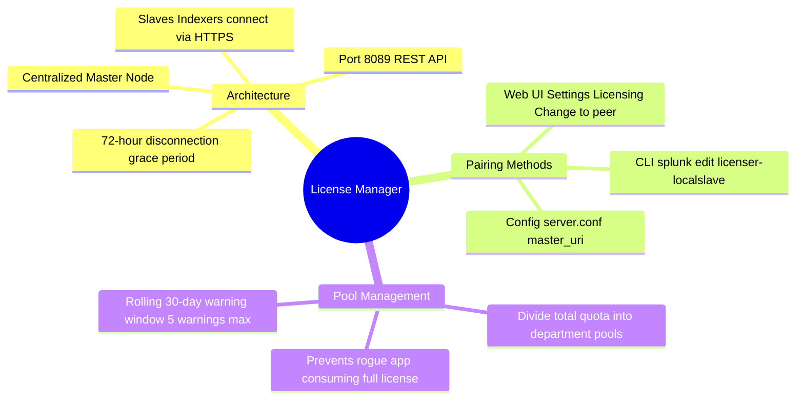

# 📖 Chapter 05 (Phase 2): License Manager Pairing & License Slave Setup

> **The Splunk Administrator's Handbook** | Phase 2: Enterprise Installation & Topology Setup  
> **Target Audience:** Complete Beginners to Enterprise Administrators  
> **Prerequisites:** Phase 2, Chapter 02 (Splunk Enterprise Installation) & Phase 1, Chapter 06 (Licensing Mechanics)

---

## 🏦 1. The Master Analogy: "The Corporate Bank & Department Debit Cards"

Imagine a large global enterprise with a **$500,000 corporate bank account**:

```text
┌────────────────────────────────────────────────────────────────────────┐
│               THE CORPORATE BANK & DEBIT CARD METAPHOR                 │
├───────────────────────────────────┬────────────────────────────────────┤
│ 🏦 THE CENTRAL BANK (LICENSE MGR) │ 💳 DEBIT CARDS (INDEXER SLAVES)    │
├───────────────────────────────────┼────────────────────────────────────┤
│ • Holds the master license key    │ • Have $0 on the machine itself.   │
│   (e.g., 500 GB / day).           │ • Draw quota dynamically from the  │
│ • Sits on a dedicated management  │   master pool during the day.      │
│   node or shared with Deployer.   │ • Check in every morning to report │
│ • Tracks daily consumption.       │   how many bytes they indexed.     │
│ • Hands out warnings if over-drawn│ • Sits on Core Indexers.           │
└───────────────────────────────────┴────────────────────────────────────┘
```

In a distributed Splunk architecture:
1. You **never install your purchased enterprise license on individual indexers**.
2. You install the license **once** on the **License Manager (LM)**.
3. All Indexers act as **License Slaves (Peers)** that point to the License Manager over **Port 8089 (HTTPS)**!

---

## 🗺️ 2. Architectural Communication & The 72-Hour Grace Period

```text
┌───────────────────────────┐                    ┌───────────────────────────┐
│ 📥 INDEXER 01 (SLAVE)     │                    │ 🏦 CENTRAL LICENSE MGR    │
│ (indexer-prod-01)         │  HTTPS Port 8089   │ (license-master-01)       │
│                           │ ─────────────────► │                           │
│ • Indexes 200 GB raw data │  REST API Check-in │ • Master License: 500 GB  │
│ • server.conf: master_uri │                    │ • Tracks daily quota      │
└───────────────────────────┘                    │ • Resets at 00:00 midnight│
                                                 │                           │
┌───────────────────────────┐                    │                           │
│ 📥 INDEXER 02 (SLAVE)     │  HTTPS Port 8089   │                           │
│ (indexer-prod-02)         │ ─────────────────► │                           │
│ • Indexes 250 GB raw data │                    │                           │
└───────────────────────────┘                    └───────────────────────────┘
```


*Figure 5.1: 3D Isometric View of the Central License Master (500GB Vault & Departmental Pools) Connected to Indexer Slaves via HTTPS Port 8089 REST API*

### ⏱️ What Happens if Network Connectivity to the LM is Lost?
If a network switch dies or the License Manager is rebooted:
* Indexers **DO NOT stop indexing**!
* Splunk provides a built-in **72-hour grace period**.
* Slaves can continue operating and indexing logs without communicating with the License Manager for up to 3 full days before search capabilities are disabled.

---

## 🛠️ 3. Step-by-Step: How to Pair an Indexer to a License Manager

You can pair an Indexer (Slave) to a License Manager (Master) using any of these 3 production methods:

---

### Method A: Via Splunk Web GUI (Beginner Friendly)

1. Log in to the **Indexer Web UI** (`http://<indexer-ip>:8000`) as `admin`.
2. In the top-right header, click **Settings ──► Licensing**.
3. Click **Change to peer**.
4. Select **Designate another Splunk Enterprise instance as the master licenser**.
5. In the **Master URI** box, enter the License Manager's management port:
   ```text
   https://<LICENSE_MANAGER_IP>:8089
   ```
6. Click **Save**.
7. Restart the Indexer when prompted:
   ```bash
   sudo -u splunk /opt/splunk/bin/splunk restart
   ```

---

### Method B: Via Splunk CLI (Automation Friendly)

Run this single command on the Indexer terminal:

```bash
sudo -u splunk /opt/splunk/bin/splunk edit licenser-localslave \
  -master_uri 'https://<LICENSE_MANAGER_IP>:8089' \
  -auth admin:Ashutosh@123
```

Restart Splunk to finalize:
```bash
sudo -u splunk /opt/splunk/bin/splunk restart
```

---

### Method C: In Configuration Files (`server.conf`)

This is how Enterprise Architects deploy licensing using configuration management (Ansible, Puppet, Terraform):

On the Indexer, edit `$SPLUNK_HOME/etc/system/local/server.conf`:

```ini
[license]
master_uri = https://192.168.1.50:8089
```

Restart Splunk:
```bash
sudo -u splunk /opt/splunk/bin/splunk restart
```

---

## 📊 4. Managing License Pools & Department Quotas

On the **License Manager**, you can divide your total license into **Pools** to prevent one noisy department from consuming the entire enterprise quota.

```text
┌────────────────────────────────────────────────────────────────────────┐
│               ENTERPRISE LICENSE POOL DIVISION (500 GB TOTAL)          │
├────────────────────────────┬─────────────────────────────┬─────────────┤
│ POOL NAME                  │ ASSIGNED INDEXERS / TEAMS   │ DAILY QUOTA │
├────────────────────────────┼─────────────────────────────┼─────────────┤
│ 🛡️ Security_Operations_Pool│ Core Security Indexers      │ 250 GB / day│
│ 🌐 IT_Infrastructure_Pool  │ Network, Firewall, Windows  │ 150 GB / day│
│ 🧪 Dev_Test_Pool           │ QA, Development Sandbox     │ 50 GB / day │
│ 💼 Unallocated Buffer      │ Emergency Ingestion Spikes  │ 50 GB / day │
└────────────────────────────┴─────────────────────────────┴─────────────┘
```

### How to Create a Pool via CLI on the License Manager:
```bash
# Add a 250GB pool named 'SecOps':
sudo -u splunk /opt/splunk/bin/splunk add licenser-pool SecOps \
  -quota 250GB \
  -slaves <SLAVE_GUID_1>,<SLAVE_GUID_2> \
  -auth admin:Password123
```

---

## 🔍 5. Verification Commands on License Master & Slave

### 1️⃣ On the License Slave (Indexer):
Verify that the Indexer recognizes its Master:
```bash
sudo -u splunk /opt/splunk/bin/splunk list licenser-localslave
```
**Expected Output:**
```text
master_uri: https://192.168.1.50:8089
status: Active
```

---

### 2️⃣ On the License Master:
See all connected indexer slaves and active pools:
```bash
# List all registered peer indexers:
sudo -u splunk /opt/splunk/bin/splunk list licenser-slaves

# List all pool allocations:
sudo -u splunk /opt/splunk/bin/splunk list licenser-pools
```

---

## 🧠 6. Chapter 05 (Phase 2) Self-Check Quiz

1. On which Splunk component do you install the purchased `.lic` enterprise license key: individual Indexers or the License Manager?
2. What network protocol and port are used by Indexer Slaves to communicate with the central License Manager?
3. What is the built-in **grace period** (in hours or days) if an Indexer temporarily loses network connectivity to its License Manager?
4. What configuration file and stanza on an Indexer define the License Master's URL?
5. If an enterprise exceeds its daily license quota by 10% on a single day, does Splunk immediately stop indexing incoming logs? Explain what actually happens.

---

## 📌 7. Visual Mind Map & Sticky Notes

### 🧠 Hierarchical Mind Map


### 🗂️ Color-Coded Digital Sticky Notes

#### 🟨 Sticky Note 1: The Master URI Rule
```text
┌─────────────────────────────────────────────────────────────┐
│ 📌 LICENSE SLAVE CONFIGURATION                              │
│                                                             │
│ • File: $SPLUNK_HOME/etc/system/local/server.conf           │
│ • Stanza: [license]                                         │
│ • Directive: master_uri = https://<LM_IP>:8089             │
│ • Protocol: Always HTTPS with management port 8089!         │
└─────────────────────────────────────────────────────────────┘
```

#### 🟩 Sticky Note 2: 72-Hour Disconnection Safety
```text
┌─────────────────────────────────────────────────────────────┐
│ 📌 NETWORK LOSS TOLERANCE                                   │
│                                                             │
│ • Grace Period: 72 hours (3 full days).                     │
│ • Indexing: Continues 100% uninterrupted.                   │
│ • Searches: Continue uninterrupted.                         │
│ • Resumes normal tracking once LM is reachable.             │
└─────────────────────────────────────────────────────────────┘
```

#### 🟪 Sticky Note 3: CLI Verification Commands
```text
┌─────────────────────────────────────────────────────────────┐
│ 📌 ESSENTIAL LICENSING CLI                                  │
│                                                             │
│ • On Slave: splunk list licenser-localslave                 │
│ • On Master: splunk list licenser-slaves                    │
│ • Check Pools: splunk list licenser-pools                   │
└─────────────────────────────────────────────────────────────┘
```

---

### ⚡ Rapid-Recall Flashcards

| # | Question (Front) | Answer & Key Detail (Back) |
| :-: | :--- | :--- |
| **01** | Where is the master license installed in a distributed cluster? | On the **License Manager (LM)** only. |
| **02** | Which port connects a License Slave to the License Master? | **Port 8089 (HTTPS)**. |
| **03** | What stanza in `server.conf` sets the license master URI? | **`[license]`** with `master_uri = https://<IP>:8089`. |
| **04** | How long can an indexer run disconnected from the LM before search lock? | **72 hours (3 days)**. |
| **05** | How many warnings trigger a license violation on an enterprise stack? | **5 warnings in a rolling 30-day window**. |

---

## 🎮 Hands-On Cyber Range Challenge: Room 02 (TryHackMe / HTB Style)

```text
┌────────────────────────────────────────────────────────────────────────┐
│ 🕹️ ARENA MISSION: Room 02 — Central License Vault Heist & 72h Grace    │
│ ⭐ DIFFICULTY: Medium | 💎 REWARD: 250 XP | ⏱️ TIME: 35 Mins           │
└────────────────────────────────────────────────────────────────────────┘
```

> **🚨 Incident Scenario:**  
> A severed WAN fiber optic cable cut communication between Indexers and the License Master.  
> Leadership fears indexing has stopped.  
> You must pair slaves via `server.conf`, explain the 72-hour disconnection grace period, and configure departmental quota pools!

### 🎯 Mission Checkpoint Questions

#### 1. What stanza in `server.conf` defines the License Master URL on an Indexer Slave?
*(Answer Format: `[*******]`)*
<details><summary>💡 Need a Hint?</summary>[license]</details>
<details><summary>🔓 Reveal Answer</summary><b>Answer:</b> <code>[license]</code> (with <code>master_uri = https://&lt;LM_IP&gt;:8089</code>)</details>

#### 2. What is the built-in grace period in hours when an Indexer temporarily loses network contact with the LM?
*(Answer Format: `** hours`)*
<details><summary>💡 Need a Hint?</summary>Three full days.</details>
<details><summary>🔓 Reveal Answer</summary><b>Answer:</b> <code>72 hours</code></details>

#### 3. How many daily violation warnings within 30 days lock the search capability?
*(Answer Format: `* warnings`)*
<details><summary>💡 Need a Hint?</summary>Fingers on one hand.</details>
<details><summary>🔓 Reveal Answer</summary><b>Answer:</b> <code>5 warnings</code> (Indexing continues 24/7!)</details>

👉 **[Launch Full Interactive Lab: Room 02 & Capture All 4 Flags (250 XP)](../Labs/Room_02_License_Vault_Heist_and_72Hr_Survival.md)**
