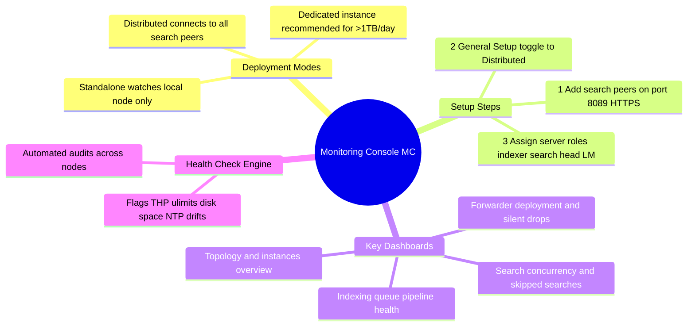

# 📖 Chapter 06 (Phase 2): Monitoring Console (MC) Distributed Setup & Telemetry

> **The Splunk Administrator's Handbook** | Phase 2: Enterprise Installation & Topology Setup  
> **Target Audience:** Complete Beginners to Enterprise Administrators  
> **Prerequisites:** Phase 2, Chapter 05 (License Manager Pairing) & Chapter 02 (Splunk Enterprise Installation)

---

## 🛰️ 1. The Master Analogy: "The Air Traffic Control Tower"

Imagine a busy international airport with 50 airplanes taking off, 30 landing, fuel trucks driving, and baggage conveyors rolling. You cannot run around the tarmac checking each plane individually. You sit in the **Air Traffic Control Tower** where radar screens show the health, altitude, speed, and fuel of every aircraft simultaneously:

```text
┌────────────────────────────────────────────────────────────────────────┐
│               THE AIR TRAFFIC CONTROL TOWER METAPHOR                   │
├───────────────────────────────────┬────────────────────────────────────┤
│ 🛰️ THE AIR TRAFFIC CONTROL TOWER  │ ✈️ AIRPLANES IN FLIGHT             │
│ (SPLUNK MONITORING CONSOLE - MC)  │ (DISTRIBUTED SPLUNK INSTANCES)     │
├───────────────────────────────────┼────────────────────────────────────┤
│ • Centralized dashboard for the   │ • Search Heads (Passenger Terminals│
│   entire deployment.              │ • Indexers (Cargo Luggage Sorting) │
│ • Watches CPU, RAM, Disk IOPS.    │ • Forwarders (Baggage Trucks)      │
│ • Detects bottlenecks in queues.  │ • License Master (Fuel Depot)      │
│ • Sounds alarms on hardware crash.│ • Report telemetry to the tower.   │
└───────────────────────────────────┴────────────────────────────────────┘
```

The **Monitoring Console (MC)** (historically called the *Distributed Management Console* or *DMC*) is Splunk's built-in operational monitoring tool that gives administrators full visibility into cluster topology, pipeline bottlenecks, search concurrency, and forwarder connectivity.


*Figure 6.1: High-Tech 3D Isometric View of the Monitoring Console Mission Control Room Surveying Distributed Indexers, Search Heads, and Forwarders*

---

## 🎮 1.1 Interactive Admin Scenarios: How You Use the MC in Real Life

Imagine you are on duty as the **Senior Splunk Administrator**. Your morning starts at the Monitoring Console Mission Control screen. Here are the 4 real-world situations you will handle:

### 🚨 Scenario A: "The Flashing Red Queue Gauge" (Ingestion Bottleneck)
* **What you see on the MC:** The `indexQueue` dial is pegged at **100% full (Red Alert)** across 4 Indexers!
* **The Diagnostic Thought Process:**
  - If `parsingQueue` is full: A bad regex in `props.conf` or `transforms.conf` is choking CPU threads.
  - If `indexQueue` is full: The disk storage is too slow! The Indexer is receiving 20 MB/s from forwarders, but the underlying disk can only write at 5 MB/s (< 1,200 IOPS).
* **Your Action:** Check the **Disk Usage & IOPS dashboard** in the MC to identify saturated storage volumes and advise the infrastructure team to allocate high-speed NVMe SSDs.

---

### 👻 Scenario B: "The Silent Forwarder Mystery" (Missing Log Feeds)
* **What you see on the MC:** In **Forwarders: Deployment**, the status panel alerts: `12 Forwarders Missing (Silent > 1 Hour)`.
* **The Diagnostic Thought Process:**
  - Did the application servers shut down?
  - Did a network firewall rule block Port 9997?
  - Did the `splunkd` forwarder process crash on the host?
* **Your Action:** Click on the alert to view the exact hostnames and IP addresses of the silent forwarders, then run `splunk status` or check port 9997 firewall reachability!

---

### ⏳ Scenario C: "The Skipped Search Crisis" (Search Head Overload)
* **What you see on the MC:** In **Search: Scheduler Activity**, the metric shows: `35% of Scheduled Searches Skipped`!
* **The Diagnostic Thought Process:**
  - Users scheduled too many heavy reports to run at the exact same minute (e.g. at 09:00 AM sharp).
  - The Search Head hit its maximum concurrency limit (`max_searches_per_cpu`).
* **Your Action:** Use the MC's **Scheduler Activity by User** table to identify who owns the abusive reports, desynchronize schedule times (e.g. change from `00 * * * *` to `07 * * * *`), or recommend adding another Search Head to the cluster.

---

### 🩺 Scenario D: "The 1-Click Health Check Audit"
* **What you do:** You navigate to **Monitoring Console ──► Health Check** and click **Start Health Check**.
* **What happens:** In 10 seconds, Splunk runs 40+ automated diagnostic scripts across every server in the enterprise, flagging:
  - Any server where Transparent Huge Pages (`THP`) was left enabled.
  - Any server with low `ulimits` (open files < 64,000).
  - Any disk partition running dangerously low on space (`minFreeSpace < 5GB`).

---

## 🗺️ 2. Standalone Mode vs. Distributed Mode

Out of the box, Splunk Enterprise ships with the Monitoring Console enabled in **Standalone Mode**.

```text
┌───────────────────────────┐                    ┌───────────────────────────┐
│ 🏠 STANDALONE MODE        │                    │ 🌐 DISTRIBUTED MODE       │
├───────────────────────────┤                    ├───────────────────────────┤
│ • Watches ONLY itself.    │                    │ • Connects to ALL nodes:  │
│ • Default on fresh install│                    │   Indexers, Search Heads, │
│ • Useless for enterprise  │                    │   Forwarders, and LM.     │
│   multi-server topologies.│                    │ • Required for production.│
└───────────────────────────┘                    └───────────────────────────┘
```

### 📍 Where Should the Monitoring Console Live?
* **Small/Medium Environments (< 500 GB/day):** Can be co-hosted on an existing Search Head or License Manager node.
* **Large Enterprise Environments (> 1 TB/day):** Must sit on a **dedicated instance**. Running heavy monitoring searches on the same box as business searches causes resource contention!

---

## 🛠️ 3. Step-by-Step: Configuring the Monitoring Console in Distributed Mode

To connect the Monitoring Console to all instances across your enterprise, follow these two steps:

```text
  Step 1: Add Search Peers (Distributed Search)
          Connects MC to remote instances over Port 8089 HTTPS
               │
               ▼
  Step 2: Configure General Setup in Monitoring Console
          Assign server roles (Search Head, Indexer, LM, DS, HF)
               │
               ▼
  Step 3: Apply Changes & Verify Dashboards
```

---

### Step 1: Add All Instances as "Search Peers"

The Monitoring Console collects data by running distributed SPL searches against internal logs (`_internal`, `_introspection`). Therefore, it must be paired with every instance as a Search Peer:

1. Log into the instance hosting the **Monitoring Console** (`http://<MC_IP>:8000`).
2. In the top navigation, click **Settings ──► Distributed search**.
3. Select **Search peers**, then click **New Search Peer**.
4. In the **Peer URL**, enter the remote instance's management port:
   ```text
   https://192.168.1.10:8089
   ```
5. Enter the administrator credentials for that remote instance and click **Save**.
6. Repeat this for **every Indexer, Search Head, Heavy Forwarder, and License Master** in your environment!

---

### Step 2: Switch to Distributed Mode & Assign Roles

1. Go to **Settings ──► Monitoring Console**.
2. In the top sub-menu of the MC, click **Settings ──► General Setup**.
3. At the top, toggle the mode from **Standalone** to **Distributed**.
4. Splunk will automatically list all Search Peers you added in Step 1.
5. In the **Server Roles** column, verify or assign the correct roles for each server:
   - `indexer`
   - `search_head`
   - `license_master`
   - `deployment_server`
   - `heavy_forwarder`
6. Click **Save** in the upper-right corner.

---

## 📊 4. The 4 Essential Telemetry Dashboards Every Admin Must Master

Once Distributed Mode is activated, the Monitoring Console unlocks pre-built enterprise operational dashboards:

```text
┌────────────────────────────────────────────────────────────────────────┐
│               THE 4 ESSENTIAL MONITORING CONSOLE DASHBOARDS            │
├────────────────────┬───────────────────────────────────────────────────┤
│ DASHBOARD NAME     │ WHAT IT TRACKS & WHY IT MATTERS                   │
├────────────────────┼───────────────────────────────────────────────────┤
│ 1. Topology &      │ Complete inventory map of all servers, Splunk     │
│    Instance Health │ versions, CPU cores, RAM capacity, and OS deta
ils.│
├────────────────────┼───────────────────────────────────────────────────┤
│ 2. Indexing Queue  │ Ingestion pipeline health: fill % of parsingQueue,│
│    Pipeline Health │ indexQueue, and disk write IOPS throughput (MB/s).│
├────────────────────┼───────────────────────────────────────────────────┤
│ 3. Search Load &   │ Concurrency limits: checks how many searches are  │
│    Concurrency     │ running vs. skipped due to Search Head CPU spikes.│
├────────────────────┼───────────────────────────────────────────────────┤
│ 4. Forwarder       │ Inventory of connected Universal Forwarders, and  │
│    Deployment      │ sends alerts if any forwarder goes SILENT (down). │
└────────────────────┴───────────────────────────────────────────────────┘
```

### 🚨 How to Spot an Ingestion Bottleneck in the MC:
Navigate to **Indexing ──► Performance ──► Ingestion Pipeline**.
* If **`indexQueue`** is at **`100% full`**: The underlying disk storage is too slow (< 1,200 IOPS)!
* If **`parsingQueue`** is at **`100% full`**: You have poorly written, catastrophic regular expressions in `props.conf` or `transforms.conf` choking CPU threads!

---

## 🩺 5. The Built-in Health Check Engine

The Monitoring Console includes an automated diagnostic tool called the **Health Check**:
* Go to **Monitoring Console ──► Health Check**.
* Click **Start Health Check**.

Splunk runs dozens of automated audits across every server, including:
1. 🚫 **Transparent Huge Pages (THP):** Flags any indexer where THP is still enabled.
2. 📂 **File Descriptor Limits (`ulimits`):** Flags any server where `nofile` is below 64,000.
3. 💾 **Disk Space Thresholds:** Warns if any partition is approaching `minFreeSpace` (5GB default).
4. ⏰ **Clock Synchronization (NTP):** Alerts if system clocks between servers drift by more than a few seconds.

---

## 🧠 6. Chapter 06 (Phase 2) Self-Check Quiz

1. What was the former name of the **Monitoring Console (MC)** in earlier Splunk versions?
2. What is the fundamental difference between **Standalone Mode** and **Distributed Mode** in the Monitoring Console?
3. Which port and protocol does the Monitoring Console use to connect to remote instances as "Search Peers"?
4. In an enterprise processing 5 TB/day, why should the Monitoring Console be hosted on a dedicated instance rather than on a production Search Head?
5. If the Monitoring Console shows that the **`indexQueue`** is 100% full across your Indexers, what is the most likely hardware bottleneck?

---

## 📌 7. Visual Mind Map & Sticky Notes

### 🧠 Hierarchical Mind Map


### 🗂️ Color-Coded Digital Sticky Notes

#### 🟨 Sticky Note 1: Distributed Mode Prerequisite
```text
┌─────────────────────────────────────────────────────────────┐
│ 📌 SEARCH PEER PREREQUISITE                                 │
│                                                             │
│ • Before turning on Distributed Mode in MC:                 │
│ • Must add all servers as Search Peers in:                  │
│   Settings ──► Distributed search ──► Search peers          │
│ • Target: https://<peer_ip>:8089 with admin credentials.    │
└─────────────────────────────────────────────────────────────┘
```

#### 🟩 Sticky Note 2: Queue Bottleneck Diagnosis
```text
┌─────────────────────────────────────────────────────────────┐
│ 📌 PIPELINE HEALTH INTERPRETATION                           │
│                                                             │
│ • parsingQueue @ 100%: Bad regex / CPU chokepoint.          │
│ • indexQueue @ 100%: Slow disk IOPS (< 1,200 IOPS).         │
│ • Both empty (0-10%): Healthy, smooth log ingestion!        │
└─────────────────────────────────────────────────────────────┘
```

#### 🟪 Sticky Note 3: Dedicated MC Rule
```text
┌─────────────────────────────────────────────────────────────┐
│ 📌 SIZING & ARCHITECTURE                                    │
│                                                             │
│ • Small Lab (<500GB): Co-locate with Search Head or LM.     │
│ • Large Enterprise (>1TB): DEDICATED INSTANCE!              │
│ • Why: Heavy monitoring SPL queries must not degrade        │
│   business user searches or dashboard rendering.            │
└─────────────────────────────────────────────────────────────┘
```

---

### ⚡ Rapid-Recall Flashcards

| # | Question (Front) | Answer & Key Detail (Back) |
| :-: | :--- | :--- |
| **01** | What was the original name of the Monitoring Console? | **Distributed Management Console (DMC)**. |
| **02** | What port does the MC use to query remote nodes? | **Port 8089 (HTTPS REST API)**. |
| **03** | How does the MC collect system telemetry from peers? | Runs distributed SPL searches over internal indexes: **`_internal`** and **`_introspection`**. |
| **04** | What does an `indexQueue` fill rate of 100% indicate? | **Disk I/O saturation** (the disk cannot write as fast as data arrives). |
| **05** | What built-in MC tool automatically audits THP and ulimits? | **The MC Health Check Engine** (`Settings ──► Monitoring Console ──► Health Check`). |

---

## 🎮 Hands-On Cyber Range Challenge: Room 03 (TryHackMe / HTB Style)

```text
┌────────────────────────────────────────────────────────────────────────┐
│ 🕹️ ARENA MISSION: Room 03 — MC Queue Jam & Telemetry Triage            │
│ ⭐ DIFFICULTY: Medium-Hard | 💎 REWARD: 300 XP | ⏱️ TIME: 40 Mins      │
└────────────────────────────────────────────────────────────────────────┘
```

> **🚨 Incident Scenario:**  
> Ingestion latency is 45 minutes behind real-time.  
> You open the Monitoring Console in Distributed Mode.  
> You must determine whether a bottleneck is caused by disk IOPS (< 1,200 IOPS) or CPU regex choking, and detect silent forwarders!

### 🎯 Mission Checkpoint Questions

#### 1. What protocol and port does the Monitoring Console use to query distributed search peers?
*(Answer Format: `*****:****`)*
<details><summary>💡 Need a Hint?</summary>HTTPS on management port.</details>
<details><summary>🔓 Reveal Answer</summary><b>Answer:</b> <code>HTTPS:8089</code></details>

#### 2. If `indexQueue` is pinned at 100% while CPU usage is low (18%), what is the root cause?
*(Answer Format: Disk **** / IOPS bottleneck)*
<details><summary>💡 Need a Hint?</summary>Storage cannot write hot buckets fast enough.</details>
<details><summary>🔓 Reveal Answer</summary><b>Answer:</b> <code>Disk storage / IOPS bottleneck</code> (< 1,200 sustained IOPS)</details>

#### 3. If `parsingQueue` is pinned at 100% and CPU cores are at 99%, what is the root cause?
*(Answer Format: *** / ReGex / Parsing bottleneck)*
<details><summary>💡 Need a Hint?</summary>Catastrophic regex backtracking or heavy line breaking.</details>
<details><summary>🔓 Reveal Answer</summary><b>Answer:</b> <code>CPU / ReGex / Parsing bottleneck</code></details>

👉 **[Launch Full Interactive Lab: Room 03 & Capture All 4 Flags (300 XP)](../Labs/Room_03_Monitoring_Console_Mission_Control.md)**
