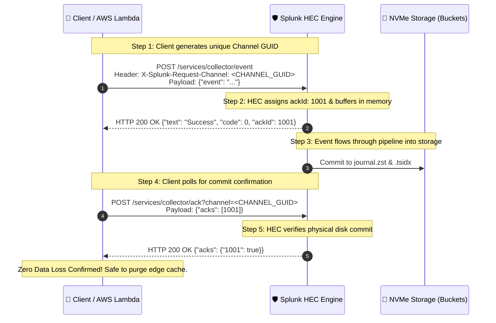

# 📖 Chapter 07 (Phase 2): HTTP Event Collector (HEC) Setup, Tokens & Security

> **The Splunk Administrator's Definitive Handbook** | Phase 2: Enterprise Installation & Topology Setup  
> **Course Status:** Phase 2, Chapter 07 | **Current Rank:** Splunk Senior Admin (2,650 XP)  
> **Target Audience:** Complete Beginners to Senior Enterprise Architects  
> **Second Brain File:** `Chapter_07_HTTP_Event_Collector_Setup_and_Security.md`  
> **Interactive Cyber Range Lab:** [Room 04: HEC Token Security & Cloud Ingestion Triage](../Labs/Room_04_HEC_Token_Security_and_JSON_Ingestion.md) `[250 XP]`

---

## ⚡ 1. The Master Analogy: "The VIP Fast-Pass Express Tollway"

Imagine an international highway toll plaza:
* Normally, heavy shipping trucks (**Universal Forwarders**) must install specialized proprietary transceivers, pass through physical weigh stations, and queue up in dedicated private lanes (**TCP Port 9997**).
* But what if modern delivery drones, electric scooters, and serverless vehicles (**Docker containers, Kubernetes pods, AWS Lambda functions, microservice APIs**) want to send data without installing heavy software?

They take the **VIP Fast-Pass Tollway (HTTP Event Collector — HEC)**:

```text
┌────────────────────────────────────────────────────────────────────────┐
│               THE VIP FAST-PASS EXPRESS TOLLWAY METAPHOR               │
├───────────────────────────────────┬────────────────────────────────────┤
│ 🛣️ THE HEC FAST-PASS (PORT 8088)  │ 🚚 THE TRADITIONAL S2S TRUCK (9997)│
├───────────────────────────────────┼────────────────────────────────────┤
│ • Agentless (Zero software agent).│ • Requires Universal Forwarder.    │
│ • Universal JSON / HTTP REST POST.│ • Proprietary Splunk S2S protocol. │
│ • Authenticated with a Token Key. │ • Configured via outputs.conf.     │
│ • Perfect for Cloud & Serverless. │ • Ideal for static physical VMs.   │
│ • Sub-second in-memory ingestion. │ • Batched disk file reading.       │
└───────────────────────────────────┴────────────────────────────────────┘
```

The **HTTP Event Collector (HEC)** is an enterprise-grade, agentless REST API endpoint embedded directly inside `splunkd`. It enables cloud microservices, developer code, and IoT devices to transmit structured events directly to Splunk over **HTTPS on Port 8088**.

---

## 🗺️ 2. Visual Architecture Tour 1: The Multi-Source Ingestion Funnel


*Figure 7.1: 3D Isometric View of Splunk HTTP Event Collector (HEC) Ingestion Funnel over HTTPS Port 8088*

### 🔍 Anatomy of the 3D Blueprint:
1. **The Edge Sources (Left Bay):** Cloud microservices, Docker swarms, AWS Lambda functions, and Kubernetes pods stream logs over encrypted **HTTPS Port 8088**.
2. **The HEC Security Gate (Center Vault):** In-memory token verification inspects the `Authorization: Splunk <UUID>` header in microseconds. If valid, the security shield unlocks.
3. **The Indexer Tier (Right Bay):** Clean, verified events flow directly into the indexing queue to be written to NVMe storage disks.
4. **The Acknowledgement Circuit (Top Loop):** If `useACK=1` is enabled, an orange and green feedback loop confirms data is written to disk before closing the transaction.

---

## 🔬 3. Deep-Dive: How HEC Operates Inside `splunkd`

### 3.1 The HEC Internal Threading Engine
Unlike legacy inputs that spawn heavy OS processes, HEC runs directly inside the core `splunkd` binary as a high-concurrency event-driven web server:

```text
[External Clients (Lambda / K8s / curl)]
                │
                ▼ (HTTPS Port 8088)
┌───────────────────────────────────────────────────────────┐
│ SPLUNKD HEC ENGINE (Core Process)                         │
│                                                           │
│  [ Dedicated I/O Threads ] (Accepts TCP connections)      │
│         │                                                 │
│         ▼                                                 │
│  [ In-Memory Token Validator ] ──► Reject? (HTTP 403)     │
│         │                                                 │
│         ▼ (Valid Token)                                   │
│  [ JSON Parser & Metadata Tagging Engine ]                │
│         │                                                 │
│         ▼                                                 │
│  [ Pipeline Injection Point ] ──► Injected into           │
│                                   parsingQueue/indexQueue │
└─────────────────────────────┬─────────────────────────────┘
                              │
                              ▼
┌───────────────────────────────────────────────────────────┐
│ INDEXING TIER STORAGE                                     │
│                                                           │
│   [ Hot Buckets: journal.zst + .tsidx on NVMe Disks ]     │
└───────────────────────────────────────────────────────────┘
```

### 3.2 Global Configuration (`inputs.conf`)
HEC is controlled globally in `$SPLUNK_HOME/etc/system/local/inputs.conf` under the **`[http]`** stanza:

```ini
[http]
disabled = 0
port = 8088
enableSSL = 1
dedicatedIoThreads = 2
maxSockets = 10000
maxThreads = 0
```

* **`disabled = 0`**: Activates the internal HEC engine.
* **`port = 8088`**: Default port for HEC.
* **`enableSSL = 1`**: Enforces TLS/SSL encryption across all network communication.
* **`dedicatedIoThreads = 2`**: Number of CPU threads dedicated strictly to accepting new incoming HTTP sockets.
* **`maxSockets = 10000`**: Maximum concurrent HTTP keep-alive connections allowed before throttling.

---

## 🛡️ 4. Token Scoping & Least-Privilege Architecture

Every team or application receives its own distinct token. This ensures **complete data governance**:

```ini
[http://aws_lambda_payment]
disabled = 0
token = e8a7d3c2-4b5f-4a1e-92c8-112233445566
index = payment_prod
indexes = payment_prod,payment_stage
sourcetype = json:payment
useACK = 1
```

```text
┌────────────────────────────────────────────────────────────────────────┐
│ 🛡️ THE 3 SECURITY GATES OF AN HEC TOKEN                                │
├─────────────────┬──────────────────────────────────────────────────────┤
│ 1. Authentication│ Client must pass 'Authorization: Splunk <UUID>'      │
│                 │ in the request header. Plain HTTP or Bearer is       │
│                 │ immediately rejected with HTTP 403 Forbidden!        │
├─────────────────┼──────────────────────────────────────────────────────┤
│ 2. Index Boundary│ 'indexes = ...' defines the legal whitelist.         │
│                 │ If a developer tries to inject logs into 'security'  │
│                 │ or 'audit', Splunk aborts with HTTP 400 Bad Request! │
├─────────────────┼──────────────────────────────────────────────────────┤
│ 3. Default Tags │ 'index' and 'sourcetype' auto-tag events if client   │
│                 │ forgets to declare them in the JSON payload.         │
└─────────────────┴──────────────────────────────────────────────────────┘
```

---

## 📦 5. Dissecting the HEC JSON Event Envelope

When sending structured data to `/services/collector/event`, Splunk expects a JSON envelope:

```json
{
  "time": 1789810900.123,
  "host": "k8s-pod-billing-77",
  "source": "aws:lambda:payment_service",
  "sourcetype": "json:payment",
  "index": "payment_prod",
  "event": {
      "action": "charge_credit_card",
      "status": "SUCCESS",
      "transaction_id": "TXN-90412",
      "amount": 499.00,
      "currency": "USD",
      "customer_id": "CUST-8821"
  },
  "fields": {
      "cluster_region": "us-east-1",
      "environment": "production"
  }
}
```

```text
┌────────────────────────────────────────────────────────────────────────┐
│ 🔍 FIELD-BY-FIELD DISSECTION                                           │
├──────────────────┬─────────────────────────────────────────────────────┤
│ "time"           │ Event timestamp in UNIX epoch format with ms.       │
│ "host/source/..."│ Overrides the default metadata keys for this event. │
│ "event"          │ THE RAW PAYLOAD: This object becomes the '_raw'     │
│                  │ text stored in the compressed raw data journal!     │
│ "fields"         │ INDEX-TIME FIELDS: Extracted directly into the      │
│                  │ .tsidx inverted index for lightning-fast search!    │
└──────────────────┴─────────────────────────────────────────────────────┘
```

---

## 🗺️ 6. Visual Architecture Tour 2: The HEC Acknowledgement (`useACK = 1`) Protocol

In cloud and serverless systems, an HTTP `200 OK` only confirms the network packet arrived in the Linux OS socket buffer. If power cuts out 1 millisecond later, the log in memory is lost forever.

To achieve **mission-critical zero data loss**, Splunk provides the **HEC Indexer Acknowledgement protocol**:


*Figure 7.2: 3D Isometric Lifecycle of the Splunk HEC Two-Way Acknowledgement (`useACK = 1`) Protocol*

### 🔄 Step-by-Step Handshake Lifecycle:



---

## 🌐 7. Enterprise High Availability: Load Balancer Architecture

In production environments processing 500 GB to 50 TB/day, clients do not send data to a single Indexer. They send data to a **Network Load Balancer (AWS ALB / F5 / NGINX)**:

```text
[Cloud Clients / K8s / Lambda]
               │
               ▼ (HTTPS 8088)
   ┌───────────────────────┐
   │ NETWORK LOAD BALANCER │
   │ (AWS ALB / F5 / NGINX)│
   └───────────┬───────────┘
               │
      ┌────────┴────────┬─────────────────┐
      │                 │                 │
      ▼ (Port 8088)     ▼ (Port 8088)     ▼ (Port 8088)
┌─────────────┐   ┌─────────────┐   ┌─────────────┐
│ INDEXER 01  │   │ INDEXER 02  │   │ INDEXER 03  │
│ (HEC Active)│   │ (HEC Active)│   │ (HEC Active)│
└─────────────┘   └─────────────┘   └─────────────┘
```

> [!CAUTION]
> ### ⚠️ ARCHITECTURAL GOLDEN RULE: HEC ACK & SESSION AFFINITY
> If `useACK = 1` is enabled on your tokens, the Load Balancer **MUST enable Sticky Sessions (Session Affinity)** based on the `X-Splunk-Request-Channel` header or source IP.  
> **Why?** The `ackId` is stored in the memory buffer of the specific Indexer that received the POST. If the client's subsequent `/services/collector/ack` query is routed to a *different* Indexer, that Indexer will return `{"acks": {"1001": false}}`, causing false duplicate resends!

---

## 🧪 8. Hands-on Screencasts & Production `curl` Runbook

### 8.1 Testing HEC Health (`/services/collector/health`)
Before sending logs, verify that the HEC listener is ready:
```bash
curl -k https://192.168.1.100:8088/services/collector/health
```
* **HTTP 200 OK:** HEC is active and ready to accept data.
* **HTTP 400 Bad Request / 503 Service Unavailable:** Downstream queues are full (server is congested).

---

### 8.2 Batch Ingestion (High-Throughput Optimization)
Sending 10,000 individual HTTP requests causes high TCP overhead. Send **newline-delimited JSON batches** in a single HTTP POST:

```bash
curl -k https://192.168.1.100:8088/services/collector/event \
   -H "Authorization: Splunk e8a7d3c2-4b5f-4a1e-92c8-112233445566" \
   -d '{"event": "User logged in", "host": "web-01"}
       {"event": "Checkout clicked", "host": "web-01"}
       {"event": "Payment approved", "host": "web-01"}'
```

---

### 8.3 Ingesting Raw Text Streams (`/services/collector/raw`)
When logging raw text without JSON wrapping:
```bash
curl -k https://192.168.1.100:8088/services/collector/raw \
   -H "Authorization: Splunk e8a7d3c2-4b5f-4a1e-92c8-112233445566" \
   -d "2026-09-19 09:40:12.112 [ERROR] Database connection timed out"
```

---

## 🚨 9. Administrator Troubleshooting Runbook: Error Codes

| HTTP Status Code | Splunk Return JSON | Root Cause | Administrator Remediation |
| :---: | :--- | :--- | :--- |
| **`401 Unauthorized`** | `{"text":"Token is required","code":2}` | The HTTP request header is completely missing the `Authorization` key. | Add `-H "Authorization: Splunk <token>"` to the request. |
| **`403 Forbidden`** | `{"text":"Invalid token","code":4}` | The token GUID is invalid, disabled in `inputs.conf`, or used `Bearer` prefix instead of `Splunk`. | Verify `inputs.conf` stanza `[http://<name>] disabled = 0` and ensure header uses `Splunk <UUID>`. |
| **`400 Bad Request`** | `{"text":"Incorrect index","code":7}` | The client specified an index that is not listed in the token's `indexes = ...` whitelist. | Add the target index to the `indexes = ...` whitelist in `inputs.conf`. |
| **`503 Service Unavailable`** | `{"text":"Server is busy","code":9}` | Internal memory queues (`indexQueue`) are 100% saturated due to disk I/O bottlenecks. | Inspect Indexer storage IOPS. Increase IOPS to $\ge 1,200\text{ IOPS}$ or scale out Indexers. |

---

## ⚡ 10. Rapid-Recall Flashcards

| # | Question (Front) | Answer (Back) |
| :-: | :--- | :--- |
| **01** | What is the default port used by Splunk HTTP Event Collector? | **TCP Port 8088 (HTTPS)**. |
| **02** | What exact prefix must precede the token in the HTTP header? | **`Authorization: Splunk <TOKEN_UUID>`** |
| **03** | In `[http://<token>]`, what does the `indexes` parameter do? | Sets the **strict whitelist** of indexes the token is permitted to write to. |
| **04** | What is the difference between `/event` and `/raw` endpoints? | `/event` accepts structured JSON envelopes; `/raw` accepts unformatted plain text. |
| **05** | How does HEC indexer acknowledgement guarantee delivery? | Client supplies an `X-Splunk-Request-Channel` GUID and queries `/ack` until Splunk confirms the event is written to disk. |
| **06** | Why do load balancers require sticky sessions for HEC with ACK? | The `ackId` tracking state is stored in the memory of the specific Indexer that received the initial POST. |

---

## 🎮 Hands-On Cyber Range Challenge: Room 04 (TryHackMe / HTB Style)

```text
┌────────────────────────────────────────────────────────────────────────┐
│ 🕹️ ARENA MISSION: Room 04 — HEC Token Security & Ingestion Triage      │
│ ⭐ DIFFICULTY: Medium | 💎 REWARD: 250 XP | ⏱️ TIME: 35 Mins           │
└────────────────────────────────────────────────────────────────────────┘
```

> **🚨 Incident Scenario:**  
> The DevOps team launched a serverless AWS Lambda microservice cluster.  
> The microservices cannot run the Universal Forwarder. Developers created an unauthorized HEC token writing to the `main` index without SSL.  
> You must configure global HEC on Port 8088, enforce TLS, create a restricted token scoped strictly to `index = cloud_telemetry`, and verify ingestion via `curl`!

### 🎯 Mission Checkpoint Questions

#### 1. What is the default listening port for Splunk HTTP Event Collector?
*(Answer Format: `****`)*
<details><summary>💡 Need a Hint?</summary>Eight thousand and eighty-eight.</details>
<details><summary>🔓 Reveal Answer</summary><b>Answer:</b> <code>8088</code></details>

#### 2. What keyword must precede the token inside the HTTP `Authorization` request header?
*(Answer Format: `******`)*
<details><summary>💡 Need a Hint?</summary>The name of the software!</details>
<details><summary>🔓 Reveal Answer</summary><b>Answer:</b> <code>Splunk</code> (e.g. <code>Authorization: Splunk &lt;token&gt;</code>)</details>

#### 3. What setting in `inputs.conf` enables Indexer Acknowledgement for an HEC token?
*(Answer Format: `****** = *`)*
<details><summary>💡 Need a Hint?</summary>useACK = 1</details>
<details><summary>🔓 Reveal Answer</summary><b>Answer:</b> <code>useACK = 1</code></details>

👉 **[Launch Full Interactive Lab: Room 04 & Capture All 4 Flags (250 XP)](../Labs/Room_04_HEC_Token_Security_and_JSON_Ingestion.md)**
