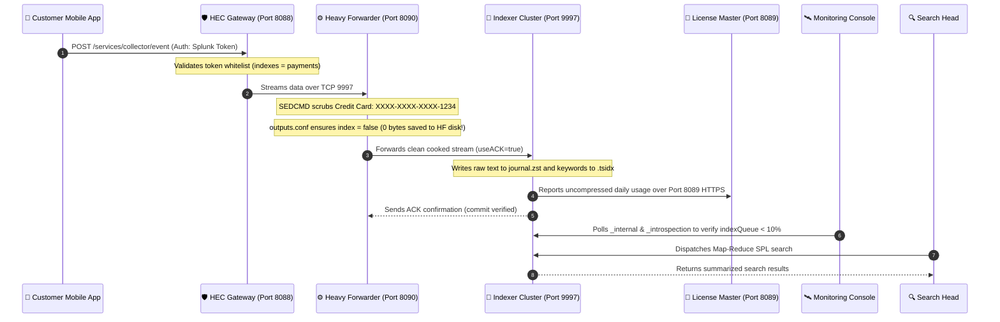

# 🏆 Chapter 08 (Phase 2): Phase 2 Capstone — Enterprise Multi-Tier Topology & Milestone Exam

> **The Splunk Administrator's Definitive Handbook** | Phase 2: Enterprise Installation & Topology Setup  
> **Course Milestone:** Phase 2 Grand Finale | **Current Rank:** Splunk Senior Admin (2,650 XP)  
> **Second Brain File:** `Chapter_08_Phase_2_Capstone_Lab_and_Exam.md`  
> **Interactive Cyber Range Lab:** [Room P2-Capstone: The Enterprise Multi-Tier Boss Arena](../Labs/Room_P2_Capstone_Boss_Arena.md) `[400 XP]`

---

## 🏰 1. The Big Picture: How a Real Enterprise Cluster Actually Works

In Chapters 01 through 07, you built individual bricks.  
Now, look at the entire **Castle**:

```text
┌────────────────────────────────────────────────────────────────────────┐
│               THE 4 PRODUCTION TIERS OF ENTERPRISE SPLUNK              │
├────────────────────────────────────────────────────────────────────────┤
│ 1. THE EDGE FLEET (Data Sources)                                       │
│    • Universal Forwarders on 1,000 servers reading files ➔ Port 9997   │
│    • Cloud Lambda & Docker containers sending JSON ➔ HEC Port 8088     │
├────────────────────────────────────────────────────────────────────────┤
│ 2. THE DATA LAUNDROMAT (Heavy Forwarder Tier)                          │
│    • In-memory Python engine scrubs credit cards (SEDCMD)              │
│    • Discards debug spam to nullQueue                                  │
│    • Listens on Mgmt Port 8090 (No collision with UF!)                 │
│    • outputs.conf: [indexAndForward] index = false                     │
├────────────────────────────────────────────────────────────────────────┤
│ 3. THE STORAGE VAULTS (Indexer Cluster Tier)                           │
│    • Hardened Linux Kernel: THP = never, ulimits = 64,000              │
│    • High-Speed Storage: >= 1,200 IOPS NVMe Disks                      │
│    • Runs safely under dedicated non-root 'splunk' user                │
│    • S2S Ingestion on Port 9997 with useACK = true                     │
├────────────────────────────────────────────────────────────────────────┤
│ 4. MISSION CONTROL (Management & Search Tier)                          │
│    • Central License Master (The Bank Vault, 72-Hour Grace Period)     │
│    • Monitoring Console in Distributed Mode watching indexQueue/IOPS   │
│    • Search Heads executing Map-Reduce queries over HTTPS Port 8089    │
└────────────────────────────────────────────────────────────────────────┘
```

---

## 🗺️ 2. The Complete 3D Isometric Architecture Blueprint


*Figure 8.1: Full 3D Isometric Blueprint of the Production Enterprise Multi-Tier Deployment*

---

## 🔄 3. Trace a Single Log Line Through the Entire Enterprise

Let's watch a real customer log travel from a phone app all the way to a security dashboard:



---

## 📋 4. The Splunk Administrator Production Golden Rules

| Component / Layer | Critical Configuration | What Happens If You Forget It? |
| :--- | :--- | :--- |
| **Linux OS Kernel** | `THP = never` via Systemd | Memory defragmentation lockups; 60% indexing latency drop! |
| **Linux OS Limits** | `nofile 64000` in `limits.conf` | Daemon crashes with `FATAL: Too many open files`. |
| **Security Account** | `User=splunk` (Never `root`!) | Severe vulnerability: apps can execute root commands on host. |
| **Heavy Forwarder** | `[indexAndForward] index = false` | HF saves duplicate copy of every log; disk fills 100% in 48 hrs! |
| **Forwarder Ports** | `splunk set splunkd-port 8090` | Management port 8089 collision causes splunkd to fail startup. |
| **Reliability** | `useACK = true` in `outputs.conf` | Network blip causes in-flight logs to be dropped without warning. |
| **License Slaves** | `server.conf: [license] master_uri` | Indexers cannot report usage; after 72 hrs, searches are blocked. |
| **Monitoring Console**| Mode: `Distributed` (Search Peers) | MC only monitors itself; administrators fly completely blind! |
| **HEC Ingestion** | Header: `Authorization: Splunk <UUID>` | Using `Bearer` or plain HTTP results in `HTTP 403 Forbidden`. |

---

## 🎮 Hands-On Cyber Range Challenge: Room P2-Capstone (TryHackMe / HTB Style)

```text
┌────────────────────────────────────────────────────────────────────────┐
│ 🕹️ FINAL BOSS ROOM: Room P2-Capstone — Enterprise Multi-Tier Arena    │
│ ⭐ DIFFICULTY: Advanced | 💎 REWARD: 400 XP | ⏱️ TIME: 45 Mins        │
└────────────────────────────────────────────────────────────────────────┘
```

> **🚨 P1 Mega-Incident Briefing:**  
> It's Black Friday at 02:00 AM!  
> The entire retail logging pipeline is failing:  
> 1. The Heavy Forwarder crashed because port 8089 was locked.  
> 2. The Indexers are showing `indexQueue 100% full` because someone provisioned cheap 200 IOPS cloud disks.  
> 3. An executive claims Splunk stopped indexing data because the daily license was exceeded by 50 GB.  
> 4. Developers using AWS Lambda are getting `HTTP 403 Forbidden` from the HEC endpoint.  
> Your mission as the Lead Splunk Architect is to solve all 4 outages, capture the flags, and save the company's Black Friday operations!

👉 **[Enter the Final Boss Arena: Room P2-Capstone](../Labs/Room_P2_Capstone_Boss_Arena.md)** `[400 XP]`

---

# 🎓 Phase 2 Milestone Capstone Exam

Answer these 7 real-world architectural questions to complete **Phase 2** and graduate to **Phase 3 (Data Onboarding & Parsing Pipeline)**:

### Question 1 (Hardware & Kernel Tuning)
Why does Splunk strictly mandate that **Transparent Huge Pages (THP)** be set to `never` on Linux Indexers, and what minimum sustained random write IOPS benchmark is required?

### Question 2 (Installation Security)
What is the primary security risk of running Splunk Enterprise as the `root` user, and what file allows silent, automated provisioning of the initial admin password?

### Question 3 (Universal Forwarder Reliability)
In `outputs.conf`, what parameter protects in-flight logs from being permanently lost if a network switch dies while a Universal Forwarder is transmitting data?

### Question 4 (Heavy Forwarder Operations)
What two critical settings must an administrator configure on a Heavy Forwarder to prevent port conflicts and stop the forwarder's local disk from filling to 100%?

### Question 5 (Licensing & Disaster Recovery)
If an Indexer Cluster completely loses network connectivity to its central License Master for 36 hours due to a fiber cut, what happens to incoming data ingestion?

### Question 6 (Monitoring Console Health Triage)
In the Monitoring Console, you notice `indexQueue` is at 100% while CPU usage is at 15%. What is the bottleneck, and how does this differ from `parsingQueue` at 100% with CPU at 99%?

### Question 7 (HTTP Event Collector Security)
What is the difference between `index = ...` and `indexes = ...` in an HEC token definition inside `inputs.conf`, and what prefix must be in the HTTP Authorization header?

---
*Respond with your answers to graduate from Phase 2, earn +400 XP, and unlock Phase 3!*
