# 📚 Phase 3: Deep Data Onboarding & Parsing Pipeline — Handbook & TOC

> **The Splunk Administrator's Definitive Handbook** | Phase 3  
> **Target Audience:** Enterprise Splunk Administrators & Architects  
> **Prerequisites:** Phase 1 (Fundamentals) & Phase 2 (Enterprise Topologies)  
> **Core Objective:** Master the transformation of raw, chaotic machine data into clean, normalized, searchable enterprise intelligence across the input, parsing, and indexing pipelines.

---

## 🎯 Phase 3 Roadmap & Curriculum (Days 16–28)

```mermaid
graph TD
    subgraph InputTier ["Input Pipeline (Edge & Collection)"]
        C1["Ch 01: inputs.conf Anatomy & Fishbucket Mechanics<br/>(Monitor, Batch, Scripted, Windows Event, CRC, btprobe)"]
        C2["Ch 02: Sourcetype Strategy & Naming Standards<br/>(Built-in vs Custom, TAs, Splunk Standard Taxonomy)"]
    end

    subgraph ParsingTier ["Parsing & Typing Pipelines (Heavy Forwarder / Indexer)"]
        C3["Ch 03: Event Breaking & Timestamp Recognition<br/>(LINE_BREAKER, SHOULD_LINEMERGE, TIME_PREFIX, TIME_FORMAT)"]
        C4["Ch 04: props.conf vs transforms.conf Architecture<br/>(Execution order, Who parses what & where)"]
        C5["Ch 05: Index-Time Routing & Filtering<br/>(Selective indexing, nullQueue trash chute, regex routing)"]
        C6["Ch 06: Data Masking & Anonymization<br/>(SEDCMD, PII/PCI-DSS redaction before disk commit)"]
    end

    subgraph SearchTimeTier ["Search-Time Knowledge & Normalization (Search Head)"]
        C7["Ch 07: Search-Time Field Extractions (Inline & Transforms)<br/>(Regex capture groups, delimiters, JSON/XML spath)"]
        C8["Ch 08: Calculated Fields, Field Aliases & Renaming<br/>(EVAL-, FIELDALIAS-, sourcetype renaming)"]
        C9["Ch 09: Lookups Architecture (CSV, Automatic, KV Store, Scripted)"]
        C10["Ch 10: Splunk Common Information Model (CIM) & Add-ons<br/>(Data models, tags, CIM compliance verification)"]
        C11["Ch 11: Eventtypes & Tags Classification Architecture"]
    end

    subgraph OperationsTier ["Troubleshooting & Capstone"]
        C12["Ch 12: Ingestion Pipeline Troubleshooting Runbooks<br/>(Catastrophic backtracking, timestamp drift, queue blocks)"]
        C13["Ch 13: Phase 3 Capstone Lab & Master Milestone Exam<br/>(Multi-line custom enterprise app onboarding)"]
    end

    C1 --> C2 --> C3 --> C4 --> C5 --> C6 --> C7 --> C8 --> C9 --> C10 --> C11 --> C12 --> C13

    style C1 fill:#fef3c7,stroke:#d97706,stroke-width:2px
    style C2 fill:#e0f2fe,stroke:#0284c7,stroke-width:2px
    style C3 fill:#dcfce7,stroke:#16a34a,stroke-width:2px
    style C4 fill:#f3e8ff,stroke:#9333ea,stroke-width:2px
    style C5 fill:#fce7f3,stroke:#db2777,stroke-width:2px
    style C6 fill:#ffedd5,stroke:#ea580c,stroke-width:2px
    style C7 fill:#ccfbf1,stroke:#0d9488,stroke-width:2px
    style C8 fill:#fef08a,stroke:#ca8a04,stroke-width:2px
    style C9 fill:#ede9fe,stroke:#7c3aed,stroke-width:2px
    style C10 fill:#fee2e2,stroke:#dc2626,stroke-width:2px
    style C11 fill:#ecfccb,stroke:#65a30d,stroke-width:2px
    style C12 fill:#e0e7ff,stroke:#4338ca,stroke-width:2px
    style C13 fill:#fef08a,stroke:#b45309,stroke-width:3px
```

---

## 📖 Chapter Directory & 🎮 Cyber Range Arena (Phase 3)

| Chapter | Day | Topic Name | Practical Focus | Cyber Range Room (THM / HTB Style) | XP Reward |
| :---: | :---: | :--- | :--- | :--- | :---: |
| **01** | Day 16 | `inputs.conf` Anatomy & Fishbucket | Monitor vs Batch, Blacklist/Whitelist, CRC, `btprobe` | [Room P3-01: Fishbucket Forensics](../Labs/Room_P3_01_inputs_conf_and_Fishbucket_Forensics.md) | `250 XP` |
| **02** | Day 17 | Sourcetype Strategy & Naming Standards | Splunk Standard Taxonomy, App Add-on precedence | [Room P3-02: The Sourcetype Taxonomy](../Labs/Room_P3_02_Sourcetype_Taxonomy.md) | `200 XP` |
| **03** | Day 18 | Event Breaking & Timestamp Recognition | `LINE_BREAKER`, `TIME_PREFIX`, `TIME_FORMAT`, Regex | [Room P3-03: The Event Breaking Surgery](../Labs/Room_P3_03_Event_Breaking_Surgery.md) | `250 XP` |
| **04** | Day 19 | `props.conf` vs `transforms.conf` Mechanics | Execution order, UF vs HF vs Indexer parsing | [Room P3-04: Props & Transforms Battleground](../Labs/Room_P3_04_Props_and_Transforms_Battleground.md) | `250 XP` |
| **05** | Day 20 | Index-Time Routing & Filtering | `nullQueue` discard, selective index routing | [Room P3-05: The NullQueue Trash Chute](../Labs/Room_P3_05_NullQueue_Trash_Chute.md) | `250 XP` |
| **06** | Day 21 | Data Masking & Anonymization | `SEDCMD`, PII/PCI regex masking at ingest time | [Room P3-06: PII Redaction Operations](../Labs/Room_P3_06_PII_Redaction_Operations.md) | `250 XP` |
| **07** | Day 22 | Search-Time Field Extractions | Inline regex, transforms, delimiters, JSON/XML | [Room P3-07: Search-Time Regex Heist](../Labs/Room_P3_07_Search_Time_Regex_Heist.md) | `250 XP` |
| **08** | Day 23 | Calculated Fields & Aliases | `EVAL-`, `FIELDALIAS-`, Sourcetype renaming | [Room P3-08: The Calculated Field Alchemist](../Labs/Room_P3_08_Calculated_Field_Alchemist.md) | `200 XP` |
| **09** | Day 24 | Lookups Architecture | Static CSV, Automatic, KV Store, Scripted lookups | [Room P3-09: KV Store & Lookup Infiltration](../Labs/Room_P3_09_KV_Store_Lookup_Infiltration.md) | `250 XP` |
| **10** | Day 25 | Common Information Model (CIM) & TAs | Normalization, Data Models, Enterprise Security tags | [Room P3-10: CIM Normalization Arena](../Labs/Room_P3_10_CIM_Normalization_Arena.md) | `300 XP` |
| **11** | Day 26 | Eventtypes & Tags Architecture | Hierarchical classification, Alert integration | [Room P3-11: Eventtype Tagging Ops](../Labs/Room_P3_11_Eventtype_Tagging_Ops.md) | `200 XP` |
| **12** | Day 27 | Ingestion Troubleshooting Runbooks | Catastrophic backtracking, timestamp drift, queue jams| [Room P3-12: The Ingestion Outage Runbook](../Labs/Room_P3_12_Ingestion_Outage_Runbook.md) | `300 XP` |
| **13** | Day 28 | **Phase 3 Capstone Lab & Milestone Exam** | End-to-end multi-line custom banking log onboarding | [Room P3-Capstone: The Banking Log Gauntlet](../Labs/Room_P3_Capstone_Banking_Log_Gauntlet.md) | `500 XP` |

---

## 🏆 Graduation Criteria for Phase 3
To complete Phase 3 and unlock **Phase 4 (Advanced SPL & Search Optimization)**:
1. Complete all 13 textbook chapters with full theoretical mastery.
2. Complete all 13 Cyber Range challenge rooms and collect all flags.
3. Pass the **Phase 3 Master Milestone Exam** with $\ge 90\%$ score.
4. Total XP to graduate Phase 3: **`+3,450 XP`** $\rightarrow$ Rank Promotion to **Principal Splunk Architect**!
