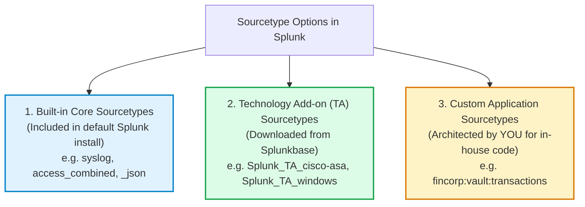

# 📘 Chapter 02 (Phase 3): Sourcetype Strategy & Best Practices

> **The Splunk Administrator's Definitive Handbook** | Phase 3: Data Onboarding & Parsing Pipeline  
> **Day:** 17 | **Milestone:** Data Taxonomy & Parsing Blueprints | **Current Rank:** Splunk Enterprise Architect (3,050 XP)  
> **Second Brain File:** `Chapter_02_Sourcetype_Strategy_and_Taxonomy.md`  
> **Interactive Cyber Range Lab:** [Room P3-02: The Sourcetype Taxonomy & Ingestion Surgery](../Labs/Room_P3_02_Sourcetype_Taxonomy.md) `[200 XP]`

---

## 🏗️ 1. The Simple Explanation: "The Rosetta Stone & Translation Prism"

Imagine walking into a United Nations assembly where diplomats from 195 countries are speaking French, Japanese, Arabic, and German all at the same time:
- If your translators don't know which language a diplomat is speaking, they cannot translate their words into English.
- **This is what `sourcetype` is in Splunk.** It is the **Rosetta Stone**.
- When raw, unformatted text streams into Splunk, the `sourcetype` tells the parsing engine:
  - *"This stream is Cisco ASA firewall output—break lines on `%ASA-` and look for timestamps at byte position 0."*
  - *"This stream is Nginx web access logs—extract the first string as `clientip` and the number after the URI as `status`."*


*Figure 3.2: The Optical Prism Analogy — How the Sourcetype Taxonomy splits raw chaotic machine streams into structured, standardized intelligence.*

---

## 🔍 2. Step-by-Step: The 5-Step Journey of Sourcetype in Splunk

```text
┌────────────────────────────────────────────────────────────────────────┐
│             THE 5-STEP JOURNEY OF SOURCETYPE IN SPLUNK                 │
├────────────────────────────────────────────────────────────────────────┤
│ Step 1: Assignment at the Edge (inputs.conf)                           │
│         - The forwarder assigns a sourcetype label to the stream:      │
│           [monitor:///var/log/cisco/asa.log]                           │
│           sourcetype = cisco:asa                                       │
│                                                                        │
│ Step 2: Ingestion-Time Parsing Rule Matching (props.conf)              │
│         - On the Heavy Forwarder / Indexer, Splunk searches props.conf │
│           for the stanza matching [cisco:asa]:                         │
│           • How to break lines? (LINE_BREAKER)                         │
│           • Where is the timestamp? (TIME_PREFIX, TIME_FORMAT)         │
│                                                                        │
│ Step 3: Index-Time Routing & Anonymization (transforms.conf)           │
│         - If sourcetype = cisco:asa, evaluate custom regex filters:    │
│           • Discard noisy teardown events (nullQueue)                  │
│           • Mask internal IP subnets before committing to disk         │
│                                                                        │
│ Step 4: Storage in the Index Catalog (.tsidx)                          │
│         - The word "cisco:asa" is saved into the index metadata as:    │
│           sourcetype::cisco:asa                                        │
│         - Enables lightning-fast searches: sourcetype=cisco:asa        │
│                                                                        │
│ Step 5: Search-Time Knowledge Activation (Search Head)                 │
│         - When an analyst searches sourcetype=cisco:asa:               │
│           • Field extractions populate: src_ip, dest_port, action      │
│           • Lookups correlate IP addresses with threat intelligence    │
│           • Common Information Model (CIM) maps fields for dashboards! │
└────────────────────────────────────────────────────────────────────────┘
```

---

## 🏷️ 3. Splunk Standard Naming Conventions (The Enterprise Taxonomy)

Never invent random sourcetype names like `my_log`, `server1_data`, or `app_output`!  
Splunk mandates an enterprise-wide naming taxonomy:

```text
┌────────────────────────────────────────────────────────────────────────┐
│               THE SPLUNK STANDARD SOURCETYPE TAXONOMY                  │
├────────────────────────────────────────────────────────────────────────┤
│           <vendor>:<product>:<technology>:<format>                     │
└────────────────────────────────────────────────────────────────────────┘
```

### Real-World Production Examples:

| Data Source | ❌ Bad Custom Name | ✅ Splunk Standard Sourcetype | Why It Matters |
| :--- | :--- | :--- | :--- |
| **Cisco ASA Firewall** | `cisco_firewall` | `cisco:asa` | Automatically hooks into the official Cisco Add-on and CIM Network Traffic model! |
| **Palo Alto PAN-OS** | `palo_alto_traffic` | `pan:traffic` | Out-of-the-box field extractions for threat hunting and dashboards. |
| **Nginx Web Server** | `nginx_log` | `nginx:access` / `nginx:error`| Separates access metrics from error traces cleanly. |
| **Windows Security** | `win_sec_event` | `XmlWinEventLog:Security` | Enables native XML multi-line parsing with zero CPU regex overhead. |
| **Custom Java App** | `payment_api` | `fincorp:payment:json` | Adheres to `<company>:<application>:<format>` standard! |

---

## ⚖️ 4. The 3 Types of Sourcetypes: Built-in, Add-on, and Custom



### Golden Rule for Architects:
> **Always check Splunkbase for an official Technology Add-on (TA) before inventing a custom sourcetype.**  
> If Cisco, Palo Alto, AWS, or CrowdStrike already spent 500 engineering hours building CIM-compliant field extractions, do NOT reinvent the wheel! Use their standard sourcetype name!

---

## 📍 5. Where Can You Assign Sourcetypes?

Splunk allows sourcetypes to be assigned at multiple points in the data stream:

### Method A: Static Ingestion Assignment (`inputs.conf`) — Recommended
Configured directly on the forwarder reading the file:
```ini
[monitor:///var/log/httpd/access.log]
index = web
sourcetype = access_combined
```

### Method B: Source-Path Dynamic Matching (`props.conf`)
If a forwarder sends logs without specifying a sourcetype, an Indexer can dynamically match the file path (`source`):
```ini
# $SPLUNK_HOME/etc/system/local/props.conf
[source::/var/log/.../access*.log]
sourcetype = access_combined
```

### Method C: Regex Host/Port Dynamic Re-assignment (`transforms.conf`)
Used when receiving a flood of mixed syslog over Port 514 UDP on a Heavy Forwarder:
```ini
# props.conf
[syslog]
TRANSFORMS-force_sourcetype = force_cisco_asa, force_palo_alto

# transforms.conf
[force_cisco_asa]
REGEX = %ASA-\d-\d+
DEST_KEY = MetaData:Sourcetype
FORMAT = sourcetype::cisco:asa

[force_palo_alto]
REGEX = ,(TRAFFIC|THREAT|SYSTEM),
DEST_KEY = MetaData:Sourcetype
FORMAT = sourcetype::pan:traffic
```

---

## 🚨 6. The Three Classic Production Traps

### ❌ Trap 1: The "Catch-All `syslog`" Disaster
**The Mistake:** An admin routes firewall, router, switch, Linux, and proxy logs into `sourcetype = syslog`.  
**Why it Destroys Performance:**  
- When a user searches `sourcetype=syslog`, Splunk must scan every single network device in the entire company!
- Cisco format, Linux format, and Juniper format collide, causing line breaking errors and timestamp drift!
- **The Fix:** Always use `transforms.conf` to split incoming syslog into `cisco:ios`, `linux:secure`, `palo:traffic`, etc.

### ❌ Trap 2: Case Sensitivity Heartbreak
**The Mistake:** Admin writes `sourcetype = Cisco:ASA` on forwarder A, and `sourcetype = cisco:asa` on forwarder B.  
**Why it Breaks Splunk:**  
- Splunk sourcetypes are **strictly case-sensitive**!
- Searches for `sourcetype=cisco:asa` will **silently miss** all data tagged as `Cisco:ASA`!
- **The Fix:** Enforce 100% lowercase naming conventions enterprise-wide.

### ❌ Trap 3: The `...-too_small` Horror
**The Mistake:** A forwarder monitors a newly created empty file or a file with only 2 lines, without specifying `sourcetype` in `inputs.conf`.  
**Why it Happens:**  
- Splunk tries to guess the sourcetype by reading the first few lines. If the file has fewer than 100 lines, Splunk gives up and creates an auto-generated sourcetype named: `app.log-too_small`!
- **The Fix:** Never allow Splunk to guess! Explicitly set `sourcetype = <name>` in `inputs.conf` for every monitor stanza.

---

## 🎮 Hands-On Cyber Range Challenge: Room P3-02

```text
┌────────────────────────────────────────────────────────────────────────┐
│ 🕹️ ROOM P3-02: The Sourcetype Taxonomy & Ingestion Surgery             │
│ ⭐ DIFFICULTY: Intermediate | 💎 REWARD: 200 XP | ⏱️ TIME: 30 Mins    │
└────────────────────────────────────────────────────────────────────────┘
```

> **🚨 Production Incident Briefing:**  
> A financial SIEM dashboard monitoring credit card fraud has gone dark!  
> The SOC analysts cannot see any events in their `Network_Traffic` data model.  
> Your triage reveals:
> 1. A rogue forwarder is tagging Cisco ASA firewall streams with the non-standard name `cisco_firewall_v2`, breaking all CIM data models.
> 2. Mixed syslog on UDP port 514 is dumping Cisco, Linux, and F5 logs into a single messy bucket.
> 3. An intern configured a file monitor without a sourcetype, creating thousands of orphaned `events.log-too_small` artifacts!

👉 **[Enter the Cyber Range: Room P3-02](../Labs/Room_P3_02_Sourcetype_Taxonomy.md)** `[200 XP]`

---

## 🧠 End-of-Chapter Self-Check Quiz

1. **What is the recommended 4-part naming taxonomy format for Splunk sourcetypes?**
2. **Why is assigning `sourcetype = syslog` considered a dangerous anti-pattern in high-throughput enterprise environments?**
3. **If a file monitor stanza in `inputs.conf` does not define `sourcetype`, what auto-generated suffix might Splunk assign if the file contains only 2 lines?**
4. **Are Splunk sourcetypes case-sensitive or case-insensitive during search execution?**
5. **On which instance tier (UF, HF, or Indexer) should dynamic syslog sourcetype re-assignment via `transforms.conf` (`DEST_KEY = MetaData:Sourcetype`) take place?**

---
*Ready to advance to Chapter 03: Event Breaking & Timestamp Recognition (`LINE_BREAKER`, `TIME_PREFIX`, `TIME_FORMAT`)?*
