# 📚 Phase 4: Advanced SPL & Search Optimization — Handbook & TOC

> **The Splunk Administrator's Definitive Handbook** | Phase 4  
> **Target Audience:** Enterprise Splunk Administrators, SOC Lead Engineers & Architects  
> **Prerequisites:** Phase 1 (Fundamentals), Phase 2 (Enterprise Topologies), Phase 3 (Data Onboarding)  
> **Core Objective:** Master the execution mechanics of Search Processing Language (SPL), distributed Map-Reduce search processing, streaming vs transforming commands, memory-efficient data correlation, and sub-second query optimization using `tstats`, Report Acceleration, and the Search Job Inspector.

---

## 🎯 Phase 4 Roadmap & Curriculum (Days 29–38)

```mermaid
graph TD
    subgraph FoundationTier ["Search Engine & Pipeline Foundations"]
        C1["Ch 01: SPL Foundations & Search Modes<br/>(Fast vs Smart vs Verbose, Search Pipeline & Dispatch Directory)"]
        C2["Ch 02: Transforming Commands Architecture<br/>(stats, chart, timechart, top, rare, contingency, Streaming vs Transforming)"]
        C3["Ch 03: Event Manipulation & Multivalue Fields<br/>(eval, rex, replace, spath, mvexpand, nomv)"]
        C4["Ch 04: Filtering, Structuring & Deduplication<br/>(where vs search, dedup, head, tail, sort, table vs fields)"]
    end

    subgraph CorrelationTier ["Multi-Dataset Correlation & Subsearches"]
        C5["Ch 05: Correlation: stats vs transaction & Joins<br/>(Memory footprint, transaction eviction, join limits, append, union)"]
        C6["Ch 06: Subsearches Architecture & Optimization<br/>(Inner search execution, maxout 10k, timeout 60s, format command)"]
        C7["Ch 07: Lookups & KV Store in SPL<br/>(inputlookup, outputlookup, lookup, KV Store CRUD operations)"]
    end

    subgraph AccelerationTier ["Enterprise Acceleration & Performance Diagnostics"]
        C8["Ch 08: Enterprise Acceleration Techniques<br/>(Report Acceleration, Summary Indexing sistats/collect, Data Model Acceleration)"]
        C9["Ch 09: tstats Command Mastery<br/>(Direct tsidx querying, summariesonly=t, accelerated data models)"]
        C10["Ch 10: Search Job Inspector & Performance Diagnostics<br/>(Duration breakdown, scanCount vs eventCount, LIS ratio, optimization)"]
        C11["Ch 11: Phase 4 Capstone Lab & Master Milestone Exam<br/>(Enterprise query refactoring from 180s to 1.2s)"]
    end

    C1 --> C2 --> C3 --> C4 --> C5 --> C6 --> C7 --> C8 --> C9 --> C10 --> C11

    style C1 fill:#fef3c7,stroke:#d97706,stroke-width:2px
    style C2 fill:#e0f2fe,stroke:#0284c7,stroke-width:2px
    style C3 fill:#dcfce7,stroke:#16a34a,stroke-width:2px
    style C4 fill:#f3e8ff,stroke:#9333ea,stroke-width:2px
    style C5 fill:#fce7f3,stroke:#db2777,stroke-width:2px
    style C6 fill:#ffedd5,stroke:#ea580c,stroke-width:2px
    style C7 fill:#ccfbf1,stroke:#0d9488,stroke-width:2px
    style C8 fill:#fef08a,stroke:#ca8a04,stroke-width:2px
    style C9 fill:#ede9fe,stroke:#7c3aed,stroke-width:2px
    style C10 fill:#fee2e2,stroke:#dc2626,stroke-width:2px
    style C11 fill:#fef08a,stroke:#b45309,stroke-width:3px
```



---

## 📖 Chapter Directory & 🎮 Cyber Range Arena (Phase 4)

| Chapter | Day | Topic Name | Practical Focus | Cyber Range Room (THM / HTB Style) | XP Reward |
| :---: | :---: | :--- | :--- | :--- | :---: |
| **01** | **29** | **SPL Foundations & Search Modes** | Fast vs Smart vs Verbose mode, dispatch directory, Map-Reduce phases | [Room P4-01: The Search Dispatch Heist](../Labs/Room_P4_01_Search_Dispatch_and_Modes.md) | `250 XP` |
| **02** | **30** | **Transforming Commands Architecture** | `stats`, `chart`, `timechart`, `top`, `rare`, streaming vs transforming | [Room P4-02: Transforming Arena](../Labs/Room_P4_02_Transforming_Commands_Arena.md) | `200 XP` |
| **03** | **31** | **Event Manipulation & Multivalue** | `eval`, `rex`, `spath` JSON, `mvexpand`, `nomv`, array dissection | [Room P4-03: Multivalue JSON Surgery](../Labs/Room_P4_03_Multivalue_JSON_Surgery.md) | `250 XP` |
| **04** | **32** | **Filtering, Sorting & Structuring** | `where` vs `search`, `dedup`, `sort`, `table` vs `fields +/-` disk footprint | [Room P4-04: The LIS Index Filter Optimization](../Labs/Room_P4_04_Filtering_and_Dedup_Optimization.md) | `200 XP` |
| **05** | **33** | **Correlation: stats vs transaction** | Memory profiling, `transaction` evictions, `join` memory traps, `union` | [Room P4-05: The Transaction Memory Meltdown](../Labs/Room_P4_05_Transaction_vs_Stats_Memory_Wars.md) | `250 XP` |
| **06** | **34** | **Subsearches Architecture** | Subsearch lifecycle, 10k event & 60s hard caps, `format`, anti-join patterns | [Room P4-06: The Subsearch 10K Ceiling](../Labs/Room_P4_06_Subsearch_Architecture_and_Limits.md) | `250 XP` |
| **07** | **35** | **Lookups & KV Store in SPL** | `inputlookup`, `outputlookup`, `lookup`, KV Store CRUD, `_key` management | [Room P4-07: KV Store High-Speed CRUD](../Labs/Room_P4_07_KV_Store_SPL_CRUD.md) | `200 XP` |
| **08** | **36** | **Enterprise Acceleration Techniques**| Report Acceleration, Summary Indexing (`sistats`, `collect`), DMA | [Room P4-08: The Summary Index Accelerator](../Labs/Room_P4_08_Summary_Indexing_and_Report_Acceleration.md) | `300 XP` |
| **09** | **37** | **`tstats` Command Mastery** | Querying `.tsidx` catalogs, `summariesonly=t`, CIM Data Models | [Room P4-09: The Sub-Second Tstats Gauntlet](../Labs/Room_P4_09_Tstats_Command_Mastery.md) | `300 XP` |
| **10** | **38** | **Search Job Inspector Diagnostics** | Duration breakdown, `scanCount` vs `eventCount`, LIS ratio, disk size | [Room P4-10: Job Inspector Forensics](../Labs/Room_P4_10_Job_Inspector_Diagnostics.md) | `300 XP` |
| **11** | **38** | **Phase 4 Capstone Lab & Exam** | Production query refactoring: 180s $\rightarrow$ 1.2s, 10 Milestone Scenarios | [Room P4-Capstone: The Enterprise Query Optimization Gauntlet](../Labs/Room_P4_Capstone_Enterprise_Query_Optimization.md) | `500 XP` |

---

## 🏆 Phase 4 Graduation Criteria & Operator Rank

```text
╔══════════════════════════════════════════════════════════════════════════╗
║               PHASE 4 OPERATOR PROMOTION MILESTONES                      ║
╠══════════════════════════════════════════════════════════════════════════╣
║ • Starting Rank:    Principal Splunk Architect (3,550 XP)                ║
║ • Phase 4 Points:   +3,000 XP (11 Cyber Range Rooms + Capstone Exam)     ║
║ • Promotion Target: Master Splunk Architect (6,550+ XP)                  ║
║ • Certification:    Splunk Certified Enterprise Consultant & Architect   ║
╚══════════════════════════════════════════════════════════════════════════╝
```
