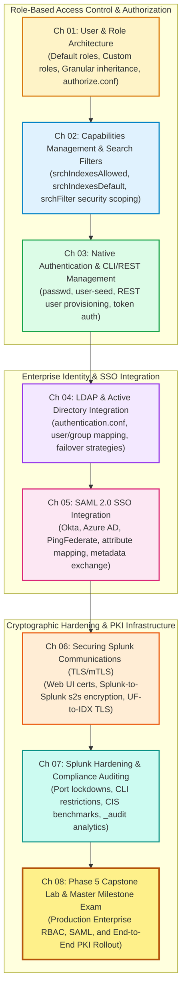

# 📚 Phase 5: Authentication, RBAC & Security Administration — Handbook & TOC

> **The Splunk Administrator's Definitive Handbook** | Phase 5  
> **Target Audience:** Enterprise Splunk Administrators, SOC Lead Engineers & Security Architects  
> **Prerequisites:** Phase 1 (Fundamentals), Phase 2 (Topologies), Phase 3 (Onboarding), Phase 4 (Advanced SPL)  
> **Core Objective:** Master Splunk Enterprise Identity Governance, Role-Based Access Control (RBAC), Granular Index-Level Search Filters (`srchFilter`), LDAP/Active Directory & SAML 2.0 SSO, End-to-End TLS/mTLS Encryption across all tiers, and Hardened Compliance Auditing.

---

## 🎯 Phase 5 Roadmap & Curriculum (Days 39–46)



---

## 📖 Chapter Directory & 🎮 Cyber Range Arena (Phase 5)

| Chapter | Day | Topic Name | Practical Focus | Cyber Range Room (THM / HTB Style) | XP Reward |
| :---: | :---: | :--- | :--- | :--- | :---: |
| **01** | **39** | **User & Role Architecture** | Custom roles, inheritance hierarchies, `authorize.conf`, default roles | [Room P5-01: The RBAC Vault Infiltration](../Labs/Room_P5_01_User_and_Role_Architecture.md) | `250 XP` |
| **02** | **40** | **Capabilities & Search Filters** | `srchIndexesAllowed`, `srchIndexesDefault`, `srchFilter` index row isolation | [Room P5-02: The Search Filter Sandbox Trap](../Labs/Room_P5_02_Capabilities_and_Search_Filters.md) | `250 XP` |
| **03** | **41** | **Native Auth & CLI/REST Mgmt** | `passwd`, `splunk edit user`, REST API `/services/authentication/users` | [Room P5-03: The Admin Shadow Provisioner](../Labs/Room_P5_03_Native_Auth_and_REST_User_Mgmt.md) | `200 XP` |
| **04** | **42** | **LDAP & Active Directory** | `authentication.conf`, AD group-to-role mappings, multi-domain failover | [Room P5-04: Active Directory Forest Synchronization](../Labs/Room_P5_04_LDAP_Active_Directory_Integration.md) | `300 XP` |
| **05** | **43** | **SAML 2.0 SSO Integration** | Okta / Azure AD integration, SP metadata, IdP certificate verification | [Room P5-05: The SAML Identity Federation Breakout](../Labs/Room_P5_05_SAML_SSO_Federation.md) | `300 XP` |
| **06** | **44** | **Securing Splunk (TLS/mTLS)** | Web UI HTTPS, S2S encryption port 9997, UF-to-IDX mutual TLS, CA certs | [Room P5-06: The S2S Man-in-the-Middle Defense](../Labs/Room_P5_06_Securing_Splunk_Communications_TLS.md) | `350 XP` |
| **07** | **45** | **Hardening & Compliance Auditing** | CIS benchmark hardening, port lockdown, CLI access security, `_audit` | [Room P5-07: The Fortress Hardening Audit](../Labs/Room_P5_07_Splunk_Hardening_and_Audit_Forensics.md) | `300 XP` |
| **08** | **46** | **Phase 5 Capstone Lab & Exam** | Enterprise RBAC, SAML, mTLS PKI rollout, 10 Master Milestone Scenarios | [Room P5-Capstone: Enterprise Security Architecture Gauntlet](../Labs/Room_P5_Capstone_Enterprise_Security_Architecture.md) | `500 XP` |

---

## 🏆 Phase 5 Graduation Criteria & Operator Rank

```text
╔══════════════════════════════════════════════════════════════════════════╗
║               PHASE 5 OPERATOR PROMOTION MILESTONES                      ║
╠══════════════════════════════════════════════════════════════════════════╣
║ • Starting Rank:    Master Splunk Architect (6,550 XP)                   ║
║ • Phase 5 Points:   +2,450 XP (8 Cyber Range Rooms + Capstone Exam)      ║
║ • Promotion Target: Splunk Security & Cryptographic Architect (9,000 XP) ║
║ • Certification:    Splunk Certified Enterprise Security Administrator   ║
╚══════════════════════════════════════════════════════════════════════════╝
```
