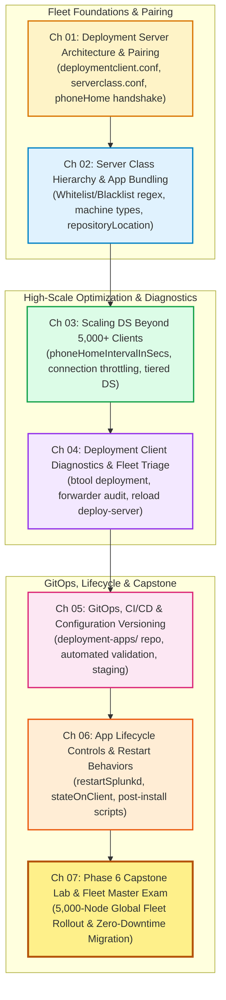

# 📚 Phase 6: Centralized Deployment Management — Handbook & TOC

> **The Splunk Administrator's Definitive Handbook** | Phase 6  
> **Target Audience:** Enterprise Splunk Administrators, Fleet Operations Leads & DevOps Engineers  
> **Prerequisites:** Phase 1 (Fundamentals), Phase 2 (Topologies), Phase 3 (Onboarding), Phase 4 (Advanced SPL), Phase 5 (Authentication & RBAC)  
> **Core Objective:** Master Splunk Enterprise Fleet Automation, Deployment Server (DS) Architecture, `deploymentclient.conf` & `serverclass.conf` Engineering, 10,000+ Client High-Scale Polling Optimization, GitOps App CI/CD, and Seamless Zero-Downtime Fleet Updates.

---

## 🎯 Phase 6 Roadmap & Curriculum (Days 47–53)



---

## 📖 Chapter Directory & 🎮 Cyber Range Arena (Phase 6)

| Chapter | Day | Topic Name | Practical Focus | Cyber Range Room (THM / HTB Style) | XP Reward |
| :---: | :---: | :--- | :--- | :--- | :---: |
| **01** | **47** | **Deployment Server & Pairing** | `deploymentclient.conf`, `targetUri`, `serverclass.conf`, phoneHome handshake | [Room P6-01: The Rogue Forwarder Fleet](../Labs/Room_P6_01_Deployment_Server_and_Pairing.md) | `250 XP` |
| **02** | **48** | **Server Classes & App Bundling** | Granular whitelist/blacklist filters, OS architecture matching, `deployment-apps` | [Room P6-02: Server Class Precision Surgery](../Labs/Room_P6_02_Server_Classes_and_App_Bundles.md) | `250 XP` |
| **03** | **49** | **Scaling DS Beyond 5,000 Clients** | `phoneHomeIntervalInSecs`, TCP socket exhaustion, tiered hierarchical DS | [Room P6-03: The 10,000-Node Thundering Herd](../Labs/Room_P6_03_Scaling_Deployment_Server_High_Volume.md) | `300 XP` |
| **04** | **50** | **Fleet Diagnostics & Triage** | `splunk reload deploy-server`, `_telemetry`, forwarder phoneHome triage | [Room P6-04: Deployment Client Diagnostic Runbook](../Labs/Room_P6_04_Deployment_Client_Diagnostics.md) | `250 XP` |
| **05** | **51** | **GitOps & App CI/CD Pipelines** | Git version control for `deployment-apps/`, automated syntax validation, staging | [Room P6-05: The GitOps App Deployment Pipeline](../Labs/Room_P6_05_GitOps_App_Deployment_Pipeline.md) | `300 XP` |
| **06** | **52** | **App Lifecycle & Restart Controls** | `restartSplunkd`, `stateOnClient = enabled/noop`, post-activation execution | [Room P6-06: Zero-Downtime Fleet Maintenance](../Labs/Room_P6_06_App_Lifecycle_and_Restart_Controls.md) | `250 XP` |
| **07** | **53** | **Phase 6 Capstone Lab & Exam** | 5,000-Node Fleet Deployment, GitOps, tiered DS, 10 Master Milestone Scenarios | [Room P6-Capstone: Global Fleet Orchestration Gauntlet](../Labs/Room_P6_Capstone_Global_Fleet_Orchestration.md) | `500 XP` |

---

## 🏆 Phase 6 Operator Promotion Milestones

```text
╔══════════════════════════════════════════════════════════════════════════╗
║               PHASE 6 OPERATOR PROMOTION MILESTONES                      ║
╠══════════════════════════════════════════════════════════════════════════╣
║ • Starting Rank:    Splunk Security & Cryptographic Architect (9,000 XP) ║
║ • Phase 6 Points:   +2,100 XP (7 Cyber Range Rooms + Capstone Exam)      ║
║ • Promotion Target: Master Enterprise Fleet Orchestrator (11,100 XP)     ║
║ • Certification:    Splunk Certified Deployment Specialist               ║
╚══════════════════════════════════════════════════════════════════════════╝
```
