# 🌐 Phase 7: Distributed Splunk & High-Availability Clusters — Handbook & TOC

> **The Splunk Administrator's Definitive Handbook** | Phase 7  
> **Target Audience:** Principal Splunk Architects, Enterprise Infrastructure Engineers & High-Availability Specialists  
> **Prerequisites:** Phase 1 (Fundamentals), Phase 2 (Topologies), Phase 3 (Onboarding), Phase 4 (Search Optimization), Phase 5 (RBAC & Security), Phase 6 (Deployment Server)  
> **Core Objective:** Master Enterprise Distributed Search, Single-Site & Multi-Site Indexer Clustering, Search Head Clustering (SHC) with Raft Consensus, SmartStore Cloud-Native Tiering, Disaster Recovery Failover, and Zero-Downtime Rolling Upgrades.

---

## 🎯 Phase 7 Roadmap & Curriculum (Days 54–66)

```mermaid
graph TD
    subgraph DistributedCoreTier ["Distributed Search & Indexer Clustering Foundations"]
        C01["Ch 01: Distributed Search & Map-Reduce Engine<br/>(distsearch.conf, Search Head to Peer REST dispatch)"]
        C02["Ch 02: Single-Site Indexer Clustering<br/>(Replication Factor RF=3, Search Factor SF=2, peer replication)"]
        C03["Ch 03: Cluster Manager (CM) Mechanics & Heartbeats<br/>(server.conf [clustering], bucket fixup, maintenance mode)"]
    end

    subgraph MultiSiteDRTier ["Disaster Recovery & Cluster Operations"]
        C04["Ch 04: Multi-Site Indexer Clustering & Site Affinity<br/>(site_replication_factor, site_search_factor, inter-site bandwidth)"]
        C05["Ch 05: Bucket Fixup Tasks & Rolling Restarts<br/>(Searchable rolling restart, generation ID, decommissioning peers)"]
        C06["Ch 06: Indexer Cluster Triage & Failure Recovery<br/>(Fixup backlogs, peer offline, unfulfilled search factor)"]
    end

    subgraph SHCTier ["Search Head Clustering & Cloud SmartStore"]
        C07["Ch 07: Search Head Clustering & Raft Consensus<br/>(Captain election, member synchronization, dynamic failover)"]
        C08["Ch 08: SHC Deployer & Bundle Distribution<br/>(shcluster/apps, bundle push, configuration precedence)"]
        C09["Ch 09: SHC Operations: Dynamic Captaincy & KV Store<br/>(Artifact replication, mongod replica set, KV Store clustering)"]
        C10["Ch 10: SmartStore Cloud-Native Remote Storage<br/>(indexes.conf remotePath, Cache Manager, LRU eviction)"]
    end

    subgraph ResilienceTier ["Enterprise Upgrades, DR & Capstone"]
        C11["Ch 11: Zero-Downtime Rolling Cluster Upgrades<br/>(Searchable rolling upgrades across CM, Indexers, SHs)"]
        C12["Ch 12: Disaster Recovery Site Loss Simulation<br/>(Data center failure, site failover, manual failover override)"]
        C13["Ch 13: Phase 7 Capstone Mega-Lab & Master Exam<br/>(Multi-Site Cluster Deployment, Raft failure, DR failover)"]
    end

    C01 --> C02 --> C03 --> C04 --> C05 --> C06 --> C07 --> C08 --> C09 --> C10 --> C11 --> C12 --> C13

    style C01 fill:#fef3c7,stroke:#d97706,stroke-width:2px
    style C02 fill:#e0f2fe,stroke:#0284c7,stroke-width:2px
    style C03 fill:#dcfce7,stroke:#16a34a,stroke-width:2px
    style C04 fill:#f3e8ff,stroke:#9333ea,stroke-width:2px
    style C05 fill:#fce7f3,stroke:#db2777,stroke-width:2px
    style C06 fill:#ffedd5,stroke:#ea580c,stroke-width:2px
    style C07 fill:#e0e7ff,stroke:#4f46e5,stroke-width:2px
    style C08 fill:#ccfbf1,stroke:#0d9488,stroke-width:2px
    style C09 fill:#fef9c3,stroke:#ca8a04,stroke-width:2px
    style C10 fill:#f1f5f9,stroke:#475569,stroke-width:2px
    style C11 fill:#fce7f3,stroke:#db2777,stroke-width:2px
    style C12 fill:#fee2e2,stroke:#dc2626,stroke-width:2px
    style C13 fill:#fef08a,stroke:#b45309,stroke-width:3px
```



---

## 📖 Chapter Directory & 🎮 Cyber Range Arena (Phase 7)

| Chapter | Day | Topic Name | Practical Focus | Cyber Range Room (THM / HTB Style) | XP Reward |
| :---: | :---: | :--- | :--- | :--- | :---: |
| **01** | **54** | **Distributed Search Topology** | `distsearch.conf`, Search Head to Indexer dispatch, map-reduce, peer latency | [Room P7-01: The Search Head Dispatch Nexus](../Labs/Room_P7_01_Distributed_Search_Topology.md) | `250 XP` |
| **02** | **55** | **Single-Site Indexer Clustering** | Replication Factor ($RF=3$), Search Factor ($SF=2$), primary vs copy bucket states | [Room P7-02: Single-Site Indexer Cluster Forge](../Labs/Room_P7_02_Single_Site_Indexer_Clustering.md) | `250 XP` |
| **03** | **56** | **Cluster Manager (CM) Mechanics** | `server.conf [clustering]`, peer heartbeats, bucket fixup queues, maintenance mode | [Room P7-03: The Cluster Manager Heartbeat Citadel](../Labs/Room_P7_03_Cluster_Manager_Mechanics.md) | `300 XP` |
| **04** | **57** | **Multi-Site Indexer Clustering** | Multi-site DR, `site_replication_factor`, `site_search_factor`, site affinity | [Room P7-04: Multi-Site Disaster Recovery Bridge](../Labs/Room_P7_04_Multi_Site_Indexer_Clustering.md) | `300 XP` |
| **05** | **58** | **Bucket Fixup & Rolling Restarts** | Searchable rolling restart, generation ID, graceful peer decommissioning | [Room P7-05: The Searchable Rolling Restart](../Labs/Room_P7_05_Bucket_Fixup_and_Rolling_Restarts.md) | `250 XP` |
| **06** | **59** | **Indexer Cluster Failure Triage** | Fixup backlog forensics, peer sudden death, unfulfilled search factor triage | [Room P7-06: The Indexer Cluster Breakdown](../Labs/Room_P7_06_Indexer_Cluster_Failure_Triage.md) | `300 XP` |
| **07** | **60** | **Search Head Clustering & Raft** | Raft consensus, Captain election, member synchronization, split-brain defense | [Room P7-07: The Raft Consensus Crucible](../Labs/Room_P7_07_Search_Head_Clustering_Raft.md) | `300 XP` |
| **08** | **61** | **SHC Deployer & Bundle Pushes** | Deployer staging, `shcluster/apps/`, bundle push modes, precedence rules | [Room P7-08: The Deployer Bundle Arsenal](../Labs/Room_P7_08_SHC_Deployer_Bundle_Pushes.md) | `250 XP` |
| **09** | **62** | **SHC Operations & KV Store Sync** | Dynamic captaincy transfer, search artifact replication, KV Store mongod clustering | [Room P7-09: Dynamic Captaincy & KV Store Grid](../Labs/Room_P7_09_SHC_Operations_and_KV_Store.md) | `300 XP` |
| **10** | **63** | **SmartStore Cloud-Native Tiering** | Remote storage (S3/GCS), Cache Manager, LRU eviction, `indexes.conf remotePath` | [Room P7-10: The SmartStore Cloud Vault](../Labs/Room_P7_10_SmartStore_Cloud_Tiering.md) | `350 XP` |
| **11** | **64** | **Zero-Downtime Rolling Upgrades** | Step-by-step rolling enterprise upgrade across CM, Indexers, and Search Heads | [Room P7-11: Zero-Downtime Cluster Upgrade Protocol](../Labs/Room_P7_11_Rolling_Cluster_Upgrades.md) | `300 XP` |
| **12** | **65** | **Disaster Recovery Site Loss Drill** | Catastrophic data center blackout, manual failover, site affinity re-routing | [Room P7-12: Complete Data Center Loss Simulation](../Labs/Room_P7_12_Disaster_Recovery_Site_Loss.md) | `350 XP` |
| **13** | **66** | **Phase 7 Capstone Mega-Lab & Exam** | Full Multi-Site Cluster + SHC + SmartStore Gauntlet (12 Master Scenarios) | [Room P7-Capstone: Multi-Site Cluster & SHC Mega-Lab](../Labs/Room_P7_Capstone_Multi_Site_Cluster_Mega_Lab.md) | `500 XP` |

---

## 🏆 Phase 7 Operator Promotion Milestones

```text
╔══════════════════════════════════════════════════════════════════════════╗
│               PHASE 7 OPERATOR PROMOTION MILESTONES                      │
╠══════════════════════════════════════════════════════════════════════════╣
│ • Starting Rank:    Master Enterprise Fleet Orchestrator (11,100 XP)     │
│ • Phase 7 Points:   +4,000 XP (13 Cyber Range Rooms + Capstone Exam)     │
│ • Promotion Target: Principal High-Availability Cluster Architect        │
│                     (15,100 XP)                                          │
│ • Certification:    Splunk Certified Enterprise Architect                │
╚══════════════════════════════════════════════════════════════════════════╝
```
