# 🎯 Splunk Administrator Cyber Range & Challenge Arena

> **Gamified Hands-On Training Environment** | Inspired by *TryHackMe* & *Hack The Box*  
> **Mission:** Ditch passive theory. Step into realistic enterprise outages, broken topologies, P1 incident triages, and capture administrative flags.  
> **Scoring:** Complete Challenge Tasks, Capture Config Flags (`FLAG{...}`), and Level Up from **Script Kiddie** to **Enterprise Splunk Architect**.

---

## 🏆 Player Profile & Arena Stats

```text
┌────────────────────────────────────────────────────────────────────────┐
│ 👤 OPERATOR: venom                       🎖️ RANK: Splunk Enterprise Arch│
│ 🌟 TOTAL XP: 3,050 / 6,500               🔥 STREAK: Day 16             │
│ 🚩 FLAGS CAPTURED: 33 / 65               📊 PHASES: Phase 1 & 2 Clear │
└────────────────────────────────────────────────────────────────────────┘
```

---

## 🗺️ Master Curriculum: Cyber Range Challenge Roadmap

```mermaid
graph TD
    subgraph "Phase 1: Fundamentals Cyber Range"
        P1_1["🎮 Room P1-01<br/>Machine Data Decoder & Schema-on-Read<br/><b>[150 XP]</b>"]
        P1_2["🎮 Room P1-02<br/>Core Architecture & Component Recon<br/><b>[200 XP]</b>"]
        P1_3["🎮 Room P1-03<br/>4-Stage Pipeline & Backpressure<br/><b>[200 XP]</b>"]
        P1_4["🎮 Room P1-04<br/>Directory Structure & Btool Detective<br/><b>[200 XP]</b>"]
        P1_5["🎮 Room P1-05<br/>Bucket Lifecycle & Cold Storage Thaw<br/><b>[250 XP]</b>"]
        P1_6["🎮 Room P1-06<br/>Licensing Mechanics & Quota Breach<br/><b>[200 XP]</b>"]
        P1_7["🎮 Room P1-07<br/>Port Matrix & Firewall Defense<br/><b>[200 XP]</b>"]
    end

    subgraph "Phase 2: Topology & Cluster Range"
        P2_1["🎮 Room P2-01<br/>Linux Hardening, THP & 1200 IOPS<br/><b>[200 XP]</b>"]
        P2_2["🎮 Room P2-02<br/>Splunk Linux Deployment & Systemd<br/><b>[200 XP]</b>"]
        P2_3["🎮 Room P2-03<br/>UF Fleet Rollout & outputs useACK<br/><b>[200 XP]</b>"]
        P2_4["🎮 Room 01<br/>Heavy Forwarder Port Clash<br/><b>[200 XP]</b>"]
        P2_5["🎮 Room 02<br/>Central License Vault Heist<br/><b>[250 XP]</b>"]
        P2_6["🎮 Room 03<br/>Monitoring Console: Queue Jam Triage<br/><b>[300 XP]</b>"]
    end

    P1_1 --> P1_2 --> P1_3 --> P1_4 --> P1_5 --> P1_6 --> P1_7
    P1_7 --> P2_1 --> P2_2 --> P2_3 --> P2_4 --> P2_5 --> P2_6

    style P1_1 fill:#dcfce7,stroke:#16a34a,stroke-width:2px
    style P1_2 fill:#dcfce7,stroke:#16a34a,stroke-width:2px
    style P1_3 fill:#dcfce7,stroke:#16a34a,stroke-width:2px
    style P1_4 fill:#dcfce7,stroke:#16a34a,stroke-width:2px
    style P1_5 fill:#dcfce7,stroke:#16a34a,stroke-width:2px
    style P1_6 fill:#dcfce7,stroke:#16a34a,stroke-width:2px
    style P1_7 fill:#dcfce7,stroke:#16a34a,stroke-width:2px
    style P2_1 fill:#fef3c7,stroke:#d97706,stroke-width:2px
    style P2_2 fill:#fef3c7,stroke:#d97706,stroke-width:2px
    style P2_3 fill:#fef3c7,stroke:#d97706,stroke-width:2px
    style P2_4 fill:#fef3c7,stroke:#d97706,stroke-width:2px
    style P2_5 fill:#fef3c7,stroke:#d97706,stroke-width:2px
    style P2_6 fill:#fee2e2,stroke:#dc2626,stroke-width:2px
```



---

## 📂 Phase 1 Challenge Rooms (Splunk Fundamentals)

| Room ID | Room Name | Focus Area | Difficulty | Points / XP | Link |
| :---: | :--- | :--- | :---: | :---: | :---: |
| **ROOM P1-01** | **The Machine Data Decoder** | Schema-on-Read, 5 Metadata Keys, `_raw` | 🟢 Easy | `150 XP` | **[Enter Room](./Room_P1_01_Machine_Data_and_Schema_on_Read.md)** |
| **ROOM P1-02** | **Core Architecture & Recon** | UF vs HF, Indexer TSIDX, SH Map-Reduce, Deployer | 🟢 Easy-Med | `200 XP` | **[Enter Room](./Room_P1_02_Core_Architecture_and_Components.md)** |
| **ROOM P1-03** | **4-Stage Pipeline Backpressure** | Input ➔ Parsing ➔ Indexing, Fishbucket, `useACK=true` | 🟡 Medium | `200 XP` | **[Enter Room](./Room_P1_03_Data_Pipeline_and_Backpressure.md)** |
| **ROOM P1-04** | **The Btool Detective** | $SPLUNK_HOME, S-A-A-S Precedence, `btool --debug` | 🟡 Medium | `200 XP` | **[Enter Room](./Room_P1_04_Directory_Structure_and_Btool_Detective.md)** |
| **ROOM P1-05** | **Index Storage & Cold Thawing** | Hot/Warm/Cold/Frozen, `splunk rebuild`, retention | 🟡 Medium | `250 XP` | **[Enter Room](./Room_P1_05_Bucket_Lifecycle_and_Cold_Storage_Thawing.md)** |
| **ROOM P1-06** | **Licensing & Quota Breach** | Uncompressed metering, Free allowances, 5 warnings | 🟡 Medium | `200 XP` | **[Enter Room](./Room_P1_06_Licensing_Mechanics_and_Quota_Breach.md)** |
| **ROOM P1-07** | **Network Port Matrix Defense** | Ports 9997, 8089, 8000, 8191, Netcat Zero-I/O | 🟢 Easy-Med | `200 XP` | **[Enter Room](./Room_P1_07_Ports_Protocols_and_Firewall_Hardening.md)** |

---

## 📂 Phase 2 Challenge Rooms (Enterprise Topology & Ops)

| Room ID | Room Name | Focus Area | Difficulty | Points / XP | Link |
| :---: | :--- | :--- | :---: | :---: | :---: |
| **ROOM P2-01** | **Linux Kernel Hardening & IOPS** | Disable THP via Systemd, ulimits 64k, 1200 IOPS | 🟡 Medium | `200 XP` | **[Enter Room](./Room_P2_01_Linux_Kernel_Tuning_and_1200_IOPS.md)** |
| **ROOM P2-02** | **Production Linux Deployment** | Non-root splunk, user-seed.conf, Systemd boot-start | 🟡 Medium | `200 XP` | **[Enter Room](./Room_P2_02_Splunk_Enterprise_Linux_Deployment_and_Systemd.md)** |
| **ROOM P2-03** | **UF Fleet Rollout & useACK** | Silent rollout, `monitor://`, autoLBFrequency 30s | 🟡 Medium | `200 XP` | **[Enter Room](./Room_P2_03_Universal_Forwarder_Fleet_Deployment_and_ACK.md)** |
| **ROOM 01** | **The Heavy Forwarder Port Clash** | Port 8089 ➔ 8090 offset, `index=false`, PII regex | 🟢 Easy-Med | `200 XP` | **[Enter Room](./Room_01_Heavy_Forwarder_Infiltration_and_Port_Clash.md)** |
| **ROOM 02** | **The Central License Vault Heist** | License Master, `server.conf` pairing, 72h grace | 🟡 Medium | `250 XP` | **[Enter Room](./Room_02_License_Vault_Heist_and_72Hr_Survival.md)** |
| **ROOM 03** | **Monitoring Console: Queue Triage**| Distributed MC, `indexQueue` vs `parsingQueue`, disk chokes | 🔴 Med-Hard | `300 XP` | **[Enter Room](./Room_03_Monitoring_Console_Mission_Control.md)** |
| **ROOM 04** | **HEC Token Security & Cloud Triage**| Port 8088, inputs.conf, Token scoping, `curl`, useACK | 🟡 Medium | `250 XP` | **[Enter Room](./Room_04_HEC_Token_Security_and_JSON_Ingestion.md)** |
| **ROOM P2-CAP**| **The Multi-Tier Boss Arena** | Full 4-Tier Troubleshooting, IOPS, ports, HEC | 🔴 Hard | `400 XP` | **[Enter Room](./Room_P2_Capstone_Boss_Arena.md)** |

---

## 📂 Phase 3 Challenge Rooms (Data Onboarding & Parsing Pipeline)

| Room ID | Room Name | Focus Area | Difficulty | Points / XP | Link |
| :---: | :--- | :--- | :--- | :---: | :---: |
| **ROOM P3-01** | **Fishbucket Forensics & Ingestion** | `inputs.conf`, Wildcards, CRC 256, `btprobe`, Salt | 🟡 Medium | `250 XP` | **[Enter Room](./Room_P3_01_inputs_conf_and_Fishbucket_Forensics.md)** |
| **ROOM P3-02** | **The Sourcetype Taxonomy Surgery** | Standard Taxonomy, syslog split, CIM, `...-too_small` | 🟡 Medium | `200 XP` | **[Enter Room](./Room_P3_02_Sourcetype_Taxonomy.md)** |
| **ROOM P3-03** | **The Event Breaking Surgery** | `LINE_BREAKER`, `TRUNCATE`, `TIME_PREFIX`, `TIME_FORMAT` | 🟡 Medium | `250 XP` | **[Enter Room](./Room_P3_03_Event_Breaking_Surgery.md)** |
| **ROOM P3-04** | **Props & Transforms Battleground** | Tier Distribution Matrix, `TRANSFORMS-` vs `REPORT-` | 🟡 Medium | `250 XP` | **[Enter Room](./Room_P3_04_Props_and_Transforms_Battleground.md)** |
| **ROOM P3-05** | **The NullQueue Trash Chute** | `nullQueue` discard, licensing savings, `_MetaData:Index` | 🟡 Medium | `250 XP` | **[Enter Room](./Room_P3_05_NullQueue_Trash_Chute.md)** |
| **ROOM P3-06** | **PII Redaction Operations** | `SEDCMD`, PCI-DSS card masking, SSN scrubbing, API keys | 🟡 Medium | `250 XP` | **[Enter Room](./Room_P3_06_PII_Redaction_Operations.md)** |
| **ROOM P3-07** | **Search-Time Regex Heist** | `EXTRACT-`, `DELIMS` tokens, `MV_ADD`, `KV_MODE = json` | 🟡 Medium | `250 XP` | **[Enter Room](./Room_P3_07_Search_Time_Regex_Heist.md)** |
| **ROOM P3-08** | **The Calculated Field Alchemist** | `FIELDALIAS-`, `EVAL-` formulas, sourcetype renaming | 🟡 Medium | `200 XP` | **[Enter Room](./Room_P3_08_Calculated_Field_Alchemist.md)** |
| **ROOM P3-09** | **KV Store & Lookup Infiltration** | Automatic CSV Lookups, MongoDB port 8191, `outputlookup` | 🟡 Medium | `250 XP` | **[Enter Room](./Room_P3_09_KV_Store_Lookup_Infiltration.md)** |
| **ROOM P3-10** | **CIM Normalization Arena** | CIM Data Models, Enterprise Security, tags & eventtypes | 🔴 Hard | `300 XP` | **[Enter Room](./Room_P3_10_CIM_Normalization_Arena.md)** |
| **ROOM P3-11** | **Eventtype Tagging Ops** | Boolean filters, `eventtypes.conf`, `tags.conf`, `tag::<field>` | 🟡 Medium | `200 XP` | **[Enter Room](./Room_P3_11_Eventtype_Tagging_Ops.md)** |
| **ROOM P3-12** | **Ingestion Outage Runbook** | Queue bottlenecks, 1970 drift, regex backtrack, `btprobe` | 🔴 Hard | `300 XP` | **[Enter Room](./Room_P3_12_Ingestion_Outage_Runbook.md)** |
| **ROOM P3-CAP**| **The Banking Log Gauntlet** | Full Banking Onboarding, Fishbucket, nullQueue, SEDCMD, CIM | 🔴 Expert | `500 XP` | **[Enter Room](./Room_P3_Capstone_Banking_Log_Gauntlet.md)** |

---

## 📂 Phase 4 Challenge Rooms (Advanced SPL & Search Optimization)

| Room ID | Room Name | Focus Area | Difficulty | Points / XP | Link |
| :---: | :--- | :--- | :--- | :---: | :---: |
| **ROOM P4-01** | **The Search Dispatch Heist** | Fast vs Smart vs Verbose, Dispatch directory, `info.csv`, kill job | 🟢 Easy-Med | `250 XP` | **[Enter Room](./Room_P4_01_Search_Dispatch_and_Modes.md)** |
| **ROOM P4-02** | **Transforming Arena** | `stats`, `chart`, `timechart`, `top`, `rare`, rate normalization | 🟡 Medium | `200 XP` | **[Enter Room](./Room_P4_02_Transforming_Commands_Arena.md)** |
| **ROOM P4-03** | **Multivalue JSON Surgery** | `spath`, nested JSON arrays, `rex max_match`, `mvexpand`, `eval` | 🟡 Medium | `250 XP` | **[Enter Room](./Room_P4_03_Multivalue_JSON_Surgery.md)** |
| **ROOM P4-04** | **The LIS Index Filter Optimization** | `where` vs `search`, `dedup sortby`, `fields +`, `head` vs `tail` | 🟡 Medium | `200 XP` | **[Enter Room](./Room_P4_04_Filtering_and_Dedup_Optimization.md)** |
| **ROOM P4-05** | **Transaction Memory Meltdown** | `transaction` vs `stats`, memory eviction, `join` 50k cap, `union` | 🟡 Medium | `250 XP` | **[Enter Room](./Room_P4_05_Transaction_vs_Stats_Memory_Wars.md)** |
| **ROOM P4-06** | **The Subsearch 10K Ceiling** | Subsearch limits, `format` boolean compiler, dynamic thresholds | 🟡 Medium | `250 XP` | **[Enter Room](./Room_P4_06_Subsearch_Architecture_and_Limits.md)** |
| **ROOM P4-07** | **KV Store High-Speed CRUD** | `inputlookup where`, `outputlookup append=t`, KV Store `_key` | 🟡 Medium | `200 XP` | **[Enter Room](./Room_P4_07_KV_Store_SPL_CRUD.md)** |
| **ROOM P4-08** | **The Summary Index Accelerator** | Report Acceleration, `sitimechart`, `collect`, DMA, 0.4s query | 🔴 Hard | `300 XP` | **[Enter Room](./Room_P4_08_Summary_Indexing_and_Report_Acceleration.md)** |
| **ROOM P4-09** | **The Sub-Second Tstats Gauntlet** | `tstats summariesonly=t`, CIM Data Models, direct `.tsidx` | 🔴 Hard | `300 XP` | **[Enter Room](./Room_P4_09_Tstats_Command_Mastery.md)** |
| **ROOM P4-10** | **Job Inspector Forensics** | LIS ratio, `command.search.kv`, `peers.csv` stragglers, 8 Golden Rules | 🔴 Hard | `300 XP` | **[Enter Room](./Room_P4_10_Job_Inspector_Diagnostics.md)** |
| **ROOM P4-CAP**| **Query Optimization Gauntlet** | Full SPL refactor, Fast Mode, multi-index stats, KV Store, `tstats` | 🔴 Expert | `500 XP` | **[Enter Room](./Room_P4_Capstone_Enterprise_Query_Optimization.md)** |

---

## 📂 Phase 5 Challenge Rooms (Authentication, RBAC & Security Admin)

| Room ID | Room Name | Focus Area | Difficulty | Points / XP | Link |
| :---: | :--- | :--- | :--- | :--- | :---: |
| **ROOM P5-01** | **The RBAC Vault Infiltration** | Custom roles, inheritance hierarchies, `authorize.conf`, quotas | 🟢 Easy-Med | `250 XP` | **[Enter Room](./Room_P5_01_User_and_Role_Architecture.md)** |
| **ROOM P5-02** | **The Search Filter Sandbox Trap** | `srchIndexesAllowed`, `srchIndexesDefault`, `srchFilter` OR-bypass | 🟡 Medium | `250 XP` | **[Enter Room](./Room_P5_02_Capabilities_and_Search_Filters.md)** |
| **ROOM P5-03** | **The Admin Shadow Provisioner** | `etc/passwd`, CLI user admin, `[password_rules]`, `tokens.conf` JWT | 🟡 Medium | `200 XP` | **[Enter Room](./Room_P5_03_Native_Auth_and_REST_User_Mgmt.md)** |
| **ROOM P5-04** | **Active Directory Forest Sync** | `authentication.conf`, LDAPS port 636, group mapping, referrals | 🔴 Hard | `300 XP` | **[Enter Room](./Room_P5_04_LDAP_Active_Directory_Integration.md)** |
| **ROOM P5-05** | **SAML Identity Breakout** | SAML 2.0, Okta SSO, Claims URI mapping, `idpCertPath`, time skew | 🔴 Hard | `300 XP` | **[Enter Room](./Room_P5_05_SAML_SSO_Federation.md)** |
| **ROOM P5-06** | **The S2S MITM Defense** | Mutual TLS (mTLS), S2S port 9997, `requireClientCert`, PKI chains | 🔴 Hard | `350 XP` | **[Enter Room](./Room_P5_06_Securing_Splunk_Communications_TLS.md)** |
| **ROOM P5-07** | **The Fortress Hardening Audit** | CIS hardening, non-root `splunk`, `startwebserver=0`, `_audit` query | 🔴 Hard | `300 XP` | **[Enter Room](./Room_P5_07_Splunk_Hardening_and_Audit_Forensics.md)** |
| **ROOM P5-CAP** | **Security Architecture Gauntlet** | Enterprise RBAC, SAML SSO, S2S mTLS 9997, CIS Hardening, Boss | 🔴 Expert | `500 XP` | **[Enter Room](./Room_P5_Capstone_Enterprise_Security_Architecture.md)** |

---

## 📂 Phase 6 Challenge Rooms (Centralized Deployment Management)

| Room ID | Room Name | Focus Area | Difficulty | Points / XP | Link |
| :---: | :--- | :--- | :--- | :--- | :---: |
| **ROOM P6-01** | **The Rogue Forwarder Fleet** | `deploymentclient.conf`, `targetUri`, `serverclass.conf`, reload | 🟢 Easy-Med | `250 XP` | **[Enter Room](./Room_P6_01_Deployment_Server_and_Pairing.md)** |
| **ROOM P6-02** | **Server Class Precision Surgery** | `serverclass.conf`, `whitelist.<n>` sequencing, `machineTypesFilter` | 🟡 Medium | `250 XP` | **[Enter Room](./Room_P6_02_Server_Classes_and_App_Bundles.md)** |
| **ROOM P6-03** | **The 10,000-Node Thundering Herd**| `phoneHomeIntervalInSecs = 900`, request rate math, ulimits 65535 | 🔴 Hard | `300 XP` | **[Enter Room](./Room_P6_03_Scaling_Deployment_Server_High_Volume.md)** |
| **ROOM P6-04** | **Deployment Client Diagnostics**  | `splunk list deploy-clients`, GUID collisions, targeted reload | 🟡 Medium | `250 XP` | **[Enter Room](./Room_P6_04_Deployment_Client_Diagnostics.md)** |
| **ROOM P6-05** | **The GitOps App Pipeline**        | GitOps versioning, `ksconf check/sort`, AppInspect CLI | 🔴 Hard   | `300 XP` | **[Enter Room](./Room_P6_05_GitOps_App_Deployment_Pipeline.md)** |
| **ROOM P6-06** | **Zero-Downtime Fleet Maintenance**| `restartSplunkd`, `stateOnClient` (enabled/noop), de-provisioning | 🟡 Medium | `250 XP` | **[Enter Room](./Room_P6_06_App_Lifecycle_and_Restart_Controls.md)** |
| **ROOM P6-CAP** | **Global Fleet Orchestration Gauntlet** | 10k-node architecture, GitOps CI/CD, tiered DS, Master Exam | 🔴 Expert | `500 XP` | **[Enter Room](./Room_P6_Capstone_Global_Fleet_Orchestration.md)** |

---

## 📂 Phase 7 Challenge Rooms (Distributed Splunk & High-Availability Clusters)

| Room ID | Room Name | Focus Area | Difficulty | Points / XP | Link |
| :---: | :--- | :--- | :--- | :--- | :---: |
| **ROOM P7-01** | **The Search Head Dispatch Nexus** | `distsearch.conf`, bundle bloat triage, peer quarantine recovery | 🟡 Medium | `250 XP` | **[Enter Room](./Room_P7_01_Distributed_Search_Topology.md)** |
| **ROOM P7-02** | **Single-Site Indexer Cluster Forge**| Cluster Manager, $RF=3$, $SF=2$, port 9887, primary failover | 🟡 Medium | `250 XP` | **[Enter Room](./Room_P7_02_Single_Site_Indexer_Clustering.md)** |

---

## 🎮 How to Play the Challenge Rooms

1. **🚨 Incident Brief:** Every room starts with a simulated production outage, emergency ticket, or enterprise migration requirement.
2. **🛠️ Interactive Lab Target:** You are provided with the target IPs, configuration paths (`/opt/splunk/etc/...`), and active ports.
3. **🎯 Tasks & Flags:**
   - Execute CLI commands, inspect configuration stanzas, and debug broken topologies.
   - Answer challenge questions or capture flags (`FLAG{...}`).
   - Earn XP and level up your production credentials.
4. **💡 Hints & Solutions:** Each question has interactive spoiler tags for hints when you're stuck, plus full solution walkthroughs.
