# 🎯 Splunk Administrator Cyber Range & Challenge Arena

> **Gamified Hands-On Training Environment** | Inspired by *TryHackMe* & *Hack The Box*  
> **Mission:** Ditch passive theory. Step into realistic enterprise outages, broken topologies, P1 incident triages, and capture administrative flags.  
> **Scoring:** Complete Challenge Tasks, Capture Config Flags (`FLAG{...}`), and Level Up from **Script Kiddie** to **Enterprise Splunk Architect**.

---

## 🏆 Player Profile & Arena Stats

```text
┌────────────────────────────────────────────────────────────────────────┐
│ 👤 OPERATOR: venom                       🎖️ RANK: Splunk SysAdmin      │
│ 🌟 TOTAL XP: 2,350 / 5,000               🔥 STREAK: Day 12             │
│ 🚩 FLAGS CAPTURED: 24 / 52               📊 PHASES: Phase 1 & Phase 2 │
└────────────────────────────────────────────────────────────────────────┘
```

---

## 🗺️ Master Curriculum: Cyber Range Challenge Roadmap

```mermaid
graph TD
    subgraph "Phase 1: Fundamentals Cyber Range"
        P1_1["🎮 Room P1-01<br/>Machine Data Decoder & Schema-on-Read<br/><b>[150 XP]</b>"]
        P1_2["🎮 Room P1-02<br/>Core Architecture & Component Recon<br/><b>[200 XP]</b>"]
        P1_3["🎮 Room P1-03<br/>4-Stage Pipeline & Backpressure<br/><b>[200 XP]</b>"]
        P1_4["🎮 Room P1-04<br/>Directory Structure & Btool Detective<br/><b>[200 XP]</b>"]
        P1_5["🎮 Room P1-05<br/>Bucket Lifecycle & Cold Storage Thaw<br/><b>[250 XP]</b>"]
        P1_6["🎮 Room P1-06<br/>Licensing Mechanics & Quota Breach<br/><b>[200 XP]</b>"]
        P1_7["🎮 Room P1-07<br/>Port Matrix & Firewall Defense<br/><b>[200 XP]</b>"]
    end

    subgraph "Phase 2: Topology & Cluster Range"
        P2_1["🎮 Room P2-01<br/>Linux Hardening, THP & 1200 IOPS<br/><b>[200 XP]</b>"]
        P2_2["🎮 Room P2-02<br/>Splunk Linux Deployment & Systemd<br/><b>[200 XP]</b>"]
        P2_3["🎮 Room P2-03<br/>UF Fleet Rollout & outputs useACK<br/><b>[200 XP]</b>"]
        P2_4["🎮 Room 01<br/>Heavy Forwarder Port Clash<br/><b>[200 XP]</b>"]
        P2_5["🎮 Room 02<br/>Central License Vault Heist<br/><b>[250 XP]</b>"]
        P2_6["🎮 Room 03<br/>Monitoring Console: Queue Jam Triage<br/><b>[300 XP]</b>"]
    end

    P1_1 --> P1_2 --> P1_3 --> P1_4 --> P1_5 --> P1_6 --> P1_7
    P1_7 --> P2_1 --> P2_2 --> P2_3 --> P2_4 --> P2_5 --> P2_6

    style P1_1 fill:#dcfce7,stroke:#16a34a,stroke-width:2px
    style P1_2 fill:#dcfce7,stroke:#16a34a,stroke-width:2px
    style P1_3 fill:#dcfce7,stroke:#16a34a,stroke-width:2px
    style P1_4 fill:#dcfce7,stroke:#16a34a,stroke-width:2px
    style P1_5 fill:#dcfce7,stroke:#16a34a,stroke-width:2px
    style P1_6 fill:#dcfce7,stroke:#16a34a,stroke-width:2px
    style P1_7 fill:#dcfce7,stroke:#16a34a,stroke-width:2px
    style P2_1 fill:#fef3c7,stroke:#d97706,stroke-width:2px
    style P2_2 fill:#fef3c7,stroke:#d97706,stroke-width:2px
    style P2_3 fill:#fef3c7,stroke:#d97706,stroke-width:2px
    style P2_4 fill:#fef3c7,stroke:#d97706,stroke-width:2px
    style P2_5 fill:#fef3c7,stroke:#d97706,stroke-width:2px
    style P2_6 fill:#fee2e2,stroke:#dc2626,stroke-width:2px
```



---

## 📂 Phase 1 Challenge Rooms (Splunk Fundamentals)

| Room ID | Room Name | Focus Area | Difficulty | Points / XP | Link |
| :---: | :--- | :--- | :---: | :---: | :---: |
| **ROOM P1-01** | **The Machine Data Decoder** | Schema-on-Read, 5 Metadata Keys, `_raw` | 🟢 Easy | `150 XP` | **[Enter Room](./Room_P1_01_Machine_Data_and_Schema_on_Read.md)** |
| **ROOM P1-02** | **Core Architecture & Recon** | UF vs HF, Indexer TSIDX, SH Map-Reduce, Deployer | 🟢 Easy-Med | `200 XP` | **[Enter Room](./Room_P1_02_Core_Architecture_and_Components.md)** |
| **ROOM P1-03** | **4-Stage Pipeline Backpressure** | Input ➔ Parsing ➔ Indexing, Fishbucket, `useACK=true` | 🟡 Medium | `200 XP` | **[Enter Room](./Room_P1_03_Data_Pipeline_and_Backpressure.md)** |
| **ROOM P1-04** | **The Btool Detective** | $SPLUNK_HOME, S-A-A-S Precedence, `btool --debug` | 🟡 Medium | `200 XP` | **[Enter Room](./Room_P1_04_Directory_Structure_and_Btool_Detective.md)** |
| **ROOM P1-05** | **Index Storage & Cold Thawing** | Hot/Warm/Cold/Frozen, `splunk rebuild`, retention | 🟡 Medium | `250 XP` | **[Enter Room](./Room_P1_05_Bucket_Lifecycle_and_Cold_Storage_Thawing.md)** |
| **ROOM P1-06** | **Licensing & Quota Breach** | Uncompressed metering, Free allowances, 5 warnings | 🟡 Medium | `200 XP` | **[Enter Room](./Room_P1_06_Licensing_Mechanics_and_Quota_Breach.md)** |
| **ROOM P1-07** | **Network Port Matrix Defense** | Ports 9997, 8089, 8000, 8191, Netcat Zero-I/O | 🟢 Easy-Med | `200 XP` | **[Enter Room](./Room_P1_07_Ports_Protocols_and_Firewall_Hardening.md)** |

---

## 📂 Phase 2 Challenge Rooms (Enterprise Topology & Ops)

| Room ID | Room Name | Focus Area | Difficulty | Points / XP | Link |
| :---: | :--- | :--- | :---: | :---: | :---: |
| **ROOM P2-01** | **Linux Kernel Hardening & IOPS** | Disable THP via Systemd, ulimits 64k, 1200 IOPS | 🟡 Medium | `200 XP` | **[Enter Room](./Room_P2_01_Linux_Kernel_Tuning_and_1200_IOPS.md)** |
| **ROOM P2-02** | **Production Linux Deployment** | Non-root splunk, user-seed.conf, Systemd boot-start | 🟡 Medium | `200 XP` | **[Enter Room](./Room_P2_02_Splunk_Enterprise_Linux_Deployment_and_Systemd.md)** |
| **ROOM P2-03** | **UF Fleet Rollout & useACK** | Silent rollout, `monitor://`, autoLBFrequency 30s | 🟡 Medium | `200 XP` | **[Enter Room](./Room_P2_03_Universal_Forwarder_Fleet_Deployment_and_ACK.md)** |
| **ROOM 01** | **The Heavy Forwarder Port Clash** | Port 8089 ➔ 8090 offset, `index=false`, PII regex | 🟢 Easy-Med | `200 XP` | **[Enter Room](./Room_01_Heavy_Forwarder_Infiltration_and_Port_Clash.md)** |
| **ROOM 02** | **The Central License Vault Heist** | License Master, `server.conf` pairing, 72h grace | 🟡 Medium | `250 XP` | **[Enter Room](./Room_02_License_Vault_Heist_and_72Hr_Survival.md)** |
| **ROOM 03** | **Monitoring Console: Queue Triage**| Distributed MC, `indexQueue` vs `parsingQueue`, disk chokes | 🔴 Med-Hard | `300 XP` | **[Enter Room](./Room_03_Monitoring_Console_Mission_Control.md)** |

---

## 🎮 How to Play the Challenge Rooms

1. **🚨 Incident Brief:** Every room starts with a simulated production outage, emergency ticket, or enterprise migration requirement.
2. **🛠️ Interactive Lab Target:** You are provided with the target IPs, configuration paths (`/opt/splunk/etc/...`), and active ports.
3. **🎯 Tasks & Flags:**
   - Execute CLI commands, inspect configuration stanzas, and debug broken topologies.
   - Answer challenge questions or capture flags (`FLAG{...}`).
   - Earn XP and level up your production credentials.
4. **💡 Hints & Solutions:** Each question has interactive spoiler tags for hints when you're stuck, plus full solution walkthroughs.
