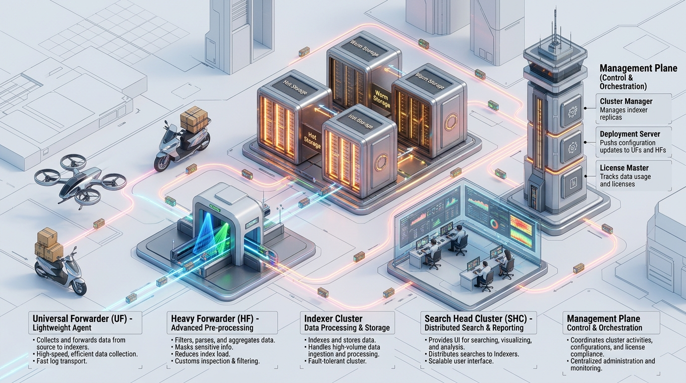
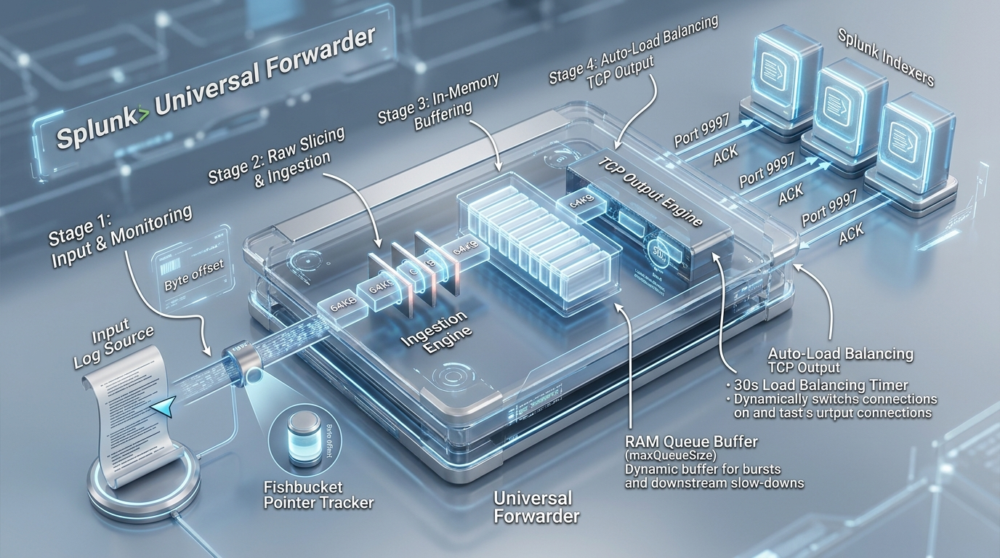
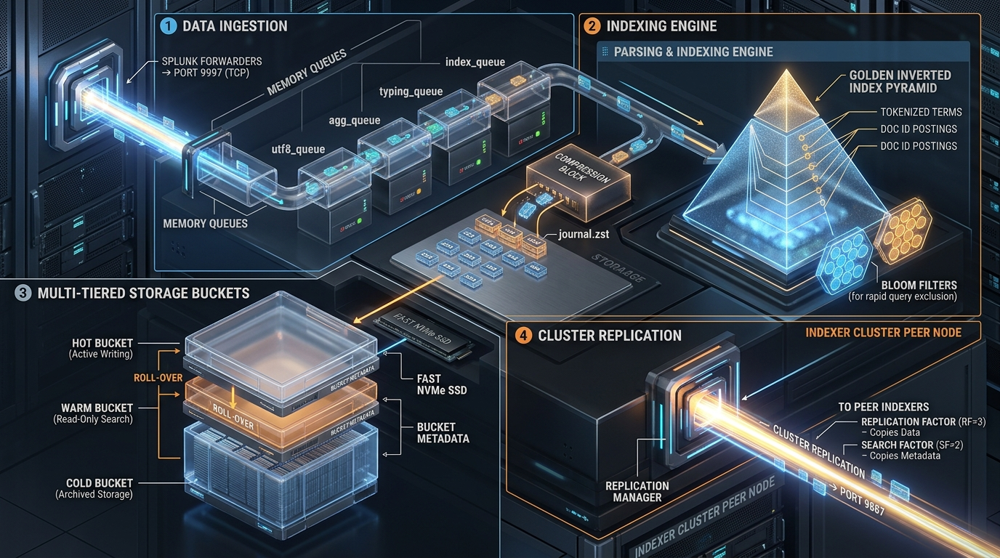
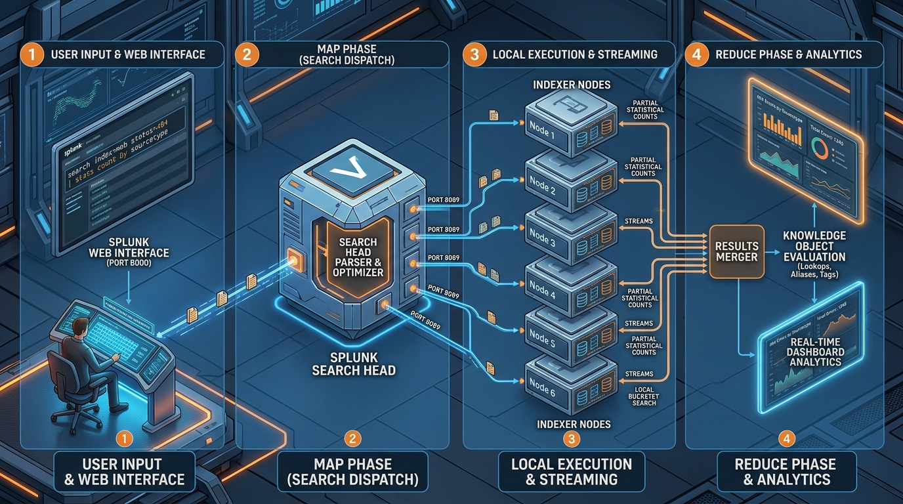
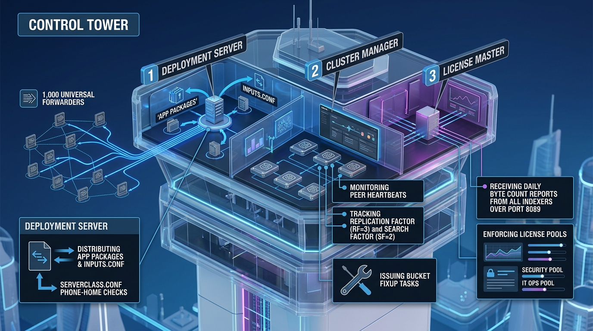

# 🎮 Room P1-02: Core Architecture & Component Recon

```text
┌────────────────────────────────────────────────────────────────────────┐
│ 🏷️ ROOM: Core Architecture & Recon        ⭐ DIFFICULTY: Easy-Medium   │
│ 🎯 TOPIC: UF, HF, Indexer, Search Head    💎 REWARD: 200 XP            │
│ ⏱️ ESTIMATED TIME: 30 Mins                🛡️ CATEGORY: Architecture   │
└────────────────────────────────────────────────────────────────────────┘
```

> **Briefing Room:** The Architecture Audit Mission!  
> You have been dispatched to a Fortune 500 company whose Splunk deployment has ground to a halt.  
> The previous administrator installed all roles on a single VM, ran search-time queries on forwarders, and tried to install heavy add-ons on Universal Forwarders.  
> Your mission is to perform architectural reconnaissance, map out the 3 functional tiers (Collection, Indexing, Search), identify illegal component configurations, and separate the management plane!

---

## 🗺️ Mission Architecture & Component Breakdown


*Figure 2.1: 3D Isometric View of the Core Component Ecosystem (Collection ➔ Indexing ➔ Search ➔ Management)*

```text
┌──────────────────────────────────────────────────────────────────────────────┐
│ 🖥️ ENTERPRISE TIER SPECIFICATIONS                                           │
├──────────────────────────────────────────────────────────────────────────────┤
│ • Tier 1: Collection Tier ➔ Universal Forwarders (UF) & Heavy Forwarders (HF)│
│ • Tier 2: Indexing Tier   ➔ Peer Indexers (Hot/Warm/Cold TSIDX Stores)       │
│ • Tier 3: Search Tier     ➔ Search Heads (Map-Reduce Dispatch & UI)         │
│ • Tier 4: Management Tier ➔ Deployment Server, Cluster Mgr, License Master   │
└──────────────────────────────────────────────────────────────────────────────┘
```

---

## 🎯 TASK 1: Universal Forwarder (UF) vs Heavy Forwarder (HF) Recon (50 XP)


*Figure 2.2: Universal Forwarder Internals (64KB Slicing & Fishbucket Pointer)*

### 📖 Technical Recon
A Junior Admin claims: *"Let's install Universal Forwarders everywhere and use them to mask sensitive customer credit cards with regex before sending to indexers."*

---

### ❓ Challenge Questions — Task 1

#### Question 1.1
Why will the Junior Admin's plan fail on Universal Forwarders?  
- [A] The Universal Forwarder only works on Windows.
- [B] The Universal Forwarder does NOT contain the Python engine or the parsing pipeline; it cannot perform in-memory regex masking.
- [C] The Universal Forwarder can only forward data to one Indexer.
- [D] The Universal Forwarder requires an enterprise license key.

<details>
<summary>💡 Need a Hint?</summary>
Look at Figure 2.2. What binaries are stripped out of the UF to keep its memory footprint under 50MB?
</details>

<details>
<summary>🔓 Solution Walkthrough</summary>
<b>Answer:</b> [B] UFs are lightweight C/C++ binaries without Python or parsing pipeline libraries. Complex parsing, regex masking, and modular inputs require a Heavy Forwarder (HF).
</details>

**🚩 Capture the Flag 1.1:**
```text
FLAG{UF_LIGHTWEIGHT_NO_PARSING_ENGINE}
```

---

## 🎯 TASK 2: The Indexer & TSIDX Inverted Index (50 XP)


*Figure 2.3: Indexer Internals (Raw Data Journals & TSIDX Lexicon Trees)*

### 📖 Technical Recon
The Indexer performs two critical duties:
1. Compresses raw data into compressed `.gz` journal slices (`journal.zst` or `journal.gz`).
2. Builds an inverted index dictionary called **`TSIDX`** (Time Series Index) that maps keywords to exact disk offset pointers.

---

### ❓ Challenge Questions — Task 2

#### Question 2.1
What file extension does Splunk use for its time-series inverted index files that enable lightning-fast keyword searches?  
*(Answer Format: .****)*

<details>
<summary>💡 Need a Hint?</summary>
Time Series Index = TS...
</details>

<details>
<summary>🔓 Solution Walkthrough</summary>
<b>Answer:</b> <code>.tsidx</code><br/>
TSIDX files contain the lexicon and posting lists that allow searches to locate terms without scanning raw text sequentially.
</details>

**🚩 Capture the Flag 2.1:**
```text
FLAG{TSIDX_INVERTED_INDEX_LEXICON}
```

---

## 🎯 TASK 3: Search Head Map-Reduce Dispatch (50 XP)


*Figure 2.4: Search Head Map-Reduce Architecture*

### 📖 Technical Recon
When an analyst types a search query like:
```spl
index=security status=failed | stats count by user
```
The Search Head does NOT pull 50 million raw events across the network. It splits the query into two phases:
1. **Map Phase (Transforming):** Search Head sends the query to all Indexers. Each Indexer runs `stats count by user` locally against its own TSIDX files and hot/warm buckets.
2. **Reduce Phase (Consolidation):** Indexers return only the summarized count tables back to the Search Head. The Search Head merges the sums and presents the final table.

---

### ❓ Challenge Questions — Task 3

#### Question 3.1
What distributed computing paradigm does Splunk use to delegate search processing down to Indexers and aggregate results on the Search Head?  
*(Answer Format: ***-******)*

<details>
<summary>💡 Need a Hint?</summary>
Google popularized this programming model for big data processing (Map and ...).
</details>

<details>
<summary>🔓 Solution Walkthrough</summary>
<b>Answer:</b> <code>Map-Reduce</code><br/>
Splunk dispatches the search request (Map) to peer indexers, and consolidates the intermediate sub-results (Reduce) on the Search Head.
</details>

**🚩 Capture the Flag 3.1:**
```text
FLAG{MAP_REDUCE_DISTRIBUTED_SEARCH}
```

---

## 🎯 TASK 4: Management Plane Recon (50 XP)


*Figure 2.5: Management Plane Components (DS, CM, Deployer, LM, MC)*

### 📖 Technical Recon
Match the central management component to its primary duty:
1. **Deployment Server (DS):** Pushes apps and configurations to forwarders.
2. **Cluster Manager (CM):** Coordinates bucket replication (RF/SF) across Indexer Clusters.
3. **Deployer:** Pushes apps and configurations to Search Head Clusters (SHC).
4. **License Master (LM):** Tracks daily volume and enforces enterprise quotas.

---

### ❓ Challenge Questions — Task 4

#### Question 4.1
Which management component distributes apps and configuration baselines to **Search Head Cluster (SHC) members**?  
- [A] Deployment Server
- [B] Deployer
- [C] Heavy Forwarder
- [D] Universal Forwarder

<details>
<summary>💡 Need a Hint?</summary>
Do not confuse the Deployment Server (used for forwarders) with the tool dedicated to Search Head Clusters!
</details>

<details>
<summary>🔓 Solution Walkthrough</summary>
<b>Answer:</b> [B] Deployer. The Deployer is specifically used to push non-replicated apps and configs to Search Head Cluster members using <code>splunk apply shcluster-bundle</code>.
</details>

**🚩 Capture the Flag 4.1:**
```text
FLAG{DEPLOYER_SHC_BUNDLE_MANAGER}
```

---

## 🏆 Room P1-02 Completion Summary

```text
┌────────────────────────────────────────────────────────────────────────┐
│ 🎉 CONGRATULATIONS, OPERATOR! ROOM P1-02 COMPLETE                      │
├────────────────────────────────────────────────────────────────────────┤
│ • Total XP Earned: 200 / 200 XP                                        │
│ • Flags Captured: 4 / 4                                                │
│ • Skills Verified: UF vs HF Capabilities, TSIDX Inverted Index,       │
│   Search Head Map-Reduce, Deployer vs Deployment Server Roles          │
│                                                                        │
│ ➡️ NEXT ROOM: Room P1-03 — The 4-Stage Pipeline Backpressure Simulator │
└────────────────────────────────────────────────────────────────────────┘
```
