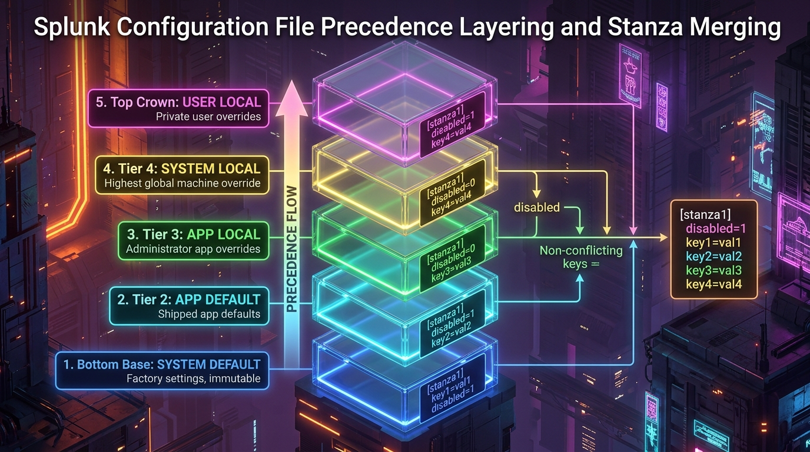

# 🎮 Room P1-04: Directory Structure & The Btool Detective

```text
┌────────────────────────────────────────────────────────────────────────┐
│ 🏷️ ROOM: The Btool Detective              ⭐ DIFFICULTY: Medium        │
│ 🎯 TOPIC: $SPLUNK_HOME, Precedence & Btool💎 REWARD: 200 XP            │
│ ⏱️ ESTIMATED TIME: 30 Mins                🛡️ CATEGORY: Configuration   │
└────────────────────────────────────────────────────────────────────────┘
```

> **Briefing Room:** The Mystery of the Overwritten Settings!  
> At 16:45 PM, a developer pushed a new technology add-on to the Indexer.  
> Suddenly, custom sourcetypes stopped parsing, timestamps shifted back 5 hours, and index routing failed!  
> The developer insists: *"I configured props.conf inside `/opt/splunk/etc/apps/my_app/local/props.conf`—why is Splunk ignoring my settings?!"*  
> As the enterprise administrator, you must grab your configuration magnifying glass: **`splunk btool`**.  
> Your mission is to master the **S-A-A-S Configuration Precedence Stack**, locate rogue files across `$SPLUNK_HOME/etc`, and solve the collision!

---

## 🗺️ Mission Architecture & Precedence Hierarchy


*Figure 4.1: Splunk Filesystem Hierarchy (`$SPLUNK_HOME/etc` Acrylic Server Rack)*


*Figure 4.2: The Configuration Layering & Merging Precedence Stack*

```text
┌──────────────────────────────────────────────────────────────────────────────┐
│ 🏆 THE S-A-A-S PRECEDENCE HIERARCHY (Global Context)                         │
├──────────────────────────────────────────────────────────────────────────────┤
│ 1. [HIGHEST] System Local   ➔ $SPLUNK_HOME/etc/system/local/                 │
│ 2.           App Local      ➔ $SPLUNK_HOME/etc/apps/<app_name>/local/        │
│ 3.           App Default    ➔ $SPLUNK_HOME/etc/apps/<app_name>/default/      │
│ 4. [LOWEST]  System Default ➔ $SPLUNK_HOME/etc/system/default/              │
└──────────────────────────────────────────────────────────────────────────────┘
```

---

## 🎯 TASK 1: The Golden Rule of Splunk Configuration (40 XP)

### 📖 Scenario Context
You open `/opt/splunk/etc/system/default/inputs.conf` and see a junior admin attempting to change settings directly in that file!

---

### ❓ Challenge Questions — Task 1

#### Question 1.1
Why is it strictly forbidden to edit configuration files inside any `default/` directory in Splunk?  
- [A] The files are read-only and encrypted.
- [B] Any Splunk software upgrade or app update will completely overwrite and wipe all `default/` files.
- [C] Editing `default/` deletes user passwords.
- [D] `default/` files are ignored by Splunk.

<details>
<summary>💡 Need a Hint?</summary>
What happens during a version upgrade (e.g. 9.1 to 9.2)?
</details>

<details>
<summary>🔓 Solution Walkthrough</summary>
<b>Answer:</b> [B] Software upgrades overwrite the entire <code>default/</code> directory. Custom settings must ALWAYS reside in a <code>local/</code> directory or a custom app.
</details>

**🚩 Capture the Flag 1.1:**
```text
FLAG{NEVER_TOUCH_DEFAULT_DIRECTORIES}
```

---

## 🎯 TASK 2: Master the S-A-A-S Hierarchy (50 XP)

### 📖 Scenario Context
A setting for `TIME_FORMAT` is defined in three different places on the filesystem:
1. File A: `/opt/splunk/etc/system/default/props.conf` ➔ `TIME_FORMAT = %Y-%m-%d`
2. File B: `/opt/splunk/etc/apps/Splunk_TA_nix/local/props.conf` ➔ `TIME_FORMAT = %d-%b-%Y`
3. File C: `/opt/splunk/etc/system/local/props.conf` ➔ `TIME_FORMAT = %s`

---

### ❓ Challenge Questions — Task 2

#### Question 2.1
According to the S-A-A-S rule, which file wins and dictates the active `TIME_FORMAT` in runtime?  
*(Choose the winning file)*
- [A] File A (System Default)
- [B] File B (App Local)
- [C] File C (System Local)

<details>
<summary>💡 Need a Hint?</summary>
Which directory sits at the very top of the S-A-A-S hierarchy?
</details>

<details>
<summary>🔓 Solution Walkthrough</summary>
<b>Answer:</b> [C] File C (System Local). <code>/etc/system/local</code> has the highest precedence in global context and overrides all app-level and default configurations.
</details>

**🚩 Capture the Flag 2.1:**
```text
FLAG{SYSTEM_LOCAL_TRUMPS_ALL_GLOBAL}
```

---

## 🎯 TASK 3: The `splunk btool` X-Ray Command (60 XP)


*Figure 4.3: Splunk Btool Command Mechanics (X-Ray Inspector)*

### 📖 Technical Recon
Never guess which configuration file is winning. Splunk provides the **`btool`** utility to inspect the exact merged in-memory configuration.

```bash
# View active merged props.conf
sudo /opt/splunk/bin/splunk btool props list --debug

# Check for syntax errors and typos across all conf files
sudo /opt/splunk/bin/splunk btool check
```

The `--debug` flag is the administrator's superpower: it prints the active setting **and the exact file path where it originated**!

---

### ❓ Challenge Questions — Task 3

#### Question 3.1
Which `btool` argument reveals the exact filesystem path of the configuration file where each active setting originated?  
*(Answer Format: --*****)*

<details>
<summary>💡 Need a Hint?</summary>
It starts with `--d` and has 5 letters.
</details>

<details>
<summary>🔓 Solution Walkthrough</summary>
<b>Flag:</b> <code>--debug</code><br/>
Command: <code>splunk btool &lt;conf_name&gt; list --debug</code><br/>
Example output: <code>/opt/splunk/etc/system/local/server.conf  [general] mgmtHostPort = 8090</code>
</details>

**🚩 Capture the Flag 3.1:**
```text
FLAG{BTOOL_DEBUG_ORIGIN_LOCATOR}
```

#### Question 3.2
Which `btool` command is executed to scan all configuration files across `$SPLUNK_HOME/etc` for syntax typos, invalid stanza names, and unrecognized parameters?  
*(Answer Format: `splunk btool *****`)*

<details>
<summary>💡 Need a Hint?</summary>
A 5-letter verb meaning to inspect or verify.
</details>

<details>
<summary>🔓 Solution Walkthrough</summary>
<b>Command:</b> <code>splunk btool check</code><br/>
This identifies orphaned lines, malformed brackets, and invalid stanza declarations before restarting the daemon.
</details>

**🚩 Capture the Flag 3.2:**
```text
FLAG{BTOOL_CHECK_SYNTAX_VERIFIER}
```

---

## 🏆 Room P1-04 Completion Summary

```text
┌────────────────────────────────────────────────────────────────────────┐
│ 🎉 CONGRATULATIONS, OPERATOR! ROOM P1-04 COMPLETE                      │
├────────────────────────────────────────────────────────────────────────┤
│ • Total XP Earned: 200 / 200 XP                                        │
│ • Flags Captured: 4 / 4                                                │
│ • Skills Verified: Golden Rule of local/ vs default/, S-A-A-S Hierarchy│
│   splunk btool --debug inspection, splunk btool check syntax triage    │
│                                                                        │
│ ➡️ NEXT ROOM: Room P1-05 — Index Bucket Lifecycle & Storage Thawing   │
└────────────────────────────────────────────────────────────────────────┘
```
