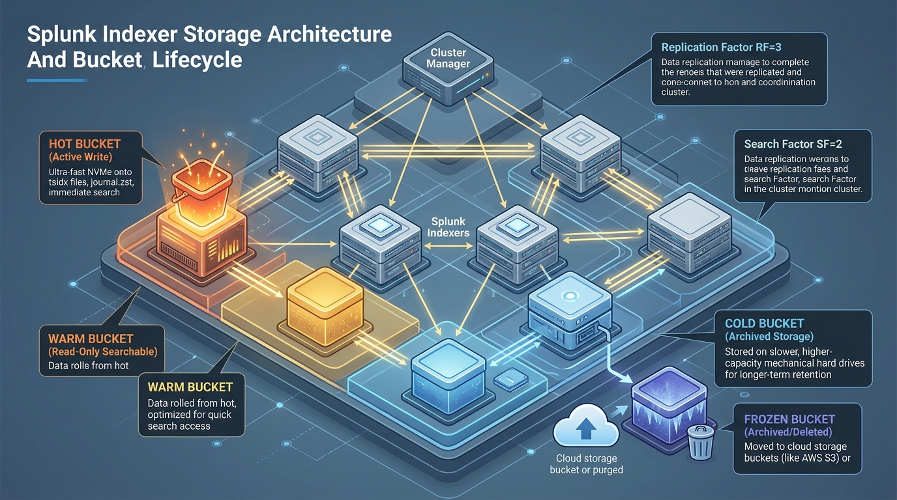

# 🎮 Room P1-05: Index Storage & The Cold Storage Thawing Operation

```text
┌────────────────────────────────────────────────────────────────────────┐
│ 🏷️ ROOM: Storage & Thawing Operation      ⭐ DIFFICULTY: Medium        │
│ 🎯 TOPIC: Bucket Lifecycle & Index Repair 💎 REWARD: 250 XP            │
│ ⏱️ ESTIMATED TIME: 35 Mins                🛡️ CATEGORY: Storage Ops     │
└────────────────────────────────────────────────────────────────────────┘
```

> **Briefing Room:** Legal Subpoena & Frozen Vault Retrieval!  
> At 08:30 AM, Corporate Legal served a formal eDiscovery subpoena:  
> *"We need all financial transaction logs from December 2024 to defend against a regulatory audit. The search must be completed within 6 hours."*  
> However, your retention policy rolled those logs from **Hot ➔ Warm ➔ Cold ➔ Frozen** 14 months ago!  
> The frozen raw `.gz` buckets sit in an offline archival S3/NFS bucket with **zero TSIDX index files**.  
> Your mission as the enterprise administrator is to restore the frozen bucket into the **`thawed/`** directory, rebuild the missing `.tsidx` inverted indexes using **`splunk rebuild`**, and execute the compliance search!

---

## 🗺️ Mission Architecture & Bucket Lifecycle


*Figure 5.1: Index Storage & The 5 Bucket Stages (Hot ➔ Warm ➔ Cold ➔ Frozen ➔ Thawed)*

```text
┌──────────────────────────────────────────────────────────────────────────────┐
│ 📦 BUCKET LIFECYCLE DIRECTORY PATHS (e.g. index = security)                  │
├──────────────────────────────────────────────────────────────────────────────┤
│ 1. HOT:    /opt/splunk/var/lib/splunk/security/db/hot_v1_0/ (Actively written)│
│ 2. WARM:   /opt/splunk/var/lib/splunk/security/db/db_16094... (Read-only)     │
│ 3. COLD:   /opt/splunk/var/lib/splunk/security/colddb/db_16081... (Slow disk) │
│ 4. FROZEN: /mnt/archival_nfs/security/ (Archived raw data; tsidx deleted!)   │
│ 5. THAWED: /opt/splunk/var/lib/splunk/security/thaweddb/ (Restored & rebuilt) │
└──────────────────────────────────────────────────────────────────────────────┘
```

---

## 🎯 TASK 1: Bucket Lifecycle Mechanics (50 XP)

### 📖 Technical Recon
1. **Hot Buckets:** The only buckets currently receiving live incoming data. They are actively being written to and open for search.
2. **Warm Buckets:** When a Hot bucket reaches max size (`maxDataSize = auto = 750MB`) or max time span (`maxHotSpanSecs`), it is renamed to `db_<youngest>_<oldest>_<localID>` and rolled to Warm.
3. **Cold Buckets:** Rolled to cheaper, slower storage disks (`coldPath`) based on age or volume size.
4. **Frozen Buckets:** Rolled out of Splunk. By default, if `coldToFrozenScript` or `coldToFrozenDir` is not set, **frozen data is permanently deleted**!

---

### ❓ Challenge Questions — Task 1

#### Question 1.1
What is the default action Splunk takes when a Cold bucket rolls to Frozen if neither `coldToFrozenScript` nor `coldToFrozenDir` has been configured in `indexes.conf`?  
- [A] It moves the data to `/tmp`.
- [B] It compresses the data and sends an email to the administrator.
- [C] It permanently deletes the bucket data from disk.
- [D] It stops indexing incoming logs.

<details>
<summary>💡 Need a Hint?</summary>
What happens to trash when there is no recycling archive script configured?
</details>

<details>
<summary>🔓 Solution Walkthrough</summary>
<b>Answer:</b> [C] Permanently deletes the bucket data from disk. To retain compliance logs, administrators must declare an archival destination or retention script.
</details>

**🚩 Capture the Flag 1.1:**
```text
FLAG{FROZEN_DEFAULT_IS_PERMANENT_DELETION}
```

---

## 🎯 TASK 2: Frozen Data Restoration Protocol (75 XP)

### 📖 Scenario Context
You retrieve the archived frozen bucket from the legal tape backup:
```text
/mnt/backup/frozen_buckets/security/db_1733011200_1735689600_101/
├── rawdata/
│   └── journal.zst  (or journal.gz)
```
Notice that **no `.tsidx` files exist** in the frozen directory! Why? Because Splunk strips away TSIDX files during freezing to save 70% of storage space.

### 🛠️ Interactive Admin Mission
1. Copy the bucket into the designated **`thaweddb/`** directory of the index:
   ```bash
   sudo cp -r /mnt/backup/frozen_buckets/security/db_1733011200_1735689600_101 \
       /opt/splunk/var/lib/splunk/security/thaweddb/
   ```
2. Rebuild the missing TSIDX search index:
   ```bash
   sudo -u splunk /opt/splunk/bin/splunk rebuild \
       /opt/splunk/var/lib/splunk/security/thaweddb/db_1733011200_1735689600_101
   ```

---

### ❓ Challenge Questions — Task 2

#### Question 2.1
Which Splunk CLI command is executed to reconstruct the `.tsidx` inverted index dictionary for an unindexed or restored bucket?  
*(Answer Format: `splunk ******* <bucket_path>`)*

<details>
<summary>💡 Need a Hint?</summary>
A 7-letter verb meaning to construct again.
</details>

<details>
<summary>🔓 Solution Walkthrough</summary>
<b>Command:</b> <code>splunk rebuild &lt;bucket_path&gt;</code><br/>
This reads the raw journal and generates fresh <code>.tsidx</code> files, allowing search heads to query historical data immediately without restarting Splunk.
</details>

**🚩 Capture the Flag 2.1:**
```text
FLAG{SPLUNK_REBUILD_TSIDX_RECONSTRUCTION}
```

---

## 🎯 TASK 3: Hot vs Warm Bucket Naming Conventions (60 XP)

### 📖 Technical Recon
- Hot bucket directory name: `hot_v1_<id>` (e.g. `hot_v1_0`)
- Warm/Cold bucket directory name: `db_<youngest_epoch>_<oldest_epoch>_<local_id>`

---

### ❓ Challenge Questions — Task 3

#### Question 3.1
How can an administrator instantly distinguish a **Hot bucket** from a **Warm bucket** simply by looking at the directory name inside `/opt/splunk/var/lib/splunk/<index>/db/`?  
- [A] Warm buckets start with `db_` followed by epoch timestamps; Hot buckets start with `hot_v1_`.
- [B] Hot buckets are encrypted with a password.
- [C] Warm buckets end with `.zip`.
- [D] Hot buckets have no files inside.

<details>
<summary>💡 Need a Hint?</summary>
Look at the prefix of the folder name!
</details>

<details>
<summary>🔓 Solution Walkthrough</summary>
<b>Answer:</b> [A] Hot buckets use the <code>hot_v1_&lt;id&gt;</code> convention. When closed and rolled to Warm, they are renamed to <code>db_&lt;newest&gt;_&lt;oldest&gt;_&lt;id&gt;</code>.
</details>

**🚩 Capture the Flag 3.1:**
```text
FLAG{HOT_V1_VS_DB_EPOCH_CONVENTION}
```

---

## 🎯 TASK 4: Index Retention Constraints (65 XP)

### 📖 Scenario Context
In `indexes.conf`:
```ini
[security]
homePath = $SPLUNK_DB/security/db
coldPath = $SPLUNK_DB/security/colddb
thawedPath = $SPLUNK_DB/security/thaweddb
maxTotalDataSizeMB = 500000
frozenTimePeriodInSecs = 7776000
```

---

### ❓ Challenge Questions — Task 4

#### Question 4.1
In `indexes.conf`, what happens if `maxTotalDataSizeMB` (500 GB) is exceeded before `frozenTimePeriodInSecs` (90 days) elapses?  
- [A] Splunk crashes.
- [B] The oldest bucket is rolled to Frozen immediately, regardless of whether it has reached 90 days of age.
- [C] Splunk stops indexing incoming data.
- [D] Splunk ignores `maxTotalDataSizeMB`.

<details>
<summary>💡 Need a Hint?</summary>
Whichever limit is reached first triggers the bucket roll!
</details>

<details>
<summary>🔓 Solution Walkthrough</summary>
<b>Answer:</b> [B] First-to-hit rule. Whichever retention limit is reached first (size or time) triggers the oldest bucket to roll to Frozen to preserve disk health.
</details>

**🚩 Capture the Flag 4.1:**
```text
FLAG{FIRST_TO_HIT_SIZE_OR_TIME_RETENTION}
```

---

## 🏆 Room P1-05 Completion Summary

```text
┌────────────────────────────────────────────────────────────────────────┐
│ 🎉 CONGRATULATIONS, OPERATOR! ROOM P1-05 COMPLETE                      │
├────────────────────────────────────────────────────────────────────────┤
│ • Total XP Earned: 250 / 250 XP                                        │
│ • Flags Captured: 4 / 4                                                │
│ • Skills Verified: 5-Stage Bucket Lifecycle, Frozen Deletion Default,  │
│   splunk rebuild Execution, First-to-Hit Retention Pruning             │
│                                                                        │
│ ➡️ NEXT ROOM: Room P1-06 — Licensing Mechanics & Quota Breaches        │
└────────────────────────────────────────────────────────────────────────┘
```
